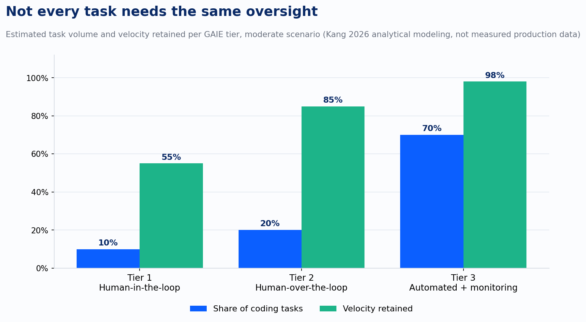
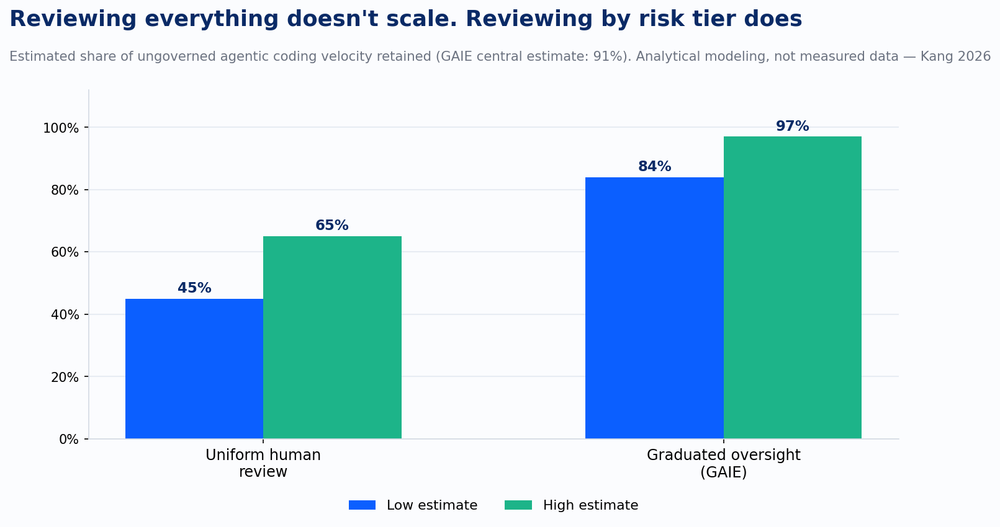
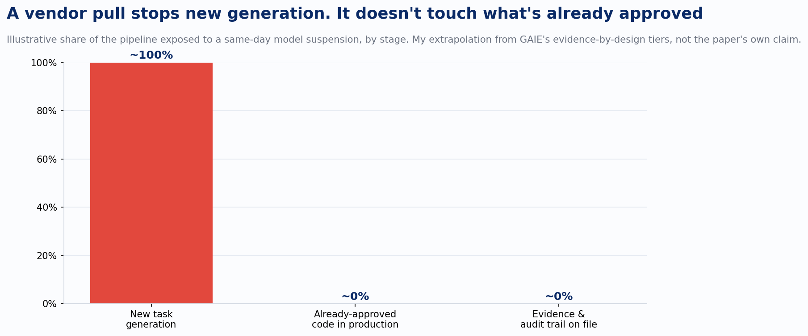

At 5:21pm Eastern on June 12, 2026, Anthropic received a letter from the US government. Citing national security authorities, it ordered the company to suspend all access to Fable 5 and Mythos 5, worldwide, for every customer, effective immediately. Fable 5 had launched three days earlier. Access to every other Claude model stayed untouched. Access to the two newest ones went dark: Mythos 5 partially restored for some US organizations on June 26, Fable 5 fully back on July 1, nineteen days after the letter arrived.

That's the plain fact underneath a story that got covered as a security scare, and it's proof that "which model is on the approved vendor list" is a governance answer with a shelf life measured in an afternoon.

Read Anthropic's own account of what triggered the order and the strangeness sharpens. The government's evidence, by Anthropic's telling, was verbal: a narrow, non-universal jailbreak that essentially consisted of asking the model to read a specific codebase and fix its flaws. No universal jailbreak had been found, by the government or anyone else. Anthropic said the capability the government flagged was widely available from other models, naming OpenAI's GPT-5.5 as one, without any bypass required. Fable's defense-in-depth posture, including a thirty-day data retention policy built specifically to research and shut down jailbreak attempts, held up by the company's own account. None of that mattered to the outcome. The model went dark for every customer anyway, on the strength of a claim the company disputed in public within hours.

I'm not bringing this up to relitigate whether the suspension was warranted. I'm bringing it up because it's the cleanest evidence I've seen this year that vendor trust doesn't buy continuity. An enterprise that did its diligence, picked the most red-teamed model on the market, and built its safety case on the vendor's own published posture still woke up with a compliance gap and no restoration date. What failed was the assumption that model selection is where the governance work ends.

There's a paper that gives this problem an actual answer instead of a shrug: "Governed AI-Assisted Engineering," posted to arXiv in June by Richard Kang at DoiT International. It argues for calibrated review, borrowing the case from a place that solved this decades before software did. SAE J3016 skips the binary question of whether cars should be autonomous and asks what level of autonomy fits a given driving context, with six graded levels instead of one switch. Kang applies the same move to agentic coding.

The mechanism is called the Oversight Classification Model. It's a deterministic function that scores every code generation task on four dimensions, regulatory impact, customer proximity, reversibility, and data sensitivity, and routes it to one of three tiers. Tier 1, human-in-the-loop, catches strategic functions: credit approval logic, anti-money-laundering rules, anything a regulator has already said needs a human before it ships. A person reviews the approach before generation starts and signs off again before deployment. Tier 2, human-over-the-loop, catches customer-facing work that isn't strategic. The agent generates and tests on its own; a human still approves the deploy. Tier 3, automated with monitoring, covers internal tooling and CI pipelines. Nobody gates it. It ships on passing tests, and a monitoring layer watches for anomalies afterward.

The reason this beats blanket review is arithmetic. Kang's analytical modeling puts uniform human-in-the-loop review, checking everything everywhere, at somewhere between 45% and 65% of ungoverned agentic coding velocity. Split the same workload across three tiers by actual regulatory weight instead, and the estimate climbs to 84% to 97%, central estimate 91%. The gap is the difference between agentic coding paying for itself and agentic coding getting quietly strangled by its own review queue, which is exactly the failure mode a paper Kang cites, Farrag's productivity-reliability paradox, describes: uniform governance applied to a workload that was never uniform risk to begin with.

Here's the part the paper doesn't say directly but that June 12 makes obvious in hindsight. Run the Fable 5 suspension against a codebase already organized by these tiers, and the blast radius shrinks to almost nothing. Tier 3's evidence chain, test results, security scans, a monitoring baseline, references whether the code passed, not which vendor's model wrote it. Swap the underlying model and that pipeline doesn't notice, because its approval gate was never "and it came from an approved vendor." Tier 2's human still approves the next deploy, exactly as before. Tier 1's human was already reviewing the substance of the work before it shipped, model or no model. What a same-day suspension actually stops is new generation for whatever slice of the pipeline was mid-task when the letter arrived. It doesn't touch the code already approved, and it doesn't touch the audit trail already on file, because neither one was ever conditioned on the vendor's name.

That's the reframe worth sitting with. "Is this model approved" and "what tier of oversight does this task need" sound like the same question asked two ways, but they answer different failures. One breaks the instant a government letter, a breach, or a quiet deprecation notice takes an option off the table. The other never referenced the vendor, so it has nothing to break.

None of this is proven at scale yet, and Kang says so plainly. The velocity numbers come from analytical modeling; nobody has measured them against production telemetry yet. The regulatory mapping runs primarily against the Bank of Thailand's 2025 AI risk circular, with lighter cross-jurisdiction analysis against Singapore's MAS, NIST, ISO 42001, and the EU AI Act. Expert practitioner validation is listed as future work, still to be done. Treat the tier structure as a strong design pattern worth building toward, not a compliance product you install whole.

What made the pattern land for me is how familiar the evidence-by-design piece already is. Improving runs under a SOC 2 Type II program, and change management under SOC 2 already asks for exactly what these tiers produce automatically: who authorized the change, what evidence backs the decision, whether the person approving the work is different from the person who did it. The paper's separation of generation and approval, the rule that the agent writing the code never gets to approve its own deployment, is the same segregation-of-duties control SOC 2 already requires of human engineers, pointed at a new kind of author. For a team with that muscle already built, tiering agentic coding this way extends a control it already runs to a change author it hadn't had to classify before.

The letter that suspended Fable 5 arrived on a Friday evening with no restoration date attached. Whatever governance design survives that kind of notice is the one that had already answered, for every task in the pipeline, how much oversight that task needed, regardless of who wrote the code.

---

*Sources: Anthropic, "Statement on the US government directive to suspend access to Fable 5 and Mythos 5" (June 12, 2026) and "Redeploying Claude Fable 5" (June 30, 2026). Kang, "Governed AI-Assisted Engineering: Graduated Human Oversight for Agentic Code Generation in Regulated Domains" (arXiv:2606.22484).*
