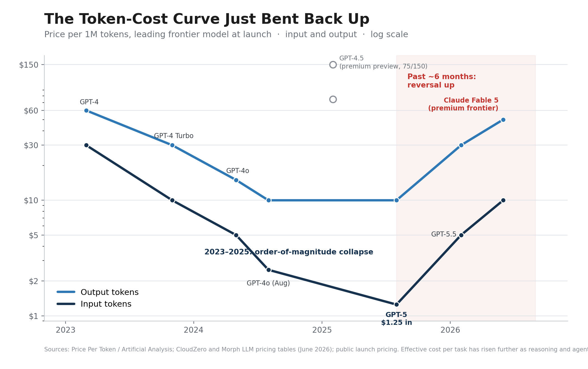
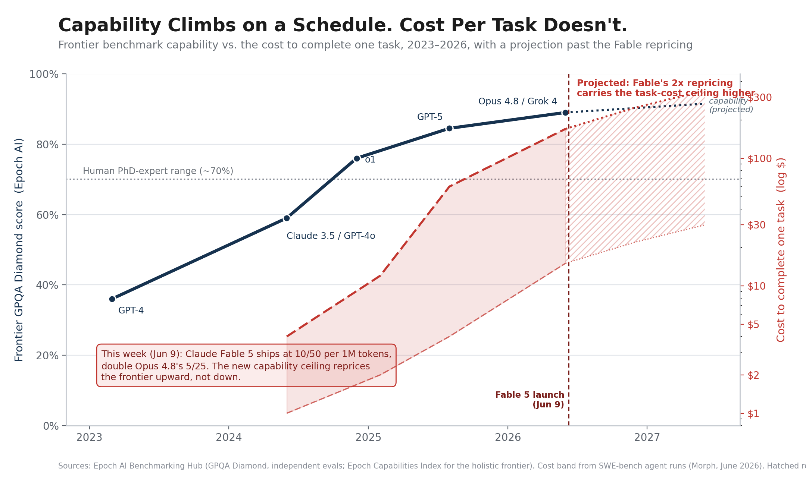

Executives who lived through Web3 and the metaverse have earned their skepticism. The pattern recognition is reasonable: a technology arrives wrapped in extraordinary claims, capital floods in, and most of the promised transformation never ships. Asking why AI is different is the right question, and it deserves a better answer than enthusiasm.

The answer starts with an observation from economic history: hype is a poor discriminator. Carlota Perez documented in "Technological Revolutions and Financial Capital" that every genuine technological revolution of the past two centuries arrived with a speculative frenzy attached. Canal mania, railway mania, the dot-com bubble. The presence of hype tells you nothing in either direction. What separates a real inflection from a costume party is the underlying capability and cost data, and on AI that data is unambiguous.

## The Capability Evidence

Since 2022, AI models have been measured against a growing set of professional-grade benchmarks. The results are documented:

**FrontierMath** (graduate-level mathematics): leading models reaching approximately 27% on problems that most professional mathematicians cannot solve quickly. In 2021, the best models were at near-zero on this benchmark.

**GPQA Diamond** (PhD-level science questions in biology, chemistry, and physics): multiple leading models now at or above the level of non-expert PhD scientists (approximately 70%+). The questions are designed to be hard for experts outside the specific subdomain.

**Mock AIME** (high school mathematics olympiad): leading models achieving 80-90% accuracy. This is stronger performance than the vast majority of students who attempt this competition.

**Software development benchmarks**: leading models completing 75-80% of standard software development tasks autonomously. These are end-to-end task executions, well past code completion.

**Deep research tasks**: models achieving measurable performance on complex, multi-step research synthesis that requires reading and integrating dozens of sources.

The pattern across all of these benchmarks is the same: performance was near-zero or clearly below human levels two to three years ago, has crossed meaningful thresholds in the last eighteen months, and continues to improve.

## The Cost Evidence

Capability improvements would matter less if they came with proportional cost increases. The cost story is the part of this argument that has moved the most in the past year, and the move sharpens the case instead of weakening it.

Through 2025, the per-token price of a given capability tier fell relentlessly. Industry trackers put the decline at roughly two orders of magnitude across the GPT-3 to GPT-5 era, and the floor kept dropping. A leading frontier model that cost about $30 per million input tokens in early 2023 reached roughly $1.25 by the GPT-5 launch in August 2025. That is the collapse everyone internalized, and it is the curve most strategy decks are still drawing.

Then the curve bent back up. Over the past six months the frontier sticker price reversed. By mid-2026 the premium flagships sit at $5 to $10 per million input tokens and $25 to $50 per million output tokens, several multiples above the GPT-5 floor, and the reversal is steeper on output, which is where the work actually lands. The clearest signal arrived this week. Claude Fable 5, released June 9, ships at $10 input and $50 output per million tokens, exactly double the Opus 4.8 flagship it sits above. The most capable model on the board is now the most expensive, the gap is widening, and the direction is up. A global compute crunch is the proximate cause. Providers have hit a capacity wall, and the newest flagship models are priced to ration scarce inference rather than to win a race to zero.

The effective cost of getting useful work done rose faster than the sticker price. Reasoning models think before they answer, and that thinking burns tokens, often 50 to 500 times more per task than a single-shot completion. Agentic workflows compound it, firing ten to twenty model calls to finish one human request. The result lands on the invoice. Enterprise AI bills have roughly tripled even as unit prices fell, token consumption is up about 13x since January 2025, and the average enterprise AI budget has moved from low single-digit millions to the high single digits in two years.

Set the cost picture against capability and the shape of the moment gets sharp. Holistic benchmark trackers like Epoch AI show frontier capability climbing on a remarkably steady schedule. GPQA Diamond, a set of PhD-level science questions, sat near 36% at the GPT-4 launch in 2023 and clears the high 80s in 2026, well past the human expert range. The capability you are buying improves on a predictable line. The cost of fielding it per task does not. It widens, because the way you reach the top of that capability line now runs through reasoning and agentic configurations that consume tokens by the thousands.

This is the Nordhaus light story playing out in real time, and it confirms the mechanism rather than breaking it. William Nordhaus traced the price of artificial light across seven centuries and found that each order-of-magnitude drop in cost per lumen triggered an explosion in consumption. Falling unit cost is what converts a capability into an economy, and it did exactly that here. Cheap tokens did not produce small bills. They produced enormous demand, which is precisely why the headline price has started to climb: the market ran out of slack because the underlying capability became too useful to ration. Tasks that were economically marginal at 2023 prices now run by the billions, and the binding constraint has moved from "can we afford a token" to "can we get enough compute."

For an operator, the strategic reading flips. The instinct to wait for prices to fall further is now the expensive choice, because the cheap window is closing. The organizations that built their token economics, their model-routing discipline, and their cost-per-task instrumentation while prices sat on the floor are the ones positioned to absorb a rising frontier. The organizations still treating inference as a rounding error are about to meet their P&L.

## The Data Exhaustion Signal

There is a third data point that is less widely discussed and strategically significant: the training data ceiling.

Current large language models are trained primarily on publicly available human-generated text. Estimates suggest that the total corpus of meaningful, non-duplicative human text is finite and that frontier model training may approach the ceiling of available data in the 2027-2028 timeframe.

This is an inflection signal. When training on existing human text reaches diminishing returns, the source of future capability improvements will shift. The most likely candidates: synthetic data generation, tool use and reinforcement from task performance, and modality expansion beyond text.

The strategic reading: the era of easy capability gains from scaling training on human text is ending. The organizations that build AI capabilities and operating models while those gains are still available are the ones best positioned for whatever comes next. The organizations waiting for the technology to mature further may be waiting for a different kind of maturation than they expect.

## Where the Argument Could Break

The skeptical case deserves more than a strawman, and it has two strong versions.

The first is the deployment gap. Benchmark performance is a weak proxy for reliable business deployment. Models hallucinate, fail on edge cases a domain expert would catch, and the governance requirements of enterprise use remain unevenly solved. Arvind Narayanan and Sayash Kapoor have argued this position carefully: AI is a normal technology whose diffusion will be gated by the slow parts of organizations, regulation, and trust. All of that is true. It was also true of every previous technology that eventually reached mainstream adoption. The internet in 1996 was unreliable, insecure, and missing most of the infrastructure required for mainstream commerce. The organizations that built for the infrastructure that would exist became Amazon. The organizations that waited became case studies.

The second is the scaling wall. If capability gains stall as training data runs out, the inflection flattens and the patient follower does fine. Possibly. The benchmark trajectory of the past eighteen months, driven increasingly by reasoning techniques and tool use layered on top of raw scale, points the other way. And even a flat capability line at current levels keeps expanding the economically viable use cases, because the work performed per token keeps rising. That dynamic now runs alongside a rising token price, which changes the planning math: the advantage no longer comes from waiting for a cheaper token, it comes from extracting more useful work per token than your competitors while compute is scarce.

The reliability question, asked correctly, is a timing question: what AI-capable operating models should we build today so that we are positioned when the reliability bar meets the use cases we need?

## The Timing Argument

GPT-class technologies do not wait for organizations. The electrification of industry produced a bifurcation: organizations that built for electrification outcompeted organizations that did not, because the cost and capability structure of electrified operations was fundamentally different.

The timing of that transition was outside any individual organization's control. What each one controlled was when it began building.

The capability and cost data described here are observations, and the debate about whether AI is a GPT-class transformation has stopped being useful. The cost curve reversing upward does not soften that conclusion, it hardens it: the cheap-token era was the easy on-ramp, and it is ending. The question worth the executive team's time is how quickly your organization builds for the world that is already arriving.
