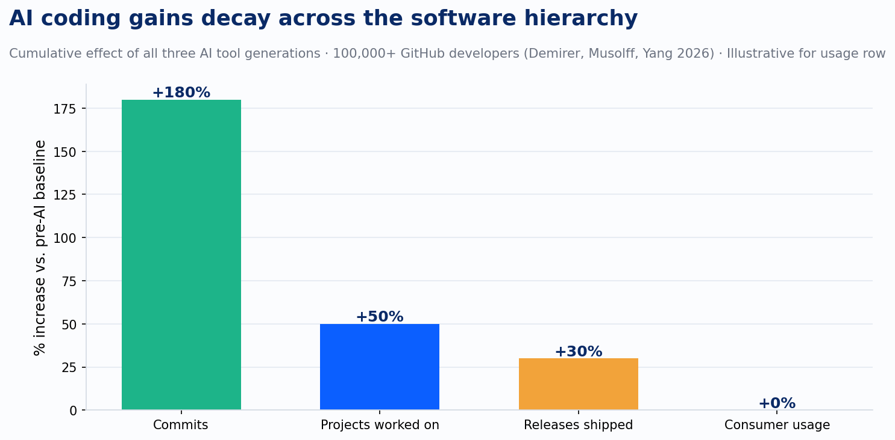

Robert Solow said in 1987 that you could see the computer age everywhere but in the productivity statistics. A team of MIT and Wharton economists just gave that line a fresh coat of paint.

Their study tracked more than 100,000 GitHub developers through three successive generations of AI coding tools: autocomplete, sync agents like Claude Code, and async agents like GitHub's Coding Agent. The data answers three separate questions, and each one has a different answer.

Can AI help developers write more code? Yes, dramatically. With access to all three tool generations, commits went up 180%. Lines of code went up by a factor of seven.

Can AI help teams ship more features? Partially. Released software went up 30%. Meaningful, but a fraction of the commit-level gain.

Does more shipped software produce more value? Not yet, at least not measurably. Consumer usage of the resulting software went up essentially zero.

*Cumulative effect of all three AI tool generations · 100,000+ GitHub developers (Demirer, Musolff, Yang 2026) · Consumer usage row is illustrative*

That attenuation pattern is not a failure of the tools. It is a failure of process architecture at two distinct handoffs. And it maps closely onto something we have been watching in our Delivery Learning Programs for the past eighteen months.

## Layer one: writing code

Every generation of AI coding tool studied in the paper operates at the same layer: the individual developer writing code. Autocomplete suggests lines as you type. Sync agents write and edit alongside you in real time. Async agents take an assigned task and run it without you watching. All three are variations on the same thing: faster code generation, measured at the commit.

That is exactly what Stages 2 and 3 of our AI maturity model describe. Stage 2, Off the Shelf, is where most of the industry actually lives right now. You use the tools as they come, Copilot, Windsurf, Claude, and you produce with them regularly. Stage 3, Task, is where serious practitioners operate. You give AI a defined task with real context and constraints, review output against a written rubric, and can prove improvement from a prompt change. The CEPR gains at the commit level are real. Both stages earn them. But Stages 2 and 3 sit upstream of the first bottleneck.

*Stages 2 and 3 are where the CEPR productivity gains live. Stage 4 is where they stop converting into shipped features. Stage 5 and beyond is where shipped features convert into organizational value.*

## Layer two: shipping features

Stage 4 is what we call Workflow: chaining multiple AI steps into a repeatable process and wrapping that process in governance. Deterministic validation at every handoff. Adversarial agents whose job is to break the output before it moves downstream. Human punch-out points the AI cannot bypass. Audit trails. Team standards documents with real sign-off.

Review. Integration. Testing. Release. The human bottlenecks the CEPR paper names are Stage 4 activities.

The O-ring theory the economists invoke to explain their data says that when production stages are strong complements, a bottleneck in one stage caps output regardless of how much you speed up the others. That is technically accurate, and it obscures the actionable version of the truth. The stages where AI has penetrated are not the stages where the bottleneck lives. You cannot ship features at 180% faster rates if your review and integration processes were designed for 1x generation speed. In practice, the O-ring tends to break at the first stage you did not redesign.

In our Delivery Learning Programs, the pattern is consistent: teams that deploy sync agents without redesigning review see commit volume rise in month one and PR approval times extend by month three. By the 90-day mark, some are approving code more slowly than before AI adoption. Generation outpaced review capacity, and the system found a new equilibrium. Slower. The tools worked. The architecture did not change to accommodate them. That is almost the definition of a Stage 3 team expecting Stage 5 outcomes.

Stage 4 is also the first stage that requires the team and IT, not just individual skill. Deterministic validation, shared standards, enforced review points — these only work if the whole team has agreed to them. One person running Stage 4 practices on a team that has not adopted them creates more problems than it solves, because requirements, architecture, and context all become shared dependencies the moment you chain steps. Very few organizations have genuinely crossed this threshold. It is the hardest jump in the model.

## Layer three: producing value

The gap between shipping features and producing value is where the second bottleneck lives, and it gets less attention in the coverage than the first.

New iOS app releases roughly doubled between early 2025 and April 2026. Consumer engagement with those new apps is flat. The share of new apps failing to reach any meaningful audience has risen. The authors see the same pattern, to varying degrees, across Google Play, the Chrome Web Store, and SourceForge. In the markets the paper tracks, software supply has expanded while consumer engagement has not moved with it.

The paper offers two possible explanations: lower-quality apps clearing the publication bar because entry costs fell, or a consumer attention ceiling that does not expand with supply. Their data cannot distinguish between the two. But both explanations reach the same place: more code at higher velocity does not solve a discovery problem. You can AI-generate your way to a denser app store. Getting people to actually use what you build is a different problem, and faster generation does not appear to be solving it yet.

The same dynamic plays out inside organizations, not just in consumer markets. Our DLP data shows that the teams shipping more features are not automatically the teams producing more value. Teams that chose high-stakes, well-scoped problems with clear acceptance criteria converted AI speed into shipped output that stakeholders cared about. Teams that pointed AI at poorly scoped work generated volume and absorbed cleanup cost. The features shipped; the value did not follow. This is what I mean when I talk about the demand limit: the number of things AI helps you produce does not automatically grow the number of people who need what you are producing.

Faster generation makes sense as a cost strategy. Taken alone, it does not make sense as a value strategy. The question that unlocks layer three is not "how do we ship faster?" It is "how do we choose better?" That is a product and organizational leadership question, not a tooling question.

## What to actually do

The three-layer frame points to three different conversations, at three different levels of the organization.

For individual developers and their immediate leads, the answer is to pursue Stages 2 and 3 rigorously. Build the prompt library. Measure output quality with a real rubric. Teach what you learn. The commit-level gains are real and compounding.

For engineering and delivery leaders, the answer is to build Stage 4 in parallel with whatever Stage 2-3 tooling is already deployed. That means multi-step workflows with deterministic validation at every handoff, adversarial agents that catch bad output before it moves downstream, human review redesigned around a quality report rather than a raw code listing, and team standards with documented sign-off. Tool providers are working to ease downstream bottlenecks, and that is true. They cannot install your governance framework. That is organizational work, and it has to be built one stage at a time.

Our own delivery data puts numbers on this. Across our Delivery Learning Programs, teams that pair Stage 2-3 tooling with structured workflow redesign ship 12–30% more features against their pre-engagement rate. Run the same program for six months with teams that have genuinely committed to the governance layer, and those numbers cross 50% above pre-engagement baseline. The variable that explains most of the spread is problem selection, not tool choice. The CEPR consumer attention finding is the same phenomenon at market scale.

For product and business leaders, the conversation is about which problems AI should be pointed at. The demand limit is not a technology failure. It is a strategy failure. If the problems your teams are accelerating do not connect to what users or customers actually need, more speed produces more waste at a faster rate. The fix is upstream of any tooling decision.

Solow's paradox lingered in computing for about fifteen years. The productivity gains did eventually show up, after firms rebuilt their processes around the technology rather than just adding the technology to their existing processes. The bottlenecks were real and they moved — from writing to shipping, and from shipping to value. The same progression is available now, stage by stage. The research puts numbers on a problem we have been diagnosing in our clients for eighteen months.

---

*Sources: Demirer, M., Musolff, L., and Yang, L. (2026). "Writing Code vs. Shipping Code: Productivity Effects Across Generations of AI Coding Tools." NBER Working Paper 35275. Published via CEPR/VoxEU, June 21, 2026. Improving eight-stage AI maturity model: "Proving Competency at Every Stage," Improving blog, June 2026.*
