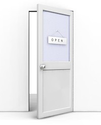

Have you ever heard of having an “open door” policy? More than likely. Have you ever found that to be a lie? Sadly, more than likely. Often times companies, or individuals, like to claim that they have this policy but aren’t truly interested in being accessible.

They believe that given sufficient access, folks would consume all their time and no work would get done. Not me. I love to tell people that I’m always available and then watch their eyes kinda bug out. This breeds trust in the people that I give that information to; they know they can have access to me anytime they may need it. This doesn’t mean that I’ll drop everything to talk with them any time they ask
but I will make room for them and allow them to help prioritize their needs in the queue that is my job. Also, that allows me to push the responsibility on to them and trust that they'll only contact me when needed and not for frivolous things. People don’t like to be a bother and aren’t looking to waste your time so I don't need to filter them thru anything to be sure they're not wasting time. They seem to do that on their own. Granted, there are always exceptions and some that are more likely to take advantage but those are edge cases. And we all know you do your best not to mandate to exceptions; just treat them as exceptions and deal with them.

# Be Accessible

[David O'Hara](https://driventodevelop.com/author/david/)

05 Dec 2013

[thoughts](https://driventodevelop.com/tag/thoughts/)
