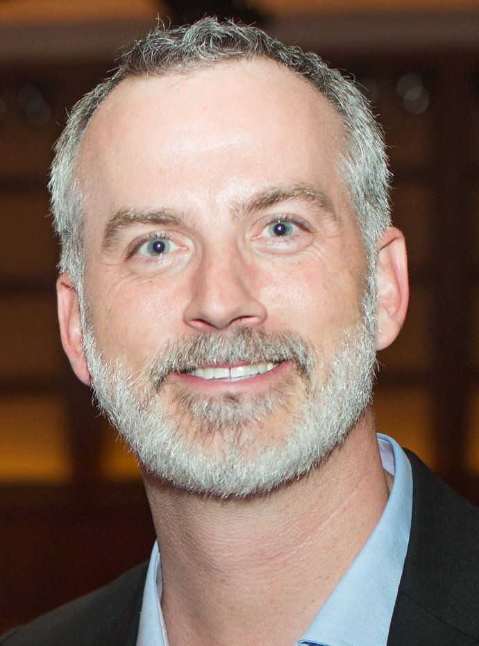

"We don’t fall asleep in the fire and rain but rather we doze in the easy sunshine"

I came across this in my notes; not sure if it's a quote (there wasn't a reference) or something I just thought up but now it's stuck in my head. It aligns for me with the ideas behind the book *Deep Change*. Outside of some severe impacting event, we rarely look to fundamentally shift ourselves or our goals towards a bigger future. It's not a bad thing, more of human nature, that we believe we can accomplish simply by showing up, doing work, and claiming victory. That's not true change. And it's not truly a **hard thing**. Hard things hurt. They stretch us and force us to grow. Or (re)make us into something new, different, and better. It's hard to do hard things when we are comfortable or when we feel like we are achieving. "Don't mess with what ain't broke!" was something I heard but I'm starting to think that this is the very thing that we SHOULD mess with. Experiment! Figure out what it could be. And then drive like mad towards a different future.

[David O'Hara](https://driventodevelop.com/author/david/)

07 Jul 2022
