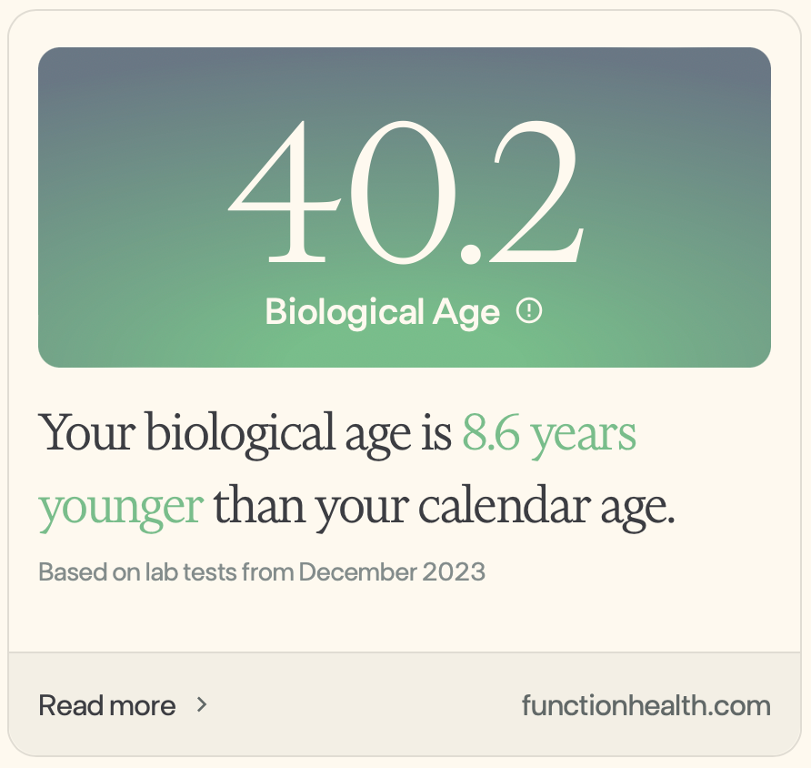
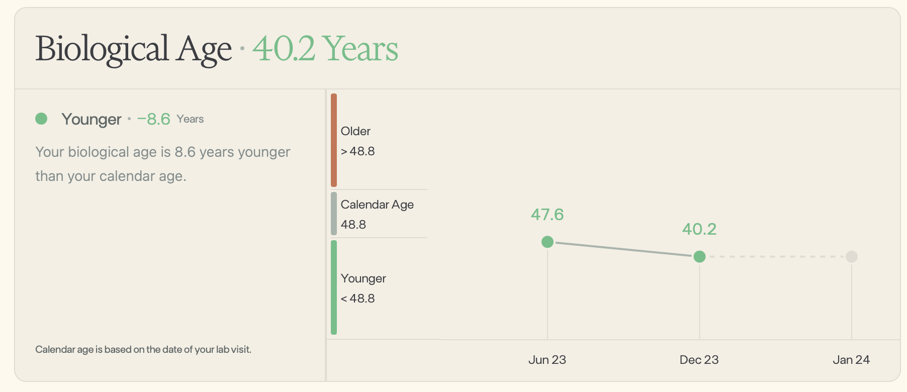

I've [talked before](https://driventodevelop.com/2023/06/27/health-journey-function-health/) about [Function Health](https://functionhealth.com/?ref=driventodevelop.com) as a platform for getting health-focused testing. It's been cool to see them continue to evolve the platform through the beta and I'm excited about where they're taking things but I wanted to share something that specifically happened for me.

For context, the platform takes your testing and gives you a variety of things around it; context for your levels (abnormal, typical, optimized, low, etc.), causes, foods to eat, foods to limit, and potential supplements (along with citing sources for these things). It's a wealth of knowledge, especially for the neophyte wanting to understand why large HDL matters and what to possibly do about your ALP (Alkaline Phosphatase) levels. Seriously fun stuff for the biology and numbers nerd that I am.

Additionally, take a look at your biological age compared to your chronological age. Biological age is about things like stress, cell damage, diet, exercise, and toxins. There's a collection of biomarkers they use in calculating it that I won't dig into but I wanted to share what's happened since I've been using the service. My first blood test was in June 2023 and showed me at 47.6 as compared to my chronological age of 48.4. Not too bad given that I work out quite a bit and have mostly eaten well for a while now.

Fast forward to my most recent test this month and here are my results:

I moved my biological age BACK by nearly 7 and 1/2 years in the last 6 months by focusing on supplementation ([IDLife](https://driventodevelop.com/2023/05/17/health-journey-idlife/), [AG1](https://driventodevelop.com/2023/05/19/health-journey-ag1/), [Toniiq](https://driventodevelop.com/2023/10/10/health-journey-toniiq/)), [recovery](https://driventodevelop.com/2023/12/14/whoop-recovery/), and what I eat ([Levels](https://driventodevelop.com/2023/06/01/health-journey-levels/), [Everlywell](https://driventodevelop.com/2023/08/31/health-journey-everlywell/)). Workouts are unchanged (mostly) and I have not done any crazy diets or anything. WOW!!

It's so awesome to see such positive movement in my numbers and I look forward to seeing what else I can optimize on this health journey.

**Referral link warning: **You can sign up using my [personal link](https://my.functionhealth.com/signup?code=DOHARA10&ref=driventodevelop.com)

DISCLAIMER: I'm not getting paid for any of this. Just sharing what I've learned and my experience.

[David O'Hara](https://driventodevelop.com/author/david/)

26 Dec 2023

[health](https://driventodevelop.com/tag/health/)
