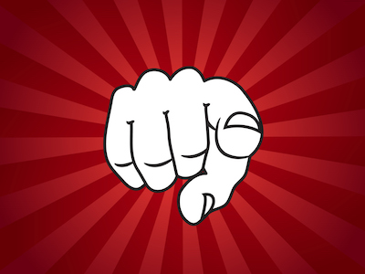

Managers are limited by cognitive load. Because stuff can't think, they must and their capacity to do so for the multitude of things is the bottleneck to what can get done. When we try to manage people, we imply that they are incapable of the thinking and, thus, only things.

Being a leader provides us with the opportunity to increase our capacities because we distribute that cognitive load across the people under our care. They can do the thinking about the stuff and we an focus on creating space for them to reach their maximum capacity while making them better capable in managing things.

In order to grow other, you must grow as a leader (leading that growth through example). Leaders continually grow in order to grow others. Leaders who value people have the primary goal of serving other. This means staying with them rather than leaving them behind to enjoy the spoils of success. It's not the heights that we achieve individually that measure our success but rather how far along we can bring others. That is the true measure of our leadership.

[David O'Hara](https://driventodevelop.com/author/david/)

20 Feb 2017

[leadership](https://driventodevelop.com/tag/leadership/)
