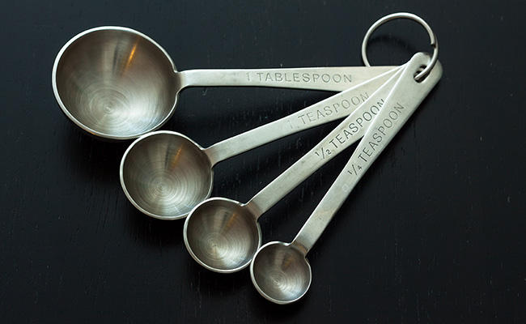

Life is a story. It’s not a set of facts or a compilation of data but a complicated interplay of the small and the large. Sure, those the facts and stuff are in there but the true value is in the way they create the larger whole. As I was cooking the other day I was thinking about how life is also like a recipe; well, more a collection of episodic recipes but bear with me. As we go thru our day we have multiple opportunities to contribute and we need to seize those as our purpose in being present. With our recipe, even the smallest parts, the 1/4 teaspoons, play a role in making things come together. Sure they don’t carry as big a load or make as big an impression as the 2 cups or 1.5 quarts but if they’re not there, something is diminished. The end result isn’t everything it could have been and something is lacking.

Far too often we feel like our 1/4 teaspoons aren’t worth much or are too little to make a difference but that’s simply not true. We need to be aware of all that is in front of us so that we can play our part on making a flavorful life for ourselves and those around us. This is living in our purpose.

[David O'Hara](https://driventodevelop.com/author/david/)

24 Feb 2017

[thoughts](https://driventodevelop.com/tag/thoughts/)
