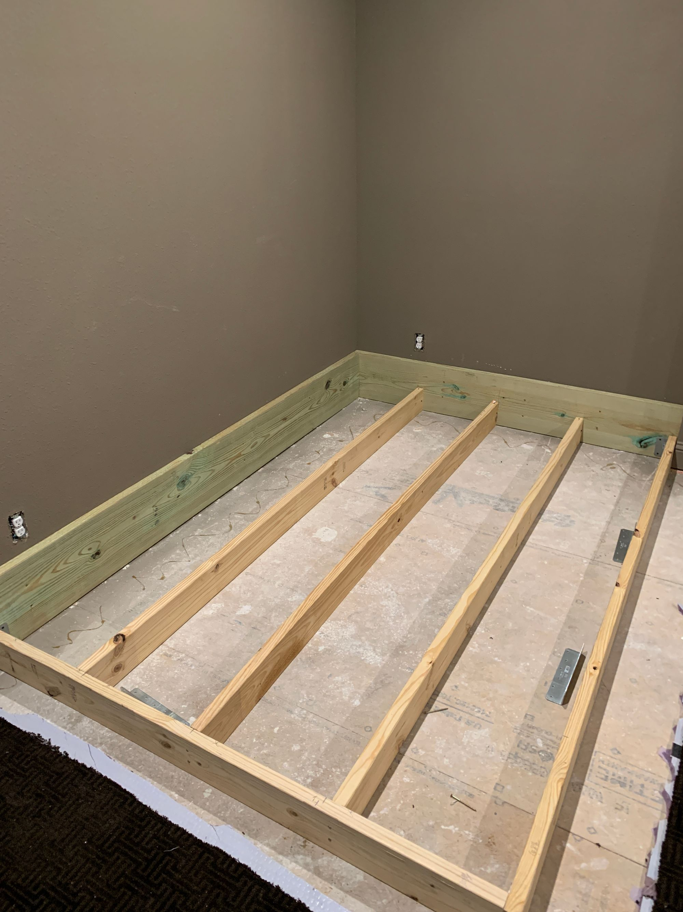
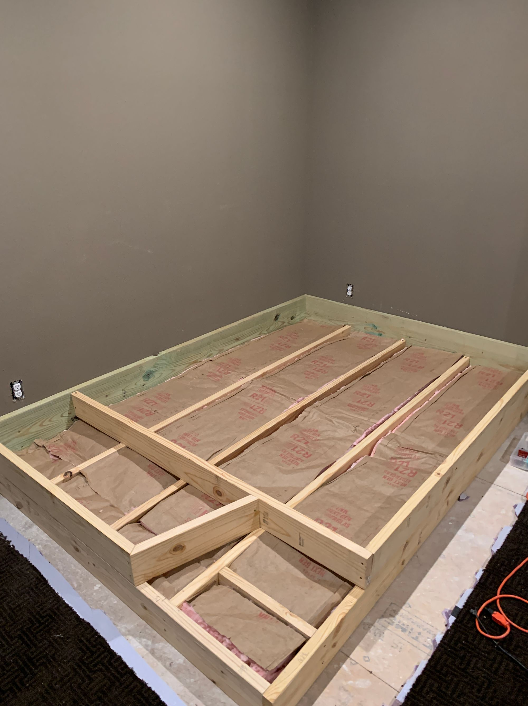
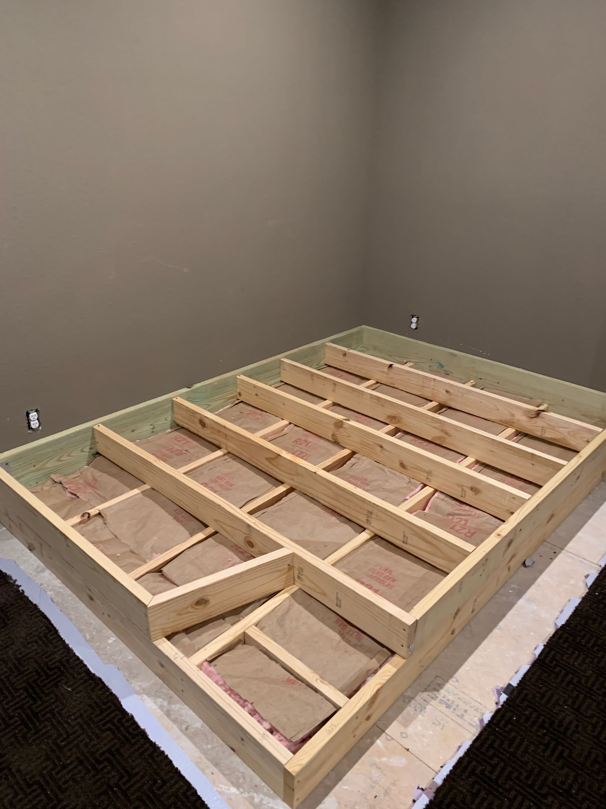
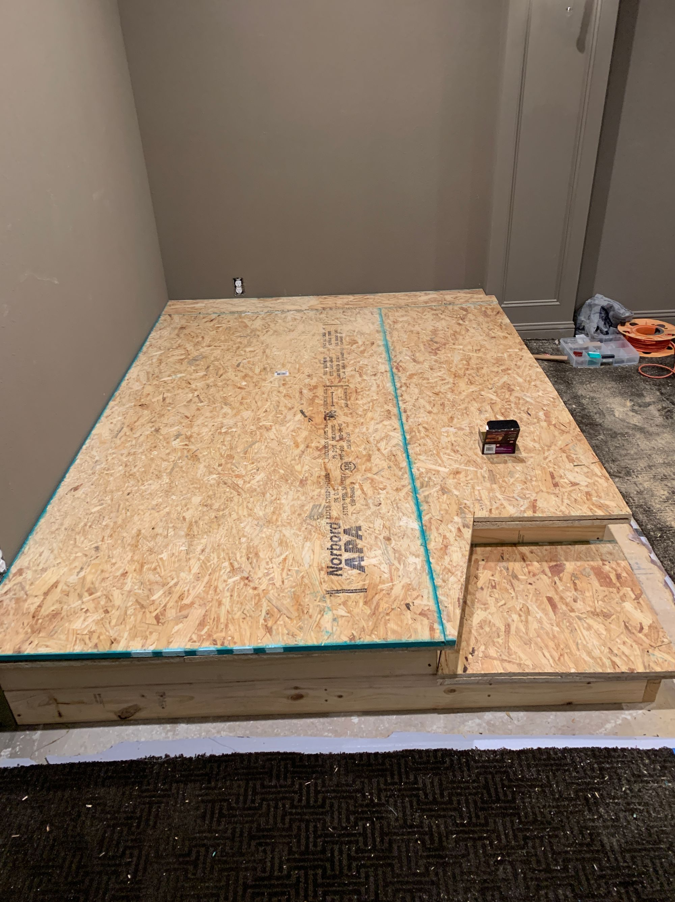
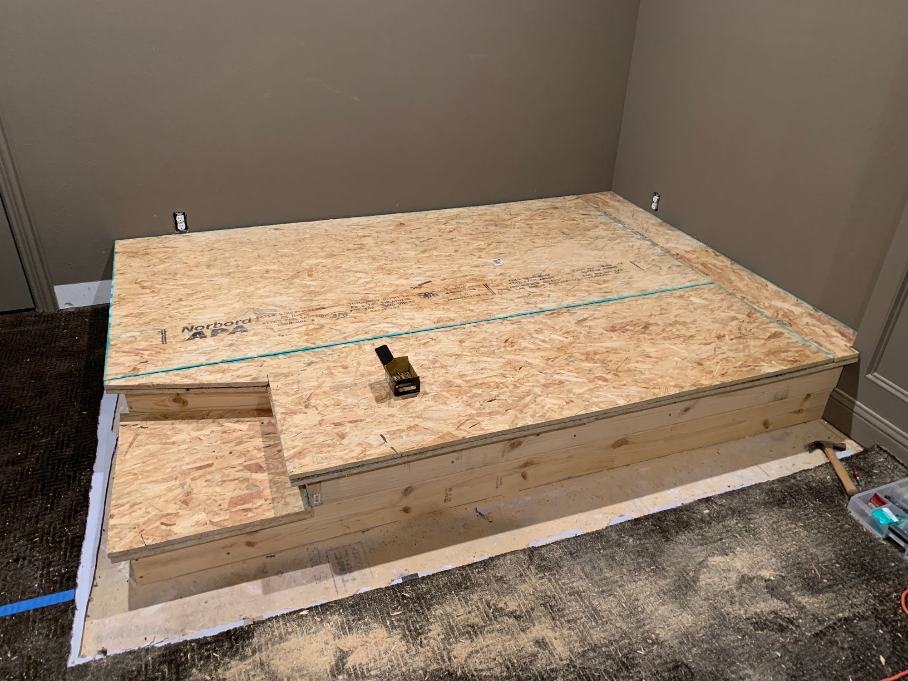
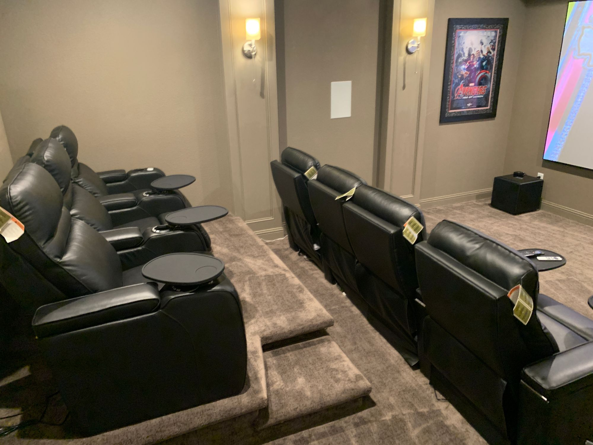
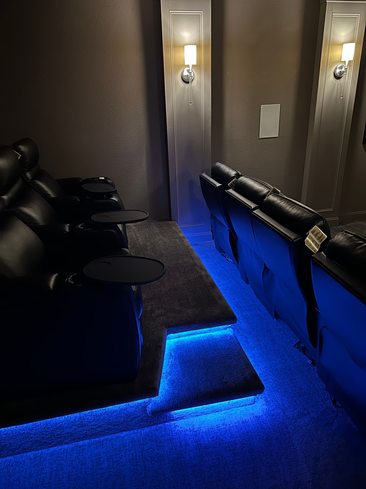

I'm going to deviate from my normal posts to share something my son and I recently did. We have a media room that has languished as our in-house storage closet for as long as we've been in the house. It was time to revv it up and get it functioning as intended. He and I made this a Saturday project and had fun building it but I wanted to share the details of the build (and a few pics) in case someone else stumbles along looking to build something similar. This is what I learned...

### Sizing & Dimensions

We knew we needed space for our recliners, 3 across, on the platform and they lean back a ways but we also wanted a bit of walkway so we decided to build a 103" by 70" (which also turned out to fit perfectly behind a decorative wall-thingy). Additionally, I wanted to have a little more interest to the step so I made it slightly slanted; this was not well thought out for the LED strips I undermounted on the overhangs. Connectors for those like right-angles better but we figured it out (more on those later)

### Materials

Home Depot order as follows; 4-4x8' OSB subfloor, 8-2x6x8 boards, 2-2x12x10 boards, 4-2x6x12 boards, 5# pack of #8x3" wood screws, and 2 R-21 Owens Corning faced fiberglass insulation. I forgot the subfloor adhesive and brackets on the first order so we had to make a dutiful trip to pick up 3 tubes and the brackets (6 short-L right angle, 4 long-L right angle) as we got going. Also, I bought the Armacost Lighting RGB+W Smart LED tape light kit along with their channel mount and diffuser. Ordering an extra connector kit for 5 pin LED strips from Amazon was a big help too, especially when it came time to navigate those angles.

### Level 1 (Foundation)

Nothing magical here; cut the 2x12 to fit sizing and screwed them into the studs. I used the short-L angle brackets to put the first level of 2x6 in place and then made sure the spacing for the joists fit for the insulation. We used the long-L angle bracket to secure it to the existing subfloor.

### Level 2

I added a little more support on level 1 for the stair (we are large humans in my house) and then cut an angle on the stair riser to make it a little less boxy. Both the level 2 attachments at the wall used short-L angle brackets too.

### Level 2 cont.

Obviously the next level joists needed to crossover and I did have a little bit of a spacing issue because I decided to do the fancy angle thing on the stair but it mostly worked out. Insert insulation and we were good to close it up.

### Decking

I wanted a couple of things in this build; an overhang to mount LED lights on and to keep it from being a creaky soundtrap. The insulation helped with the latter and some good measuring on my part meant I had a 2" overhang all around level 2 and a 1.5" on the stair. The creaky bit I handled by doing 2 layers of subflooring. OSB has a direction so I put the first layer down in one direction and the second layer down 90-degrees from that. Coupled with a healthy dose of subfloor adhesive between the 2 layers and a bucket of screws and it was rock-solid.

### Finish Up

We had a professional come in and carpet the whole thing because I am NOT doing that and then we got to mounting the LED light strips. Overally, I'm pretty happy with them but I realized too late there was very little clearance for the undermount so I probably would do a corner mount instead, if I did it over again.

# Media Room Riser with LED Lights

[David O'Hara](https://driventodevelop.com/author/david/)

14 Apr 2023

[family](https://driventodevelop.com/tag/family/)
