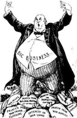

"Capitalism" is typically a word that evokes images of a fat business man on a pile of other people's hard work and money. It's not a pretty image and certainly not one that most folks want to be associated with. No one wants to think the profits of their efforts feed some singluarly greedy entity, personal or corporate. However, the reality of business is that it REQUIRES profits to maintain it's ability to run and provide the opportunity for folks to work and provide for themselves and their families. So how do we break out of that mold? Can business be both good and profitable?

### Conscious Capitalism

I've recently become aware of [Conscious Capitalism](http://www.consciouscapitalism.org/?ref=driventodevelop.com). It was started by John Mackey, CEO of Whole Foods, and Kip Tindell, CEO of Container Store, as a movement towards a more holistic view of corporate responsibility to a larger audience and a deeper purpose. Basically, profits are not evil but should be focused on the environment that produced them as a way to grow the business. To illustrate this, we have the
Stakeholder Model - whereas typical business focuses on the shareholder and customers as the main stakeholders in a business' success, we believe in the larger perspective of stakeholders. The employees who provide value to our customers, industry that we are working in, the suppliers who provide us with the goods we need to produce value, as well as the community we live in. Without any one of these critical stakeholders, the company would be decreased and less effective. These are the relationships that we should focus on and be investing in. By focusing on this larger perspective, we are able to feed back significantly to the ecosystem that we live in.

For me this was a "duh" moment. Of course there's a broader perspective (there usually is if you are paying attention) and it was great to have a framework and vocabulary to match the things I have believed and been living for a while now.
Let me explain...

### Improving

One of the founding ideas of [Improving](http://improvingenterprises.com/?ref=driventodevelop.com) was that we would be THE place that people want to work. A place that you can
find fullfillment and success in what you do. A place that focused on people and relationships first and foremost. This was a VERY different philosophy than what I had come thru previously in my
career. At Improving, we cared about our customers and their success as most businesses do but there was more. Our
suppliers would come and hang out with us (one in particular spends mornings at our office to have coffee and chat about
family and life). The vast majority of the user groups in the area used our facilities and were given pizza and drinks for free.
We spoke at a significant number of conferences and attended them in packs. We fundraised for the local community and
found ways to contribute time and money to the types of charities I've come to believe make a difference. Most of all,
people cared about each other. They truly and honestly were involved in each other's lives both inside and outside of
work. I don't want to paint things too perfect, they're not. We have our share of challenges and are always looking at
ways to be better but we
have a perspective for what could be and now we have a model for speaking to that. It's been cool to see how the things laid
out by Conscious Capitalism are what have been built into Improving from the start. And to see that something that
sounds idealistic can be a reality and, even better, a success.

# Profits for Good

[David O'Hara](https://driventodevelop.com/author/david/)

06 Jun 2013

[business](https://driventodevelop.com/tag/business/)
