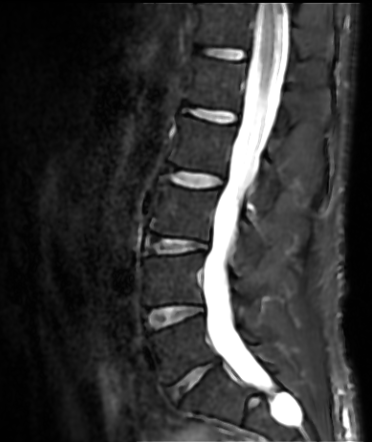

For about six weeks, I thought I had a hamstring problem: tight hamstrings, overtraining, typical stuff. PT helped briefly, dry needling made no difference, and then the pain started moving. Down the back of my right leg, into the knee, up into my glute. Oh, and then the bottom of my big toe got numb...that fiery nerve pain that tells you something is wrong at a different level.

I'd already been to my sports medicine guy and done a round of PT for some back pain before this started. When the hamstring thing showed up, I thought it was related, maybe even a progression. We tried a few things. Nothing worked. So Julli, my physician, and I decided it was time for an MRI.

The MRI itself was easy. I always chat up the technician. This guy was particularly friendly, and normally techs don't say much because they see hundreds of these and they're not supposed to read them anyway. But when I slid out of the machine, this guy slid me a note: a name and phone number, and said the words "Tarlov cyst".

I went home and did some research. Turns out Dr. Feigenbaum, right here in Dallas, is one of the few physicians in the country who actually does procedures on these. The cysts showed up on my MRI pretty clearly (two grape-like formations hanging off the bottom of my spinal cord, which is a sentence I did not expect to write this year). The imaging came on a CD, which: come on. I dug up a drive, opened them myself, and immediately saw what the technician saw.

My appointment with Dr. Feigenbaum went well, but the next step was a confirmation test with a pain specialist. That guy was headed out on family vacation and couldn't get me in for a month. I had already eaten my way through two bottles of Tylenol, two bottles of Aleve, Gabapentin, Robaxin...all for a guy who doesn't take anything even for a headache. Waiting another month wasn't happening.

So I found another pain specialist, Dr. Nathan Walters, got a consult, and he pointed out something that changed everything for me: Tarlov cysts are not typically symptomatic. They can be, but probably not the first place to jump to. The radiologist's report hadn't been especially helpful (that's a separate rant), but Dr. Walters thought he could give me an injection that would clarify what was actually driving the pain. He was right. The pain resolved. I'm off everything. I'm back to training. Thank God! Plus, I was able to sit for a full workday without limping around like a peg-legged pirate for 15 minutes while my pain subsided.

Here's what I took away from this: the medical system is not set up to advocate for you. No one is going to push you toward a second opinion. The technician who slid me that note took a risk he didn't have to take. Dr. Walters ran a different differential than the first specialist and got a different result. Both of those things only happened because I kept moving. I'm not a doctor, so this isn't advice; just a share of my experience. Your mileage may vary.

[David O'Hara](https://driventodevelop.com/author/david/)

28 Jul 2026

[health](https://driventodevelop.com/tag/health/)
