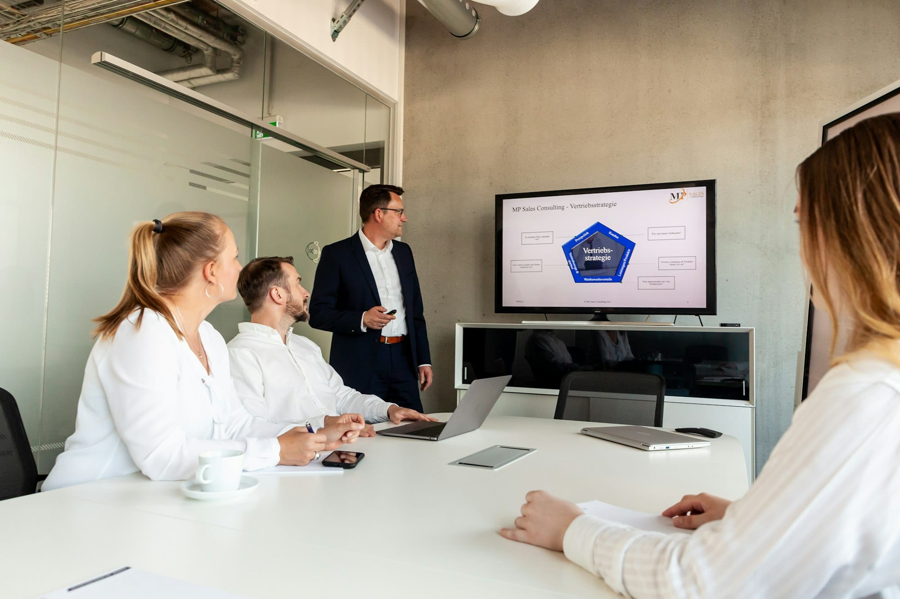

Accenture just announced 11,000 layoffs as part of an $865 million AI restructuring. KPMG cut 400 advisory positions in the U.S. Deloitte is restructuring select practices. If you thought the consulting talent model shift was a 2027 planning item, it moved up.

A few weeks ago I was looking at PwC data showing that junior roles exposed to AI were seven times more likely to require advanced human skills going forward. That framing made it sound like a structural pressure building slowly, something to get ahead of over the next few years. The announcements this week changed the urgency of that conversation. The restructuring is not theoretical anymore.

The work being eliminated has a profile: high-volume, structured, document-heavy. That is exactly the profile of a first- and second-year analyst at most of these firms, not because those people lack capability, but because that was the assigned work. The model assumed you needed a large base of early-career people to handle the volume before the senior judgment layer took over. AI is absorbing that volume at a fraction of the cost, and the firms with the most to gain from that efficiency are the ones moving fastest to realize it.

The replacement is not pure automation. It's a smaller number of more senior people operating with AI augmentation, covering ground that used to require a team. Accenture's own guidance says overall headcount will grow in fiscal 2026, but the growth is in AI-aligned roles. The cuts are in the work AI already does well. (If you want to understand what the reskilling side of this looks like, the details from earlier this year are worth revisiting: [Accenture Just Set the Reskilling Bar](https://driventodevelop.com/2026/07/29/accenture-just-set-the-reskilling-bar/).)

The question for everyone running organizations is narrower than it sounds: what does year one look like for someone joining your team today, and does that year actually prepare them for year three? The old answer was that they pay dues processing documents and learn from proximity to senior people. That answer may not hold anymore, and you're going to have to spend time understanding what it does look like.
