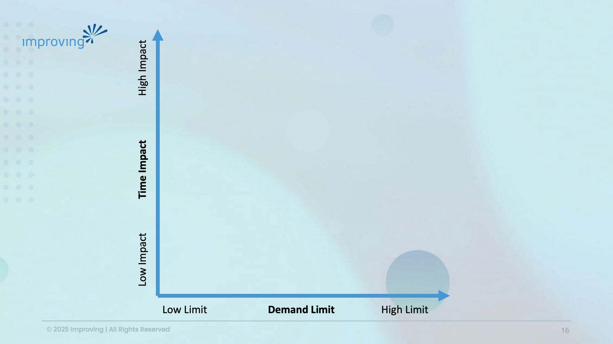

The numbers are embarrassing now. 90% of senior executives surveyed across four countries say AI has produced no measurable productivity gains over three years. Microsoft just committed $2.5 billion and 6,000 of its own engineers to embed within customer companies and handle deployment for them. That is not a vendor bet. That is a diagnosis.

I've been in enough client conversations to know what happened. The company identified its most urgent problem. They applied AI to it. Nothing moved. They blamed the model. They tried a different one. Nothing moved again.

The bottleneck was never the model.

What I see inside organizations, and what we've been mapping in our AI workshops at Improving, is a gap between two fundamentally different categories of AI value. The first is task compression: AI does the task, just faster. The second is the demand curve for the work: if more of the task is done, is it providing value to the business? Paying invoices faster: demand-limited (you only have so many to pay). Proactive outreach at scale: demand-unlimited. Map those out on a graph, and you have a guidebook for what to start on and when.

The urgency trap is this: companies attack the thing that's causing them the most angst because it's visible and felt. The workflow already exists (mostly understood), and the pain is clear, so the ROI story writes itself. But the leverage is rarely available, and the ROI is often poorly understood. Finding those demand-unlimited tasks that are highly compressible is where the value is. Those are the ones that compound.

It is why we built the AI Innovation Lab at Improving. Not to help clients automate faster, but to help them see which problems they shouldn't even attempt and where to focus for real ROI. The shift in posture from 'how do we do this more efficiently' to 'what could we now do that we didn't have capacity for previously' is where the transformation actually lives.

The vendors figured this out in dollars. Microsoft and Amazon are embedding engineers inside organizations because the model is the easy part. The hard part is knowing which category of work to attack and building the muscle to go after the right territory instead of just compressing what you already do (and haphazardly, at that!).

[David O'Hara](https://driventodevelop.com/author/david/)

14 Jul 2026

[AI](https://driventodevelop.com/tag/ai/)
