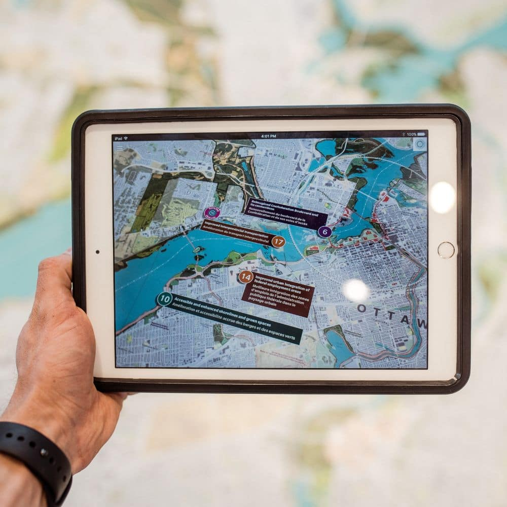

Technology is constantly evolving, and it can be difficult to predict which technologies will become significant in the future. However, 2023 could see the progress of several technologies that will be innovative.

One technology that already exists today but that may become more widely adopted in 2023 is 5G connectivity. With speeds up to 100 times faster than 4G, this new network technology could revolutionize how businesses operate, allowing for faster data transmission and better communication overall.

These differences will start subtly, like in better field data for mining, energy, and weather measurements, then progress to daily usages with appliances and vehicles already set up to take advantage. It could also have a big impact on consumer-facing applications like streaming services and mobile gaming since it will allow for even more efficient use of limited cellular data plans and increased download speeds.

Another upcoming technology expected to flourish in 2023 is Artificial Intelligence (AI). AI has been around for decades now but with advances in machine learning, natural language processing, and deep learning algorithms, AI will soon be able to understand our needs better than ever before; from finding information quicker than a human ever could to providing recommendations tailored just for us or even helping author some crazy things, AI will quickly become an essential part of our daily lives.

While Virtual Reality (VR) gets a lot of the flash and headlines, I believe that Augmented Reality (AR) holds much more promise for seeing real-world applications in 2023. It lacks the specific and bulky hardware that VR typically demands and can often be powered by the phones we already possess. Better motion tracking, GPS, and evolving camera technology means the experiences are going to continue to go up in fidelity and the business applications are wide and varied.

From 5G connectivity unlocking all sorts of applications to AI understanding our needs better than ever before and AR making our environments more accessible and informative; these are just some of the technologies I think we will be seeing in 2023.
