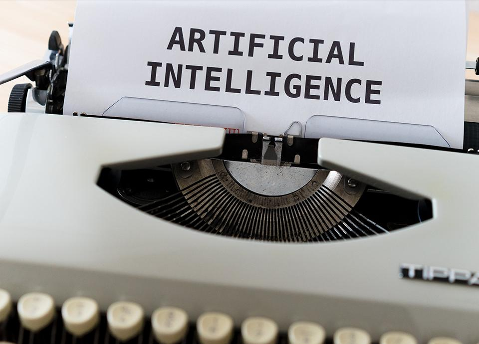

Has talk of Artificial Intelligence left you lost in a word salad? Artificial Intelligence. Machine Learning. Big Data. These phrases are frequently used together, sometimes interchangeably, blurring the lines on what they really mean. Misunderstandings and confusion ensue.

Conversations about Artificial Intelligence can seem incomprehensible to anyone who hasn’t spent years studying the underlying technology. This doesn’t need to be the case! Today, we’ll talk through some common terms and help you see that much of this mystery isn’t mysterious at all.

## AI Glossary and Definitions

### 1. Artificial Intelligence

Artificial Intelligence is one of those broad terms used when describing technology. Many organizations seek ways to adopt AI in some form, with the promise of reduced operational costs and increased revenue. It is often a catch-all for new approaches that come with vast promises.

Artificial Intelligence can most succinctly be described as an umbrella term for any system that gives the appearance of intelligence. It is hard to describe but intuitive for humans to identify. Artificial Intelligence is not a specific implementation or technique, as it may include elements of programming, statistical analysis, and machine learning.

### 2. Data Science

Data Science is a discipline that, as its name implies, takes an empirical lens to the analysis and interpretation of data. As with any scientific endeavor, it is imperative to form a hypothesis, inspect the data, confirm or refute the hypothesis, and iterate. Data Science comprises a wide range of techniques like statistical analysis and machine learning.

Data Science partially overlaps with Artificial Intelligence in that the artifacts produced may enable a system of artificial intelligence. However, it is worthy to note that many results of a data science project can be interpretations of data that would not normally qualify as artificial intelligence.

### 3. Big Data

Big Data is often equated with the amount of data, as measured in rows in a database or the total number of bytes. Volume of data is not the only measure, however. Big Data also refers to data from disparate sources in various formats that are minimally interpreted and often not immediately amenable to storage in a relational database. The combination of these factors drives the adoption of new approaches to ingesting, storing, and processing data. The complexity of new approaches to data forms the basis for Big Data concepts.

### 4. Advanced Analytics

Advanced Analytics refers to a collection of methods for data analysis and predictions that go beyond those of traditional business intelligence. Historical data forms the core of any advanced analytics practice, which can then answer predictive questions to inform business goals and strategies. Advanced Analytics is useful to model potential business scenarios and outcomes.

A related term, Data Analytics, is more narrowly defined. It focuses on extracting meaning from data, which is an essential part of the broader picture of Advanced Analytics. Data Science focuses on the analysis of the data and often employs Machine Learning. A team focused on Advanced Analytics likely includes roles that cover Data Analytics, Data Science, visualization, and presentation of the data.

### 5. Machine Learning

Machine Learning is an approach to programming where the computer learns by inspecting a large collection of examples. The developer chooses the algorithm, sets the hyperparameters (learning settings), and defines the desired outcome as metrics calculated on the accuracy of the prediction. The developer then presents this learning framework with a large set of data points. These are used to iteratively refine the chosen algorithms until sufficient accuracy is reached. The result of learning from these examples is a machine learning model.

For example, if we wanted to categorize images as being those of a domestic cat, we would train the machine learning model using pictures of cats which are marked as positive examples to represent what we want to learn. Then, pictures of related animals such as tigers and bobcats would be marked as negative examples to help restrict the definition of a cat.

Many algorithms can be used in machine learning. No discussion of this topic would be complete if we omitted two of the most common terms: Neural Networks, and Deep Learning. So, without further ado, we present you with two bonus definitions!

### 5A. Neural Nets

Neural Nets, formally known as Artificial Neural Networks, are a collection of Machine Learning algorithms with a common foundation. The commonality between Neural Nets is that they are modeled on the human brain and its biological neurons. The basic structure of a Neural Net comprises nodes connected to each other to form layers between the input (data to inspect) and output (desired prediction).

Machine Learning researchers have discovered certain network layouts that enable efficient learning for some problem categories. There exist many possible structures and often it is not clear which may be most efficient. Data Science, using experiments and empirical analysis, can help discover the most efficient approach for a given problem.

### 5B. Deep Learning

Deep Learning refers to Neural Nets of higher complexity, meaning those with more layers. The higher degree of interconnections between nodes allows Deep Learning to learn more complex problems, solving predictive questions beyond the capabilities of other Machine Learning algorithms.

Neural Nets comprise, at a minimum, three layers that represent the input, the hidden layer of nodes, and the output. Deep Learning is any Neural Net with more than three layers; as such it would have at least two hidden layers of nodes.

## AI Transformation

I hope you’ve come away with a better understanding of the most common terms related to Artificial Intelligence. As you’re able to engage with your technical teams more directly, you can push the boundaries of new developments for your organization. I’d love to hear your stories of success or challenges in developing Artificial Intelligence initiatives. You can [reach me directly on LinkedIn](https://www.linkedin.com/in/olivieraubin/) or [our team at Improving](https://improving.com/contact).
