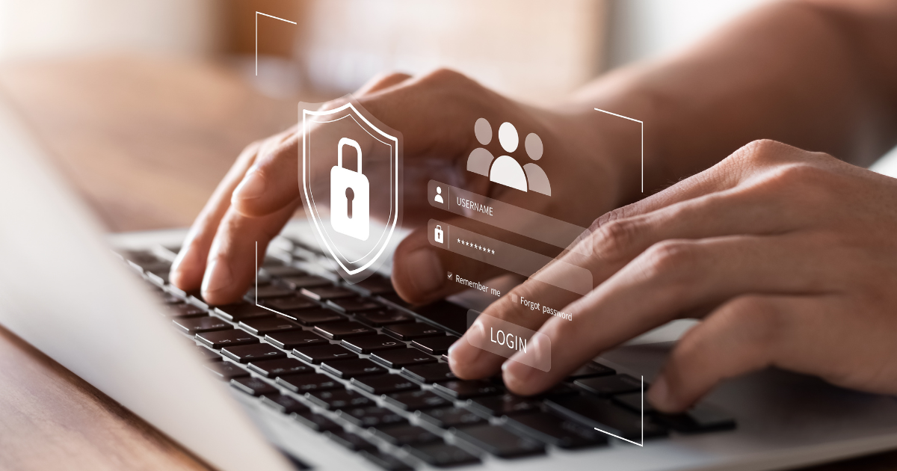

As the digital landscape evolves, remote working has become the norm for many organizations. Remote working brings with it numerous benefits like increased flexibility, productivity, and employee satisfaction.

But, with great perks comes great responsibility. Protecting sensitive data, keeping your business running smoothly, and staying safe from sneaky cyber threats is a top priority. So, let’s explore why cybersecurity is absolutely necessary for remote working teams and discuss key considerations for a truly secure remote work environment.

**1. Heightened Vulnerability: **Remote working introduces new risks that can compromise organizational security. If your team is scattered across different locations and connecting from various networks, there's a higher chance of accidentally exposing sensitive information to attackers. The risk of data breaches, unauthorized access, and malware infections is significantly increased.

**2. Protection of Sensitive Data: **Remote working often involves sharing and accessing confidential company and client data. It's like passing around a secret recipe, and you definitely want to keep it safe. Maintaining integrity, confidentiality, and availability of this information is crucial. Implementing strong encryption, secure file transfer protocols, and access controls guarantee that sensitive data remains protected.

**3. Endpoint Security: **A lot of remote working relies on employees’ personal devices. While it's nice to be able to use your own laptops, smartphones, and tablets, they can become potential entry points for cyber threats. That's where strong endpoint security comes into play. Firewalls, antivirus software, and regular software updates act as a spectacular trio, protecting your devices from those evil hackers.

**4. Phishing and Social Engineering: **A classic move pulled by cybercriminals—phishing attacks and social engineering tricks. When working remotely, distractions are everywhere. So, training your team to identify and respond to phishing attempts is critical for maintaining a secure remote work environment.

**5. Secure Remote Access: **Remote working means the need to secure access to the company's networks, systems, and applications. It's like having the keys to the kingdom, but you want to make sure no one else can get in. You can do this through multi-factor authentication (MFA) and virtual private networks (VPNs). These tools will help your team securely connect to company resources, encrypt our data transmissions, and keep unauthorized intruders out.

**6. Secure Collaboration Tools: **Remote teams rely heavily on collaboration tools such as video conferencing, file-sharing platforms, and messaging apps. However, these tools can also be potential targets for attackers. So, make sure you choose platforms with solid security features, end-to-end encryption, and regular security updates. That way, you can protect sensitive communications and keep your shared data on lockdown.

**7. Incident Response and Recovery: **We have to be realistic here. Even with the best security measures, breaches can happen. Establishing an incident response plan and a robust backup strategy ensures that remote working teams can swiftly identify, contain, and mitigate the impact of a security incident. Backups, encrypted storage, and a tested response plan are your tools for rapid recovery and minimizing downtime.

In today's remote work era, cybersecurity is pivotal for keeping organizations, their invaluable data, and the smooth flow of business operations safe and sound. By prioritizing cybersecurity, organizations can empower their remote working teams to operate securely, mitigating risks and ensuring the protection of critical assets. Ready to safeguard your remote teams? Reach out to us today!
