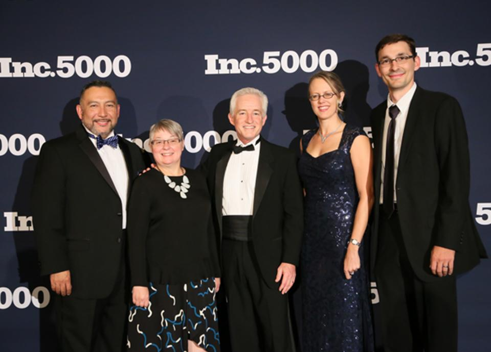

We are thrilled and honored to be named once again as one of the fastest growing companies in America by[ Inc. 5000](https://www.inc.com/inc5000/list/2016/). This marks our eighth year on the list and we couldn't be happier to be among so many other great and successful companies. For 2016, we ranked #3,934 and are among only 116 other companies to have made the list for eight years in a row.

We had a small delegate of Improving executives attend the annual Inc. 5000 Conference to meet other award-winning companies and to celebrate the win. The conclusion of the event included a formal black tie gala and an esteemed dinner with top Inc. Magazine officials. The 2016 Conference took place in October in San Antonio, Texas, and featured speakers such as Tony Robbins and founders of several large companies around the country.

### *"The Inc. 5000 conference and celebration was motivating! So many successful business owners sharing ideas and their enthusiasm," *

##### *- Ric DeAnda, SVP of Operations.*

The 2016 Inc. 500/5000 is ranked according to the percentage of growth by comparing 2013 to 2015. To qualify, companies must have had to thrive through the past three challenging years in the American economy. Additionally, they had to be based in the United States, privately held, for profit, or independent – not subsidiaries or divisions of other companies.
