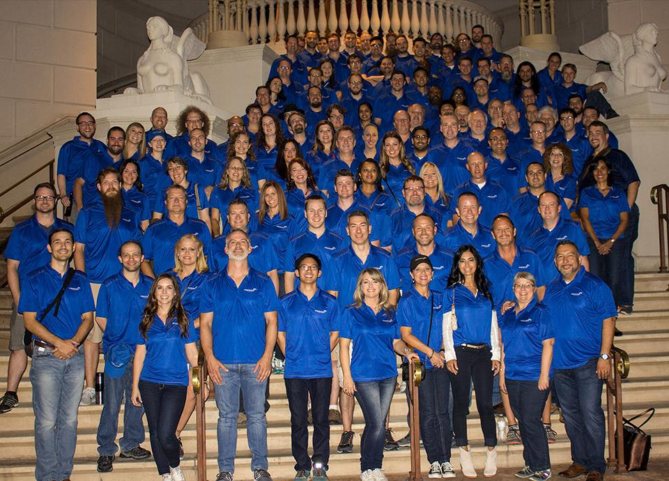

Improving is thrilled to be featured on [Inc. 5000's list recognizing America's Fastest-Growing Companies](https://www.inc.com/inc5000/list/2017). This year marks the ninth year that Improving has made the list! For 2017, we are ranked #4461 and among only 81 other companies who have been on the year for nine consecutive years.

We are looking forward to attending the [Inc. 5000 Conference](https://conference.inc.com/) in Palm Desert this October. The conference will be three days packed with inspirational talks given by business leaders from across the country. We'll get the chance to hear from influential speakers such as [Daymond John](https://www.linkedin.com/in/daymondjohn/) from Shark Tank and Alan Mulally, former CEO of The Ford Motor Company. The conference will end with the traditional Black-Tie Gala awards ceremony for all of the Inc. 5000 honorees.

