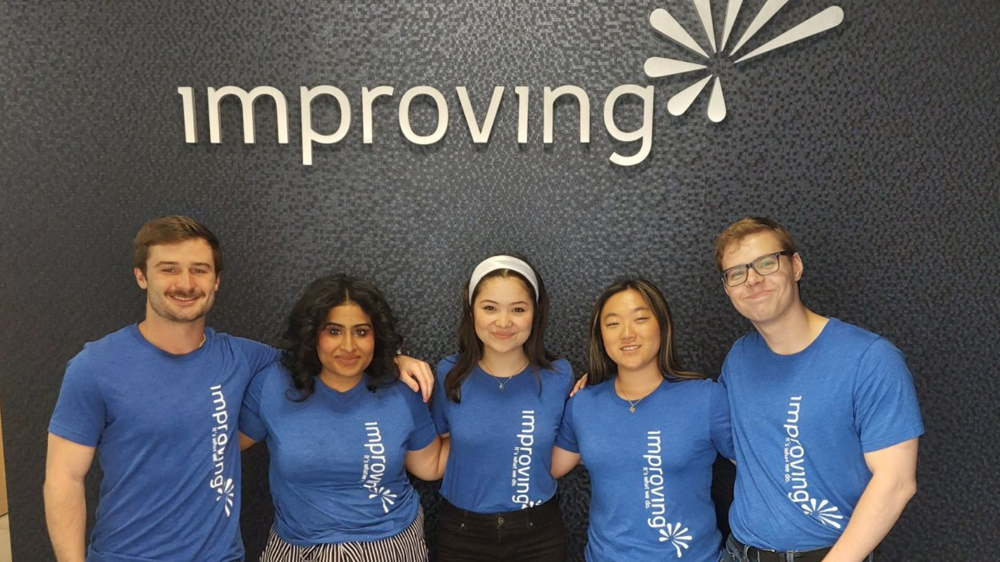
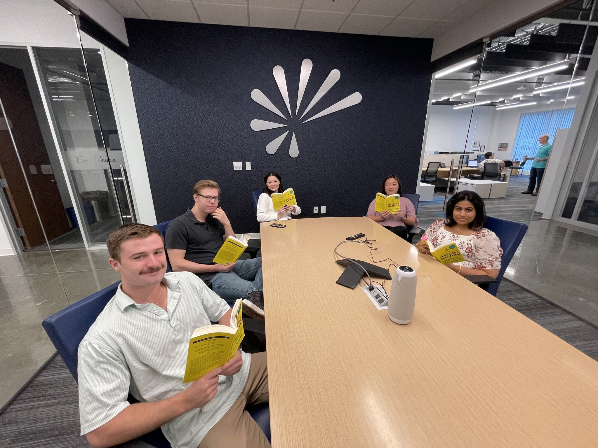
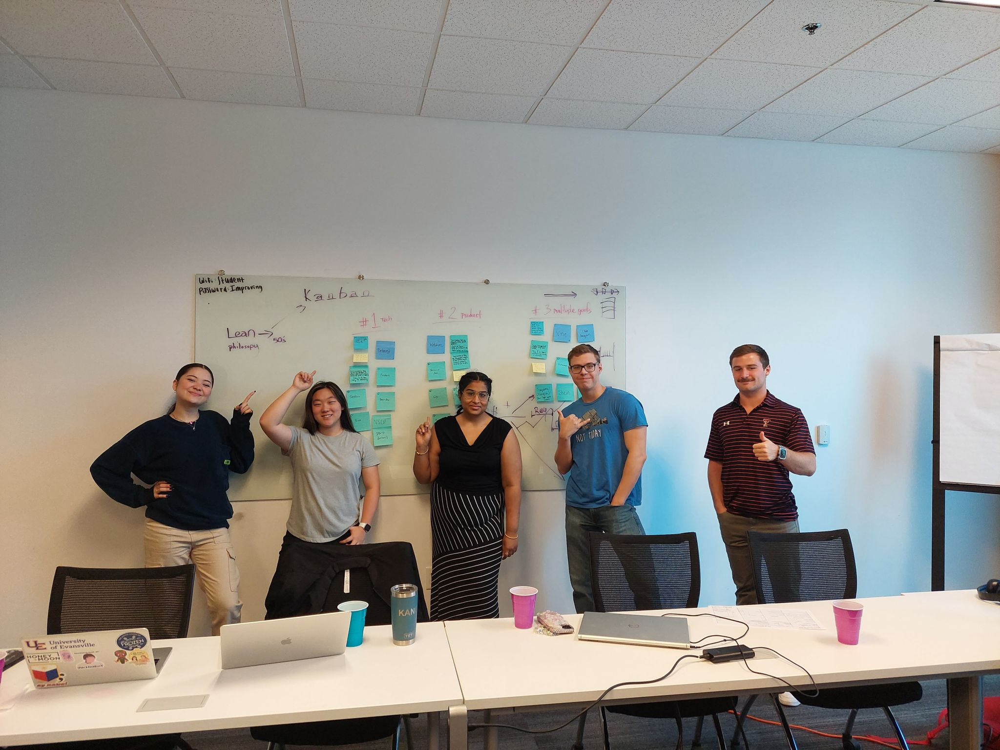
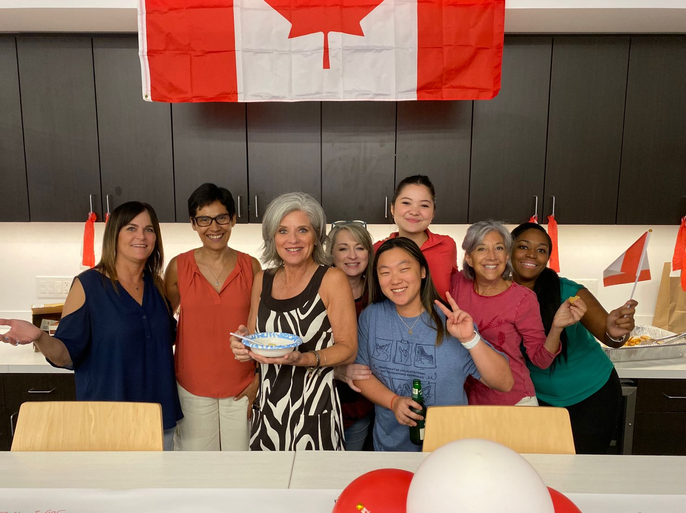

*“I really don’t think any of us could’ve expected to grow the way we did”*

8 weeks, 5 interns, 4 departments, 3 books, 1 company; Welcome to the life of an Improving Intern. Improving is dedicated to positively changing the perception of the IT profession. What we didn’t know is they also challenge the expectation of what it means to be an Intern in the IT industry. With the assumption of coffee runs and printing documents, we were happily surprised about what the internship actually was.

*“How would you describe the Improving internship?”*

We would describe it as a source of learning, personal growth, and new experiences both as a team and individually. We spent time in the Recruiting, Marketing, Sales, and Delivery departments, but our learning did not stop there. We learned and practiced many different skills including sourcing, branding, lead generation, project management, and effective communication. In terms of personal growth, we got to do a weekly Trust Pod with a current Improver who taught us the 13 Trust Behaviors.

In continuation, we’ve had so many wonderful experiences together. We all got to know each other and created a productively-joyful environment that included banter, laughter, and smiles. The internship has been essential in our professional journeys by providing so many areas of growth.

From our ages ranging from 18-22, we each came in with our own personalities and expectations. Now at the end of the Internship, we were able to reflect on how those expectations were positively challenged and changed.

*“What surprised you the most about the internship?”*

The first thing that comes to our mind is how we were immediately accepted into the company and its culture. It’s not common in an internship to grow so close with coworkers who genuinely care about you as an individual, but it was that case for every intern. Everyone in the office was so invested in building relationships with us, pouring knowledge into us, and helping us throughout the whole internship. We will never forget the love and acceptance we were shown.

*“What is something you learned that you weren’t expecting to learn?”*

Before working for Improving, if you would’ve asked me what a “Trust Pod” was, I’d probably make a fool of myself trying to come up with an answer. Now we know, Trust is the foundation for everything encompassing being an Improver. In our Trust Pod, the 13 Trust Behaviors were explored and we were asked how they related to our everyday lives, outside of the workplace. This is an example of the common theme we encountered throughout our internship; learning things that we can use throughout life no matter what career or walk of life we are in.

These past few days have been filled with hard work and sentimental reminders that we’re wrapping up our time with Improving. We took some time to talk about our highlights and favorite parts of the process.

*“What was your favorite part of the internship?”*

Unanimously we agree that the connections we made with our fellow Improvers was our favorite part about being here for the Summer. Everyone is so down to Earth and welcoming. There wasn’t a single second we felt out of place or not accepted; it was more than we could have ever asked for.

During breaks, lunch, or even just walking to get coffee, we could strike up a conversation with anyone in the office. We were able to make genuine, meaningful connections with people of different backgrounds, expertise, and hobbies. We are extremely grateful for this opportunity to connect with them, we will genuinely miss the Improving family, and look back on this experience fondly.

So this is it, this is how it ends. But before the 2023 Summer Improving Interns sign off, we wanted to leave any future interns with a piece of advice from each of us.

*“What advice would you give future interns?”*

Trey Thomas: “Future interns, above all else, come into the internship program with an open mind and a desire to learn. It’s rare to get to learn from 4 different departments in just one short intern program, so it’s important to be attentive and take full advantage of the content you’ll be taught. Aside from that, make sure to enjoy yourselves and grow close with your other interns and other people in the office. Everyone will make sure to welcome you and make you feel at home.”

Rhea Kumar:” Take advantage of the fact you’re working in a bunch of different departments. You will learn so many different types of skills that you can apply in your future career even if you end up going into a completely different field. The things you will learn during your internship will help you excel in the future if you choose to take advantage of it. Also, connect with a lot of people, you will meet some great people here who will make your internship a once-in-a-lifetime experience.”

Courtney Kang: “Advice I would give to future interns? Learn as much as you can from anybody and everybody at Improving. Everyone is a coach, mentor, and teacher, all completely happy to teach anyone looking to learn. Learn from people who are doing things you don’t know much about personally. I was never exposed to Sales, Recruiting, or Marketing and so I had the most to learn from them. For future interns: Be resourceful yet humble enough to ask for help.”

Bailey Crawford: “You choose what you get out of the internship. There is so much to get out of it and so much to learn, but that can only be possible if you take the time to learn what is there for you. Use your resources and genuinely build a connection with these people. It is easy to oversee the opportunities because you will be busy, but if you take a second out of your day/week to really reflect on what you’ve learned, you will come out of this experience much more knowledgeable about not just yourself, but of what you want from your life. Be open-minded and be willing to be a student, it will only make you better.”

Jonathan Sowell: “Be ready and willing to work hard and believe in yourself and your team. There will be hard days that will require work. But you and your team are capable of succeeding if you work together and hard.”

In summary, you choose what you get out of this internship, and you get out what you put in. An Improver once told us that at an internship, you may be stuck doing one thing the whole time “as an intern” until you ask and show initiative in doing more. You can do this by being willing to work hard, having a desire to learn, and letting that be known.

There are so many amazing, genuine, and unique people to connect with and learn from as they all have different experiences in life and are willing to share. The skills taught and learned from Improvers are applicable to any field so keep an open mind, and you’ll be able to find things to learn from every experience throughout the internship. This has made the internship truly one-of-a-kind. We have really loved this internship, it is unique, and we’d recommend it to anyone who wants to challenge themselves and step out of their comfort zone.

Thank you to the Improving family!

- Quinterns
