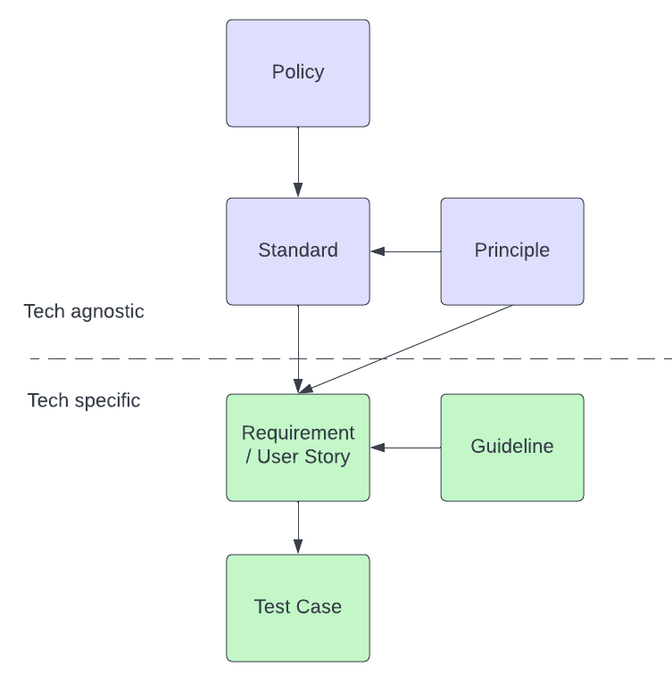

Software security is more important than ever, but developing secure applications is more confusing than ever. TLS, mTLS, RBAC, SAML, OAUTH, OWASP, GDPR, SASL, RSA, JWT, cookie, attack vector, DDoS, firewall, VPN, security groups, exploit, SLF4j, openssl, and so many other terms, concepts, technologies, and esoteric acronyms that it'll make your head spin. Usually, we talk about security from the pen-tester perspective, but that makes it daunting for the person on the other side - the developer.

This guide presents a mental model for developers to make sense of the information security landscape and build more secure applications. It should break down complex security requirements in a way that's manageable. First though, we need to define some terms.

- **Policy**: Aggregate of directives, rules, and practices that prescribes how an organization manages, protects, and distributes information. Example: Company must comply with GDPR.
- **Principle**: Ideas shared by all secure applications and apply to any kind of software system. The more they are applied, the more robust the system’s security. Example: Principle of least privilege.
- **Standard**: Specific techniques devised to protect a software system in one or more ways. Example. OAUTH2 spec for authorization.
- **Guideline**: Tool or technology provided to help programs conform to certain standards. Typically technology-specific. Example: Parameterized queries in JDBC to prevent SQL injection.

These are working definitions for this guide. These terms have different and overlapping meanings in other contexts, but they'll suffice in understanding this model.

### The Model

The company or organization has a **Policy**. The team chooses an industry **Standard** that follows good design **Principles** and adheres to company Policy. There exists **Guidelines** describing how we should implement that **Standard** in our specific technology stack. We use the culmination of these to write good **Requirements** and **User Stories** that we can test easily with a **Test Case**.

### Let's walk through this with an example.

The company Policy states that user data cannot be publicly accessible. We're building a highly distributed real-time system. We need to find an appropriate industry Standard that satisfies this Policy. User data is going to travel outside the company intranet. CLASP security Principles tell us to assume that the network is compromised. We decide to adopt the TLS Standard so that we can secure our data over a compromised network. But how? We need to find Guidelines specific to our technology stack. Let's say that Kafka is our main communication mechanism. It just so happens that Confluent Cloud supports TLS out of the box. Finally, we can create a User Story with the summary:

Enable TLS for client-broker and broker-broker communication in Confluent Cloud

What did we do here? We took a vague high-level policy that could be applied to any number of security concepts and narrowed it down to a specific industry standard based on applying security principles to our architecture. That allowed us to easily find an appropriate technology-specific guideline. Finally, we were able to write a workable story.

### Now reverse it.

Consider the following requirement:

"Implement authorization in the application."

Incredibly unhelpful, but also incredibly common. Moreover, it doesn't reference a Policy. But given what we know about security Principles, we can make some assumptions. We figure it's a good idea to minimize attack surface area by only allowing certain users to use the system. Also, it's wise to only give those users as few permissions as possible. In other words, we want to authenticate users and give authenticated users minimal authorizations. We need to find authentication and authorization Standards appropriate to our organization and architecture. We propose SASL for authentication and ACLs for authorization. Our technology stack already has support for both. Now we satisfy the requirement with the stories:

- Configure SASL/PLAIN for Kafka clients - Give users read permissions for Topics A, B, and C in Zookeeper ACLs

These stories are easy to understand and implement. Maybe the project manager pushes back and says that we must use the company's internal RBAC system. In the context of the model, we know the project manager is proposing a different Standard. The engineer simply needs to find and implement the Kafka guideline to satisfy that standard. The model helped us take a daunting requirement and break it down in a way that is much easier to understand, discuss, and implement.

*Inspired by Brian Glas, Great Expectations: A Secure Software Story, Open Source North 2018. *
