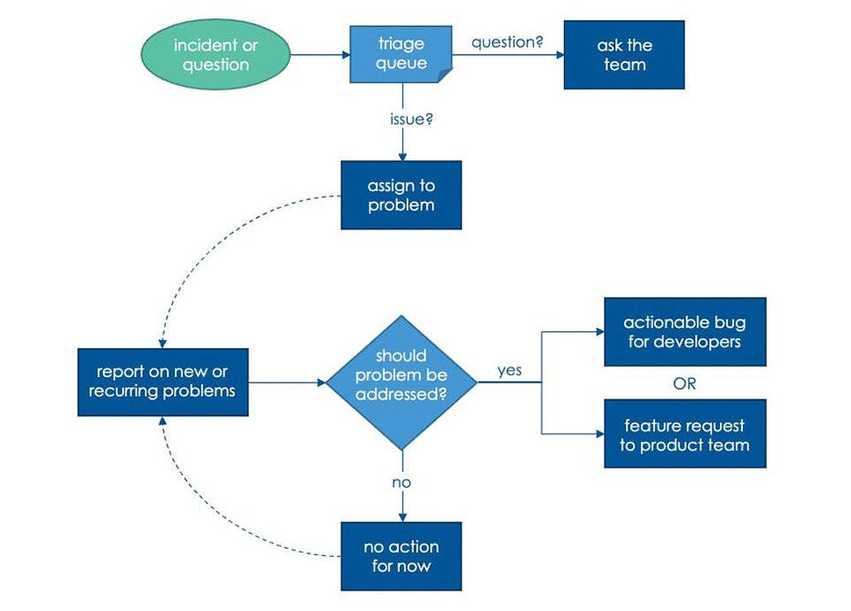

Do you have thousands of defects in your backlog? Do you struggle to figure out which bug reports are actionable? Do you feel like you need a complete reset?

Most organizations I’ve worked with have struggled to implement a sustainable defect management process that serves the needs of their customers, developers, and internal processes. Bug reports have been used as a catch-all for far too many disparate use cases. Even the definitions of a defect, bug, or issue are up for debate and are often used interchangeably.

Why not make a New Year’s resolution to improve your defect workflow? In this article, informed from years of firsthand experience, I share a process improvement that enables you to better serve your customers, developers, and business stakeholders.

## When Bugs Accumulate

Many organizations use bug reports to capture every issue that arises as part of a product, service, or business process. While a wide range of issues are captured as bugs – and here we use the term “bug” quite broadly regardless of which specific tool is used to track this information – your developers are using this to track feature requests or defects that need to be remediated.

Developers end up spending a significant amount of time repeatedly reviewing and triaging bugs. Stale bugs, often not removed for fear of losing information or kept “just in case”, clog up your project management process and require time to review, and re-review, to just have them put off again until later. Poorly defined bugs become technical debts that the team needs to manage and understand.

The accumulation of stale bugs reaches a tipping point when you’re overwhelmed with defect management effort that isn’t moving your business forward. One product company where I worked talked of reaching bug bankruptcy. And one day, the leadership decided to follow through on that talk. All bugs were deleted for a fresh start with new bug reports. The intent was to actively triage and remediate the new bugs as they came in.

Guess what? A year later, bugs were piling up. Another year later, talk of declaring bug bankruptcy came up again. How is this sustainable? How does this help the business move forward in a productive way?

## What Issue Are We Trying to Solve in Defect Management?

A customer reports an issue. Your support team collects information, confirms there’s anomalous behavior, and files a bug.

Your QA team is doing one more test run through your product. They notice unexpected behavior and file bugs.

Your customer success team is chatting with a prospective customer who asks if your product has certain features. In hopes of closing the deal, your team files bugs for features they believe are missing.

In all these cases, bugs take on different forms. Some are questions about why certain behaviors were observed, often because documentation was lacking or expectations were misaligned.

Some bugs are known issues that are resolved through alternate means – documentation, different workflow, and workarounds. In the mix may be legitimate defects that should be addressed, though they’re not yet prioritized nor is there an understanding of the full impact of the defect.

If we step back and consider the stakeholders in your software development life cycle, the different needs become more apparent.

Business users want defect analysis about incidence rates, customer-reported issues, and product areas of concern. Product management teams are interested in understanding product defects and feature requests to develop a more robust product roadmap. The development team is using the issue management system to define work items and keep everyone on task.

## A Proposal for a More Sustainable Defect Management Process

Here, we propose a new approach to your defect management process based on a sustainable, flexible, and informative workflow.

We will first clarify our definitions for some terms.

An **incident **or **observation **represents one occurrence of some behavior, be it expected or unexpected. Specifically, it does not imply any required action or resolution. It simply represents one empirical data point about an observable behavior with context about when, where, and how it occurred.

A **problem** represents a collection of similar incidents that need to be investigated. A problem may be a **defect** if it represents anomalous behavior that should be corrected.

A **bug** is an actionable, developer-focused work item to resolve a problem or defect.

With These Definitions in Mind, We Propose the Following Process:

#### 1. Create a Database to Hold All Incidents & Observations

This can often be created as a separate project within an existing issue management system. Incoming incidents are logged with any supporting information that can be collected.

Existing incidents are* not *referenced nor should there be any attempt made to de-duplicate incidents. Each time an observation is made, however frequent, it should be recorded as a separate entry. Categorization, such as product area, can be added to the incident.

#### 2. Establish a Daily Process to Review New Incidents

The business team, such as product managers and business analysts, should consider each incident in turn. If there’s an existing problem that covers that topic, the incident should be assigned to that problem. Incidents not represented by existing problems should be left as-is.

#### 3. Establish a Weekly Process to Review Patterns of Incidents Not Yet Assigned to Problems

Data analytics should be used to group incidents into similar behaviors. The business team defines problems for any group of incidents that need further investigation and may require some sort of resolution.

#### 4. Following Weekly Incident Grouping, Review All Problems in Which New Incidents Have Been Assigned

You’ll want to establish the severity, likelihood, and impact of the problem to determine if it is a defect and needs remediation. Involve the development team to understand the scope of the problem and identify potential solutions.

#### 5. For Problems Requiring Resolution, Create a Bug or Feature Request in the Product Development Backlog,

Include a specific and actionable request for the development team. The bug report should also include priority relative to other work, completion criteria, success metrics, and any other information to meet your organization’s definition of “ready for development”. Any problems not intended to be resolved in the short term should *not* lead to a bug report.

#### 6. Execute!

Include bugs in the development backlog with categorization, identified value, and priority. Bugs will only continue to be a growing list unless they are treated as 1st classwork items and there is a plan to act on them.

With the process outlined above, both development and business teams understand the importance of the bugs identified and will ensure that their priority, relative to other work, is maintained. As the development team works through their backlog, the focus will be on the value your customers need, new features, and higher quality.

Below, we offer a visual summary of the defect management workflow.

Implementing this process gives you a steady, predictable flow from incidents, to problems, to actionable defects. Roles and expectations become clearer, leading to higher efficiency across the teams.

## Just the Beginning of a New & Improved Defect Management Process...

With the defect management process we just described, you can consider the incoming incidents as an event stream, much like sensor readings, page views, and database changes. You could store the incidents, or event messages derived from them, in a data lake or other suitable storage.

As discussed in a prior article, [Unlock Your Data](https://improving.com/thoughts/unlock-your-data), you can perform data analytics on the event stream of incidents, monitor incident rate, explore trends for the source of incidents, predict problem areas, and implement monitoring and alerting on your system.

The most successful businesses understand how to tune their processes and leverage data analytics. [Reach out](https://improving.com/contact) to our team at Improving for strategic advice and project delivery.
