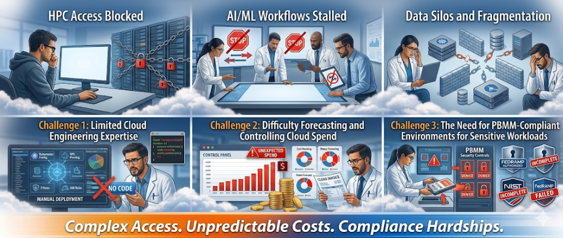
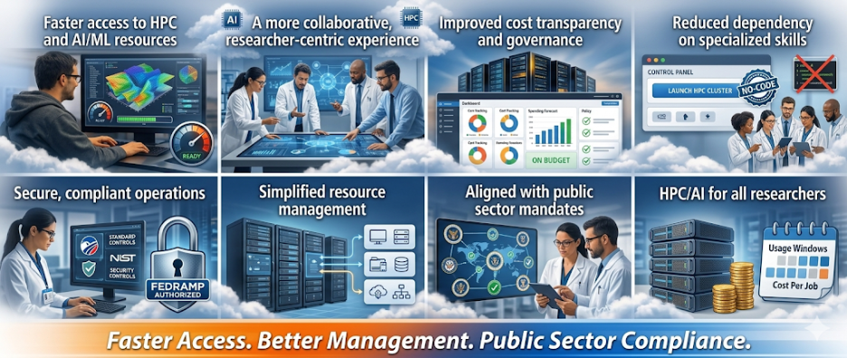

Public sector research departments and agencies are under increasing pressure and scrutiny to deliver faster insights, scale advanced analytics, and responsibly manage costs, often within the constraints of aging on‑premises infrastructure. High‑performance computing (HPC), artificial intelligence (AI), and machine learning (ML) workloads adds an additional layer of complexity through an increased demand for elastic compute, specialized accelerators, modern collaboration tools, and specialized expertise for on-prem solutions. Yet many government and healthcare research teams remain bottlenecked by limited access to on‑prem HPC capacity, long provisioning cycles, and complex cost governance models.

These challenges were central to the work undertaken by a defense research agency client, where Improving, in collaboration with Google Cloud, delivered a secure, compliant, and scalable solution called the Research Accelerator Portal that fundamentally transformed how their researchers access and manage HPC, AI, and ML resources.

## **The Limits of On‑Premises HPC for Modern Research**

Traditional on‑prem high-performance computing, AI, & ML environments were designed for predictable, batch‑oriented workloads. Today’s research workflows, spanning AI model training, geospatial analysis, and data‑intensive simulations, are anything but predictable.

HPC clusters often require large physical footprints, high energy consumption, specialized cooling, dedicated networking, and niche (and often costly) expertise, all of which compound operational complexity and cost over time. For public sector departments and agencies operating under fixed budgets, these constraints directly limit the number of concurrent research projects that can be supported.

Historically, the capital cost of HPC infrastructure made it inaccessible for many research-oriented organizations, even as demand for AI‑driven analytics and simulation workloads increased across industries. While cloud platforms have removed many of these barriers, effective adoption still requires governance, security, and cost controls that align with public sector requirements.

## **The Challenge: Speed, Scale, and Cost Control**

Researchers at our client’s defense research agency faced a familiar challenge: long wait times for on‑prem HPC resources, limited flexibility to scale workloads, and a lack of standardized tooling to manage cloud adoption safely and efficiently. While cloud platforms offer virtually unlimited compute and advanced AI services, the organization identified key obstacles that slowed adoption:

- Limited cloud engineering expertise among research teams
- Difficulty forecasting and controlling cloud spend
- The need to operate within PBMM‑compliant environments for sensitive workloads

These challenges reflect broader public sector realities; organizations increasingly turn to cloud infrastructure to support AI and HPC workloads as demand for specialized accelerators and high‑speed networking grows beyond what traditional CPU‑based environments can sustain.

## **The Research Accelerator Portal: A Cloud‑Native Solution Purpose‑Built for Researchers**

To address our client’s challenges, Improving and Google Cloud developed the HPC & AI/ML-powered Research Accelerator Portal, a self‑service platform that enables researchers to rapidly provision secure cloud‑based computing environments, often within an hour of approval.

##### **The portal provides:**

- Pre‑configured project templates for data science, AI/ML, geospatial research, and HPC
- Built‑in budget estimation and approval workflows
- Automated spend threshold alerts at 25%, 50%, 75%, 90%, and 100%
- The ability to pause or terminate environments without losing work
- Simple collaboration features for inviting additional researchers
- Administrative oversight and lifecycle management
- Deployment within PBMM‑compliant cloud architectures on Google Cloud Platform (GCP)

By abstracting infrastructure complexity, the portal enables scientists to focus on advancing research rather than managing environments and budgets.

##### **Research Accelerator Portal Demo**

[https://www.youtube.com/channel/UCp3IAAMb13i1bkNx-39OWig](https://www.youtube.com/channel/UCp3IAAMb13i1bkNx-39OWig)

## **Why Cloud‑Based HPC Changes the Economics of Research**

Cloud‑based HPC, AI, & ML capabilities has matured significantly, allowing organizations to access advanced compute resources without the upfront capital investment traditionally required for on‑prem systems. This shift is especially impactful for public sector and healthcare research organizations managing variable workloads and evolving research priorities.

Cloud adoption trends show sustained growth driven by AI and data‑intensive workloads that benefit from elastic infrastructure and managed services. Rather than over‑provisioning infrastructure for peak demand, research teams can scale resources dynamically, while maintaining clear visibility into costs.

## **Measurable Impact With HPC, AI, & ML Resources On Google Cloud**

The Research Accelerator Portal delivered meaningful outcomes for our client, that included:

- Faster access to HPC and AI/ML resources
- Improved cost transparency and governance
- Reduced dependency on specialized cloud engineering skills
- Secure, compliant cloud operations aligned with public sector mandates
- A more collaborative, researcher‑centric experience

By leveraging Google Cloud services such as Vertex AI, Jupyter, Gemini, and Terraform, the solution provides a modern foundation for advanced analytics and AI‑driven research, without compromising security or fiscal accountability.

## **Looking Ahead: Accelerating Research Outcomes with Confidence**

As AI and ML continue to reshape scientific discovery, the ability to provision compute quickly, govern costs effectively, and operate securely will define research success. Continued growth in AI‑optimized cloud infrastructure as organizations seek scalable alternatives to traditional on‑prem environments.

Our client's customized Research Accelerator Portal demonstrates how public sector agencies can modernize HPC and AI workflows on Google Cloud by unlocking speed, scale, and flexibility while maintaining compliance and control.

## **Ready to Accelerate Your Research?**

If you are a research leader or researcher constrained by the limitations of on‑prem HPC environments, the Research Accelerator Portal offers a proven, secure path forward.

[Click to learn](https://www.improving.com/research-accelerator-portal/public-sector/#contact) how this cloud‑based portal, built on Google Cloud, can help you streamline access to HPC, AI, and ML resources, reduce operational friction, and accelerate research outcomes with confidence.
