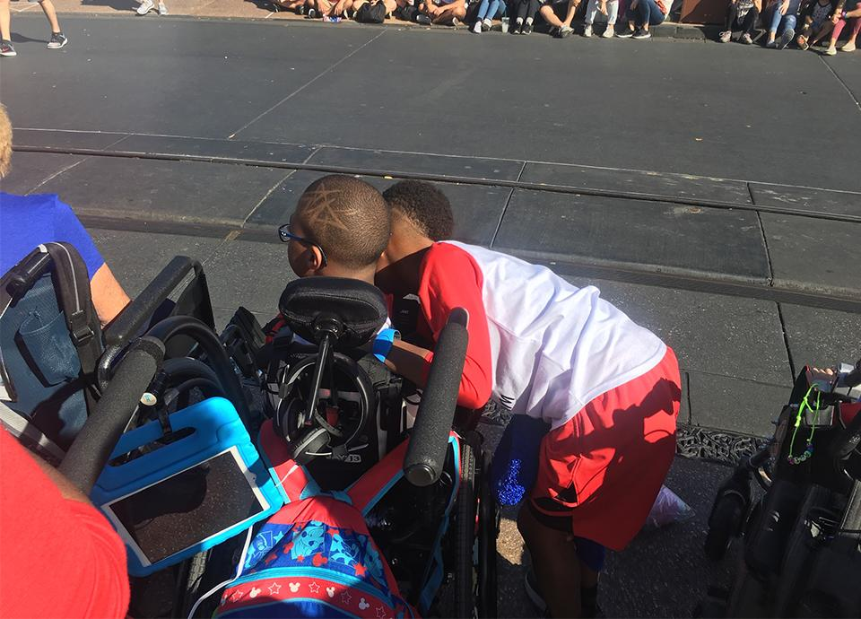
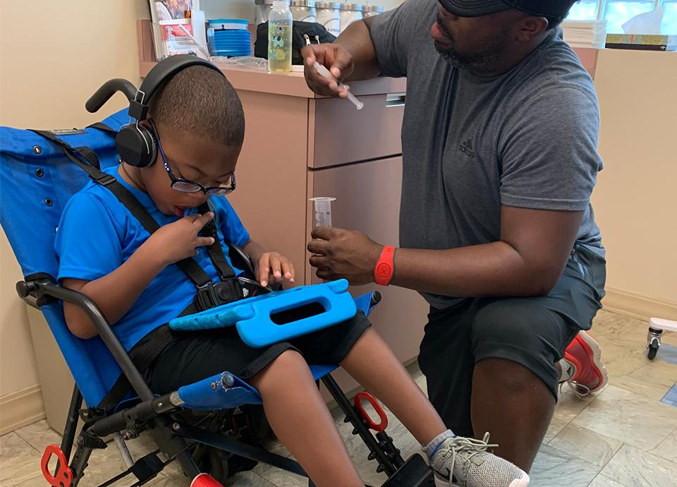
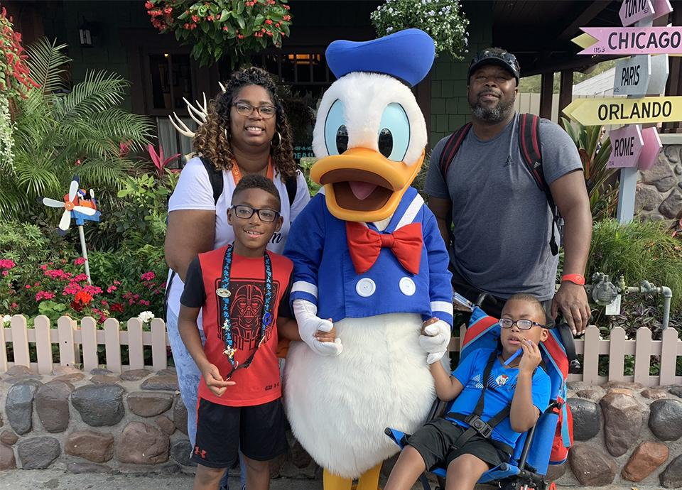

In the world of business and design, accessibility is a hot topic. Which, for those without physical or mental impairments, may not seem all that important. As a father of two wonderful sons, one of whom is disabled, let me tell you; accessibility and the quality of that accessibility has an incredible impact on my family's life.

Defined as the quality of being easily understood, obtained, used, or appreciated, accessibility at its core is about inclusion. On a recent trip to Disney World in Florida, my family and I were able to truly be a part of the magic inherent in that classic American experience simply because our needs had been anticipated by strangers at an amusement park.

Here are some things we experienced at Disney World that made our vacation extraordinary. As you read, I challenge you to think of your workspace and the places you frequent. How can those areas be made more accessibility friendly to everyone? Disney is world-renowned for making their in-park experience friendly and inclusive for all, but, as you’ll see, many of the things that made my family’s visit great were quick and straightforward solutions to common issues disabled people face.

### Parade Viewing

If you consider the sheer number of people that gather to see the parade at the Magic Kingdom park, viewing it from a wheelchair several rows back is impossible. Disney realized this and offers access to a dedicated handicap area which is roped off upfront for an optimal seated position view.

### Rides with Wheelchair Access

We were happy to learn that there are a plethora of rides and attractions with wheelchair access – over 50 to be exact! Our son enjoyed these rides from the comfort of his wheelchair with minimal effort spent getting him on and off each attraction. For some of the more intense amusement rides, it’s sometimes necessary to transfer from the wheelchair to the more secure ride seating. For convenience, employees will move your wheelchair to the end of the ride so you can seamlessly transfer into it and continue on your next adventure. If the attraction is too intense for your special-needs child, you can utilize Disney’s rider swap policy. Rider Swap allows a group to ride while one person stays behind. Once the first group finishes, the person who stayed behind can use Disney’s Fast-Pass lane to ride the attraction, enabling them to have a blast themselves too.

### DAS Passes

Disney’s Disability Access Service (DAS) is a pass for attendees whose disabilities prevent them from waiting in a conventional line. Instead, you schedule a return time and wait comfortably near the attraction or move on to enjoy the park. When your time slot comes up, you access the front of the line via the Fast-Pass access point.

### First Aid Rooms/ Nurses Stations

Quite possibly, the most significant help for our entire trip was access to the nurse’s stations while enjoying the parks. We were able to give tube feeds, change diapers, and administer medications in comfort and privacy. These rooms served as a much-needed intermission for our special needs son. The staff members were super helpful and glad to assist in any way we needed.

### Dedicated Lanes at Bus Stops

Arguably one of the best at customer experience, Disney helps you begin your magical adventure the moment you walk off the plane. For us, the first win of the vacation was the dedicated lane for special needs people while waiting for the Magic Express, the shuttle from the airport to the Disney resorts. If you are sensitive to loud noise, crowds, or need space for a wheelchair, this is a huge plus. Additionally, each bus was ADA compliant and had a wheelchair lift.

The four of us had an incredible time at Disney World and will cherish those memories forever. But think of how quickly our experience would have been diminished by frustration and confusion over accessibility limitations. Disney’s ability to anticipate our needs made this vacation a time of genuine fun and relaxation.

In your workspace, is there a quick and straightforward way, like the wheelchair area at the parade, to increase accessibility? I encourage you to look around and find specific, impactful ways to be inclusive where ever you can.
