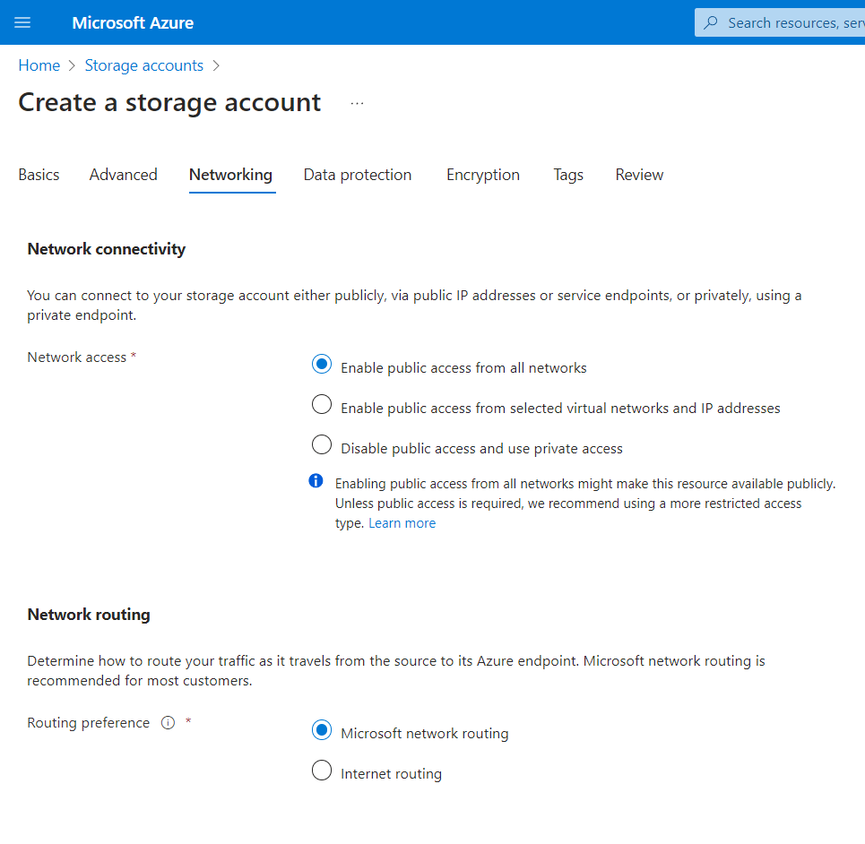
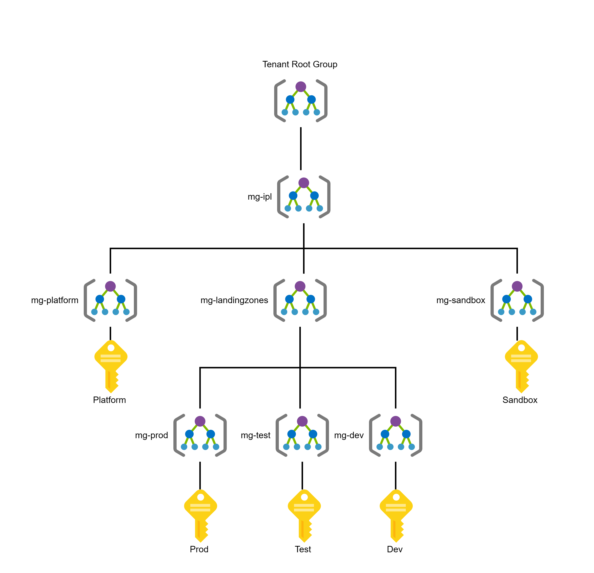
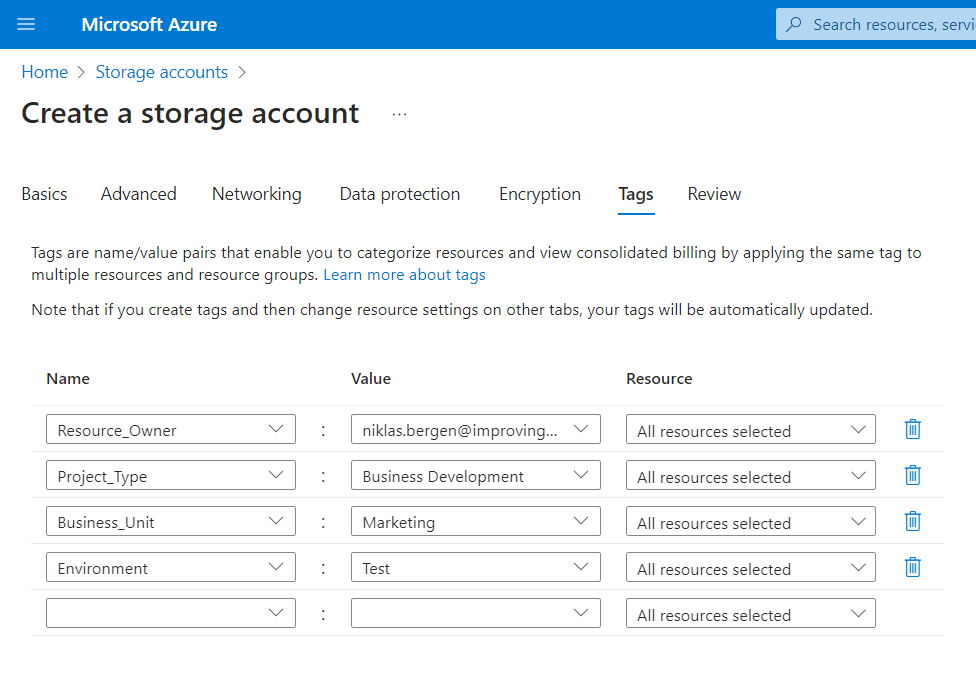

With so many enterprises migrating their on-premises systems to Microsoft Azure, it’s more important than ever to start off on the right foot with cloud environment configuration and overall approach. As your cloud environment becomes more complex and interdependent, it can become a real challenge to change resource deployments after the fact; even a simple rename can cause dependencies to break.

To assist with this, Microsoft has developed the [Cloud Adoption Framework for Azure](https://learn.microsoft.com/en-us/azure/cloud-adoption-framework/), a set of documentation providing guidance and best practices so that Azure consumers can confidently set up their environment in the best way possible for their use case. The Cloud Adoption Framework covers migration scenarios, security, governance, and overall strategic mindsets that should be considered before, during, and after cloud adoption. For brevity, this article will only focus on a few of the many possible talking points from the Cloud Adoption Framework.

### Consider the Networking

When creating new resources such as virtual machines, SQL Servers, or storage accounts, it can be tempting just to hit the “allow all traffic” button because this is the easiest way for users to connect to the resources or for the resources to communicate with each other. However, this opens up the door for the public internet to access the resources, which can lead to third parties gaining access to your data.

*Azure warns that enabling public access is a risky decision.*

Instead, Microsoft [recommends to implement](https://learn.microsoft.com/en-us/azure/cloud-adoption-framework/migrate/azure-best-practices/migrate-best-practices-networking) technology such as Virtual Networks to tightly control your workloads. Virtual Networks, when configured correctly, effectively isolate your resources within private networks and go a long way toward preventing unauthorized access to your business’s information. Other tools Azure offers for networking security include Azure Firewall, Virtual Private Networks (VPNs), Network Security Groups, and more.

### Deploy to the Right Place

In the interest of time, some users may choose to quickly deploy resources without carefully considering where it should be deployed. However, this may lead to rework down the line as more and more resources get created without any traceability or deployment patterns.

To assist with resource deployment, it is helpful to [create separate management groups and subscriptions](https://learn.microsoft.com/en-us/azure/cloud-adoption-framework/ready/landing-zone/design-area/resource-org-management-groups) depending on your organization’s structure and planned workflow. One common setup is to segregate management groups and subscriptions into production, test, development, sandbox, and platform counterparts. This helps guide Azure administrators to deploy resources in the correct location and keeps your resources organized in the right place.

For more strict deployment control, Azure Policies can be configured to deny deployments that do not meet your custom definitions, as well as continuously monitor your environment for policy compliance.

*A hierarchy of the root group, management groups, and subscriptions that we recently set up for a client.*

### Provide the Context

Another helpful governance tool is tagging, which allows you to assign custom properties to any resource to help you keep track of its origins and relevance. For instance, some common tags to apply include the owner (creator) of the resource, the project it was created for, and the business unit for billing purposes. When tags are diligently applied, future users will always know how a particular resource fits into the big picture, and other users will be able to filter resources based on their tags for reporting and other purposes.

*A few common tags can be applied when creating a new resource.*

Lastly, a consistent naming convention will go a long way toward giving your Azure environment an organized, professional feel. The Cloud Adoption Framework [provides a list of suggested abbreviations](https://learn.microsoft.com/en-us/azure/cloud-adoption-framework/ready/azure-best-practices/resource-abbreviations) for each Azure resource type.

*Example of a naming convention from the Cloud Adoption Framework*

Ready to start your migration to Azure? [Reach out to us](https://www.improving.com/contact/).
