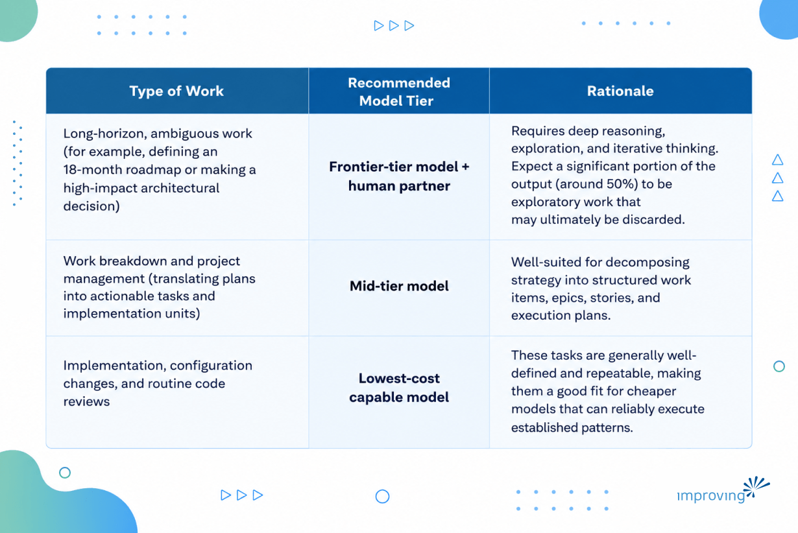
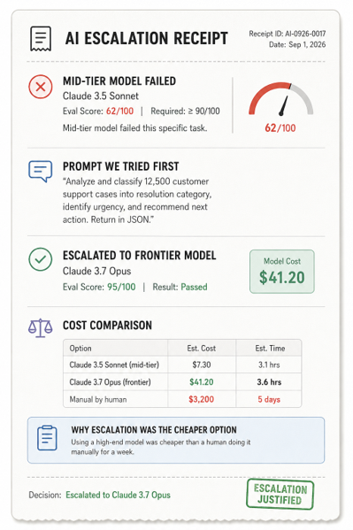

I burned $3000 in API usage over two days last month. It’s not because I ran an agent for a long time, but the problem I handed it was too big, and the agent responded exactly the way a good agent should: it spun up sub-agents, zoomed in, zoomed out, and filled the gaps in my instructions with money.

A CFO who has run cloud compute budgets for a decade has good instincts: meter usage, forecast by volume, negotiate rate cards. Those instincts fail on agentic AI, because your bill tracks context complexity, how much you hand the model before it starts working and which model tier you assigned to handle it, far more closely than it tracks output volume.

In this blog post, we will explore why AI agent cost management enterprise-wide keeps breaking the cost models finance teams already trust.

## **Understanding AI Agent Cost Management**

AI agent cost management enterprise-wide means tracking what a task costs to specify and route, not just what it costs to run.

- Cloud compute bill scales with usage you already control: instances, storage, bandwidth.
- Agentic AI bill scales with ambiguity: how much context a model has to resolve before it can act, and which model tier absorbed that ambiguity.

If you skip this distinction, you may inherit a budgeting process designed for volume while the actual spend is being set by scope and routing decisions.

## **How Models Turns Prompts into Tasks**

Large language models (LLMs) never read your prompt as a language. They convert it into point vectors in n-dimensional space, and what the model "sees" is a density map of how closely related those points are.

- Zoom out far enough and a prompt like "build a website" looks like one clean idea.
- Zoom in and it fractures into a hundred unresolved decisions: React or Angular, Node or Rust, which schema, auth model, or deployment target.

There is a granularity sweet spot between those two extremes, and it is the single highest-leverage cost lever most organizations have never named.

- Too broad a prompt, and the model has to zoom in repeatedly, doing exploratory work at every pass, spinning up sub-agents to cover the ambiguity you left behind.
- Too fragmented, and you have paid the coordination tax of breaking one problem into pieces that never needed separating.

Either mistake shows up on the invoice as tokens. Neither mistake shows up as a line item you can point to before the bill arrives. Here is the diagnostic I use now, and it costs nothing to run. If a task requires more than one phase of changes, or the exploration step needs more than one or two sub-agents, the task was too big before the model ever touched it. A well-scoped task is common and easy to solve. An ambiguous one recruits agents, and agents recruiting agents is where your cost curve stops being linear.

⚠️ **Common mistake:** Teams treat "add more sub-agents" as a scaling strategy instead of a warning sign. If your exploration step needs three sub-agents, the fix is a smaller, better-scoped task next time, instead of better agent coordination.

## **The Twenty-Eight Times Problem**

Identical engineering teams, working the same backlog, produce nearly identical output at a [28 times cost differential](https://arxiv.org/html/2608.01347v2), depending on which models they defaulted to and how well they scoped their tasks.

*The output was 28 times more expensive for no measurable difference in what shipped.*

Part of this is explained by a market dynamic working against you. Anthropic raised prices by [roughly 37%](https://news.ycombinator.com/item?id=47535897) with limited public notice earlier this year.

- Frontier-tier models have seen something close to a two-hundred-times cost increase at the top end over the past three months once you account for reasoning-token overhead in multi-step tasks.
- Bottom tier of models, the ones capable enough for well-scoped implementation work, continue the multi-year trend of costs collapsing.

You are living inside two cost curves moving in opposite directions, and most budgeting processes were only built to track one of them.

**The other part of the 28 times problem is behavioral, and it has a name worth remembering: spend follows shiny. **

When a new frontier model ships, usage spikes toward it immediately, regardless of whether the task in front of anyone actually requires that capability.

On a recent internal benchmark, a frontier-tier model solved a bug fix task in roughly the same wall-clock time as a mid-tier model, at nearly 3 times the cost, for a benchmark improvement of about fourteen percent. Tripling the spend to gain the fourteen percent of effective gain would never survive a real procurement review, if anyone were running one.

You can get an honest review of where your own spend sits before it becomes an audit finding with our [AI strategy and roadmap assessment](https://www.improving.com/thoughts/ai-strategy-and-roadmap-assessment/).

## **Align Models with Project Scope**

Nobody commutes to work in a Bugatti. The Honda Civic is fit for purpose at roughly 40 cents a mile. An F1 car, at somewhere near six figures per mile once you amortize the car and the season, is fit for purpose exactly once: when the job is winning a championship, not getting to the office.

Software teams have never had to make cost-related choices before, because a developer's brain and keyboard were a fixed cost. The wattage, the caffeine, and the laptop budget did not vary by task. Model tier costs vary by two orders of magnitude or more, and most organizations are still using the high-end models for tasks that can be done with low tier models as well.

The corrective discipline for LLM cost optimization is aiming at the minimum model tier capable of doing the work, not the maximum tier available.

## **Identify the Hidden Cost of Agentic AI with Instrumentation**

None of the above is actionable without measurement, and this is where most organizations' AI cost management enterprise programs stop before they start.

A provider-level usage dashboard tells you the total. It tells you nothing about which task types, which agent roles, or which activity categories are driving that total, and without that breakdown, every optimization conversation is a guess dressed up as a strategy. This is the same discipline platform teams are learning to design in from the start rather than bolt on after the bill arrives, which I wrote about in [building cost observability into cloud infrastructure from day one](https://www.improving.com/thoughts/webinars/smarter-ai-spending-controlling-token-costs-without-sacrificing-performance/).

The instrumentation that matters runs on five dimensions:

- **Per-task cost:** Every agent session, tied to a token count and task metadata, so you can eventually ask which task types are expensive and whether they should be.
- **Cost by agent role: **Reveals whether a role is consuming resources proportionate to its function, or whether a documentation agent is quietly burning implementation-agent money because its context window is bloated. This is also where [platform-level governance over AI agent permissions](https://www.improving.com/thoughts/platform-security-governance-ai-agents/) pays off twice, once for security and once for cost, because an over-permissioned agent is usually also an over-context agent.
- **Model-tier optimization:** The floor-versus-ceiling decision described above actually gets made here, empirically, task by task, rather than by habit or by whichever model had the best launch post.
- **Activity category:** The dimension that turns raw spend into a number a CFO can act on: cost per story point implemented, cost per defect remediated, cost per feature shipped, including the recursion and remediation cost when an adversarial review agent catches something and sends it back.
- **Cost per story point:** It specifically includes the fixing, not just the first attempt, and it includes root cause analysis on where the fixing cost originated: a coding agent that produced bad output, or a task breakdown that was too ambiguous for any model to have succeeded against.

Attributing that correctly is the difference between blaming your model and fixing your process, and it is the same math behind why compounding errors in a chained autonomous pipeline are a cost problem as much as a reliability one, an idea closely related to what I explored in [engineering context deliberately instead of relying on vibes](https://www.improving.com/thoughts/vibes-arent-a-strategy-engineering-context-in-the-age-of-ai/).

## **CFO Conversation you are Actually Having**

I use this exact framing when I teach cost observability internally at Improving. Imagine you’re the executive who owns the AI budget, and someone offers you 5x the output for 3x the cost. Would you take the deal?

I have run this scenario live in front of technical teams more than once, and nobody takes the deal once it is stated plainly instead of buried in a model launch announcement.

Most CFOs who have ever managed an IT budget say no to that trade, and they are right to. No company, including the frontier labs themselves, lets its own internal inference spend scale without a ceiling. They meter it against their own budgets for the exact reason you should meter yours. The same logic that governs [cloud cost management](https://www.improving.com/thoughts/managing-cloud-cost/) applies here: nobody gets a blank cheque on compute, and agentic AI spend is compute with an unpredictable ambiguity tax layered on top.

This is where evidence-grounded routing earns its name, and where the discipline starts to resemble an expense report. If a task escalates to a frontier-tier model, you should be able to produce the equivalent of a receipt that includes the evaluation score. The receipt should cover:

- The mid-tier model failed this specific task
- Prompt we tried first
- Using a high-end model was the cheaper option once you priced in the alternative of a human doing it manually for a week.

Keeping that receipt is the exact discipline that lets you defend an escalation to a stakeholder who is, correctly, skeptical of AI spend by default.

The organizations still writing blank cheques for AI tooling are not going to run out of credibility with the people who approve budgets, the same way early cloud migrations burned credibility when lift-and-shift workloads got more expensive in the cloud than they had been on premises, before anyone rebuilt them to be cloud-native.

With AI-native cost management, you get the agentic economics by rebuilding how you specify and route the work, and by being able to prove it, task by task, every time someone asks what the spend bought.

## Closing Remarks

If you want a quick gut check before your next budget review, pull the last five tasks your team escalated to a frontier-tier model. Ask whoever made that call to produce the receipt with the eval score, the lower-tier attempt that failed, and the actual cost delta versus the alternative. If that receipt exists for fewer than three of the five, you already know where the rebuilding has to start

What would your own version of the twenty-eight-times number look like if you pulled the data instead of estimating it?

If you want a second set of eyes on that number, I'm glad to look at it with you. [Reach out and let's talk through what your own version of this audit would find](https://www.improving.com/contact-us/).

## **Frequently Asked Questions**

**Do we need new tooling to start tracking cost of agentic AI, or can we start with what we have? **

You can start tracking the cost of agentic AI with what you have. A spreadsheet that tags every agent session with task type, model tier, and token count gets you most of the way to the four-dimension instrumentation described above. Purpose-built tooling matters once volume makes manual tagging impractical, not before.

**What if our team genuinely can't predict task complexity in advance? **

If your team is not able to predict the task complexity, then you must track it retroactively for a month before trying to route anything. You need the twenty-eight-times gap to be visible in your own data before you can act on it, and most teams are surprised by which task types are driving the gap once they look.

**Is this only relevant to engineering teams running coding agents? **

No. Any workflow where an agent has discretion over how much context to pull in, and how many sub-steps to take, carries this same risk. Document processing and research agents show the same cost curve as coding agents once ambiguity enters the picture.

**How long before this pays for itself? **

Most teams find their single most expensive task category within two weeks of instrumenting, and fixing just that one category typically covers the cost of building the instrumentation. The twenty-eight-times gap tends to concentrate in a small number of task types, not spread evenly.
