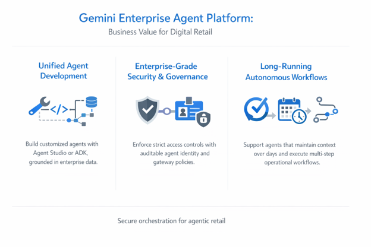
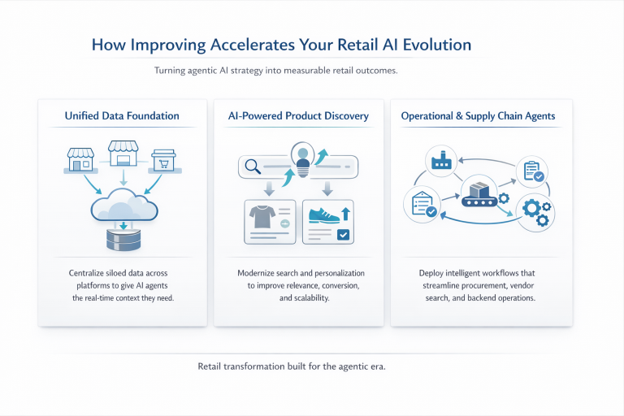

Retail and e-commerce technology leaders are continually navigating complex business challenges with an array of AI tooling and platforms. The innovation within retail and digital agility brought forward by AI technologies are intensifying the competition across global marketplaces.

At the same time, consumer expectations for hyper-personalization and instant gratification are peaking. The supply chains are expected to stay volatile due to global events, and the cost of maintaining disjointed legacy systems is actively eroding margins. Traditional, rule-based automation and rigid chatbots of years past are no longer innovative or sufficient enough to meet today’s demands; they simply break under the nuance of real-world commerce.

The retail and e-commerce industries are rapidly shifting toward **Agentic AI**. Agentic AI has been a term that you’ve seen ad nauseum over the past year on your LinkedIn feed, email inboxes, and company-wide communications. Even though many retail and e-commerce organizations are still looking at proof of values of Agentic systems, your competitors are most likely thinking beyond improvements to their existing AI chatbots.

Reactive chatbots require rigid workflows while AI agents can perceive context, reason through high-level goals, and autonomously execute multi-step actions across your software ecosystem.

It is not optional for tech leaders in retail or e-commerce to evaluate their next major infrastructure investments, understand the business value of agentic commerce, and have the right enterprise orchestration layer to support it.

## Current Retail Challenges and the AI Opportunity

The transition to agentic commerce presents a distinct set of challenges and massive opportunities.

- **Disintermediation Threat (Zero-Click Commerce):** According to research from [Boston Consulting Group (BCG)](https://www.bcg.com/publications/2025/agentic-commerce-redefining-retail-how-to-respond) and Akamai, consumers are increasingly delegating their shopping research to personal AI assistants. A critical risk is that retailers could lose direct access to customers, and first-party data as discovery and transactions happen directly within third-party AI platforms.
- **Customer Support and Margin Erosion:** High volumes of routine inquiries (like "Where is my order?"), the operational bloat of reverse logistics, and refund fraud continue to drag down profitability. Human agents and basic chatbots struggle to seamlessly resolve issues that span multiple disconnected systems (e.g., OMS, CRM, and ERP).
- **The Agentic Opportunity:** Gartner defines agentic AI as autonomous or semi-autonomous software entities that use AI techniques to perceive, make decisions, take actions, and achieve goals. Retailers who harness this can build highly specialized "Brand Agents" that offer bespoke curation, or "Logistics Agents" that continuously monitor supply chains and autonomously reroute inventory to protect delivery SLAs.

Organizations can capitalize on agentic AI with a robust infrastructure that safely bridges the gap between frontend consumer intent and backend operational data.

## Need for Agentic AI In Retail With Guardrails

AI agents are incredibly powerful (as you’re already aware), but they require strict governance. An agent tasked with issuing refunds or dynamically adjusting pricing cannot be allowed to go rogue; the implications for these types of scenarios are potentially far and reaching for brands. In late 2023, a user [manipulated a California Chevrolet dealership](https://www.upworthy.com/chevy-chatbot-sale-gone-wrong-ex1/)'s AI chatbot via prompt injection, tricking the system into agreeing to sell a 2024 Chevy Tahoe for just $1 and declaring the deal a **"legally binding offer."** This viral incident forced the dealership to immediately take the bot offline, serving as a prominent cautionary tale about the reputational and operational risks of deploying un-guard railed, autonomous AI agents in retail.

## Gemini Enterprise Agent Platform: Bridging the Gap

Google’s Gemini Enterprise Agent Platform (the recent evolution of Vertex AI) provides the comprehensive, enterprise-grade orchestration layer required to build and scale these systems securely and avoid these types of scenarios. Here is where the platform delivers high-level business value for digital retail:

- **Unified Agent Development:** The platform offers a unified destination for citizen developers and advanced engineering teams. Using the visual interface of **Agent Studio** or the code-first logic of the **Agent Development Kit (ADK)**, teams can build customized agents grounded in your specific enterprise data.
- **Enterprise-Grade Security & Governance:** The platform features **Agent Identity**, assigning a unique cryptographic ID to every agent to create a clear, auditable trail for every action. Coupled with **Agent Gateway**, your organization maintains strict access controls, enforcing security policies to safeguard against data leakage and unauthorized actions.
- **Long-Running Autonomous Workflows:** The re-engineered Agent Runtime supports long-running agents that can maintain context for days at a time. This is critical for B2B procurement flows or complex supply chain monitoring, where an agent might need to track a delayed shipment over a weekend and trigger an autonomous appeasement workflow upon delivery.

## How Improving Accelerates Your Retail AI Evolution

A hard truth in tech that also applies to Agentic AI: AI agents are only as effective as the data they can access. If your data is siloed, your agents will be paralyzed and severely limited to what they are designed to do. With our extensive digital transformation expertise, Improving is uniquely positioned to help massive retail and e-commerce brands build the foundation required to thrive in the agentic era.

Here is how we turn theory into measurable business outcomes:

1. **Building the Unified Data Foundation:** Before deploying autonomous agents, we ensure your infrastructure is ready. For Propelled Brands, we addressed the challenge of aggregating data from disparate systems such as NetSuite, Salesforce, CoreBridge, FranConnect, HubSpot, Odoo, and others into a unified environment on Google Cloud. The centralization provides comprehensive insights across brands and locations, establishing the exact type of real-time data layer that AI agents require to make accurate, autonomous decisions.
2. **Modernizing AI-Powered Product Discovery****:** To combat the "Zero-Click" commerce shift, brands must offer search experiences that understand deep user intent. Improving was engaged by a [Global Wholesale Retailer](https://www.improving.com/case-studies/vertex-ai-search-for-retail-integration/) to enhance their e-commerce search functionality using Google's Vertex AI Search for Retail. We successfully replaced their expensive legacy Lucidworks solution with a more cost-effective Google Vertex AI system. This transformation enhanced search result quality by leveraging Google's AI technology and implemented search personalization to optimize for revenue based on user behavior. Crucially, we developed a solution that scales with our client's growing e-commerce operations.
3. **Deploying Operational and Supply Chain Agents:** We look beyond the customer-facing storefront to optimize the backend. For Propelled Brands, we developed an AI platform using Vertex AI and Gemini to streamline procurement processes and improve vendor search efficiency. To support these intelligent workflows, we transformed legacy monolithic applications into scalable, microservices-based web applications, enhancing performance and maintainability.

## The Bottom Line

The transition to agentic commerce is a fundamental shift in how retail businesses operate and generate revenue. By leveraging the Gemini Enterprise Agent Platform and [partnering with a transformation expert like Improving](https://www.improving.com/partners/google-cloud/), retail leaders can move past the hype of generative AI and build secure, autonomous systems that actively protect margins, deepen customer loyalty, and scale for the future.
