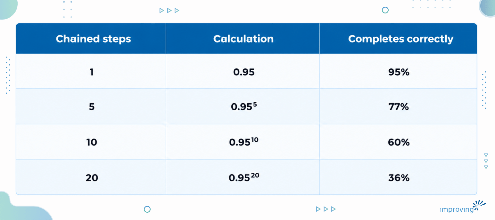
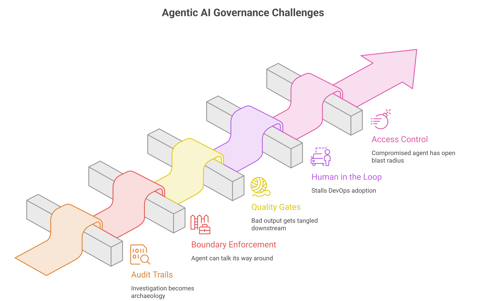

The DevOps tooling problem was solved by 2018. Source control became mainstream, mature CI patterns emerged, and infrastructure as code graduated from experimental to standard practice. Most organizations had adopted little of it.

When I mapped the adoption curve that year, I didn't label the blocker "tooling maturity" or "unclear ROI." I labeled it "Trust in Agile (Technologists)." Leadership didn't trust developers to do what they said they'd do, and the tooling that would have proven them wrong never got deployed cleanly enough to make its case.

I'm watching the same pattern in agentic AI, faster and with worse math. Organizations are treating agentic AI governance as an afterthought, the way they treated [CI/CD](https://www.improving.com/expertise/applications/platform-engineering/) as a nice-to-have in 2015.

## What Is Agentic AI Governance?

[Agentic AI governance](https://www.improving.com/thoughts/ai-governance-agentic-ai-framework/), also called AI [governance systems](https://www.improving.com/thoughts/webinars/governance-that-actually-works/) engineering, is the practice of building the controls that let an organization extend autonomy to AI agents and prove afterward what those agents did. It covers audit trails, boundary enforcement, quality gates, human-in-the-loop approvals, and access control. Each is designed before deployment and enforced by the system, because a policy document cannot stop an agent.

I use this as the diagnostic starting point for most of the [AI governance and agentic engagements](https://www.improving.com/expertise/ai/) I run. The first question I ask is whether anyone would notice in time if the model got it wrong.

## Why DevOps Adoption Stalled in Low-Trust Organizations

The conventional read blamed the tools for being immature, unproven, or still waiting on a killer case study. That read was wrong. In low-trust organizations, the tools that did get deployed were never used as designed.

- CI pipelines went in, and the build stayed marked optional.
- Infrastructure as code got adopted for new environments and abandoned at the production boundary, because production was "too critical to automate."
- Manual checkpoints quietly preserved the old trust boundary underneath the new automation.

A team can deploy the most sophisticated agent architecture available and still get zero value from it, because the organization surrounds it with enough manual review to rebuild the exact bottleneck the agent was meant to remove.

## Why "Just Like DevOps" Undersells the Problem

DevOps trust could have been solved by culture and time alone. A CTO patient enough to let teams build a track record in low-stakes environments, and stubborn enough to hold the line against reflexive manual gates, could have gotten there with mediocre tooling.

Human reliability is legible. You can watch a team, read their incident reports, sit in their retros, and form an accurate opinion about whether they're ready for more autonomy. Agentic systems don't offer that legibility, and the reason is arithmetic.

### How errors compound across agentic workflows

Most people hear "95% accurate per step" and picture a 95% accurate system. That picture is wrong. Step accuracies multiply across a chain, so the chain finishes correctly only when every step does. Here is what that looks like at 95% per step.

At ten steps, four runs in ten contain an error. At twenty steps, roughly two in three do. Reliability engineers have understood this since [Robert Lusser's work in the 1940s](https://en.wikipedia.org/wiki/Lusser%27s_law). A manager building trust the [DevOps way](https://www.improving.com/thoughts/baby-steps-to-devops/), through observation and incident review, is watching a system that fails this often and this fast, and observation cannot keep pace with that failure rate. Trust has to be built into the system with engineering controls.

### Why agent trust is an engineering problem

DevOps trust was mostly a culture and sequencing problem that infrastructure happened to accelerate. Agentic trust is a systems engineering problem, because failure compounds faster than any human review cadence can track. The [governance layer works](https://www.improving.com/thoughts/webinars/governance-that-actually-works/) like a safety interlock on machinery that fails silently and at speed. It catches what a person standing next to the machine would catch too late.

## Why Governance Has to Exist Before Autonomy

We worked with a major airline whose teams were producing AI-assisted changes faster than its testing and regulatory review process could clear them. The instinct was to slow the teams down to the speed of review. What worked instead was moving compliance into the pipeline, where regulatory-review agents checked every change against the airline's own standards before it moved forward. Governance became an active participant in the workflow instead of an audit that happened after the change had already shipped.

Skipping governance costs more than the delay it saves. After an incident, a regulator, an auditor, or a customer wants a record of what happened and why, and no amount of model reliability substitutes for one. The [NIST AI Risk Management Framework](https://www.nist.gov/itl/ai-risk-management-framework) treats this accountability requirement as a core function, and Improving's own [view of platforms as the security enforcement layer for AI agents](https://www.improving.com/thoughts/platform-security-governance-ai-agents/) covers where those controls live.

## Five Agentic AI Governance Controls to Build First

Together these five controls form a working AI agent governance framework, and they are the agentic AI governance best practices I start with.

1. **Audit trails:** Record what input produced what decision, at what confidence. Without it, a failure investigation is archaeology instead of diagnosis.
2. **Boundary enforcement:** Implement boundaries as access policy, not as an instruction in the system prompt asking the agent to be careful. A boundary an agent can talk its way around isn't a boundary. Without enforced limits, one wrong action reaches systems the agent was never meant to touch.
3. [**Quality gates**](https://www.improving.com/thoughts/ai-pipeline-reliability-governance/)**:** Put explicit pass criteria at every handoff between chained steps. Without them, a bad output gets caught three steps downstream, tangled into something else, instead of at the step that produced it.
4. **Human in the loop:** Reserve human approval for decisions that are expensive to reverse, and place it deliberately. Approval gates on every trivial step bring back the manual checkpoints that stalled DevOps adoption.
5. **Access control:** Scope each agent to the minimum its specific job needs. This is the core of agentic AI security, because a compromised or simply wrong agent then has a contained blast radius instead of an open one.

None of this is exotic, and it maps almost directly onto double-entry bookkeeping. That ledger checked itself, which let merchants extend credit across seas they would never cross personally. The control made commerce at a distance possible.

Governance for agents works the same way. It looks like friction until you see that it is what makes autonomy scalable.

## Two Common Objections to Agentic AI Governance

Two objections come up in nearly every conversation about this.

### Objection 1: Will better models make governance unnecessary

The argument is that model error rates keep falling, so a governance layer designed for today's ninety-five percent step accuracy becomes dead weight once models clear ninety-nine. As a claim about capability, I think that's mostly right. It says almost nothing about accountability, and the two get conflated constantly.

Run the same math at 99% per step. Ten steps complete correctly 90% of the time (0.99¹⁰), and twenty steps complete correctly 82% of the time (0.99²⁰). Better models shrink the problem, and a chain that still fails nearly one run in five needs gates.

The accountability point is separate. A model that fails once in a thousand runs still needs an audit trail, because after an incident the question is "show me what happened and why."

Aviation is the clean precedent. Jet engines got dramatically more reliable over fifty years, and airlines kept every checklist, because the checklist makes reliability something a regulator, an insurer, and a passenger can trust instead of something an engineer merely believes. Falling error rates change where you set the thresholds in your quality gates. Thresholds and proof of what the system did remain necessary.

### Objection 2: Will vendors ship AI agent governance as a feature

Some of it will, mainly audit trails and access control, which are closer to commodity infrastructure. The operating model won't ship in a box. The sequencing of which agents get how much autonomy over which decisions, and the boundary design specific to your workflows, belong to the business running them.

The ERP wave taught the same lesson. The software was the cheap part, and the process redesign around it was the real project. A governance platform bought without the organizational design work is a filing cabinet that gets called an audit.

## Why DevOps-Mature Teams Misread Agent Failures

Organizations that did the DevOps work between 2018 and 2022 tend to assume that maturity transfers. It transfers less than they expect. What they built trust in was a system of human actors whose failure modes are slow, visible, and socially mediated.

A developer about to ship something risky usually hesitates, asks a question in Slack, or gets flagged in standup before the mistake ships. That hesitation is free monitoring, and mature DevOps cultures have relied on it for years without naming it as infrastructure.

Agents don't hesitate or get nervous. They don't check with a colleague, and they don't slow down when they're less sure, unless you've built a confidence threshold that makes them. A team with excellent human trust instincts and no instrumentation for a non-hesitating actor will read early agent failures as a trust violation, the same read they'd give a developer who broke a promise.

Nobody built the mechanism that does the hesitating. DevOps-mature organizations are not ahead by default, and they risk mistaking a missing control for a character flaw, because that is the diagnostic reflex their culture trained.

## Start Agentic AI Governance Before Your Pilot Scales

The organizations that get agentic AI right will treat governance as a discipline. They will design it before deployment, instrument it for an actor that never hesitates, and extend autonomy only as far as the instrumentation can already prove. Everyone else will spend 2027 having the conversation we had about DevOps in 2015, with different nouns, and reach the same wrong conclusion about what broke.

If you're running an agentic pilot, pull up its audit trail and try to reconstruct why it made its last three decisions from the record alone. If you can't do that without asking the person who built it, the governance layer isn't finished, however good the model looks in a demo. Better to find that gap on your own schedule than have a regulator, a customer, or an incident find it on theirs.

If you want a second set of eyes on your pilot's audit trail, [let's talk](https://www.improving.com/contact/). I'm happy to walk through it with you.

## FAQ

**What is agentic AI governance?**

Agentic AI governance is the set of engineered controls that lets an organization give AI agents autonomy and prove afterward what they did. It includes audit trails, boundary enforcement, quality gates, human-in-the-loop approvals, and access control, all designed before deployment and enforced by the system.

**What is an AI agent audit trail?**

An AI agent audit trail is a record of what input produced each decision an agent made, and at what confidence. It lets a team reconstruct why an agent acted after an incident, using the record alone.

**What if we can't build all five controls before launch?**

Start with audit trails and access control, since they're the cheapest to retrofit into logging and identity you already run. Keep autonomy narrow until quality gates and human-in-the-loop approvals exist.

**How long does this take?**

It depends on how many chained steps your agents run and how much logging already exists. Build the controls alongside each agent as a launch prerequisite, so they ship together.

**Does this apply to a single-step agent?**

Less so for compounding, since one step has no chain to multiply across. You still need the audit trail, boundaries, and access scoping.

**Should we wait for vendor governance features?**

No. Take the vendor's audit and access features when they arrive, and build the operating model and boundary design yourself, because the vendor can't know your workflows.
