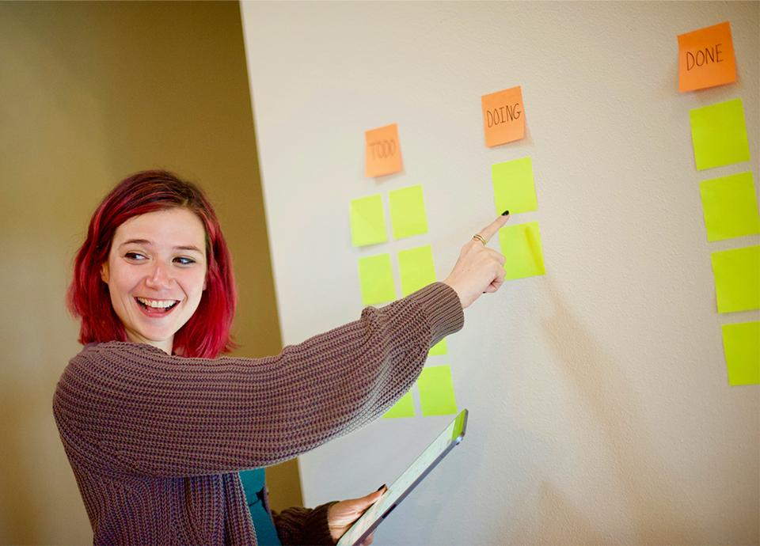
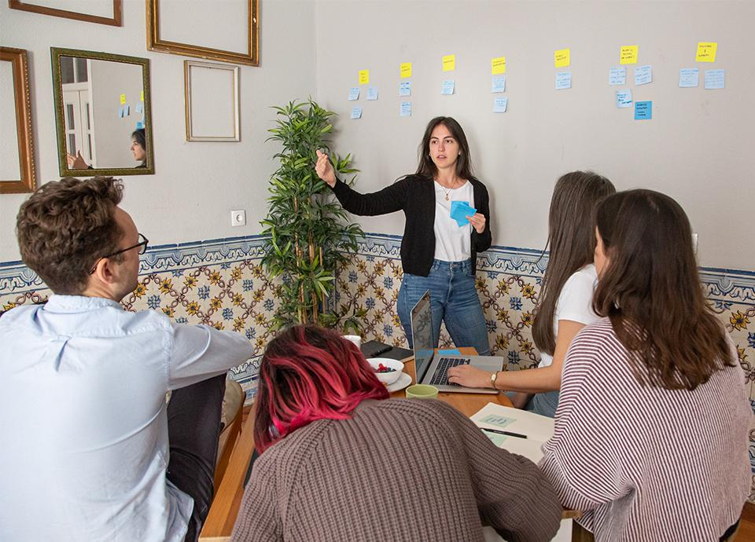

So often Agile coaches are brought in by someone to fix a team or ensure that Agile practices are enforced, but this type of change doesn’t always produce the intended results. Instead, how can we as coaches and practitioners create a culture of Agility? Changing the narrative from how to apply Agile practices to how to instill Agile ideals will help you and your teams successfully start their Agile journey and pave the way to continue growth.

So often, Agile coaches are brought in to fix the way teams work. Agile practices are not being adopted and teams only complete the activities to complete the action, rather than commit to the practice. Even worse, there are teams who consistently underperform in their roles and struggle to adopt the changes needed to grow and achieve their goals. If the intended goal is to fix what is wrong at the team level, we are often missing the important elements of why Agile developed. There is always room to expand on how we practice Agility, but often we are missing the space needed to do so.

Agile leadership needs to start with you. A deep understanding of why we do the work paves the way for how we do the work. So how do we practice being more Agile? First, stop trying to enforce the way the team works.

As a coach, work to apply the continuous improvement approach to how you work with a team. Make small meaningful changes to how work is done by addressing what is missing from the team. Create the space needed for them to be open and transparent with you. Allow yourself the space to experiment with what they need and try new things. This is what we ask of them, a certain vulnerability to try and fail as they progress forward. Make that allowance for yourself. Know the rules so you can break them and explain why we are doing that.

This is hard for some people. We are taught methodologies in a way that applies a rigid framework to a continuous improvement environment. Agile coaches are there to coach, not enforce. Find out how the team works now, and why. This means if Daily Stand Up is long, listen to why. Is the team being heard? Have we made space for them to get the answers they need? Do they have support to share knowledge in their daily job? Are they allowed to explore and try new things?

This is an important first step to the most important aspect of Agile, psychological security. Teams don’t need to be fixed; they cannot just get better at Agile without creating the space for them to be successful. Coaching needs to happen at all levels. Listening to why teams are not successful in their environment is the first step to fixing it. Start asking about the consequences of underperformance, and where those ideas originated. This will lead to an interesting discussion on who needs coaching. An often-overlooked element of team coaching is management.

An Agile shift cannot happen in a vacuum. Go back to the ideals, why do we want teams to work the way they do? Are we creating the space for them to continuously improve, or asking them to behave in a way that contradicts the culture of the organization? When applying Agile practices, we ask that we value people, the way they work, collaboration, and being dynamic. If the organization doesn’t value those things, nothing about the way they work will be successful. Start the conversations with management teams that oversee Agile teams to see what they can do to create that environment.

Start with communication. Communicate with your team and celebrate their successes and the things they learn. Let management know what you are accomplishing, and what you need. Never leave anything unsaid. Lean into what we as Agile practitioners do, and be an advocate for the work. Most importantly, never stop learning. There will always be something you can do better as a coach, and something you can encourage others to work toward as well.
