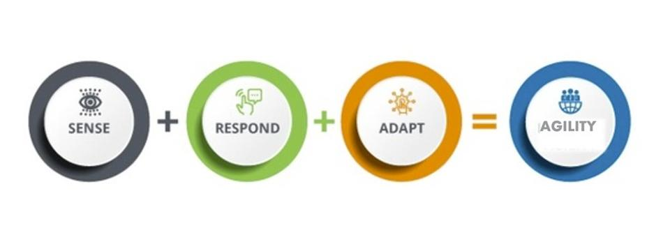
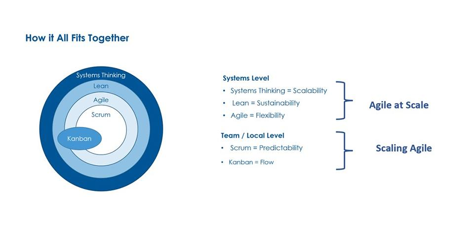
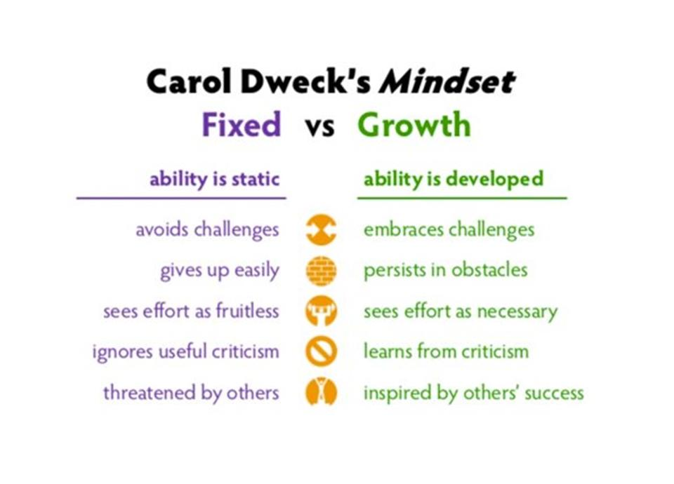

To scale or not to scale... this is a phrase often heard in the Agile world. However, that is not the question we should be asking. For those who do not know, scaling is the ability to grow and include more people, while still being effective and efficient. But, I believe we should think about bringing Agile at scale to every single part of a company instead of individual teams.

## Setting the Foundation

So, if we are not asking ourselves if we should scale, what should we do? What even is the point of any of this? It’s really about demystifying what Agile is, why it is so important for businesses to pay attention to, and enabling the mindset of agility as part of its core values of culture.

One of the jobs that exposed me to agility early in my career was being a food server in a few different restaurants. In that role, I learned a lot of lessons, one of them being how the restaurant world facilitates teamwork and focuses on the customer. When employees are engaged and there is servant leadership, magic happens!

It’s with this foundation I have continued to relate what I do in the corporate world to the experience of how restaurants run their businesses. Agility is all about being able to move quickly and easily, in addition to being able to think and understand quickly. What business would not want to enable this mindset?

Especially in the digital age, how fast things change can make your head spin. How we respond to changes in the marketplace, how we adjust to internal changes, and how employees feel engaged can make businesses stronger or ruin them.

Now let’s define what scaling means and tie some of the concepts together from my last two blogs titled [**Modern Ways of Working: Complacency to Innovation**](https://improving.com/thoughts/modern-ways-of-working) and [**Strategic Brand Management: What’s the Rush? **](https://improving.com/thoughts/strategic-demand-management-whats-the-rush)

## Scaling Agile vs Agile at Scale

Scaling Agile can have many interpretations. In one of its simplest forms, it’s known as the theory behind how Scrum can be spread across an entire organization. While there are many different approaches and opinions for the best way to do this, and I have my own to offer, that’s a discussion for another day.

Ultimately, every organization wants better market share, position, and engaged and passionate employees, right? Well, Agile at scale may be the key to getting there. That’s the difference between Agile at scale and scaling Agile. Though they sound extremely similar, Agile at scale means the organization is Agile. It can develop, deliver and pivot quickly. Systems thinking and lean are used to continuously evaluate and refine our ways of working.

Systems thinking and lean are two concepts at the heart of both of my previous blog posts. Systems thinking is the understanding of all inner workings that make a business get from concept to cash. Lean thinking continuously removes waste from our business (system of systems). It enables us to be nimble and proactively determine how we want to invest our limited resources. (Remember, time and money = employees!)

Going back to restaurants as an example, Agile at scale is what they do every day—continuously sensing, responding, and adapting to their reality while delighting their customers.

For the intent of this blog, we are going to use the definitions above, focusing on Agile at scale. Because at the end of the day, if companies are not able to stay relevant and delight their customers, they risk staying in business. How many teams are using Scrum doesn’t really matter.

## Agile at Scale is All About Mindset

Using our restaurant example again, successful restaurants don’t just happen. They rely on good employees, countless repeat customers, and rave reviews. I have yet to see a restaurant with Scrum teams, but they are Agile at scale at its core.

Because restaurants have a direct line of access to their customers that walk through their doors every day, their leaders can obtain feedback easier than other businesses. Agile at scale may seem easier in this setting, as all employees in the front of the house (FOH) and back of the house (BOH) can inspect and adapt along the way.

If we have built a culture that embraces change and we can learn from our past experiences, we have the potential for making magic happen. When everyone understands the goal is to delight our customers, we create alignment. With alignment comes autonomy, and with autonomy comes the ability to have agility at scale.

For companies who are thriving and not just surviving, mindset is the differentiator. If we look at the characteristics Carol Dweck highlights in her book, Mindset, the difference between a Fixed Mindset and a Growth Mindset can make or break the way companies manage change and create opportunities for innovation and expansion.

A Growth Mindset is critical. It’s how we respond to the challenges and obstacles along the way that drive the success or failure of businesses.

For companies who don’t currently have a way to obtain direct customer feedback, there’s an opportunity for teams to be innovative and figure out how to get the data and enable data-driven decision-making—addressing this is also an opportunity to practice a Growth Mindset. It may not be easy, but easy is not the goal.

## Scaling Agile Uses Frameworks

Many organizations start their Agile journeys by adopting Scrum at the team level. And more often than not, they reach a tipping point where they find it challenging to coordinate efforts between Scrum teams or are struggling to integrate and release high-quality products reliably across teams. When looking to scale Agile with multiple Scrum teams, there are many different frameworks to choose from.

Scaling Agile frameworks provide a set of guidelines, techniques, and processes with roles and artifacts. The four most popular are Nexus, Large Scale Scrum (LeSS), Scaled Agile Framework (SAFe), and Disciplined Agile (DA).

I’ll let you in on a secret: there is not a best framework across the board. The trick is to determine which framework best fits the organization’s needs. This is based on evaluating different factors such as the size of the company, organizational culture, and the maturity of the current Scrum teams.

Understanding how the scaling frameworks differ and which one(s) to try is an important decision. Improving has a lot of experience in this space, so if you are looking for a partner, please reach out to us.

## What’s the Point?

Agile at scale is a journey and making sure everyone is in alignment on behalf of the ‘why’ is really important. The digital world has changed everything and to be truly competitive and stay relevant companies must build for change and resiliency. There is no silver bullet solution for all of the challenges, so embrace the Growth mindset and have fun delighting your customers….otherwise, what’s the point in any of this?

And next time you are at your favorite restaurant, think about why it is, what they do to delight you, and bring that mindset to your company every day! [Reach out to us at Improving](https://improving.com/careers) if you would like to learn more about how you can embrace Agile within your entire organization.
