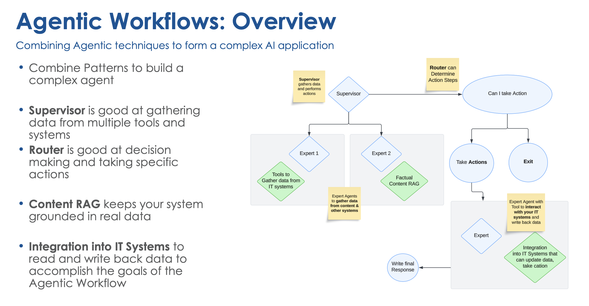

Artificial Intelligence (AI) has become an integral part of modern business operations, transforming how companies manage workflows and interact with data. One of the most significant advancements in this field is the development of AI agentic workflows, which leverage AI to automate and optimize complex business processes. This blog post explores the evolution of AI chatbots and the implementation of agentic workflows in business, highlighting their capabilities, benefits, and the techniques involved in building these systems.

### **Understanding AI and Machine Learning**

AI and machine learning are often used interchangeably, but they represent distinct concepts. AI involves the input of rules and data to generate answers, while machine learning focuses on building models that can learn from data and improve over time. Machine learning is a subset of AI that uses statistical methods and algorithms to create models capable of making predictions or decisions based on data. These models form the foundation of AI systems, enabling them to perform tasks such as text generation, search, and summarization.

### **The Role of Foundational Models**

Foundational models are a crucial component of modern AI systems. These models are trained on vast amounts of data, providing them with a broad understanding of human knowledge. They can be general-purpose, like ChatGPT, or specialized for specific domains, such as medical or industrial applications. Foundational models offer a suite of capabilities, including text generation, chatbots, and search and summarization functions. These capabilities are essential for building AI agents that can perform complex tasks within a business context.

### **Building AI Agentic Workflows**

AI agentic workflows are designed to accomplish specific goals within a business by leveraging the capabilities of AI models. One of the most popular techniques for building these workflows is Retrieval Augmented Generation (RAG). RAG involves using an AI agent to search a specific content warehouse for relevant data and then generating responses based on that data. This approach ensures that the AI agent uses accurate and relevant information, rather than relying solely on its training data.

To build an effective AI agentic workflow, it is essential to define the capabilities of the AI agent, prepare a knowledge base, and integrate the necessary tools. For example, a staff and project planner AI agent might need to search for staff with specific skills, check their availability, and assign them to projects. This requires integrating tools that can access staff information, project details, and other relevant data.

### **Structuring Outputs for AI Agents**

One of the key challenges in building AI agentic workflows is ensuring that the outputs are structured in a way that other systems can understand. Instead of generating human-readable text, AI agents should produce outputs in formats such as JSON or XML. This allows the outputs to be parsed and used by other IT systems, enabling seamless integration and automation of business processes.

### **Designing Complex Agentic Systems**

Designing complex AI agentic systems involves creating multiple tools and integrating them into a cohesive workflow. For instance, a project assignment tool might need to interact with a staff search tool and a project management system to determine the availability of staff and assign them to projects. This requires careful planning and coordination to ensure that the AI agent can perform all necessary tasks efficiently.

### **The Importance of Supervisors and Routers**

In more complex AI agentic systems, supervisors and routers play a crucial role. Supervisors oversee the operation of expert systems, ensuring that they perform their tasks correctly and efficiently. Routers make decisions based on the data and actions of the tools, directing the workflow down the appropriate path. These components are essential for managing the complexity of AI agentic workflows and ensuring that they operate smoothly.

### **Embracing AI as a Wingman**

Despite concerns about AI potentially eliminating jobs, it is important to view AI as a tool that can enhance and optimize personal workflows. By automating routine tasks and providing valuable insights, AI allows professionals to focus on higher-level, more meaningful work. Embracing AI as a wingman can lead to greater productivity and job satisfaction, as it helps workers perform their tasks more efficiently and effectively.

### **Looking Ahead**

AI agentic workflows represent a significant advancement in the field of artificial intelligence, offering businesses the ability to automate and optimize complex processes. By leveraging foundational models, structuring outputs, and integrating tools, companies can build AI agents that perform a wide range of tasks, from staff planning to project management. As AI continues to evolve, it will become an increasingly valuable asset for businesses, helping them achieve greater efficiency and productivity. Embracing AI as a wingman can lead to a brighter future, where technology and human ingenuity work together to drive success.

*If you missed the full presentation, make sure to explore the *[*Tomorrow Technology. Today*](https://www.improving.com/tomorrow-technology-today/webinar-series/)* series for more insights on AI, data ecosystems, and platform engineering.*
