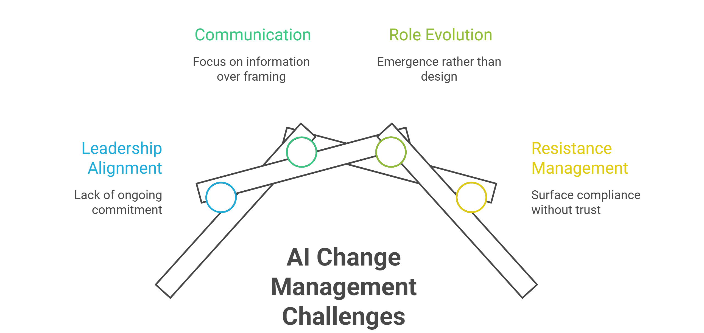

Nearly every AI change management deck includes the same warning: most AI transformations fail, and the reason is usually organizational, not technical.

The problem is that organizations often deploy the tool before they build the trust required to use it. I’ve seen the failure rate cited as seventy percent, sometimes eighty. [Prosci’s 2026 research](https://www.prosci.com/blog/why-ai-transformation-fails), based on more than 1,100 professionals, puts human factors at 56 to 64 percent of AI implementation challenges. User proficiency alone accounts for 38 percent, which matches the pattern behind [why most AI pilots fail to scale](https://www.improving.com/thoughts/why-ai-pilots-fail-to-scale/).

The exact figure moves depending on who's presenting it, but the second half of the claim stays constant across every version of that slide. Technology wasn't the obstacle. People were.

I don't argue with that half but I'm suspicious of how neatly it resolves into a bullet point, because a diagnosis that explains every failure explains none of them in particular. It gives you nothing to do differently on the next attempt, which is the same complaint I'd make about most lists of the [top reasons AI projects fail](https://www.improving.com/thoughts/top-10-reasons-ai-projects-fail/): accurate, exhaustive, and short on sequence.

## **Understanding AI Change Management**

AI change management is the discipline of getting an organization's people ready to adopt AI tools and the new ways of working they require. It covers the same four levers most transformation programs already use:

1. Leadership alignment
2. Communication
3. Role evolution
4. Resistance management

What makes it distinct from generic change management is the pace. AI capability shifts faster than the org chart can be redrawn to match it, which means the sequencing of those four levers matters more here than it did in slower transformations.

In 2018, I mapped DevOps practices against the technology adoption curve and found something that didn't match the story people were telling about slow adoption.

- Source control had been mainstream for a decade.
- CI had mature and well-documented patterns available in every language ecosystem.
- Infrastructure as code (IaC), the newest of the three, had moved well past experimental.

The tooling case was closed, and most organizations still hadn't adopted any of it. The label I put on the actual blocker was "trust in Agile," specifically trust in technologists. Leadership didn't believe developers would do what they said they'd do, and that disbelief wasn't irrational. Plenty of those development teams had earned it through prior incidents.

- Organizations that deployed [CI pipelines](https://www.improving.com/case-studies/enhancing-public-safety-technology-through-strategic-devops/) into a low-trust environment got CI pipelines that were marked optional.
- Organizations that adopted infrastructure as code for new environments left production managed by hand, because production was "too critical to automate."

The automation wasn't rejected outright. It was hemmed in by exactly enough manual process to reproduce the old trust boundary underneath the new tool, which meant the automation never got to prove the case that would have earned more trust.

## **Importance of Getting the Sequence Right**

People tried to deploy the tool first and let it build trust through results. But the sequence that actually worked, on the rare occasions I saw it work, was to establish the conditions for trust, then let the tooling operate inside them.

The cost of getting the sequence backward isn't only a failed pilot, but a repeatable pattern of failed pilots, because each one reinforces the same trust boundary instead of dissolving it.

I think the standard "four levers" of AI change management, *leadership alignment, communication, role evolution, and resistance management, *get taught as four separate workstreams on a project plan when they're really four places where the same sequencing error shows up wearing different clothes. It's also why most of the [AI adoption and transformation](https://www.improving.com/expertise/ai/adoption-transformation/) work I run now starts with a trust audit instead of a training schedule.

## **Where Leadership Alignment Actually Breaks**

The version of leadership alignment I see most often is a single executive briefing near the start of an engagement, followed by a status update near the end. Leadership alignment is treated as an event. So the leadership nods at the plan, and then, after three weeks, quietly reintroduces a manual sign-off step "just for now," because nobody built the leadership team's actual comfort with letting the system run unsupervised.

In more than one AI adoption engagement I've run, the moment a leadership team sees the operating model implication of AI-assisted delivery, smaller cross-functional teams doing what larger teams did before, someone asks directly whether this means canceling QA, or eliminating the business analyst role, or a headcount reduction disguised as a pilot.

These questions are the leadership-level version of the ops team asking whether the deployment pipeline is going to bypass their review, and they deserves a direct, specific answer about what changes, and on what timeline.

If you skip that conversation, then the alignment you think you have is only postponed. It resurfaces at the worst point in the rollout, usually right after the first visible productivity gain, when the implications stop being hypothetical. Getting that first conversation right before a change program ever starts is its own discipline.

## **Real Communication Problem is Framing**

Most communication plans I review are distribution plans. There is an all-hands announcement, a FAQ document, and a channel for questions. Distribution assumes the problem is information scarcity. The actual problem, almost every time, is framing scarcity. People have the facts. They don't have a frame that lets those facts mean something other than "my role is next."

In my experience, what works best is co-pilot, not autopilot, stated specifically and often enough that it stops sounding like a slogan and starts functioning as a stated constraint. It works because it's falsifiable. If the tool starts operating without a person in the loop on a decision that used to require one, the framing has been violated and someone can say so concretely.

A vague reassurance like "AI will help, not replace" isn't falsifiable in the same way, so it doesn't build trust. It just delays the moment someone tests it against reality.

Communication that reduces anxiety has to give people a specific claim they can check. A boundary an autonomous system can't talk its way around is worth more than an instruction telling it to be careful.

💡 **Counterintuitively:** Co-pilot, not autopilot, only works if you're willing to say, out loud, which decisions still require a human sign-off, and then hold that line even when the AI performs well enough that the line feels unnecessary. The moment leadership quietly drops the constraint because the tool "earned it," the framing stops being falsifiable, and the trust it built starts to reverse.

## **Role Evolution Follows the Shape of the Work**

I’ve seen the same pattern repeat often enough to trust it: AI changes roles in two main ways.

- **When demand is capped:** AI reduces the time needed for the same work. The team may not be redesigned formally, but people create space for new work. A twelve-person team might split into a smaller group that keeps the product running and another group that takes on something new.
- **When demand is not capped:** Faster delivery creates more work upstream. Product owners and business analysts absorb nearby tasks instead of waiting for handoffs, and role boundaries start to blur.

In both cases, the people who use the new tools well often become informal coaches. They are usually mid-level practitioners: experienced enough to help others, but still flexible enough to change how they work.

A good AI change management plan should watch where the work is changing and support the new patterns that emerge. It should not assume leadership can design every role change in advance.

## **Resistance is Rational Until Proven Otherwise**

The instinct in most AI change management programs is to treat resistance as a morale problem to be managed with more enthusiasm.

Some fraction of any organization will go through the training, do the minimum required to be seen participating, and quietly revert to the old way of working the moment attention moves elsewhere. It's a rational response from someone who hasn't yet seen evidence that the new way is safe for them specifically, and no amount of enthusiasm from a program office substitutes for that evidence.

### **Adoption collapse was Measurable**

I've watched this pattern play out at scale, and it's a close cousin of the training-failure pattern I've written about separately in [why most AI training fails](https://www.improving.com/thoughts/why-most-ai-training-fails/).

A top-ten global technology company had put roughly eighty engineering teams through structured training on AI-assisted development tools. Usage fell back to under five percent within weeks of the training ending, meaning fewer than five of every hundred trained engineers were still using the tools a month later. This was a company that sells software for a living, not one behind on modernization, and the tools still read as a displacement risk to the engineers using them rather than as leverage.

⚠️ **Common mistake:** Treating that five-percent number as a training-quality problem and responding with better training is a wrong diagnosis. The right learning is that the engineers do not believe using the AI tool is safe. No amount of re-training fixes a trust deficit, which is why the fix here was organizational change management, working the concern team by team.

The thing that actually shifts this group is visible, specific proof that the earliest adopters weren't harmed by adopting early. The company has to show that the pilot team's roles evolved instead of disappearing, the productivity gain converted into more interesting work rather than layoffs, and the leadership team held to the framing it stated at the start.

## **Sequence is the Whole Argument**

Leadership alignment, communication, role evolution planning, and resistance management aren't sequential steps you run through once and then move past into deployment.

They're the same trust-building work I watched fail and succeed in DevOps adoption a decade ago, applied to a domain where the stakes of getting the sequence backward compound faster, because the technology itself is compounding faster.

The organizations that get this right are the ones that noticed the slide was describing a sequencing error and built the trust conditions before they needed them. The next question is who owns keeping it in place day to day, which is the problem an AI center of excellence is supposed to solve.

If you want a gut check on where your own organization actually stands, pull up the last AI rollout you ran and ask which came first: the tool going live, or someone stating plainly what would and wouldn't change for the people using it. Ask your change lead whether they can point to a specific promise leadership made at the start of that rollout, and whether it's been kept in a way employees would actually recognize.

Most of the [AI adoption work I run](https://www.improving.com/expertise/ai/) now starts with exactly that audit. If the answer to the promise question makes you wince, that's the actual starting point, not the pilot you were about to launch.

What's the one unkept promise from your last rollout that people are still quietly measuring you against?

## **FAQ**

**Is AI change management just a rebrand of regular change management?**

No, but it rhymes with it. The four levers, leadership alignment, communication, role evolution, and resistance management, are the same ones any transformation uses. What's different is the clock speed: AI capability shifts faster than most organizations can redesign roles around it, so sequencing errors compound faster too.

**What if leadership won't commit to a specific answer about role changes?**

Then don't run the pilot yet. An ambiguous answer to "does this eliminate my role" reads to employees as a confirmed yes on a delay, and it will resurface at the worst possible moment, usually right after the first visible productivity win.

**How long does it take to rebuild trust once a rollout has already gone badly?**

Longer than the original rollout took. The eighty-team example here took roughly a year of team-by-team work to recover adoption that a few weeks of bad experience had killed. Trust rebuilds on the same terms it builds the first time: visible, kept promises, not better messaging.

**Can a small pilot substitute for a trust audit?**

No. A pilot that succeeds inside a high-trust team doesn't tell you anything about how a low-trust team will respond to the same tool, because the objection was never about the tool.
