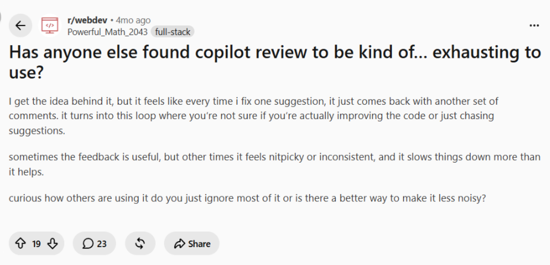

Modern AI code review tools have become remarkably good at automating parts of code review. They catch common mistakes, enforce standards, and reduce reviewer workload. But code review automation isn't the same as understanding the code. The critical issues slip through the gap between detection and comprehension.

In this article, we'll explore where AI code review delivers real value, where its blind spots begin, why context remains the missing piece, and how engineering teams can build review workflows that combine AI-driven automation with human judgment.

## What AI Code Review Does Well

AI-powered code review has genuine strengths, and here are several in detail:

### 1. Pattern Recognition at Scale

Most modern AI reviewers are highly effective at identifying coding mistakes that follow predictable patterns and language-specific anti-patterns. Unused variables, unreachable code, and potential null reference issues are all caught consistently.

A code review tool can scan thousands of lines and recognize when similar code patterns appear multiple times, flagging refactoring opportunities that humans might miss simply due to scale. Inefficient implementations that have well-known alternatives are recognized instantly. This is particularly valuable in large teams where consistent implementation patterns matter.

### 2. Security and Compliance Validation

AI detects hardcoded secrets, credentials, and tokens reliably. Common vulnerabilities such as [SQL injection, XSS](https://www.improving.com/thoughts/security-the-thing-that-everyone-loves-to-hate/), and insecure API usage are flagged automatically. AI tools verify adherence to organizational coding and security policies and act as an additional security checkpoint before code reaches production. In companies managing complex compliance requirements, AI compliant verification becomes a meaningful security layer.

### 3. Consistency and Code Quality Enforcement

Enforcing style guides and coding conventions across rapidly growing engineering teams is tedious for humans but trivial for machines. AI reviewers standardize pull request feedback regardless of reviewer availability. They help [maintain consistency across rapidly growing codebases](https://www.improving.com/thoughts/how-generative-ai-is-revolutionizing-application-security/) and reduce time spent on low-value review comments.

AI reviewers don't get tired or irritated when checking the hundredth indentation error of the day. This consistency reduces review bottlenecks, helps developers receive faster feedback, and makes it easier for new engineers to follow established coding standards. For organizations onboarding new developers, AI reviewers provide clear, repeatable guidance that accelerates learning and improves overall code quality.

### 4. Faster Developer Feedback Loops

AI reviews code immediately after a pull request is opened, surfacing issues before human reviewers even look at it. It means developers get faster feedback loops; human reviewers handle already-filtered requests, and teams can scale up their review processes without hiring proportionally more engineers. Reduced review cycle times and reviewer workload enable teams to move faster without proportional growth in engineering headcounts.

But here's where the story becomes complicated. These genuine strengths are all fundamentally about pattern matching and automation. They're solving a real problem, but it's not the entire problem of code review.

## Context Gap: What AI Code Reviewers Cannot Review

Most probably, the last significant bug you found in production wasn't caught by static analysis or pattern matching. Identifying that bug might have involved understanding why a decision was made, how multiple systems interact under specific conditions, or what assumptions were baked into the architecture years ago.

This is what AI fundamentally cannot see:** context. **Here are few things where AI code reviews are not good enough yet:

### 1. Limited Understanding of Architectural Intent

The architectural intent behind a change is nearly invisible to AI tools. While AI can analyze implementation details, identify coding patterns, and verify syntactic correctness, it has little awareness of the architectural objectives guiding the system. It cannot reliably determine whether a change aligns with long-term design principles or understand the tradeoffs that shaped previous decisions.

Architecture is built on compromises. Teams constantly balance scalability, maintainability, reliability, cost, and delivery speed. Without that context, AI may recommend technically correct changes that conflict with the architectural direction the team intentionally chose.

### 2. Missing Historical Context

Design decisions in mature systems are often shaped by previous incidents, outages, and expensive lessons learned. AI rarely understands why specific workarounds or constraints exist because that reasoning is seldom documented alongside the code.

Legacy code may appear unnecessary when viewed in isolation while actually protecting against known production failures. A seemingly awkward implementation could prevent cascading failures discovered years earlier. Much of this historical knowledge lives within engineering teams through experience and institutional memory rather than repositories that AI can access.

### 3. Incomplete Repository and Dependency Awareness

Most AI code review tools operate within the boundaries of a pull request diff. As a result, hidden dependencies between services, shared libraries, internal platforms, and data pipelines are easily overlooked. A change that appears isolated can trigger downstream effects across multiple systems that are never referenced directly in the modified code.

Cross-repository relationships remain particularly difficult to evaluate. Modifying an internal library can affect dozens of consuming services, while changes to shared APIs or [data pipelines](https://www.improving.com/expertise/data/integration-engineering/) can ripple throughout an entire platform. Without visibility into these relationships, AI reviews remain inherently incomplete.

### 4. Lack of Runtime Understanding

Static analysis also provides little insight into how software behaves after deployment.

AI has limited visibility into production traffic patterns, [system behavior under load](https://www.improving.com/case-studies/dispatch-load-testing/), and the operational characteristics that determine reliability. Without runtime context, it cannot accurately assess whether a change introduces operational risk.

Observability requirements, rollback complexity, and known failure modes frequently exist outside the scope of code review. Performance implications often depend on real workloads, infrastructure conditions, and production traffic patterns rather than source code alone.

### 5. Weak Business Context Awareness

Finally, technical correctness does not guarantee business correctness. A change may look perfectly valid from a software engineering perspective while violating domain rules, breaking compliance requirements, or conflicting with customer expectations. Business logic errors often appear indistinguishable from correct implementations when viewed purely through code.

Human reviewers frequently identify these issues because they understand what the product is supposed to do, not because they detect syntax or implementation of mistakes. That understanding of intent, customer needs, and business outcomes remains one of the biggest advantages human reviewers bring to the review process.

## Mistaking Detection for Understanding

As AI code review becomes more common, teams increasingly treat detection as understanding. The misunderstanding leads to following dangerous situations:

### 1. False Confidence in Automated Approval

The most immediate risk is false confidence. When a pull request receives few or no automated comments, teams begin perceiving it as low risk. Engineers may approve changes simply because the AI did not flag anything.

The mental shortcut is understandable but dangerous. An AI not finding issues does not mean issues do not exist. The actual issue may involve a different pattern, context, or failure mode that the AI has not encountered or learned to identify, causing it to be missed. As teams begin treating AI feedback as a substitute for engineering judgment, automated approval signals can gradually weaken critical review practices. Over time, review quality declines as engineers become increasingly reliant on automated assessments.

### 2. High Signal, Low Context

AI excels at identifying patterns but not necessarily their significance. A detected issue may be technically valid while being operationally irrelevant in your specific environment. Conversely, review comments often lack awareness of broader architectural constraints, business priorities, or operational tradeoffs that influenced the implementation.

Developers must still determine whether a recommendation should actually be applied rather than assuming every suggestion adds value.

### 3. Critical Issues Stay Invisible

Some of the most important engineering risks simply cannot be inferred from static code analysis. Some failures only emerge during runtime when multiple parts of a system interact. Distributed systems failures frequently involve multiple services and infrastructure components that are invisible within a pull request. Data consistency issues, retry storms, and cascading failures similarly arise from interactions across systems instead of individual implementations.

Architectural regressions can also pass review because each code change appears reasonable in isolation, even though the combined effect introduces long-term technical risk.

### 4. Noise and Reviewer Fatigue

Excessive low-priority comments from AI tools can actually decrease review quality. When developers encounter dozens of style suggestions mixed with a handful of meaningful findings, important signals become diluted. Engineers spend valuable time addressing formatting or stylistic recommendations instead of evaluating critical risks. False positives increase review overhead rather than reducing it.

As comment quality becomes inconsistent, trust in automated review systems gradually declines, turning AI from a helpful assistant into another source of engineering friction.

## How to Build Better AI Reviewers

We need to fundamentally rethink how AI is integrated into the engineering workflow. Here are several ways to optimize AI code reviewers for better outcomes:

### 1. Expand Context Beyond Code

To produce more meaningful reviews, AI should have access to architecture diagrams, Architecture Decision Records (ADRs), technical documentation, incident reports, service ownership information, and dependency maps. Infrastructure artifacts such as [Kubernetes](https://www.improving.com/case-studies/kubernetes/) manifests, [CI/CD pipeline](https://www.improving.com/expertise/applications/platform-engineering/) definitions, API contracts, and configuration changes should be analyzed alongside application code rather than separately.

Techniques such as [Retrieval-Augmented Generation](https://www.improving.com/expertise/ai/genai-nlp/) (RAG) and knowledge graphs can further enrich reviews by connecting AI to system-wide context and historical engineering knowledge. The [more context available](https://www.improving.com/thoughts/building-agent-memory-systems/), the fewer blind spots the reviewer develops.

### 2. Connect AI to the Engineering Ecosystem

Context should come directly from the systems where engineering work happens. AI should integrate with source repositories, issue trackers, observability platforms, deployment systems, and internal documentation. Protocols such as the [Model Context Protocol](https://www.improving.com/thoughts/when-mcp-is-not-the-right-choice/) (MCP) enable real-time access to engineering tools and operational data, allowing reviews to be informed by live system state rather than static assumptions.

Instead of guessing which components are affected, AI can identify impacted services, understand deployment history, and incorporate operational information from the [software delivery lifecycle](https://www.improving.com/thoughts/maximizing-developer-productivity-security-and-operational-efficiency/). However, access should be deliberately scoped. AI should generally have read-only visibility into the broader engineering ecosystem, with write or modification permissions granted only where they are explicitly required and controlled. Without these boundaries, an agent acting on contextual information from one system could inadvertently make changes in another system where it should have no authority.

### 3. Impact- and Risk-aware

With richer context available, reviews should evolve from file-level analysis to change-impact analysis. Rather than cataloging issues within the modified files, AI should identify affected services, APIs, databases, and downstream dependencies. Production telemetry, deployment history, logs, metrics, and previous incidents provide valuable signals for assessing operational risk that static analysis alone cannot capture.

Feedback should be prioritized based on reliability, security, performance, and architectural impact instead of maximizing the number of review comments. The objective is to surface the changes that matter most, not every possible improvement.

### 4. Combine Review with Intelligent Validation

Review should become the starting point for automated validation rather than the final step. AI findings can automatically trigger targeted tests, security scans, policy checks, and environment validation based on the risk introduced by a change. Instead of merely identifying potential issues, the review process should answer practical engineering questions:

- What systems are affected?
- What could fail?
- What needs to be validated before deployment?

In this model, AI becomes an engineering copilot that provides context-rich risk analysis and guides validation, while human reviewers remain responsible for architectural judgment, business correctness, and final decision-making.

## What Developers are Actually Saying About AI Code Reviews

> *"Silence is better than noise. In 71% of the reviews, Copilot code review surfaces actionable feedback. In the remaining 29%, the agent says nothing at all." (*[*Source*](https://github.blog/ai-and-ml/github-copilot/60-million-copilot-code-reviews-and-counting/)*) *

Developers frequently report that AI flags code that was written intentionally. Performance optimizations, defensive programming patterns, compatibility workarounds, and domain-specific logic are often identified as unnecessary complexity because the AI lacks the historical or architectural context behind those decisions. [A recent large-scale empirical study](https://arxiv.org/abs/2607.21997) of 54,791 AI-generated code review comments found that the two most common reasons developers ignored AI feedback were incorrect suggestions and intentional design decisions, reinforcing that technically plausible recommendations often fail when architectural intent is missing., reinforcing that technically plausible recommendations often fail when architectural intent is missing.

Another recurring theme is context blindness. Engineers we talked to describe AI making suggestions that ignore architectural boundaries, cross-service dependencies, previous production incidents, or business requirements that are never visible within a pull request. In a GitHub Community discussion on improving Copilot code review, developers describe [Copilot as a "review assistant" rather than an enforcing reviewer,](https://github.com/orgs/community/discussions/184163) noting that AI can explain potential issues but still depends on human judgment and complementary validation tools.

Many teams also mention review fatigue. Reddit discussions around GitHub Copilot Reviews describe [developers spending more time filtering repetitive or low-value suggestions than evaluating meaningful engineering risks](https://www.reddit.com/r/webdev/comments/1skfg0k/has_anyone_else_found_copilot_review_to_be_kind).

Common complaints include AI generating technically correct but contextually irrelevant comments, missing the broader application flow, and creating a loop of increasingly minor recommendations that slows reviews instead of accelerating them.

Interestingly, GitHub itself acknowledges this challenge. In its engineering blog, the Copilot team explains that "[Silence is better than noise" and describes ongoing work to reduce low-value comments while improving signal quality](https://github.blog/ai-and-ml/github-copilot/60-million-copilot-code-reviews-and-counting). Their recent updates focus on retrieving more repository context, reasoning across pull requests, and prioritizing actionable findings instead of maximizing comment volume.

## Where Do We Stand on AI Code Reviews?

AI code review is not mature enough to replace human code review, and pretending otherwise creates risk. These tools still lack architectural judgment, historical memory, runtime awareness, and business context. But that does not mean teams should abandon them. Used wisely, AI code review can still be a powerful accelerator: it can catch repetitive issues early, enforce standards consistently, surface security concerns faster, and free engineers to focus on the decisions that require deeper judgment.

Clear review guidelines, defined approval boundaries, contextual documentation, risk-based validation, and human accountability are what turn AI code reviews from a noisy automation layer into a useful engineering assistant. That is the approach we take at Improving, [helping organizations adopt AI](https://www.improving.com/expertise/ai/) in practical, responsible ways that improve engineering outcomes without weakening the judgment, trust, and governance that strong software teams depend on.

I’d love to hear your thoughts on this article. You can share your perspective, feedback, or experiences with AI code review with me on [LinkedIn](https://www.linkedin.com/in/ysspriya/).
