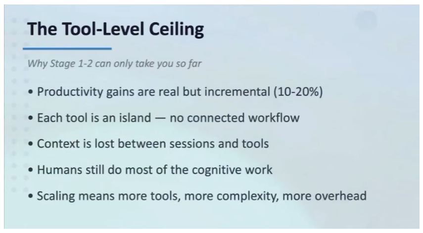
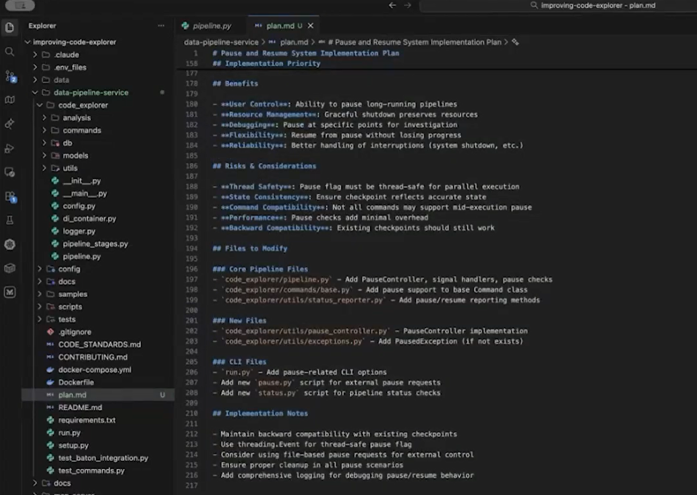
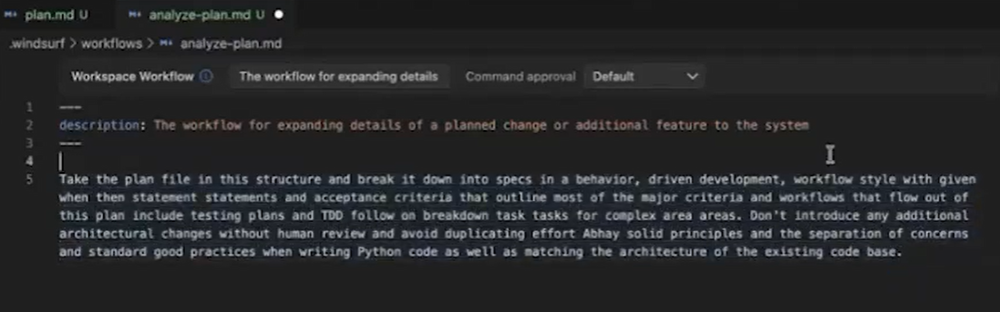
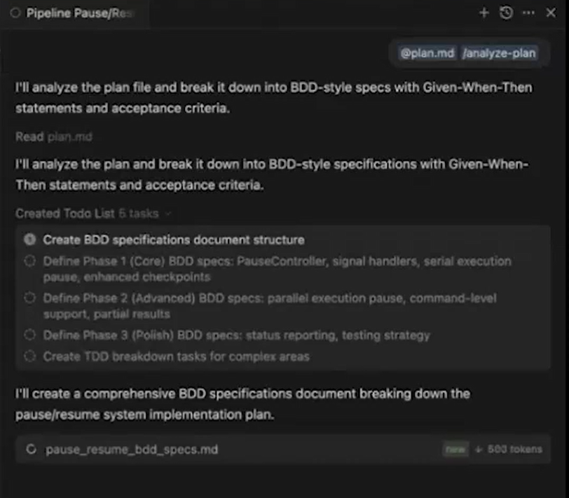
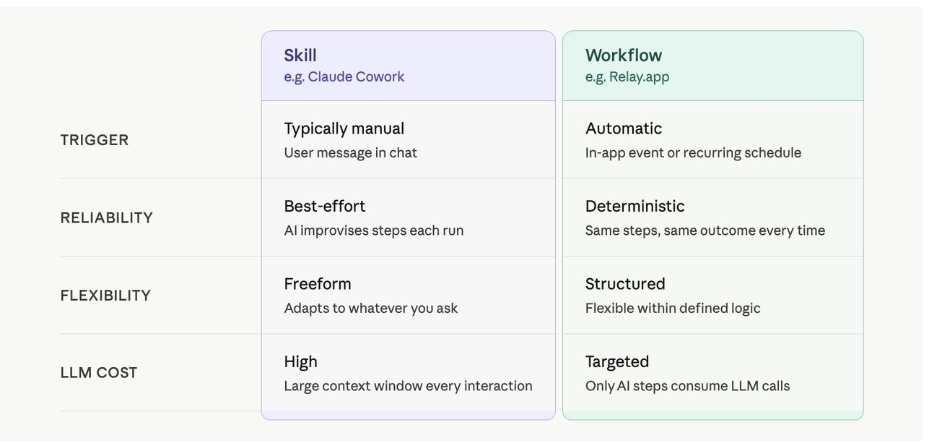
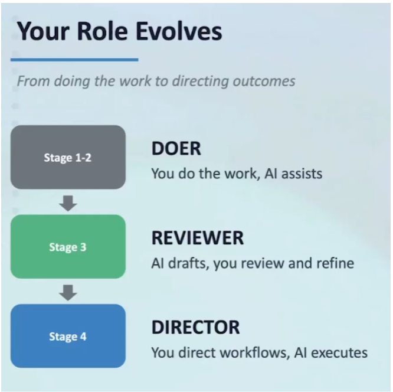
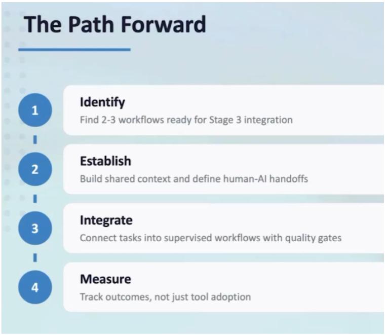

Junior developers using AI coding assistants see roughly a 30 percent productivity gain, based on the best research available right now. Senior developers see something closer to 3 to 5 percent. That gap has nothing to do with the model. It comes down to how the tool gets used, and most developers using AI coding assistants today are stuck at exactly that ceiling.

I think about this the way I think about a woodshop versus a furniture factory. A skilled craftsperson in a woodshop builds one good piece at a time, and the quality depends entirely on the hands doing the work that day. A factory is a different kind of achievement: someone designed the jigs, the sequencing, the quality checks, so the output holds steady at volume. Most developers today are running a very good woodshop.

In our Improving Tech Talk on [moving beyond AI tooling](https://www.youtube.com/watch?v=VFb8-54Rkzw), we walked through what it actually takes to start building the factory, live, inside an IDE.

## Stage Two, by Default

We used Windsurf and [Code Explorer](https://www.improving.com/expertise/ai/code-explorer/), an Improving tool for analyzing legacy codebases, and set every configuration option to its default. There are n[o MCPs,](https://www.improving.com/thoughts/when-mcp-is-not-the-right-choice) rules, workflows, or skills. Turbo mode and auto-continue are turned off. This is Stage 2 on [Improving's AI maturity curve](https://www.improving.com/expertise/ai/), where the developer is with an assistant, reaching for the tool as it ships in the box.

The task was to add a pause and resume system to an existing Python data pipeline, the kind with enrichers, migrators, and pipeline stages that any developer would recognize. The prompt was plain: *create a plan for a potential update*.

The AI pulled context from the open files and produced a plan. It worked but it was rudimentary because nothing had told it about our architecture, our testing standards, or the decisions that shaped this codebase. The absence of guidance was limiting the tools' capabilities.

At this level, the work is call and response. You send the prompt, receive the output, then you either approve or redirect and keep repeating. Each exchange is self-contained, which is fine as a starting point and slows down fast once you need to repeat something, hand work to a teammate, or pick a thread back up the next morning. Every chat was isolated as context doesn't travel between sessions.

*(The tool-level ceiling: incremental gains, no connected workflow, context lost between sessions.)*

## Persisting the Plan

The first move past Stage 2 is small on purpose: *write the plan down*. Instead of leaving it in a chat window that disappears the moment the session clears, we saved it to a plan.md file in the project. That file becomes the working artifact for everything that follows, the thing a developer, a teammate, or the AI itself can return to without reconstructing the conversation from memory.

*(The saved plan.md file: pause/resume implementation plan, benefits, risks, and files to modify, persisted outside the chat.)*

## Writing the Workflow Down

The second move is to capture how the work actually gets done. Windsurf's workflow configuration lets you describe your process in plain English, the same way you'd explain it to a new hire. I did exactly that, describing my own development process out loud: take the plan file, break it into BDD-style specs with given, when, then statements and acceptance criteria, include testing plans and TDD follow-on, break complex areas into tasks, avoid architectural changes without human review, follow SOLID principles, match the existing codebase's architecture.

*(The analyze-plan workflow definition, written in plain English and saved as a reusable file.) *

Once that workflow was saved, I ran it against the plan file. The AI followed the sequence, produced BDD specs, broke everything into a to-do list, and worked through it step by step. I could still watch and interact, but the AI was executing a defined process instead of freestyling a response to a fresh prompt. This is Stage 3 on the maturity curve: the developer as director and reviewer, evaluating output rather than typing it by hand.

Improving's own instrumentation puts a healthy Stage 3 acceptance rate at 92 to 94 percent. Below that band, trust or the definitions themselves are weak. Above it, the team is over-trusting the agent and quietly banking downstream problems.

*(The workflow running: BDD-style specifications generated from the plan file, broken into a phased to-do list.) *

We went further and built a more detailed BDD workflow that calls secondary workflows for implementation and testing in sequence. The instructions that would otherwise show up in every prompt, “I use BDD,” “follow the existing architecture,” get captured once and applied automatically every time the workflow runs.

## From Workflow to Skill

A workflow is something a developer triggers on purpose. A skill is something the AI triggers on its own, when it recognizes a match between the task in front of it and the skill's description.

*(Skill versus workflow, compared on trigger, reliability, flexibility, and cost. (Source: Jacob Bank, LinkedIn) )*

We moved our “analyze user story” workflow into a skill with this trigger description: *use when stories are vague or lack detailed acceptance criteria*. The AI matches semantically against that description, and when a story fits, it calls the skill without being told. A developer still reviews what comes back, but the AI is now choosing when to apply the process, which is the edge of Stage 4: the developer as system designer and governor.

Running the full chain against the pause and resume plan produced eleven features and sixty-one detailed tasks, along with docs and spec files. That is a lot of context, and all of it is information a human developer would normally just carry in their head. AI does not carry anything unless it is written down. That is why docs folders and design-output folders are starting to show up in repositories: they hold the accumulated context that lets the [AI operate](https://www.improving.com/thoughts/key-fundamentals-of-ai-development/) at something closer to the level of a senior developer on the team.

## Three Things that Make it Hold

Persistent planning artifacts are the foundation. Plans, status files, and architecture docs checked into the repo travel between sessions and between people. Without them, the AI produces worse output because it lost the information it needed to make a good decision.

Living documentation changes the tradeoff the Agile Manifesto was built around. The manifesto valued customer collaboration over comprehensive documentation because labor was expensive and teams had to choose one or the other. When AI handles documentation as part of the workflow itself, that choice gets cheaper. Teams can carry comprehensive documentation and detailed planning while staying just as responsive to change, because producing both no longer costs what it used to.

Quality gates set the boundary. Moving faster only works with a clear answer to where the AI stops, where tests run, and where a human reviews. That answer lives in the [SDLC](https://www.improving.com/services/development/) the workflow operates inside, not in the prompt. Teams that get this right start seeing their four-week and three-week sprints compress toward one-week cycles, or Kanban, or single-piece flow, because the cycle time that used to be set by manual review is no longer the constraint.

The Developer's Role, Restated

*(The developer's role evolves: doer at Stage 1-2, reviewer at Stage 3, director at Stage 4.)*

The developer's role evolves in stages:

- At Stage 2, the developer is the doer. The AI assists, and the developer's identity is still tied to the work they personally produce.
- At Stage 3, the developer becomes the director and reviewer: they document their process, capture it into workflows, and spend their time evaluating output instead of typing it.
- At Stage 4, the developer becomes the system designer and governor, chaining workflows into skills and stepping in for the exceptions and the edge cases rather than every line.

The parallel-work moment in the demo (in the video) is the clearest evidence of that shift. While the chained workflow ran the pause and resume implementation in the backend, I started a separate front-end theming change at the same time, on a different part of the system. Neither stream interfered with the other. That is only possible once enough of the process has been captured that a developer can trust the workflow to hold its own line while attention goes somewhere else.

## Where this Starts

*(The path forward: identify workflows ready for Stage 3, establish shared context, integrate with quality gates, measure outcomes.)*

The developers who get furthest with this start small: two or three workflows already run against every user story, written down once and saved as workflow files rather than re-typed into every prompt. The natural next step is a matching test workflow alongside the implementation workflow, so design, implementation, and testing all run through defined process rather than ad hoc instruction.

From there, the workflows start dropping their planning artifacts and shared context into a common folder checked into the repository. The storage cost is a little extra text but the return is dramatically better output and a handoff between sessions, and between people, that does not require reconstructing context from scratch. These tools carry real licensing cost across an organization, so the teams that make the strongest case at budget time are the ones measuring the outcome, whether that is a stopwatch, features shipped, or something else specific to their work.

Everything through Stage 4 is something a single developer can build, refine, and run without waiting on the rest of the team. What sits beyond it, coordinated agents working in parallel across branches, shared context moving between people instead of just between sessions, governance built into the workflow instead of bolted onto the outcome, is a different kind of problem. However, the problem is organizational work, and as a developer, you can begin can start building today.

Eric Zebanite picks this up next, on moving from personal workflows into shared knowledge systems. Michael Slater follows with agentic, team-level coordination. I'll close the series by looking at governance, audit, and compliance built into the workflow itself, rather than layered on after the fact.

AI tools can speed up individual tasks, but real value comes from how they're integrated into your engineering workflow. Our [AI Readiness Assessment](https://www.improving.com/resources/ai-readiness-assessment/) helps teams understand their current AI maturity and identify practical next steps for greater impact.
