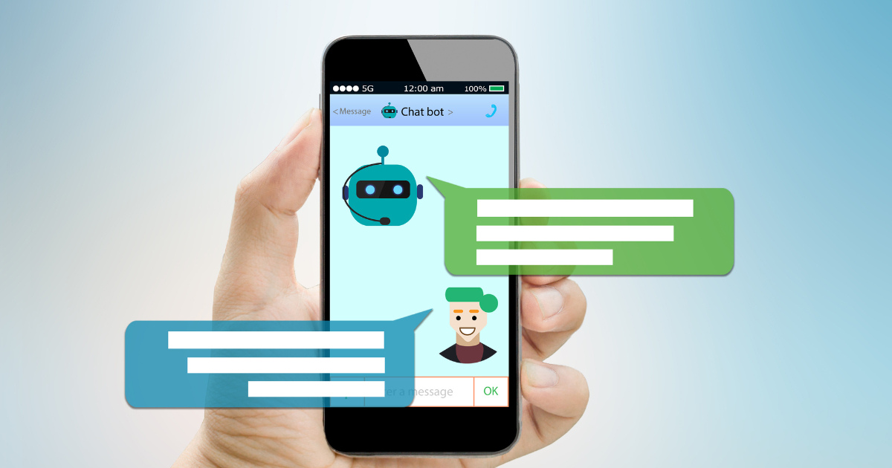

[Artificial intelligence (AI)](https://www.improving.com/expertise/ai/) has recently become a buzzword, with its capabilities and potential being continuously explored and talked about. The advent of cloud computing, coupled with AI, has unveiled limitless opportunities for businesses to enhance their operations and processes.

Let’s delve into the benefits, challenges, and best practices of utilizing AI in the cloud, and how it is transforming the landscape of technology and revolutionizing the way we work.

## How Artificial Intelligence and Cloud Computing Converge

The convergence of AI and cloud computing has revolutionized the way businesses operate and interact with their customers. By leveraging the power of cloud infrastructure, AI algorithms can analyze vast amounts of data in real-time, enabling you to make data-driven decisions that were previously impossible or took significantly longer.

With cloud computing providing on-demand access to powerful computational resources, AI systems can quickly process complex tasks such as natural language processing, image recognition, and predictive analytics. This synergy between AI and cloud computing has opened up opportunities for you to improve efficiency, innovate products and services, and enhance customer experiences.

As we continue to see advancements in both fields, it is clear that their convergence will play a significant role in shaping the future of technology.

## 5 Applications of AI in the Cloud

Using public cloud services, developers have the option to create and maintain a distinct infrastructure for AI platforms. Instead, they can leverage pre-configured settings and models for testing and deploying AI applications.

Additionally, AI-driven services that do not necessarily require a machine learning model, such as speech-to-text, analytics, and visualization, can see enhancements by being hosted on the cloud with the organization's own first-party data.

Common AI applications in the cloud encompass:

- **IoT: **Cloud architectures and services, which are the backbone of the Internet of Things, have the capability to store and analyze data produced by AI platforms operating on IoT devices.
- **Cognitive cloud computing: **Cognitive computing harnesses AI models to mimic and simulate human thought processes in intricate scenarios. Leading innovators like IBM and Google have developed cognitive cloud platforms, offering enterprises cognitive insights-as-a-service. This technology is revolutionizing sectors such as finance, retail, healthcare, and more by facilitating its application.
- **Business Intelligence: **BI represents a prominent application of AI cloud computing, enabling the collection of data on market trends, target demographics, and competitor insights for clients. The cloud serves as a robust platform for data storage and transfer, while AI leverages predictive analytics models to process this information.
- **AI as a Service (AIaaS): **Public cloud providers are now offering AI outsourcing solutions, enabling businesses to experiment with software and machine learning algorithms without jeopardizing their core infrastructure. Companies can implement ready-made AI applications for a fraction of the cost compared to developing AI in-house, resulting in substantial capital expenditure savings.
- **Chatbots: **Chatbots, powered by artificial intelligence, leverage natural language processing to engage users in conversation, proving to be a significant asset for customer service in today's era of instant gratification. These AI-driven assistants are supported by cloud platforms, which not only store but also process the data they collect. Additionally, cloud services facilitate their connection to relevant applications for further analysis. Moreover, customer data is continually fed back into the chatbot applications housed in the cloud, enhancing their efficiency and responsiveness.

## Pros and Cons of Deploying AI in Cloud Environments

As with most emerging technologies, implementing AI in cloud environments comes with both advantages and disadvantages.

### Benefits of AI in Cloud Environments

The benefits of deploying AI in cloud environments include:

- **Cost savings: **By utilizing the pay-per-use model of cloud computing, you can save money by only paying for the resources they use for their AI applications.
- **Scalability: **Cloud environments offer the ability to easily scale up or down resources as needed for AI workloads, allowing you to quickly respond to changing demands.
- **Flexibility: **With cloud deployment, AI applications can be accessed from anywhere with an internet connection, providing flexibility and remote access for users.
- **Improved performance: **Cloud providers often have access to advanced hardware and infrastructure, which can significantly improve the performance of AI algorithms and reduce training time.
- **Data availability: **Cloud environments offer large amounts of storage and data processing capabilities, making it easier to store and analyze large datasets that are necessary for training complex AI models.
- **Collaboration: **The cloud makes it easier for teams to collaborate on AI projects by providing a shared platform where data and code can be accessed and modified by multiple team members in real-time.
- **Automation: **The automation capabilities of cloud platforms can help streamline the deployment and management of AI applications, reducing manual tasks and increasing efficiency.
- **Integration with other technologies: **The cloud allows for seamless integration with other technologies such as IoT devices, big data analytics tools, and machine learning frameworks, enabling organizations to build more advanced AI solutions.

### Challenges of AI in Cloud Environments

Some potential challenges of deploying AI in cloud environments include:

- **Data privacy and security concerns: **With the sensitive nature of data used in AI, there is a risk of data breaches and unauthorized access when deploying AI in a cloud environment.
- **Vendor lock-in: **It can be challenging to switch from one cloud provider to another once an organization has invested time and resources into deploying AI in one specific cloud environment.
- **Lack of control over infrastructure: **When using a third-party cloud service, organizations have limited control over the infrastructure on which their AI is deployed. This could lead to potential downtime or other issues that are out of their control.
- **Data transfer and latency: **The speed at which data is transferred between your network and the cloud environment can impact the performance of AI applications. Latency issues may arise if the distance between the network and the cloud servers is significant.

## AI Best Practices to Keep in Mind

When considering AI in the cloud, here are some best practices to keep in mind moving forward:

1. **Understand the limitations of AI:**
   While AI can provide many benefits, it is important to understand its limitations. AI models are only as good as the data they are trained on, and biased or incomplete data can lead to inaccurate or harmful results. You should carefully consider the potential risks and biases in their AI systems and continuously monitor and improve them.
2. **Ensure data privacy and security:**
   With sensitive data being stored and processed in the cloud, companies must prioritize data privacy and security when implementing AI solutions. This includes using encryption, access controls, and regularly reviewing security protocols to prevent unauthorized access or breaches.
3. **Choose a reliable cloud provider:**
   When selecting a cloud provider for AI services, carefully evaluate the provider's reputation, reliability, and scalability. It is also important to consider whether the provider has experience with handling sensitive data and adheres to industry best practices for data protection.
4. **Train employees on AI ethics:**
   As AI becomes more prevalent in business operations, it is essential for employees at all levels to be educated on ethical considerations related to using AI. This includes understanding bias in algorithms, transparency in decision-making processes, and accountability for actions taken by AI systems.
5. **Continuously monitor performance:**
   Regularly monitor your AI systems to ensure they are performing as expected and not introducing any unintended consequences or biases. Regular audits can help identify any issues early on and allow for adjustments to be made before they escalate.
6. **Have a plan for integration:**
   Integrating AI into existing business processes can be complex, so you should have a well-defined plan in place before implementation. This includes identifying use cases where AI can add value, determining how it will integrate with existing systems, and ensuring proper training for employees who will be working with the technology.
7. **Consider explainability:**
   As consumers become more aware of how their personal data is being used by companies, there is a growing demand for transparency and explainability in AI systems. Strive to make your AI processes and decisions understandable to both internal stakeholders and external customers.
8. **Continuously evaluate ROI:**
   While implementing AI in the cloud can offer many benefits, it is important for you to continuously evaluate its return on investment (ROI). This includes tracking the cost of maintaining and improving AI systems, as well as measuring the impact on business outcomes such as efficiency, accuracy, and customer satisfaction.
9. **Stay updated on regulations:**
   As AI technology continues to evolve, so do regulations surrounding its use. Be sure to stay informed about any regulatory changes related to AI in the cloud and ensure they are compliant with data privacy laws and ethical guidelines.
10. **Plan for future advancements:**
    The field of AI is constantly evolving, with new technologies and capabilities emerging all the time. Try to have a long-term strategy in place for staying up-to-date with advancements in AI and how they can be integrated into your business operations.

## What’s in Store for AI in the Cloud?

As we venture further into the future, the integration of AI and cloud computing promises to redefine the technological landscape, fueling unprecedented levels of innovation and efficiency. By harnessing this synergy, you not only maximize your operations but also gain a competitive edge in delivering cutting-edge solutions and services.

Curious about how AI can streamline your operations? [Contact Improving today to get started on developing your AI Roadmap. ](https://improving.com/contact)
