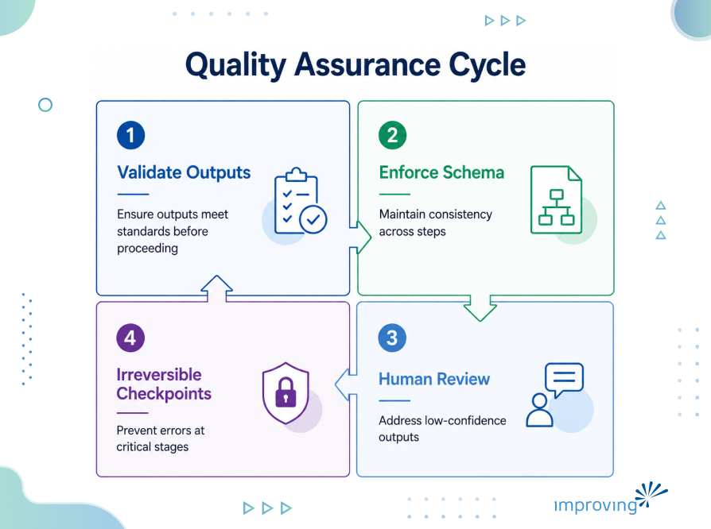

If every step in your pipeline hits 95% accuracy, what does the whole pipeline hit? Many engineers might answer, "about 95%." That answer is wrong, and it's wrong in a way that costs real money once the pipeline is in production.

First of all, it depends on the number of steps in the pipeline. Here's what actually happens across a ten-step pipeline, each step at 95%:

*Step 1: 0.95 *

*Step 2: 0.95 × 0.95 = 0.9025 *

*Step 3: 0.9025 × 0.95 = 0.857 *

*Step 5: ... = 0.774 *

*Step 8: ... = 0.663 *

*Step 10: 0.95^10 = 0.599 *

By step 10, the pipeline is right about 60% of the time end to end. Four runs out of ten produce a wrong answer somewhere along the chain, even though every individual step is hitting the number an engineering team would happily put on a dashboard. Accuracy doesn't average across a chain. It multiplies. And numbers just under 1, multiplied enough times, fall well below 1 regardless of how good any single one looked alone.

In the 1940s, Robert Lusser diagnosed why German rocket programs kept losing rockets built from thousands of individually reliable parts: a chain's reliability is the product of its links' reliabilities, not their average. That's become the [Lusser's law](https://en.wikipedia.org/wiki/Lusser%27s_law), and it's the same math running through every multi-step AI pipeline today.

Push the same pipeline to twenty steps at 95% per step and the effect compounds again, 0.95^20 is approximately 0.36. Roughly one run in three completes correctly.

## **Understanding AI Pipeline Reliability Governance**

AI pipeline reliability governance is the set of checks, gates, and ownership structures that sit between the steps of a multi-agent workflow. It is the machinery, automated or human, that catches an error at step four before it reaches step ten. Without it, per-step accuracy and end-to-end reliability are two different numbers, and only one of them is the number that ships.

## **Postmortem Gets the Diagnosis and Fix Wrong**

We worked with a general counsel's office covering an entire company's legal work with one person on staff. We built an extraction pipeline that reads contracts and legal materials, pulls out clauses and risk flags, and populates a knowledge graph she can query instead of rereading source documents by hand every time a question comes up.

Every stage of that pipeline writes its output to both the production database and a parallel test database, and a rating system compares the two on a rolling basis.

A few weeks after a routine model upgrade, that comparison caught something a person skimming outputs one at a time would have missed entirely. The pipeline had started failing four of eighteen defined risk constraints on incoming contracts. Every individual clause of extraction still looked plausible in isolation. The regression only showed up in aggregate. It was a case of a successful diagnosis, and it gets generalized.

The usual failure looks different. A team ships an autonomous pipeline that works in the pilot and gets deployed against real volume. Then it hits an edge case nobody modeled for and produces a wrong result that is expensive to trace and worse to explain upward without parallel structure in place to catch the regression. The conclusion in the room is almost always some version of "autonomous AI isn't ready yet."

### Teams fix the model instead of the chain

That conclusion is wrong, in a specific and fixable way because the agents were operating at their specified accuracy the entire time. The problem was the pipeline architecture that assumed 95% per step meant 95% end-to-end, a category error, not a capability gap.

⚠️ **Common mistake:** The postmortem on the legal pipeline traced the four-of-eighteen regression to a model upgrade that had quietly shifted diagnostic sensitivity in one narrow risk category, not to the model getting generally worse at legal work.

Teams almost always chase the wrong fix here: they swap in a better model, tune the prompt, add a few examples, and improve the per-step number modestly while leaving the compounding structure completely untouched. Going from 95% to 97% per step looks like a small win. Run it through the same multiplication (0.97^10) and end-to-end reliability moves from 60% to about 74%. Better, but still a coin flip's worth of risk sitting inside a quarter of every run, because a 2-point improvement per step can't undo what ten multiplications did to the first number.

Improving's [AI strategy and roadmap assessment work](https://www.improving.com/thoughts/ai-strategy-and-roadmap-assessment/) is built to close this exact gap before a pipeline reaches production volume, not after.

## **Why the Curve Gets Worse as Organizations Mature**

Organizations do not stay at ten-step pipelines. As agentic AI programs mature, past task agents into workflow agents and eventually into coordinated agent teams, the natural instinct is to chain more steps together, because chaining is exactly what autonomy is supposed to buy.

A team that succeeds with a ten-step pipeline at 60% reliability and responds by adding ten more steps to capture more of the workflow does not get a marginally worse number. It gets 0.95 to the twentieth, which is 0.36, less than half the reliability of the pipeline it started with.

**Autonomy Paradox:** The pipelines that look the most autonomous on an architecture diagram, the longest, with the fewest human checkpoints, are frequently the least trustworthy in production.

### When nobody owns the whole chain

Once an organization has several agent-driven workflows running, outputs from one team's pipeline start feeding into another team's pipeline as input, often across a department boundary, sometimes across a vendor boundary. Nobody owns the full chain anymore.

Our consultants see this pattern constantly during assessment work. One group's reconciliation or extraction agent hands its output downstream to another team's summarization or reporting agent, which in turn feeds a third system maintained by a different group entirely. Each team can honestly report that their own segment runs at 95% or better. Nobody has computed, or can compute, the reliability of the composed chain, because no single person or system has visibility into the whole thing.

Stacking errors stop being a pipeline design problem and become an organizational visibility problem, which is worse, because the math still applies whether or not anyone is tracking it.

### Importance of closing the reliability gap

The gap between per-step accuracy and end-to-end reliability determines whether an autonomous deployment is a capability or a liability. Skip the gate and the failure shows up downstream, at the point where it is most expensive to trace: a wrong risk flag on a contract, a bad lead assigned to a sales rep, a transaction sent on faulty data. Close the gap with a real quality gate at each transition, and the same pipeline architecture holds up as volume, step count, and the number of teams touching the chain all grow at once.

## **What Governance Buys Back**

The instinctive framing for governance is risk management, by adding oversight because AI can go wrong. However, it treats governance as friction paid against a risk that might never materialize. The stacking errors math says something stronger.

- Without a quality gate between steps, a ten-step pipeline at 95% per-step accuracy is a 60% end-to-end system.
- With a quality gate that catches and corrects errors at each transition, the effective step accuracy approaches the reliability of the gate itself, and the pipeline's end-to-end number improves.

I go deeper on what these gates need to look like at the organizational level in a companion piece on building governance in from day one, and on the mechanical pattern that keeps a gate from sliding backward once it exists in the ratchet pattern piece.

We worked with [Lakeshore Learning on a pipeline](https://www.improving.com/case-studies/lakeshore-learning/) that crawls the web for funding opportunities, scrapes the relevant pages, and maps the results into Lakeshore's application system. Three AI steps chained together formed exactly the kind of chain the compounding math warns about.

## **Design Principle the Math Implies**

The stacking errors curve suggests preferring shorter, well-bounded chains with a real gate at every transition over long chains that minimize human touchpoints for their own sake.

- Twenty-step pipeline that runs end to end with no checks looks the most impressive on a slide and delivers 36% reliability.
- Five-step pipeline with a quality gate at each handoff, run four times in sequence to cover the same twenty steps of total work, delivers the same output with a fraction of the failure rate.

Two objections come up whenever I walk a technical audience through this math, and both deserve a direct answer.

### Objection 1: Steps don't actually fail independently

A bad input tends to fail at several steps at once, and a well-built downstream step can sometimes absorb an upstream mistake.

Independence is a simplifying assumption, and what survives the simplification is the shape of the curve. Reliability decays as chains lengthen whether the exponent is exactly 0.95 or something else entirely. Nobody who has operated a long pipeline in production argues with the direction of the decay, only its slope.

### Objection 2: Self-correction replaces the need for governance

You can enable the agent to check its own work, or have a second model to verify the first, and the quality gate becomes unnecessary.

💡 **Counterintuitively:** I don't disagree with this one. A verifier model is a quality gate, and a self-consistency check is a confidence threshold. The case was never for committees, and sign-off meetings layered onto an agent's pipeline. It is for checking machinery sitting between every transition, whether that machinery is a rule, a second model, or a person, as long as something with different failure modes than the step it checks is actually there.

## Wrap Up

If you have an autonomous pipeline running today, or one on the roadmap, the exercise worth doing this week is simple: count the steps, multiply their reported accuracy rates together, and see what number actually comes out the other end. Then check whether a real quality gate sits at each handoff, or whether the pipeline is running on the assumption that per-step accuracy is the same thing as end-to-end reliability.

What does your own pipeline's real number look like once you do the multiplication? If you want a second set of eyes on that math, [reach out and let's talk](https://www.improving.com/contact-us/).

## **FAQ**

**Does every step in a pipeline need its own quality gate?**

Every step in the pipeline does not need its own quality gate. Gates belong at the transitions where an error is expensive to catch late or hard to reverse, not evenly spaced across every step.

**What if we don't have the resources to build parallel test infrastructure like the legal pipeline example?**

In case of lack of resources, a lighter version will work. Even a periodic manual sample comparison against expected output catches regressions, a per-step accuracy number will never show you.

**How do we estimate our own pipeline's real end-to-end reliability?**

To calculate the pipeline's real end-to-end reliability, multiply the reported accuracy of each step together. It's a rough estimate since steps aren't fully independent, but the direction of the number is the point, not the fourth decimal place.

**Does adding a quality gate slow the pipeline down?**

Quality gates add latency at the step, so it slows the pipeline a little bit, but it's a fraction of what a downstream failure costs to trace and fix after the fact.
