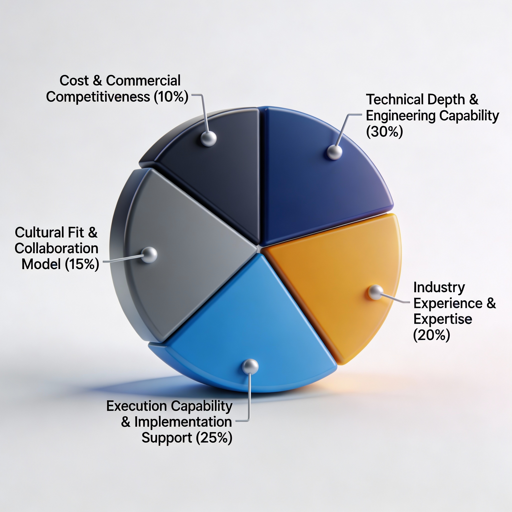

Enterprises across industries are investing heavily in AI to improve decision-making, automate complex workflows, and unlock new sources of value. Most organizations today have little difficulty identifying AI use cases or launching initial pilots. The real challenge emerges later, when those experiments need to integrate into core systems, operate under real-world constraints, and deliver measurable business outcomes at scale.

This challenge plays out consistently across sectors. In healthcare, AI diagnostic tools struggle when privacy, compliance, and audit requirements are not built in from day one. In financial services, fraud detection and risk models stall when regulators require transparency and explainability that were never planned for. In manufacturing, predictive maintenance pilots often succeed in controlled environments, only to fail when connected to legacy systems and operational realities.

The scale of this problem is reflected clearly in the data:

- [42% of enterprise-scale companies already have AI in production](https://newsroom.ibm.com/2024-01-10-Data-Suggests-Growth-in-Enterprise-Adoption-of-AI-is-Due-to-Widespread-Deployment-by-Early-Adopters), according to IBM, and another 40% are actively piloting initiatives.
- Despite this activity, [88% of AI proof-of-concepts never reach production,](https://www.cio.com/article/3850763/88-of-ai-pilots-fail-to-reach-production-but-thats-not-all-on-it.html) and [95% of enterprise AI solutions fail due to data issues](https://kesq.com/stacker-money/2025/12/16/why-95-of-enterprise-ai-projects-fail-to-deliver-roi-a-data-analysis/), as documented by MIT and IDC research.
- McKinsey research shows that [77% of companies are exploring AI, but only 20% achieve significant ROI.](https://www.mckinsey.com/capabilities/quantumblack/our-insights/the-state-of-ai)

These outcomes are not driven by random factors. They stem from repeatable mistakes such as starting with technology instead of business problems, underestimating data quality and governance requirements, treating AI as an isolated IT initiative, deferring MLOps and production planning, or relying on strategy that lacks execution depth. The difference between the organizations that succeed and those that stall is not ambition or budget, but how AI strategy is approached from the beginning.

A major challenge CXOs face today is how to avoid becoming another cautionary statistic. Organizations need more than enthusiasm and budget. They need structured AI strategy and roadmap assessments that honestly evaluate data readiness, align technical capabilities with business priorities, plan for production deployment from the onset, and build the organizational foundations required for sustainable AI maturity. In this comprehensive guide, we'll explain:

- what effective AI strategy and roadmap assessments actually involve
- why most AI initiatives fail and how to avoid those pitfalls
- how to measure AI success with specific KPIs
- what questions to ask potential consulting partners
- which firms combine strategic vision with engineering execution to help organizations move from pilot purgatory to production impact.

Whether you're launching your first AI initiative or trying to scale existing pilots across your enterprise, this guide provides the frameworks, criteria, and vendor insights you need to make informed decisions that lead to measurable business outcomes.

## **What is an AI Strategy & Roadmap Assessment**

An AI Strategy & Roadmap Assessment is a structured engagement that helps organizations & enterprises understand where AI can deliver real business value and how to implement AI strategy responsibly at scale. Rather than jumping straight into tools or models, AI assessment evaluates business goals, data readiness, technology foundations, governance requirements, and organizational maturity. The outcome is a clear AI strategy aligned to business priorities, paired with a phased roadmap that outlines what to build, when to build it, and what capabilities are required at each stage. The AI framework ensures AI initiatives are intentional, measurable, and executable rather than fragmented experiments.

## **AI Strategy Assessment Engagement Models**

Organizations have different needs depending on their AI maturity. Here are two structured engagement approaches:

### **AI/ML Discovery Engagement (2-4 Weeks)**

**Best for:** Organizations exploring AI potential or validating initial use cases

**Investment:** $25,000+

**What's Included:**

- Structured workshops to identify high-ROI AI opportunities
- Assessment of data quality, technology readiness, and organizational capabilities
- Feasibility analysis for priority use cases with ROI estimates
- Phased implementation roadmap with timelines and resource requirements
- Skills gap analysis and training recommendations

**Deliverables:** Prioritized AI use case portfolio, technology readiness scorecard, strategic roadmap with success metrics

### **AI-Driven Organizational Role Assessment (4 Weeks per Department)**

**Best for:** Organizations preparing for AI-driven workforce transformation

AI excels at "collapsible tasks"—work completed in a fraction of the usual time. When tasks taking 8 hours can be done in 2 hours with AI (75% reduction), organizations must plan for capacity reallocation and role evolution.

**Dual-Coach Approach:**

- **Process Coach:** Evaluates workflows and identifies optimization opportunities
- **Technology Coach:** Assesses AI/automation potential and technical feasibility

**Assessment Focus:**

- Identify tasks where AI achieves ≥75% time savings
- Determine if faster completion creates more work or simply requires fewer resources
- Design role evolution paths with upskilling requirements
- Plan workforce capacity reallocation

**Roles Most Impacted:** Payroll processing, quality assurance, administrative coordination, sales operations, software development—areas with repetitive, time-intensive tasks and limited demand expansion.

**Deliverables:** Role-by-role AI impact analysis with quantified efficiency gains, workforce reallocation recommendations, upskilling roadmap, change management plan

## **Why Most AI Strategies Fail**

Understanding [failure patterns](https://www.improving.com/thoughts/top-10-reasons-ai-projects-fail/) is essential before investing in AI strategy consulting. The statistics are sobering: [88% of AI proof-of-concepts never reach production](https://www.cio.com/article/3850763/88-of-ai-pilots-fail-to-reach-production-but-thats-not-all-on-it.html) according to IDC research, and [56% of organizations remain stuck in "pilot purgatory"](https://www.softwareseni.com/why-80-percent-of-artificial-intelligence-projects-fail-while-successful-implementations-achieve-383-percent-return-on-investment/)—indefinitely cycling through pilots without achieving enterprise-wide deployment.

### **The Hard Numbers Behind AI Failure**

According to MIT research, [95% of enterprise AI solutions fail due to data issues.](https://kesq.com/stacker-money/2025/12/16/why-95-of-enterprise-ai-projects-fail-to-deliver-roi-a-data-analysis/) Organizations underestimate the complexity of data quality, governance, and integration required for AI systems to function reliably. Beyond data challenges, Agile tribe reports that the average enterprise wastes [18-24 months on failed AI pilots](https://www.agiletribe.consulting/hidden-cost-of-failed-ai-pilots/), with costs ranging from $500,000 to over $3 million per failed initiative when accounting for technology investments, consulting fees, and opportunity costs. Common causes are consistent:

- Solving for technology [instead of a business problem ](https://www.improving.com/thoughts/top-10-reasons-ai-projects-fail/starting-without-a-problem/)
- Spending 60–80% of time on data prep while budgeting only 20–30%
- Treating [AI as an IT initiative](https://www.improving.com/thoughts/top-10-reasons-ai-projects-fail/overambitious-scope/)
- [Skipping MLOps until models break](https://www.improving.com/thoughts/top-10-reasons-ai-projects-fail/no-ownership-or-maintenance/)
- [Hiring strategy firms that cannot build or deploy](https://www.improving.com/thoughts/top-10-reasons-ai-projects-fail/lack-of-talent-and-team-alignment/)

### **What Separates Success from Failure**

Organizations that scale AI successfully share three traits:

1. **Engineering-backed strategy: ** Their roadmaps come from teams who understand cloud architecture, MLOps, data engineering, and production deployment—not just frameworks.
2. **Data-first approach: ** They fix data quality, governance, and infrastructure before building models. This avoids the 95% failure rate tied to bad data.
3. **Production mindset from day one: ** They plan for scalability, monitoring, and operations during strategy development, not after pilots succeed.

## **How a Successful AI Strategy & Roadmap Assessment Works**

Successful AI initiatives follow this structured sequence that aligns business goals, data readiness, technology foundations, and execution planning from the outset.

1. **Business & use-case discovery: **Identify priority business problems where AI creates a measurable impact.
2. **AI & data readiness assessment: **Evaluate data quality, availability, security, existing platforms, cloud maturity, and integration gaps.
3. **Technology & architecture evaluation: **Review current infrastructure to determine readiness for scalable AI, MLOps, and production workloads.
4. **Governance & risk analysis: **Define guardrails for responsible AI: compliance, ethics, security, model lifecycle management.
5. **Roadmap & execution planning: **Deliver a phased roadmap with short, mid, and long-term initiatives, dependencies, effort estimates, and success metrics.

## **Data Readiness: The Foundation AI Strategies Are Built On**

**As quoted earlier, 95% of enterprise AI solutions fail due to data issues **(according to MIT and IDC research). Before any AI strategy can succeed, organizations must confront this fundamental truth.

### **5 Data Readiness Questions to Ask Before Planning Your AI Strategy**

1. **Can we access all data required for our priority use cases in real-time or near-real-time?**
2. **What percentage of our data meets quality standards for AI?** (completeness, accuracy, consistency, timeliness)
3. **Do we have documented data governance policies?** (ownership, lineage tracking, access controls, compliance)
4. **Can our current infrastructure support AI workload volume, velocity, and variety?**
5. **Have we identified data security and compliance standards?** (GDPR, CCPA, HIPAA, industry-specific regulations)

Teams that avoid/delay these questions early in the cycle pay for it later with additional delays, efforts, and increased chances of hitting the wall.

## **From Pilot to Production: The AI Validation Journey**

56% of organizations stay stuck running pilots indefinitely. The gap between pilot and production kills most initiatives.

### **Proof-of-Concept Best Practices (4–8 weeks)**

Well-designed PoCs answer three questions:

- **Technical feasibility**: Can we build a model that performs the task with acceptable accuracy?
- **Data sufficiency**: Do we have enough quality data to train, validate, and test reliably?
- **Integration viability**: Can the system integrate with existing workflows and technology?

### **Pilot Success Criteria**

Define success across four criteria before starting:

- **Technical performance**: Accuracy, precision, recall, explainability, bias detection, reliability
- **Business impact**: Measurable improvements in cost, revenue, efficiency, customer satisfaction
- **Operational feasibility**: Can teams operate and maintain it? Is complexity appropriate for maturity level?
- **Scalability path**: What infrastructure, processes, and governance must exist to scale?

### **The Scale-Up Framework**

The gap between successful pilots and production involves five transitions:

1. **Infrastructure transition**: Development environments to production-grade cloud
2. **Data pipeline industrialization**: Manual processes to automated, monitored pipelines
3. **MLOps implementation**: Continuous training, versioning, monitoring, retraining
4. **Governance activation**: Compliance, audit trails, explainability, risk management
5. **Organizational change**: Training, workflow redesign, support processes, change management

## **How to Measure AI Strategy Success: Essential KPIs**

### **Time-to-Value Metrics**

- **Days from strategy to first PoC**: 30–45 days (leading orgs) vs 90+ days (indicates process bottlenecks)
- **PoC-to-pilot conversion time**: 30–60 days optimal for prepared organizations
- **Prototype-to-production timeline**: 8 months industry average (Gartner, 2024)
- **Time-to-production**: Target 6–9 months for prepared organizations (Gartner)

### **Business Impact Metrics**

- **Cost reduction**: 15–20% reduction in targeted processes (McKinsey banking sector analysis)
- **Revenue impact**: 3–8% increases in conversion, average order value, lifetime value (McKinsey)
- **Employee productivity**: 26–55% productivity improvements in specific tasks (2024-2025 industry studies)
- **Customer satisfaction**: 10–20% improvements in NPS/CSAT scores

### **Financial ROI Framework**

- Target ROI: >150% within 18–24 months for initial use cases (aspirational, best-in-class)
- Payback period < 12 months for operational AI
- Payback period < 18 months for customer-facing AI

*This benchmark data is compiled from multiple authoritative industry sources:*

- ***Gartner**** - AI project success rates, pilot-to-production metrics, and timeline benchmarks (2024)*
- ***McKinsey Global Institute**** - State of AI reports, revenue impact studies, productivity analysis, and high performer research (2024-2025)*
- ***S&P Global Market Intelligence**** - AI adoption and abandonment trends (2025)*
- ***MIT NANDA**** - Generative AI implementation success rates (2025)*
- ***Forrester Research**** - ROI expectations and enterprise AI adoption (2024)*
- ***IBM Research**** - Productivity and automation impact studies (2024)*

## **What to Consider Before Choosing an AI Strategy Consulting Partner**

Not every organization needs an external AI strategy consultant. Some enterprises with mature data platforms, experienced ML teams, and clear executive alignment may choose to build and scale AI capabilities entirely in-house.

However, many organizations engage AI strategy consultants to accelerate decision-making, avoid costly missteps, and benefit from experience gained across multiple industries and deployments. The right consulting partner can help compress timelines, reduce experimentation overhead, and guide teams from pilots to production more efficiently.

Whether you build internally or bring in external expertise, the evaluation criteria below can be used to assess readiness, identify capability gaps, and determine where outside support may create the most value.

### **Decision Framework: Weighted Evaluation Criteria**

**Technical Depth & Engineering Capability (30%)**

Multi-cloud certifications, MLOps expertise, cloud-native architecture, data engineering depth, production AI experience

**Industry Experience & Domain Expertise (20%)**

Portfolio of relevant clients, industry knowledge, regulatory understanding, technology ecosystem familiarity

**Execution Capability & Implementation Support (25%)**

End-to-end support, engineering teams for implementation, ongoing optimization, training and enablement

**Cultural Fit & Collaboration Model (15%)**

Collaborative engagement approach, team embedding willingness, communication style, methodological flexibility

**Cost & Commercial Competitiveness (10%)**

Total engagement cost, pricing transparency, flexible engagement models, demonstrated ROI potential

### **29 Critical Questions to Ask AI Strategy Consultants**

Use these questions to gauge whether an AI strategy consultant can move beyond pilots and promises. The right partner should be able to address each point with real-world experience, measurable outcomes, and accountability.

**Strategy & Approach**

1. How do you balance business objectives with technical feasibility when recommending AI use cases?

2. Can you share an example where you recommended *against* AI for a use case a client proposed?

3. How do you prioritize competing AI opportunities when multiple departments want initiatives?

4. What's your approach to responsible AI, ethics, and bias mitigation?

5. How do you structure roadmaps to deliver early wins while building toward long-term transformation?

**Technical Capability**

6. How do you evaluate and recommend the most appropriate cloud platform based on a client’s existing environment, data architecture, and regulatory requirements?

7. How would you describe your MLOps methodology and what tools do you typically recommend?

8. How do you assess data readiness, and what percentage of your engagements require data remediation?

9. What's your experience with [specific technology in your stack]?

10. Can you describe your most complex AI implementation and what made it challenging?

**Experience & Track Record**

11. Can you provide any client references from our industry who implemented AI at enterprise scale successfully?

12. What percentage of your recommended solutions reach production deployment?

13. What's the typical timeline from strategy completion to first production AI system?

14. Have you worked with companies at our level of AI maturity before?

15. What industries have you served, and are there any you specialize in?

**Delivery Model & Support**

16. Do you provide implementation support, or is this a strategy-only engagement?

17. What training and enablement do you provide for our internal teams?

18. How do you staff engagements—with full-time team members or subcontractors?

19. What does your ongoing support look like after initial implementation?

20. If we want to expand AI to additional use cases, how does that work?

21. What engagement models do you offer for organizations at different AI maturity levels?

22. Can you start with a time-boxed discovery engagement before we commit to full implementation?

23. Do you provide workforce impact assessments as part of your AI strategy work?

24. How do you balance automation recommendations with employee development and morale?

**Cost & Commercial Terms**

25. What's your typical pricing model for engagements like ours?

26. What's included in your base fee, and what costs extra?

27. Can you provide a rough cost estimate based on our initial conversation?

28. What payment terms do you typically offer?

29. Have any of your AI solutions delivered net ROI that exceeded the total cost of design, development, and deployment?

### **Red Flags to Avoid**

- **Strategy-Only Firms with No Engineering Capability**: Can't discuss MLOps, cloud infrastructure, or production deployment
- **One-Size-Fits-All Methodologies**: Present identical frameworks regardless of your context
- **Lack of Industry-Relevant References**: Can't provide client examples from your industry or adjacent industries.
- **Overselling AI Capabilities**: Claim AI solves all problems without acknowledging constraints
- **No Discussion of Failure Rates**: Only show success stories without acknowledging the reality of 88% failure rate
- **Proprietary Technology Lock-In**: Push their own platforms rather than best-of-breed recommendations
- **Resistance to References**: Won't readily provide references or detailed case studies
- **Unrealistic Timelines**: Propose too aggressive timelines (e.g. 50% shorter than other bidders)

## **11 Common AI Strategy Mistakes That Waste Millions**

1. **Starting with technology instead of business problems** Building technically impressive solutions that fail to drive adoption or business value. Cost: $250K–$500K per misaligned initiative
2. **Underestimating data quality requirements** Discovering data gaps and inconsistencies after development has begun. Cost: 3–5x more than upfront assessment; 95% of projects fail due to data issues
3. **Ignoring change management** Technically successful systems that see little real-world usage. Cost: 40–60% of technically successful systems fail due to human factors
4. **Pursuing too many pilots simultaneously** Spreading budgets and teams across competing initiatives with no clear path to scale. Cost: $150K–$400K per abandoned pilot
5. **Choosing strategy-only consultants** Receiving roadmaps that internal teams lack the skills or capacity to execute. Cost: 6–12 months of lost progress before rework or re-engagement
6. **Skipping governance from day one** Attempting to retrofit compliance, explainability, and risk controls after deployment. Cost: 3–5x higher implementation costs compared to building governance upfront
7. **Neglecting MLOps infrastructure** Models degrade in performance with no monitoring, retraining, or version control. Cost: Up to 60% of deployed models lose effectiveness within six months
8. **Underinvesting in talent development** Long-term dependency on external vendors and limited internal ownership. Cost: Sustained consulting reliance and higher total cost of ownership over time
9. **Expecting immediate ROI** Canceling initiatives before systems reach production maturity. Cost: Lost investment after 6–9 months of development and delayed ROI that typically materializes at 12–18 months
10. **Treating AI as an IT project** Weak alignment with business priorities and limited executive ownership. Cost: Reduced impact and higher failure rates due to lack of business sponsorship
11. **Overlooking user-centric design** Creating powerful systems that are difficult for teams to use in daily workflows. Cost: Up to 70% of potential value lost in the final mile of adoption

## **Where AI Strategy Assessments Are Used**

Organizations need AI strategy assessments when they:

- Are stuck at pilot stage and unable to scale AI into production
- Want to prioritize AI investments across multiple business units
- Need to align AI initiatives with enterprise architecture and cloud strategy
- Operate in regulated industries requiring strong governance and explainability
- Are preparing for AI platform modernization or MLOps adoption

## **AI Strategy Trends to Watch in 2026**

- **Agentic AI & autonomous systems:** AI is moving beyond single-task models toward agents that can plan, reason, execute actions, and adapt across multi-step workflows. Enterprises are beginning to deploy agentic systems for operations, customer support, and decision automation, increasing productivity potential and governance complexity.
- **AI governance becomes regulatory requirement:** With EU AI Act enforcement underway, AI governance is no longer optional. Organizations must operationalize model documentation, risk classification, human oversight, and auditability to avoid regulatory exposure and deployment delays.
- **Small language models & edge AI:** Enterprises are increasingly adopting smaller, specialized models deployed closer to the edge to address privacy, latency, and cost constraints. These models often outperform large foundation models for narrowly defined, high-volume business use cases.
- **AI for software development accelerates:** AI-assisted coding, testing, and documentation tools are delivering measurable productivity gains, with many teams reporting 20 to 40 percent improvements. The advantage now comes from embedding AI into everyday development workflows, not isolated experiments.
- **Multimodal AI integration:** AI systems are evolving to process and reason across text, images, audio, video, and structured data together. This enables more advanced applications in areas such as customer experience, compliance, fraud detection, and enterprise search.
- **AI cost optimization becomes critical:** As AI moves from pilot to production, compute, inference, and data pipeline costs are becoming material budget concerns. Organizations are adopting FinOps-style controls to manage spend, optimize model usage, and sustain AI at scale.
- **Platform engineering for AI:** Enterprises are building internal AI platforms with standardized components, governance guardrails, and self-service capabilities. Mature platform engineering can significantly reduce project friction and accelerate time to production.
- **Responsible AI from principle to practice:** Responsible AI is shifting from high-level principles to enforceable operational controls. Automated bias detection, continuous monitoring, and audit trails are increasingly embedded directly into AI pipelines to support compliance and trust.
- **AI-driven workforce transformation:** Organizations are moving beyond "AI will help employees" to systematically assessing which tasks AI can perform 75%+ faster ("task collapsibility"). This requires evaluating demand limits, whether accelerating a task creates more work or simply requires fewer people. Leading organizations are conducting role-by-role assessments to proactively plan workforce evolution, upskilling programs, and capacity reallocation rather than reactive downsizing.

## **Final Words**

AI adoption is rarely just about choosing the right models or tools. It is a longer-term shift in how organizations use data, technology, and decision-making processes to support the business. The reason so many AI initiatives fall short is usually not lack of interest or budget, but a gap between strategic intent and execution reality. When data readiness, production constraints, governance, and operational effort are not addressed early, AI programs struggle to move beyond pilots.

Teams that see better outcomes tend to keep AI strategy grounded and practical. They start with clear business problems, assess whether their data and systems can support those goals, and plan for deployment and scale from the beginning. This reduces rework, shortens time to value, and makes it easier to turn early experiments into systems that hold up in real enterprise environments.

For organizations reassessing their AI direction or working to scale existing initiatives, a structured AI strategy and roadmap assessment can help clarify priorities and execution requirements. [Improving’s AI Strategy and Roadmap Assessment](https://www.improving.com/expertise/ai/strategy-roadmap-assessment/) evaluates data readiness, technical feasibility, governance, and production planning to support more confident, informed decision-making.

## **FAQs for CXOs Considering AI Strategy Consulting**

**1. Why does an enterprise need an AI strategy instead of experimenting with pilots?**

Without a strategy, AI efforts remain fragmented, siloed, and difficult to scale. Organizations with formal AI strategies achieve 60-70% pilot-to-production conversion rates compared to 20-30% for those experimenting without strategic direction.

**2. How long does a full AI strategy and roadmap assessment typically take?**

Commonly 4–12 weeks depending on enterprise size, data maturity, and use case complexity. Highly complex organizations may require 12-16 weeks for comprehensive assessment.

**3. What should a comprehensive AI strategy include?**

Business objectives, prioritized use cases, data readiness assessment, architecture requirements, cloud/platform strategy, MLOps and production deployment plans, governance and compliance frameworks, responsible AI policies, change management approach, talent and training requirements, and a clear execution roadmap with milestones and success metrics.

**4. What is the rough cost range for AI strategy consulting?**

USD 40,000 (small/mid-sized engagements) to USD 500,000+ (large enterprise-level strategy spanning multiple business units), depending on scope, geography, firm credentials, and complexity. Implementation support adds 2-3x the strategy cost.

**5. How do we know if we're ready for AI strategy consulting?**

You're ready if you can answer "yes" to at least 3 of these: (1) Executive sponsorship for AI investment, (2) Identified 3+ business problems where AI could create value, (3) Dedicated budget for AI initiatives, (4) Some level of cloud infrastructure, (5) Acknowledge need for external expertise.

**6. Should we hire separate firms for strategy and implementation?**

The strategy-execution gap is why 88% of AI projects fail. Best practice: Select partners who can support both, or partners whose strategy teams include engineers who've deployed production AI systems.

**7. Should we start with a discovery engagement or jump straight to comprehensive AI strategy?**

Organizations new to AI or those with limited clarity on high-ROI use cases should consider starting with a 2-4 week discovery engagement. This accelerated approach:

- Identifies and validates 3-5 priority AI use cases with ROI estimates
- Assesses technology and data readiness
- Delivers a strategic roadmap without full enterprise-wide commitment
- Typical investment: $25,000-$40,000

Organizations with clear AI objectives, executive alignment, and identified use cases can proceed directly to comprehensive strategy assessments (4-12 weeks, $40,000-$500,000+).

**8. How should we prepare our workforce for AI-driven role changes?** Successful AI adoption requires proactive workforce planning:

- Conduct department-by-department AI impact assessments (4 weeks each)
- Identify "collapsible tasks" where AI achieves ≥75% time reduction
- Distinguish between capacity creation (reallocate staff) vs. role elimination scenarios
- Develop upskilling roadmaps for affected roles
- Maintain transparency about AI's impact to build trust and engagement
- Focus on freeing employees from repetitive work to enable higher-value contributions

Many organizations find that employees embrace AI when they understand it will eliminate tedious tasks rather than eliminate jobs, provided training and transition support is offered.
