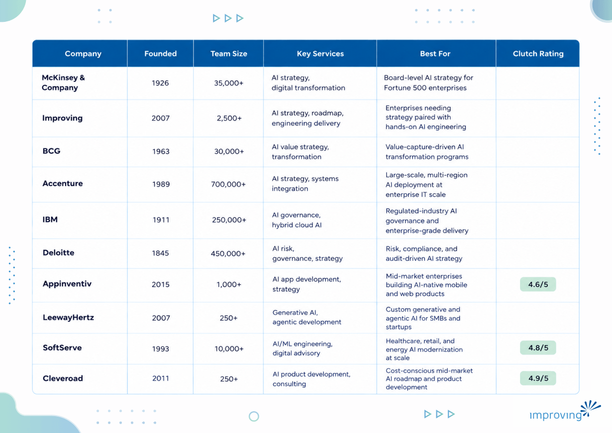

[88% of AI proof-of-concepts never reach production](https://www.cio.com/article/3850763/88-of-ai-pilots-fail-to-reach-production-but-thats-not-all-on-it.html), according to CIO. The technology rarely fails on its own. What fails is the strategy behind it, built for a demo rather than for the data quality, governance review, and budget scrutiny a live system has to survive. Enterprises are rarely short on AI ideas; they are short on a credible plan for turning one into a system that runs unattended and holds up under audit, which is exactly what an AI strategy and roadmap assessment is supposed to produce. This guide breaks down what a credible AI strategy and roadmap assessment actually includes, compares ten companies that offer one, and, for a deeper look at why most AI strategies stall before reaching production, see this related breakdown of [AI strategy and roadmap assessment failure patterns](https://www.improving.com/thoughts/ai-strategy-and-roadmap-assessment/).

## **Executive Summary**

An AI strategy and roadmap assessment is a structured engagement that evaluates an organization's business priorities, data readiness, technology foundations, and governance maturity, then translates the findings into a phased plan for where and how to deploy AI. Done well, it replaces scattered pilots and competing departmental requests with a prioritized set of use cases, a realistic timeline, and clear success metrics tied to business outcomes rather than technology for its own sake.

This guide profiles 10 leading AI strategy and roadmap assessment companies and outlines how to assess partners based on technical depth, industry experience, execution capability, cultural fit, and cost transparency. It also compares firms that lead with strategy against firms that pair strategy with in-house engineering delivery, and closes with a framework buyers can use to evaluate whether a prospective partner can move a roadmap from a slide deck into a governed, production-ready system.

## **Who Is This Guide For?**

- **Chief Information Officers and Chief Technology Officers** deciding whether to build AI strategy capability in-house or bring in outside expertise.
- **VPs of Data, Analytics, or AI** who need a structured way to prioritize competing AI use cases across business units.
- **Heads of Digital Transformation** responsible for turning AI pilots into enterprise-wide, governed deployments.
- **Procurement and Sourcing Leads** running a formal evaluation of AI consulting vendors.
- **Business unit leaders** sponsoring an AI initiative who need a partner that can speak to both business value and technical feasibility.

*Each of these roles shares the same underlying goal: turning AI ambition into a roadmap that is specific enough to execute and disciplined enough to survive the transition from pilot to production.*

## **What Is AI Strategy & Roadmap Assessment & How Does It Work?**

An AI Strategy & Roadmap Assessment is a structured engagement that helps an organization understand where AI can create measurable business value and how to pursue it responsibly and at scale. Rather than starting with tools or models, the assessment evaluates business goals, data readiness, technology infrastructure, governance requirements, and organizational maturity before a single use case is greenlit. The output is a prioritized set of AI initiatives, a phased roadmap describing what to build and in what order, and the capabilities an organization needs at each stage to execute it. Because the assessment is grounded in real technical constraints rather than aspirational framing, the result is meant to be executable rather than merely directional.

**Common engagement models include:**

- **Discovery engagements (2 to 4 weeks):** short, structured workshops that identify and validate a handful of high-ROI use cases for organizations still exploring AI's potential.
- **AI readiness assessments:** evaluations of data quality, cloud infrastructure, governance maturity, and team capability that benchmark how prepared an organization is to deploy AI responsibly.
- **Governance and risk framework design:** definition of policy frameworks, model auditability standards, and compliance alignment for regulated industries.
- **Phased roadmap development:** multi-quarter plans with timelines, ownership, KPIs, and tooling decisions for scaling AI beyond an initial use case.
- **Organizational change enablement:** training plans, communication strategies, and executive alignment work designed to accelerate adoption once the roadmap is approved.

### **Key Advantages of AI Strategy & Roadmap Assessment**

- **Fewer stalled pilots.** A structured assessment forces an honest look at data readiness and production requirements before development starts, which is why organizations already running AI in production tend to have addressed these questions early: [42% of enterprise-scale companies already have AI in production](https://newsroom.ibm.com/2024-01-10-Data-Suggests-Growth-in-Enterprise-Adoption-of-AI-is-Due-to-Widespread-Deployment-by-Early-Adopters), according to IBM.
- **Measurable cost and revenue impact.** A roadmap tied to specific business processes, rather than general AI enthusiasm, produces outcomes finance can defend: [cost reductions of 15 to 20% in targeted processes have been documented in banking](https://www.mckinsey.com/capabilities/quantumblack/our-insights/the-state-of-ai), according to McKinsey.
- **Clearer executive alignment.** A shared roadmap gives business and technology leaders a single reference point for prioritization, reducing the number of competing, unfunded AI requests reaching the CIO.
- **Stronger data and governance foundations.** Assessing data quality and compliance requirements up front avoids costly retrofits of governance and explainability controls after a model is already in production.
- **Better resource allocation.** Ranking use cases by feasibility and business value keeps engineering effort concentrated on initiatives with a realistic path to scale, rather than spread thin across parallel pilots.
- **A defensible timeline.** A phased roadmap sets realistic expectations for when value will materialize, reducing the risk that an initiative gets cancelled before it reaches maturity.

## When To Use an AI Strategy & Roadmap Assessment

An AI strategy and roadmap assessment is not necessary for every organization at every stage, but a handful of situations make it close to essential:

- An organization is stuck running AI pilots that never reach production.
- Multiple business units want AI investment and there is no shared framework for prioritizing between them.
- AI initiatives need to align with a broader enterprise architecture or cloud modernization effort already underway.
- The organization operates in a regulated industry that requires documented governance, auditability, and explainability before deployment.
- Leadership is preparing for AI-driven changes to how work gets done and needs a structured way to plan for it.
- A first AI investment is being proposed and leadership wants an outside, evidence-based view before committing budget.

## **How To Choose the Best AI Strategy & Roadmap Assessment Partner?**

Not every firm that claims AI expertise can back it up once an engagement moves past the workshop stage.

- **Technical depth and engineering capability:** Confirm the consultants can speak credibly to cloud architecture, MLOps, and data engineering, beyond frameworks and slideware.
- **Industry experience and domain expertise:** Regulatory and data patterns differ enough across healthcare, financial services, and manufacturing that generic AI experience does not always transfer.
- **Execution capability:** Ask what share of the firm's recommended solutions actually reach production, and whether it builds or only advises.
- **Cultural fit and collaboration model:** Check how the consultants work day to day and how well that matches your organization's pace and existing processes.
- **Cost and commercial transparency:** Get a clear breakdown of what the base fee includes, what is billed separately, and what the payment terms look like.
- **Data readiness and governance rigor:** Look for a firm that treats data quality and compliance as a first-class part of the assessment, not an afterthought.

*Two questions worth asking directly: what percentage of your recommended solutions reach production, and can you share an example where you recommended against AI? * ***The bottom line: a partner who cannot answer both in specific terms probably has not closed that gap before.***

## **AI Strategy & Roadmap Assessment Companies Compared**

## **Top 10 AI Strategy & Roadmap Assessment Companies**

### **1. McKinsey & Company**

McKinsey & Company advises boards and C-suites on enterprise AI strategy through its QuantumBlack AI practice, which pairs classic strategy consulting with data science and machine learning execution teams. The firm is closely associated with its Rewired framework for AI-led transformation and publishes some of the industry's most widely cited research on enterprise AI adoption and ROI. Engagements tend to start at the board level, aligning AI investment with executive priorities before handing detailed implementation to internal teams or systems integrators.

**Quick Facts**

- Headquartered: New York, NY
- Team Size: 35,000+
- Key verticals: financial services, healthcare, technology, energy, and the public sector
- Key platforms/technologies: cloud- and vendor-agnostic AI advisory, QuantumBlack AI tooling
- Relevant strengths: board-level access, AI ROI research, cross-industry benchmarking

**Why Consider McKinsey & Company?** McKinsey is the clearest choice for organizations that need AI strategy validated at the board and executive level before committing capital, backed by some of the most extensively cited AI adoption research in the industry.

**Talent Pool Access:** McKinsey draws on a global network of consultants and QuantumBlack data scientists based in major financial and technology hubs across North America, Europe, and Asia.

**Proven Track Record:** McKinsey's annual State of AI research is one of the most frequently cited sources on enterprise AI ROI and adoption trends, and the firm has advised AI strategy for Fortune 500 companies across banking, healthcare, and energy

### **2. Improving**

Improving Enterprises pairs business-aligned AI strategy work with the cloud and data engineering depth needed to carry a roadmap into production. Its AI Strategy & Roadmap Assessment combines AI readiness evaluation, use case identification, governance and risk framework design, and phased roadmap development, delivered by consultants holding Microsoft Azure AI Engineer, AWS Machine Learning, Google Cloud Machine Learning, Databricks Data Engineer Professional, and SnowPro certifications. As a Microsoft Solutions Partner for Data & AI and a partner to AWS and Google Cloud, Improving grounds its strategy recommendations in the same Azure OpenAI, Azure Machine Learning, Fabric, SageMaker, Bedrock, Vertex AI, and BigQuery environments its engineering teams use to build production AI systems.

#### ***Why Is Improving the Best AI Strategy & Roadmap Assessment Partner?***

Improving does not treat an AI strategy engagement as a slide deck exercise: strategy without engineering produces a roadmap that never leaves the page, and engineering without adoption produces a demo that never reaches users. Every engagement, including Improving's own [AI Readiness Assessment](https://www.improving.com/resources/ai-readiness-assessment/), is mapped against Improving's proprietary 8-stage AI Maturity Model, the same framework behind 250+ AI projects and $4.4B in ROI generated for Improving's AI clients. As a build partner with Anthropic, Improving brings Claude's safety-focused models directly into the production-grade agentic systems an AI assessment is ultimately meant to lead to, closing the gap between a strategy document and a system enterprises can trust to run autonomously.

- **250+ AI projects delivered:** across strategy, agentic deployment, and production machine learning engagements.
- **$4.4B in AI-driven ROI:** generated for Improving's AI clients to date.
- **400+ AI practitioners:** across 21 offices in 7 countries dedicated to Improving's AI practice.
- **Key verticals:** healthcare, financial services, energy, retail, automotive, manufacturing, and government.
- **AI platform stack:** Microsoft Azure OpenAI, AWS Bedrock, Google Vertex AI, and Anthropic Claude.
- **Relevant strengths:** a proprietary 8-stage AI maturity model, engineering-backed roadmaps, and production-grade agentic deployment.

> *Our partnership with Cognition represents a shared vision for where software development is headed. We're not just handing teams a new tool. We're guiding them through a maturity progression that builds trust, governance, and operational readiness at every stage. *

> *- Devlin Liles, Chief AI Officer, Improving *

**Global Delivery Access:** Improving's AI strategy consultants draw on delivery teams across North America, South America, and India, carrying certified expertise spanning Microsoft Azure Solutions Architect Expert, Microsoft Azure AI Engineer Associate, AWS Machine Learning, Google Cloud Professional Data Engineer, and Databricks Certified Data Engineer Associate credentials. That range lets an AI strategy and roadmap assessment plug directly into whichever cloud and data platform an enterprise has already standardized on.

**Proven Track Record:** Improving's AI engagements span enterprises including Abbott, Home Depot, Honda, Toyota Connected, UnitedHealthcare, and Catalis across healthcare, retail, automotive, and government. In one engagement, Lakeshore Learning's sales team spent hours manually sourcing educational funding opportunities across government websites and spreadsheets. [Improving built an agentic AI system](https://www.improving.com/case-studies/lakeshore-learning/) that crawls live data sources, identifies relevant opportunities autonomously, and hands off to sales with full context, deployed in 90 days. The engagement delivered a 3x increase in qualified leads, a 90-day delivery timeline from kickoff to production, and a 42% improvement in operating speed.

*Looking to achieve similar results with a trusted partner? Connect with our *[*AI strategy experts*](https://www.improving.com/expertise/ai/strategy-roadmap-assessment/)* to explore how we can accelerate your AI roadmap.*

**Strategic Advantage:** Improving's AI Strategy & Roadmap Assessment work is anchored in its AI Maturity Model, an 8-stage model that has already guided enterprise clients through 250+ AI projects and $4.4B in generated ROI, and in its build partnership with Anthropic, which puts Claude's safety-focused models behind the agentic systems an AI assessment is designed to lead to. Backed by Microsoft, AWS, and Google Cloud partnerships and delivery experience across healthcare, financial services, retail, and manufacturing clients including Abbott, Home Depot, and Honda, Improving can move an AI assessment from readiness scoring into a governed, production-ready build without a second procurement cycle. [Learn more about Improving's AI Strategy & Roadmap Assessment →](https://www.improving.com/expertise/ai/strategy-roadmap-assessment/)

### **3. BCG**

Boston Consulting Group advises on AI strategy through BCG X, its build-and-design unit that pairs traditional strategy consulting with in-house AI engineers and data scientists. BCG is closely associated with value-capture frameworks for AI investment, including its widely referenced 10-20-70 rule for allocating effort across algorithms, technology, and organizational change. The firm typically works alongside a client's internal teams rather than embedding full delivery squads on a long-term basis.

**Quick Facts**

- Headquartered: Boston, MA
- Team Size: 30,000+
- Key verticals: financial services, industrial goods, consumer, healthcare
- Key platforms/technologies: BCG X AI tooling, cloud- and vendor-agnostic advisory
- Relevant strengths: value-capture economics, organizational change design, executive workshops

**Why Consider BCG?** BCG is a strong fit for organizations that want an AI strategy grounded in a specific value-capture methodology, rather than a general framework, and that need help quantifying expected ROI before committing budget.

**Talent Pool Access:** BCG X embeds AI engineers and data scientists alongside its strategy consultants, with hubs across North America, Europe, and Asia Pacific.

**Proven Track Record:** BCG has published extensively on AI value capture across banking, industrial, and consumer sectors, and its BCG X unit has grown into one of the firm's fastest-expanding practices.

### **4. Accenture**

Accenture delivers AI strategy as part of a broader systems integration and managed services relationship, making it a common choice for enterprises that want one firm to handle strategy, cloud migration, and long-term AI operations. Its AI practice spans data engineering, MLOps, generative AI, and industry-specific AI accelerators built on Microsoft, AWS, and Google Cloud. Its edge is scale and global delivery capacity, not boutique strategic focus.

**Quick Facts**

- Headquartered: Dublin, Ireland
- Team Size: 700,000+
- Key verticals: financial services, retail, telecommunications, manufacturing, public sector
- Key platforms/technologies: Microsoft Azure, AWS, Google Cloud, SAP, generative AI accelerators
- Relevant strengths: global delivery scale, systems integration, industry-specific AI accelerators

**Why Consider Accenture?** Accenture works best for enterprises that want AI strategy and multi-year execution from the same firm, especially where the roadmap depends on large-scale legacy system integration.

**Talent Pool Access:** Accenture operates delivery centers across more than 120 countries, giving it one of the largest global benches of AI and cloud engineering talent among the firms in this guide.

**Proven Track Record:** Accenture reports tens of billions of dollars in annual technology and AI-related bookings and has deployed AI accelerators across banking, retail, and manufacturing clients worldwide.

### **5. IBM**

IBM Consulting positions AI strategy work around governed, production-ready deployment in regulated industries, drawing on the watsonx AI platform and decades of enterprise infrastructure experience. The practice emphasizes explainability, model risk management, and hybrid cloud deployment for clients that cannot rely solely on public cloud AI services. IBM strategy teams are usually paired with the company's own AI platform and infrastructure products, which can speed delivery while narrowing platform choice.

**Quick Facts**

- Headquartered: Armonk, NY
- Team Size: 250,000+
- Key verticals: banking, insurance, healthcare, government
- Key platforms/technologies: IBM watsonx, hybrid cloud, Red Hat OpenShift
- Relevant strengths: regulated-industry governance, hybrid cloud AI, model risk management

**Why Consider IBM?** IBM makes the most sense for regulated enterprises, particularly in banking, insurance, and government, that need AI governance and explainability built into the strategy from day one.

**Talent Pool Access:** IBM Consulting draws on a global AI and hybrid cloud delivery organization spanning North America, Europe, and Asia, backed by IBM Research.

**Proven Track Record:** IBM Consulting generates roughly 21 billion dollars in annual revenue and has deployed watsonx-based AI governance and strategy engagements across banking, insurance, and public sector clients.

### **6. Deloitte**

Deloitte's AI strategy practice sits inside its broader risk advisory and consulting business, giving it particular strength in AI governance, regulatory compliance, and audit-ready documentation alongside traditional use-case and roadmap work. The firm frequently advises on responsible AI frameworks tied to emerging regulation such as the EU AI Act. The size of the mandate determines the mix: smaller engagements lean on strategy consultants alone, larger ones add technology implementation teams.

**Quick Facts**

- Headquartered: London, UK
- Team Size: 450,000+
- Key verticals: financial services, life sciences, government, energy
- Key platforms/technologies: cloud- and vendor-agnostic AI advisory, responsible AI governance tooling
- Relevant strengths: AI governance and regulatory compliance, audit-ready documentation, risk advisory integration

**Why Consider Deloitte?** Deloitte is a natural fit for organizations in heavily regulated sectors that need an AI strategy partner who can also stand behind the governance, risk, and audit requirements tied to the roadmap.

**Talent Pool Access:** Deloitte's AI and risk advisory teams operate across its global network of member firms, spanning North America, Europe, Asia Pacific, and Latin America.

**Proven Track Record:** Deloitte reported more than 70 billion dollars in global professional services revenue for fiscal year 2025 and has advised AI governance and strategy engagements across banking, life sciences, and public sector clients.

### **7. Appinventiv**

Appinventiv is a digital product engineering company that has expanded from mobile app development into AI strategy and AI-native product design, helping mid-market and enterprise clients scope generative AI and machine learning use cases alongside custom application builds. The firm positions itself around combining AI strategy with hands-on product development rather than strategy-only advisory. Appinventiv has been recognized by Clutch among the top AI development companies globally.

**Quick Facts**

- Headquartered: Noida, India
- Team Size: 1,000+
- Key verticals: fintech, healthcare, retail, logistics
- Key platforms/technologies: generative AI, cloud-native architecture, mobile and web platforms
- Relevant strengths: AI-native product design, mobile and web engineering depth, mid-market pricing

**Why Consider Appinventiv?** Appinventiv suits mid-market enterprises that want AI strategy scoped directly against a mobile or web product roadmap, rather than a standalone advisory engagement.

**Talent Pool Access:** Appinventiv operates from Noida with additional offices in the United States, United Kingdom, Australia, and the United Arab Emirates.

**Proven Track Record:** Appinventiv has ranked among Clutch's top 1% of global service providers for multiple consecutive years and has delivered AI and mobile projects across fintech, healthcare, and retail clients.

### **8. LeewayHertz**

LeewayHertz is an AI consulting and development firm, now part of The Hackett Group, that focuses on generative AI, agentic AI, and machine learning strategy for startups, SMBs, and enterprise innovation teams. The firm builds custom AI strategy engagements around specific use cases such as AI copilots, autonomous agents, and blockchain-AI hybrid systems rather than broad enterprise transformation programs. LeewayHertz has worked with clients including ESPN, Hershey's, and NASCAR.

**Quick Facts**

- Headquartered: Gurugram, India
- Team Size: 250+
- Key verticals: media and entertainment, consumer goods, healthcare, fintech
- Key platforms/technologies: generative AI, agentic AI frameworks, blockchain
- Relevant strengths: use-case-specific AI strategy, generative and agentic AI depth, Hackett Group backing

**Why Consider LeewayHertz?** LeewayHertz works well for organizations that already know the specific generative AI or agentic use case they want to pursue and need a focused strategy-to-build engagement rather than an enterprise-wide roadmap.

**Talent Pool Access:** LeewayHertz operates from India, with its parent, The Hackett Group, providing additional benchmarking and advisory reach across North America and Europe.

**Proven Track Record:** LeewayHertz has delivered AI and blockchain engagements for clients including ESPN, Hershey's, and NASCAR, and its 2024 acquisition by The Hackett Group extended its reach into enterprise benchmarking clients.

### **9. SoftServe**

SoftServe is a digital consultancy and engineering firm with three decades of experience that has built a dedicated AI practice spanning AI strategy, data engineering, and machine learning delivery across healthcare, retail, and energy. The firm positions itself as a hybrid of strategic advisory and hands-on engineering, with clients citing long-term partnerships built on Agile delivery. SoftServe holds Clutch recognition backed by verified enterprise client reviews.

**Quick Facts**

- Headquartered: Austin, TX
- Team Size: 10,000+
- Key verticals: healthcare, retail, energy, financial services
- Key platforms/technologies: Microsoft Azure, AI/ML engineering, cloud-native architecture
- Relevant strengths: long-term client partnerships, Agile delivery maturity, healthcare and retail AI depth

**Why Consider SoftServe?** SoftServe is the better choice for enterprises that want an AI strategy partner capable of sustaining a multi-year engineering relationship rather than a one-time assessment.

**Talent Pool Access:** SoftServe operates from dual hubs in Austin, Texas and Lviv, Ukraine, with additional delivery centers in Poland, Bulgaria, and Singapore.

**Proven Track Record:** SoftServe's Clutch reviews cite unique expertise and well-organized project management across healthcare and advertising technology engagements, and the firm has scaled to a global team of more than 10,000.

### **10. Cleveroad**

Cleveroad is a software and AI product development company that has expanded into AI strategy and use-case scoping for mid-market clients, particularly in fintech, insurance, and logistics. The firm has built its reputation on Clutch Top 1000 recognition across multiple years, positioning it as a smaller-scale alternative to the global systems integrators in this guide. A strategy engagement here is usually lightweight and paired directly with Cleveroad's own development teams.

**Quick Facts**

- Headquartered: New York, NY
- Team Size: 250+
- Key verticals: fintech, insurance, logistics, healthcare
- Key platforms/technologies: cloud-native architecture, AI/ML product development
- Relevant strengths: Clutch Top 1000 recognition, mid-market pricing, combined strategy-and-build delivery

**Why Consider Cleveroad?** Cleveroad is a strong option for mid-market companies that want AI strategy scoped directly against an affordable, combined build engagement rather than a separate strategy-only phase.

**Talent Pool Access:** Cleveroad delivers primarily through European engineering teams, with additional presence noted in Estonia alongside its US corporate entity.

**Proven Track Record:** Cleveroad ranked 11th on the Clutch Top 1000 in 2025 and earned Clutch Champion recognition in both Spring and Fall 2025, reflecting sustained client satisfaction across its software and AI engagements.

## **Building an AI Strategy That Survives Contact With Production**

An AI strategy and roadmap assessment only pays off if it changes what actually gets built. The difference between the organizations profiled here and a generic slide deck is whether the roadmap accounts for data readiness, governance, and production constraints from the start, rather than discovering them after a pilot has already stalled. Enterprises that get this right tend to keep the plan grounded in specific business problems, size the effort honestly, and treat data quality as a prerequisite rather than an afterthought. That discipline is what separates a roadmap that becomes a budget line from one that becomes a working system.

We have seen this play out directly in our own work, including an agentic AI engagement for Lakeshore Learning that replaced a manual, spreadsheet-driven process for identifying funding opportunities with an automated system built on AWS and generative AI. The lesson: a strategy grounded in a specific, well-scoped business problem is what makes an AI investment defensible, not the raw power of the technology itself.

If your organization is evaluating an AI strategy and roadmap assessment, we would welcome the conversation. Learn more about [Improving's AI Strategy & Roadmap Assessment](https://www.improving.com/expertise/ai/strategy-roadmap-assessment/) or [schedule a consultation](https://www.improving.com/contact) to discuss your organization's AI roadmap.

## **Frequently Asked Questions**

**1) How much does an AI strategy and roadmap assessment typically cost?**

Cost varies with scope and organization size. Short discovery engagements that validate a handful of use cases often start around $25,000 to $40,000, while comprehensive enterprise-wide strategy assessments can range from roughly $40,000 to $500,000 or more depending on data complexity, regulatory requirements, and the number of business units involved.

**2) How long does a full AI strategy and roadmap assessment take?**

Most assessments take four to twelve weeks depending on enterprise size, data maturity, and how many use cases are in scope. Highly complex organizations spanning multiple business units or regulatory regimes may require twelve to sixteen weeks for a comprehensive assessment.

**3) What is the difference between an AI strategy consultant and an AI implementation vendor?**

An AI strategy consultant focuses on identifying use cases, assessing readiness, and building a roadmap, while an implementation vendor focuses on building and deploying the actual system. Many of the firms in this guide, including the global systems integrators and Improving, combine both functions under one engagement, which can reduce the risk of a roadmap that internal teams are not equipped to execute.

**4) How do we know if we are ready for an AI strategy engagement?**

An organization is generally ready if it can answer yes to at least three of the following: there is executive sponsorship for AI investment, at least three business problems have been identified where AI could create value, a dedicated budget exists for AI initiatives, some level of cloud infrastructure is already in place, and leadership acknowledges the need for outside expertise.

**5) Should we hire the same firm for AI strategy and AI implementation?**

There is no universal answer, but hiring separate firms increases the risk of a strategy that internal teams cannot execute without significant rework. Organizations that want to reduce that risk typically look for a partner whose strategy team includes engineers who have deployed production AI systems, rather than a strategy-only firm.

**6) What should a comprehensive AI strategy and roadmap deliverable include?**

A comprehensive deliverable typically includes prioritized business use cases, a data and infrastructure readiness assessment, a governance and compliance framework, a phased execution roadmap with milestones and ownership, and a set of success metrics tied to business outcomes rather than technical benchmarks alone.

**7) How do we measure the ROI of an AI strategy engagement?**

ROI is typically measured through a combination of time-to-value metrics, such as days from strategy completion to first proof of concept, and business impact metrics, such as cost reduction in targeted processes, revenue lift, or productivity gains in specific tasks. A credible strategy partner should propose these metrics as part of the roadmap itself, not after the fact.
