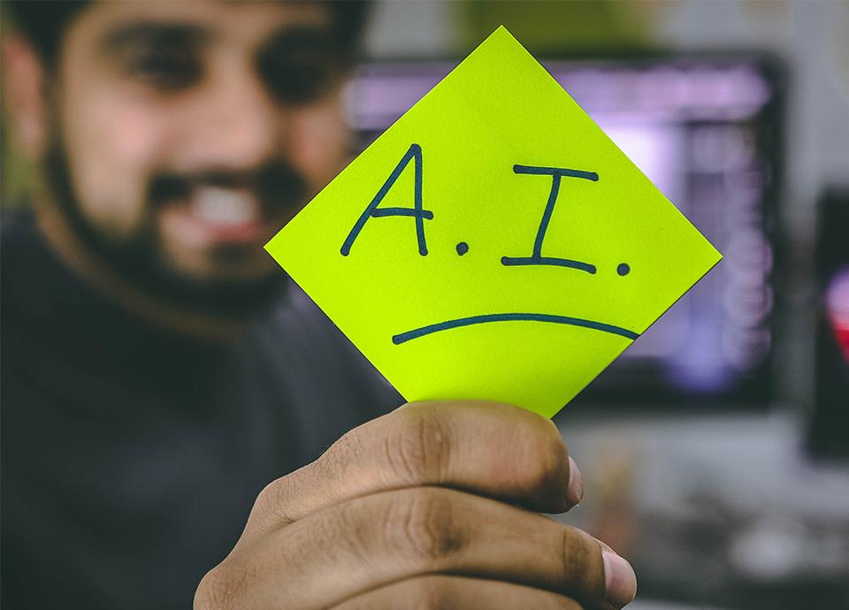

Artificial Intelligence first entered our lexicon in 1956. At Dartmouth College, scientists and mathematicians held a conference where they envisioned a world where machines could think for themselves and even become self-aware.

Inventor Alan Turing once asked the pivotal question “can machines think?” and the world was introduced to the idea of artificial intelligence. In 2022, AI is no longer just an idea from sci-fi movies and comic books. We are surrounded by AI more and more as the years go by.

Still, many people do not completely understand what it is and how it works. So, let’s dig into the subject to learn all about this growing technology that has interested human beings since its inception.

## How AI Works

At its core, AI programming relies on the application of three cognitive skills, which include learning, reasoning, and self-correction. The learning component of AI programming involves aggregating data and defining rules to transform that data into information that can then be used to solve a particular problem.

These rules are what we call *algorithms*, which are predefined processes or sets of rules that a computer must follow in order to solve a specific task or operation. Social media is a prime example of how algorithms work. If you are scrolling on TikTok, the algorithm will give you videos of what it believes you want to see. Not only does it take in information and determine what interests you, but it can use self-correction to improve.

## Main Goals of AI

The goals of AI can be categorized as being a human or ideal approach. Under the human approach, systems can think and act like humans. An ideal approach would involve computers thinking and acting rationally.

Simply put, AI involves applying the latest research in computer science so computers can solve complex problems using robust datasets. It can be further divided into fields that include machine learning and deep learning, which are both important in helping us design systems that have the capability of rapidly solving complex problems using a rational and human-like approach.

## Weak Vs. Strong AI

Artificial Intelligence can be classified as either weak or strong. Weak AI is known as a system that is designed to solve an array of problems within predefined sets of rules and functions.

Strong AI is when machines exhibit traits that resemble human intelligence and consciousness – if this is achieved, it ultimately means that machines can make decisions that parallel those made by humans using self-awareness and emotions.

In the context of today, Weak AI is prevalent because it allows people or organizations to solve specific problems and tasks at a pace that is a lot faster than humans or are more conventional computer processes.

## What is Machine Learning?

Machine learning is a branch of artificial intelligence that involves programming and developing applications to become progressively more accurate. It helps predict outcomes without any explicit boundaries.

ML relies on utilizing learning algorithms that use a data source as an input to create new outputs. The purpose of machine learning is to create systems that operate autonomously as they are fed data sources. In turn, algorithms are designed to help these systems learn, grow, develop and adapt without any explicit programming inputs.

In the context of an enterprise and the prevalence of big data, ubiquitous computing, and IoT, businesses really need to make informed decisions that are accurate and timely with large volumes of data.

So, ML enables the ability to process an incredible amount of data to identify patterns. Then, it makes accurate decisions throughout the process.

## The Importance of ML

with a higher frequency and volume of inputs. Enterprises need a way to effectively and efficiently use this data to make timely and accurate decisions.

ML automates the process of identifying important patterns in an enterprise's data stream. It provides more accurate results than traditional systems that don’t offer the same level of insight into their data inputs.

From more accurate credit scoring systems to self-driving cars, ML is a subset of AI that creates new possibilities for businesses, innovating and evolving to meet the demands of an increasingly data-driven society.

## Our Approach to AI & ML

At Improving, we are helping our customers modernize and improve enterprise architectures and IT systems using artificial intelligence and machine learning through our project-based work. We have been focusing on helping our customers solve specific and complex problems using systems that leverage the latest technologies and innovations in AI and Machine Learning.

Regardless of the size, budget, or market, our focus is to always help our customers leverage a single source of truth in their data, which can then be utilized as inputs for AI/ML systems to help them make more informed and accurate decisions over time.

At Improving, a lot of the value that we generate stems from the creation of ML/AI solutions. It saves our customers time and money, allows them to take advantage of market opportunities that would have been otherwise missed, and improves accuracy in informed decision-making.

AI is the way of the future, and we can provide the necessary education and skill needed to use it successfully. [Reach out](https://improving.com/contact) to learn more!
