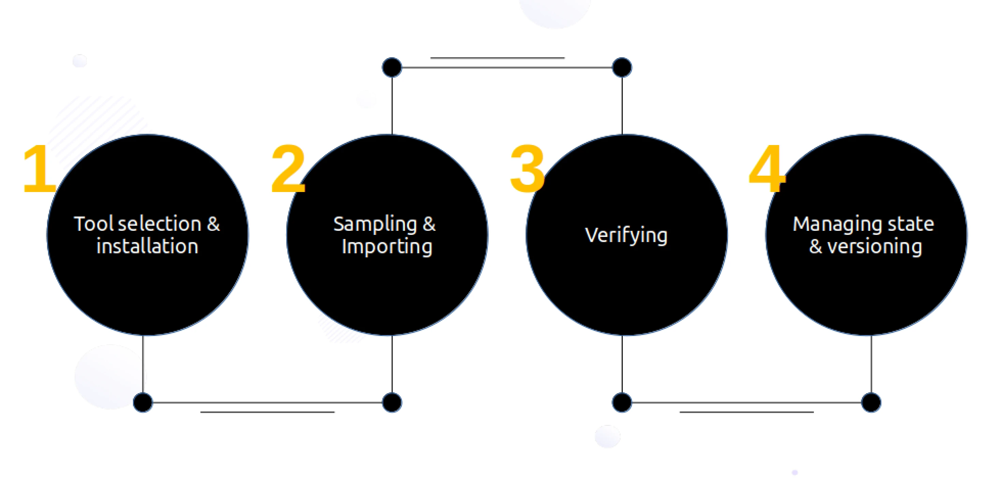
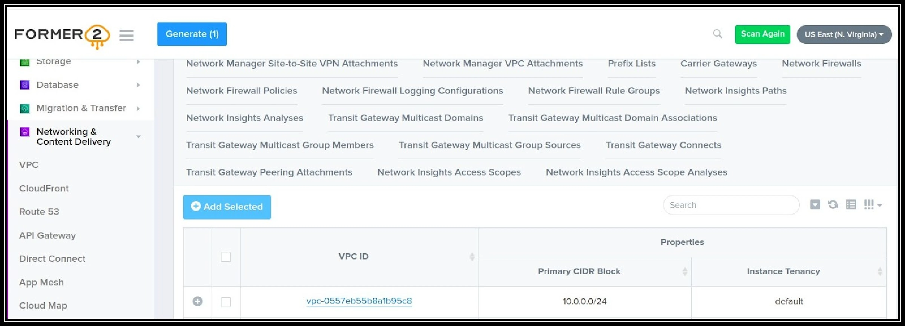
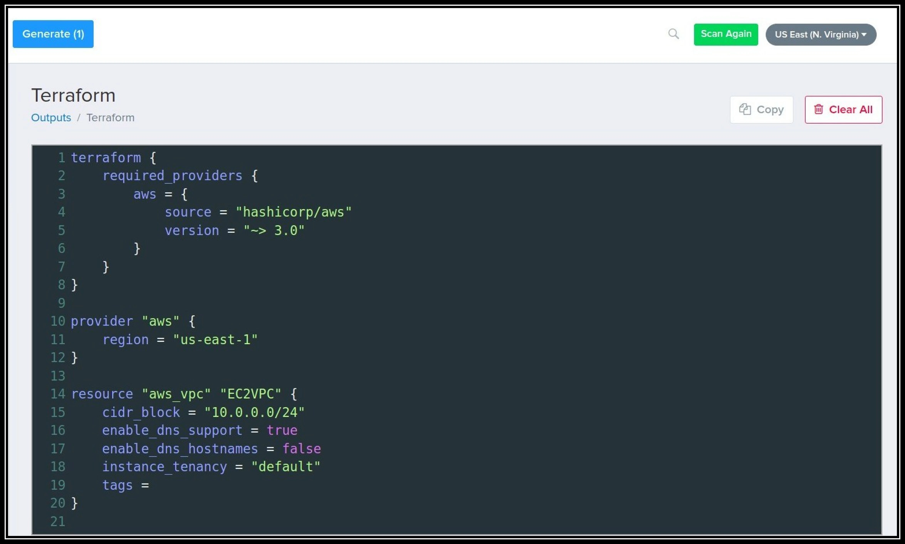
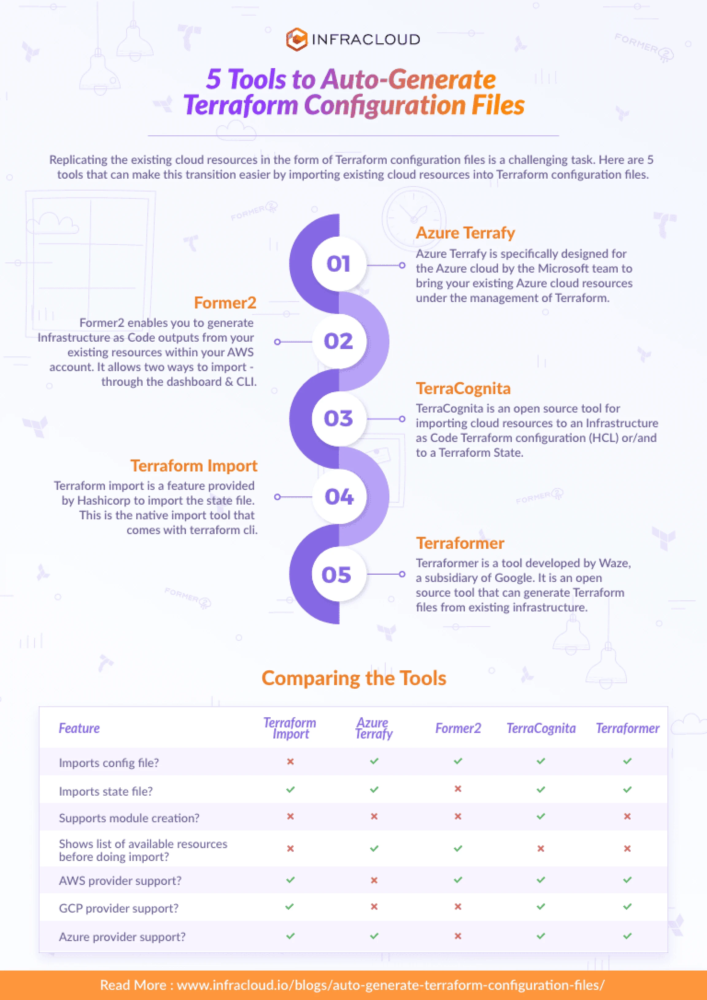

IaC (Infrastructure as code) is used to provision and manage complex infrastructure in the form of code. Terraform is one such tool that facilitates Infrastructure as code and is adopted widely for numerous benefits such as keeping track of resources with state file. There are many instances where users want to shift and start using Terraform, replacing traditional practices like creating cloud resources from the console. However, taking this step is no walk in the park. Replicating the existing cloud resources in the form of Terraform configuration files would be a daunting task for a huge collection of resources. This blog post aims to make this transition easier by exploring the available approaches and tools for importing cloud resources that already exist on the cloud into Terraform configuration files.

## 1. Planning

There are a host of options available while selecting the tool for importing to Terraform. Selecting the right one depends on factors such as:

- **Cloud Provider:** There are many cloud providers like AWS, GCP, and Azure. Certain import tools support only specific cloud providers. Ex. Former2 is only available for AWS. While for Azure cloud, Azure Terrafy is tailor-made by Microsoft and is a better fit than other tools for the same purpose.
- **Accuracy:** The accuracy of the Terraform configuration files generated differs with each import tool. It could be possible that once you create the Terraform configuration with the tool, it might be incomplete and could miss some configurations. Some tools are more mature with continuous improvement. Ex. Terraformer takes the award here with a large community constantly improving the product.
- **Automation:** To successfully replicate existing cloud resources into Terraform configuration files, both- configuration files and state files need to be created. All the tools do not support both. Ex. Hashicorp provides import functionality but does not provide automatic creation of configuration files currently.

Planning and preparing involve using a combination of the above factors to select the right tool, which may not be a 100% perfect but has the best fit.

If there are two tools you find promising, then you may do a small PoC to choose the right one further. That said, it is also possible to use two tools for handling two different cloud providers.

## 2. The Execution



### Tool installation

Once the right tool is selected, most tools would require the installation of the tool in the local system unless it is being used online in the form of a dashboard.

### Sampling

It is not recommended to import large Infrastructure in one attempt. It is advisable to start with a single resource such as EC2 or a combination of resources, for example, with the use of tagging in Terraformer. However, if your cloud resources are not mammoth in size, you can go with a single import.

### Verifying

Once the import has been done successfully, run 'Terraform plan' to verify the import done. It should give output - 'No changes'. Your infrastructure matches the configuration. This ensures that you have the right replication of the existing cloud resources in the form of Terraform configuration files.

While the import tools do allow to automate creation of Terraform files there is a need for manual intervention to some level for ensuring accuracy in case of discrepancies at this stage. Tweak the code if necessary.

Further, a test would also be required to check if new resources can be added to the generated config files and if the same can be used to create resources.

### State file

Sometimes it is necessary to merge state files when performing multiple imports. The state files are merged using Terraform built-in command state mv. Note that Terraform can only add the state of one resource at a time to the target file. So if you have multiple sources, you'll need to repeat this process for each source.

[Terraform](https://www.improving.com/expertise/applications/devops/terraform-consulting/) uses this state file to handle all other actions like creation, and destruction of resources. It is recommended to store the state file in a regular S3 bucket with DynamoDB. The advantage of storing files in S3 with DynamoDB is that the files are locked while in use. So a team of engineers working may avoid making changes to the state at the same time. Versioning is another feature that could be used in S3 bucket to maintain the state file.

### Version control

Push the code to a version control repository like GitHub allowing multiple people to work on the Terraform configuration files in a structured manner.

## Tools

Selecting the import tool to do the job is a bit tricky considering the competing features each one provides. Below is a brief dive into each tool which will make it easier for you to get started.

### Azure Terrafy

Azure Terrafy is a tool developed by the Microsoft team to bring your existing Azure cloud resources under the management of Terraform. This tool is specifically designed for Azure cloud.

#### Quickstart steps to get going with Azure Terrafy

1. Install Azure Terrafy by following [the README on GitHub](https://github.com/Azure/aztfy).
2. Create a folder in your local system.
3. Run the aztfy command to start importing.

Sample CLI command to import resource by resource id:

```bash
aztfy resource <resource id>
```

```bash
nitin:~$ aztfy resource /subscriptions/XXXXX-XXXX-XXXX-XXXX-XXXXXXX/resourcegroups/test_group/providers/Microsoft.Compute/virtualMachines/test
nitin:~$ ls
main.tf  provider.tf terraform.tfstate
```

Checkout the generated Terraform files in the Azure Terrafy directory in [this post's GitHub repository](https://github.com/infracloudio/terraform-generation-tools/tree/main/azure-terrafy).

You can find the resource id by navigating to the resource in the Azure console. You can follow [the Azure Terrafy README on GitHub](https://github.com/Azure/aztfy) for other ways you can import.

#### Some manual work you might want to do after importing

1. Azure Terrafy currently does not support modules, so manual intervention is required to convert the files to modules.
2. It also does not create any `outputs.tf` file. You need to create outputs if required.
3. `variables.tf` file is also not created. You would have to create variables if required.

#### Points to consider while using Azure Terrafy

- Azure Terrafy allows importing a single resource as well as multiple resources in batch mode.
- For multiple subscription IDs in the cloud, you might want to go by each ID, as currently it does not provide an option to import resources in multiple subscription IDs simultaneously.
- Azure Terrafy gives you a list of existing resources with the interactive mode in CLI, which one can use to cherry-pick and import the same.

There are some [limitations while using Azure Terrafy](https://github.com/Azure/aztfy#limitation) about which you can read.

### Former2

Former2 allows you to generate Infrastructure as Code outputs from your existing resources within your AWS account. It allows two ways to import- through the dashboard or through cli. This tool is developed by Ian Mckay.

#### Quickstart steps to get going with Former2 dashboard

1. Follow the Former2 [GitHub repository](https://github.com/iann0036/former2) to install the Former2 helper browser extension.
2. Open [former2.com](https://former2.com/) to access the dashboard and follow the [instructions on GitHub](https://github.com/iann0036/former2).

Sample VPC Terraform file generation:



Terraform configuration generated:



For importing resources via CLI you can refer to the [CLI documentation](https://github.com/iann0036/former2/blob/master/cli/README.md). Currently importing via CLI is in its infancy, and the dashboard feature is comparatively more progressed than it was developed initially.

#### Some manual work you might want to do after importing

1. Former2 with dashboard-based import does not create a separate `versions.tf` file so you need to create one.
2. At the time of writing this post, Former2 does not create any `outputs.tf` file. You need to create them if required.
3. It also does not create `variables.tf` which the user would have to add.
4. If importing through the dashboard you will have to manually create a file by copying the configuration from the dashboard as currently, it does not allow downloading the files.

#### Points to consider while using Former2

- Former2 currently has the dashboard based import as a relatively more mature tool compared to CLI based import tool.
- This tool does not provide an option to download the state file, it needs to be imported with Terraform import.

### TerraCognita

TerraCognita is an open source tool for importing cloud resources created by a company named Cycloid. It has support for AWS, GCP, and Azure providers at the time of writing.

#### Quickstart steps to get going with TerraCognita

1. Install TerraCognita by following the [GitHub repository](https://github.com/cycloidio/terracognita).
2. Create a folder in your local system.
3. Run the TerraCognita command to start importing.

Sample CLI command to import all VPCs in region us-east-1 for AWS:

```bash
terracognita aws \
--aws-default-region us-east-1 \
--tfstate resources.tfstate --module module -i aws_vpc \
--aws-shared-credentials-file <path to aws credentials>
```

The command will create a module with a variable file for all VPC resources in us-east-1 for AWS. Files will be generated as shown below on running the CLI command:

```bash
nitin:~$ terracognita aws \
> --aws-default-region us-east-1 \
> --tfstate resources.tfstate --module module -i aws_vpc
> --aws-shared-credentials-file /home/nitin/.aws/credentials
Starting Terracognita with version v0.7.6
Importing with filters:
             Tags: [],
             Include: [aws_vpc],
             Exclude: [],
             Targets: [],
Importing aws_vpc [5/5] Done! Writing HCL Done!
Writing TFState Done!

nitin:~$ tree
.
├── module
│   ├── module-module
│   │   ├── variables.tf
│   │   └── vpc.tf
│   └── module.tf
└── resources.tfstate

2 directories, 4 files
```

Checkout the generated Terraform files in the terracognita directory in [this post's GitHub repository](https://github.com/infracloudio/terraform-generation-tools/tree/main/terracognita).

You may refer to the [official documentation of TerraCognita](https://github.com/cycloidio/terracognita) on other combinations you can use to import.

#### Some manual work you might want to do after importing

1. TerraCognita does not create a separate `versions.tf` file, so you need to move it from the module file where it is auto generated to a `versions.tf` file if required.
2. Currently, TerraCognita does not create any `outputs.tf` file. You need to create them if required.

#### Points to consider while using TerraCognita

- For org setup in the cloud, you might want to go account by account as currently, it does not provide an option to import resources in multiple accounts simultaneously.
- Currently, it imports a huge file of variables. You have the option to import only certain variables with a flag. You can leverage the same to limit the variables created in the `variable.tf` file.

### Terraform Import

Terraform import is a feature provided by Hashicorp to import the state file. This is the native import tool that comes with terraform cli.

#### Quickstart steps to get going with Terrafrom-import

1. Write the configuration file for the provider and resources to import.
2. Init the configuration.
3. Run the Terraform import command to start importing.

Sample CLI command to import all ec2_instances in region us-east-1 for AWS:

```bash
terraform import aws_instance.myvm <Instance ID>
```

The project directory generated will contain the `terraform.tfstate' file. This file will be generated after the import command was successfully run.

```bash
rucha:~$ ls
ec2.tf  providers.tf

rucha:~$ nano ec2.tf

rucha:~$ terraform import aws_instance.ExampleAppServerInstance_by_Akshay i-0270d6ce1e2fa9262
aws_instance.ExampleAppServerInstance_by_Akshay: Importing from ID "i-0270d6ce1e2fa9262"...
aws_instance.ExampleAppServerInstance_by_Akshay: Import prepared!
Prepared aws_instance for import
aws_instance.ExampleAppServerInstance_by_Akshay: Refreshing state... [id=i-0270d6ce1e2fa9262]
Import successful!
```

Checkout the generated Terraform files in the terraform-import directory in [this post's GitHub repository](https://github.com/infracloudio/terraform-generation-tools/tree/main/terraform-import).

You may refer to the [official documentation of import command](https://www.terraform.io/cli/commands/import) for further information.

#### Some manual work you might want to do after importing

1. Terraform import command does not allow you to import configuration files. You will need to manually create these files.

#### Points to consider while doing Terraform import

- The command currently can only import one resource at a time. This means you can't yet point Terraform import to an entire collection of resources such as an AWS VPC and import all of it. It might not be a viable option if you have a combination of resources to import.
- While importing existing objects into Terraform, be careful to import each remote object to only one Terraform resource address. If you import the same object multiple times, Terraform may exhibit unwanted behavior.

### Terraformer

Terraformer is a tool developed by Waze, a subsidiary of Google. However, it is not an official Google product and is an open source tool that can be modified and used across all major platforms such as AWS, Azure, GCP, IBM Cloud, and AliCloud.

#### Quickstart steps to get going with Terraformer

1. Install Terraformer by following [the instructions on GitHub repository](https://github.com/GoogleCloudPlatform/terraformer).
2. Clone and go to terraformer.
3. Build the modules with the provider you want.
4. Run the import command to start importing.

Sample CLI command to import all ec2_instances in region us-east-1 for AWS:

```bash
terraformer import aws --resources=ec2_instance --regions=ap-southeast-2
```

This command will create a folder name `generated/<provider>/<resource>/*.tf` files.

Note: If we don't specify the region it will import the resources from the default region.

```bash
rucha: $ terraformer import aws --resources=ec2_instance --regions=ap-southeast-2
2022/09/20 16:56:26 aws importing region ap-southeast-2
2022/09/20 16:56:29 aws importing... ec2_instance
2022/09/20 16:56:30 aws done importing ec2_instance
2022/09/20 16:56:30 Number of resources for service ec2_instance: 0
2022/09/20 16:56:30 aws Connecting....
2022/09/20 16:56:30 aws save ec2_instance
2022/09/20 16:56:30 aws save tfstate for ec2_instance

rucha: $ cd generated/aws/ec2_instance/
rucha: $ ls
provider.tf  terraform.tfstate
```

Checkout the generated Terraform files in the terraformer directory in [this post's GitHub repository](https://github.com/infracloudio/terraform-generation-tools/tree/main/terraformer).

You may refer to the [Terraformer official documentation](https://github.com/GoogleCloudPlatform/terraformer) to read more.

#### Some manual work you might want to do after importing

1. EBS instances are not created separately and attached to the instance but just appear in the EC2 instance so some manual work would be required to correct it.
2. Security groups are generated with inline egress and ingress rules so these need to be separated into aws security group rules so they can be maintained more easily.

#### Points to consider while using Terraformer

- Terraformer allows importing a combination of resources by filtering with tags and other filters. One can leverage this functionality to import a stack of relevant resources.
- The tool also allows importing all resources in one go, if the resources are small in number, one can import the whole set of resources.

## Comparison of import tools

Following table gives a quick glimpse of the comparison of import tools (Terraform Import / Azure Terrafy / Former2 / TerraCognita / Terraformer):

- Imports config file? — No / Yes / Yes / Yes / Yes
- Imports state file? — Yes / Yes / No / Yes / Yes
- Supports module creation? — No / No / No / Yes / No
- Shows list of available resources before doing import? — No / Yes / Yes / No / No
- AWS provider support? — Yes / No / Yes / Yes / Yes
- GCP provider support? — Yes / No / No / Yes / Yes
- Azure provider support? — Yes / Yes / No / Yes / Yes

GitHub stars: [Azure Terrafy](https://github.com/Azure/aztfy), [Former2](https://github.com/iann0036/former2), [TerraCognita](https://github.com/cycloidio/terracognita), [Terraformer](https://github.com/GoogleCloudPlatform/terraformer) (Terraform Import is a native Terraform CLI feature with no separate repository).



## Conclusion

A systematic approach with best practices is required along with selecting the right tool to do the job of importing cloud resources into Terraform configuration. While all of the tools do provide an option to import, it is not necessarily adequate. Performing Terraform plan - ensuring no change in infrastructure is an important step. Although the tools do an impressive job at importing; they are still not mature to match the current practices of creating Terraform configuration files.

Following a well structured approach, putting in some manual work to restructure configuration files as per best practices along with maintaining the accuracy of the state and configuration files will ensure a successful transition to using Terraform to maintain cloud resources.

This blog post is written jointly by [Nitin Naidu](https://www.linkedin.com/in/nitin-naidu-4b86a7129/) and [Rucha Bhange](https://in.linkedin.com/in/rucha-bhange-2870b1155) with inputs from cloud native veterans - [Sandeep Bhandari](https://in.linkedin.com/in/bhandari-sandeepraj-6376092a), [Pooja Dhoot](https://in.linkedin.com/in/pooja-dhoot-agiwal-b9316919), and [Abhishek Soni](https://in.linkedin.com/in/abhisheksoni55). Do reach out to us to start a conversation on LinkedIn.

Looking for help with Terraform adoption? learn why so many startups & enterprises consider us as one of the [best Terraform consulting & services companies](https://www.improving.com/expertise/applications/devops/terraform-consulting/).
