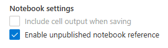
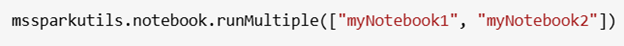
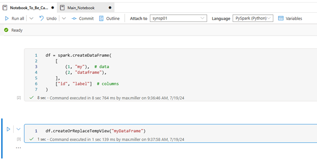
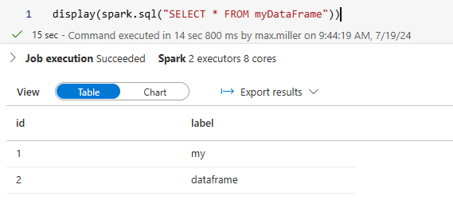
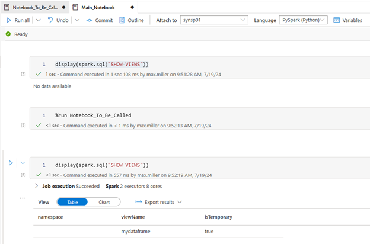
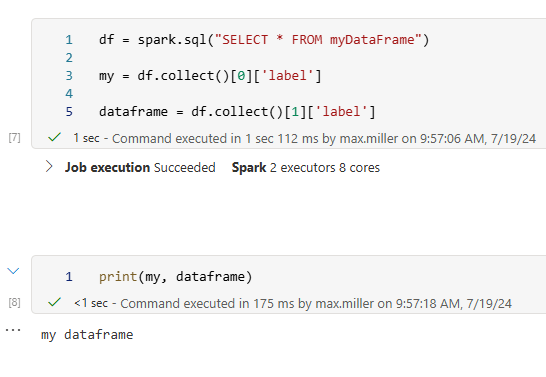

Modern data engineering solutions have evolved to take care of increasingly sophisticated analytics requirements that have arisen from large and varied data generated within enterprises, and the complicated reporting requirements of entire organizations that make use of such data. Within the Azure platform Azure Synapse Analytics hosts a variety of tools for handling each of these specific problems, from managing and building data lakes for given stages of data’s development, to modeling data warehouses on top of those data lakes, and the robust tools for transforming the data in between.

An important piece of Azure Synapse Analytics is the Synapse notebook feature, which serves as a web interface for creating, developing, and visualizing data engineering solutions in a variety of languages, including Python, C#, and R, all with the powerful distributed capabilities of Spark. At its core, Azure Synapse Notebooks provide a collaborative workspace where data engineers can author code, execute queries, visualize results, and share insights—all within a single interface. Leveraging familiar tools like Apache Spark and Python (and even SQL!), engineers can efficiently manipulate large datasets, perform advanced analytics, and build sophisticated data pipelines without the need to manage underlying infrastructure.

### **Working With Notebooks Within Notebooks**

One important feature for working with Synapse notebooks is the ability to call other notebooks within a notebook. This is useful for organizing code so that general functions can be loaded and reused across notebooks in your Synapse workspace, and for controlling the flow of your ETL transformations within the same Spark session instead of calling notebooks separately in Synapse pipelines. Synapse has two methods for calling other notebooks from within a given notebook: the first is to use the %run command within a cell. Example: %run /<path>/Notebook1 { "parameterInt": 1, "parameterFloat": 2.5, "parameterBool": true, "parameterString": "abc" }

Another way to call notebooks from another notebook is to use the mssparkutils.notebook.run command within Synapse that allows for more functionality.

Example: mssparkutils.notebook.run("notebook path", <timeoutSeconds>, <parameterMap>)

In both cases, it is possible to reference unpublished notebooks by selecting the option under Notebook Settings in the properties tab.

The mssparkutils library also includes the option to run multiple notebooks in parallel using the runMultiple command.

These notebooks will all use the same Spark session (very important for smart resource usage) as the current notebook being executed and rely on the underlying size and type of Spark pool for compute. Each of these options for calling notebooks from within another will allow you to more efficiently structure your ETL flow and condense the number of cells needed within your notebooks.

### **Problem – What If You Want to Access Data Saved from a Notebook You Called?**

An important question you will have when calling notebooks: how to access data created within a notebook you called back into the notebook being executed? Variables assigned within the called notebooks will not be accessible to the caller notebook, and the [exit notebook command] only allows you to return strings. You can write data from the called notebook to the data lake and access it from the caller notebook, but there is a more efficient way to save and access data entirely within the Spark session running. This method uses the Spark temporary catalog created when you provision your Spark cluster and start your Spark session to write data, and then allows for that data to be accessed within the same Spark session. Since calling notebooks uses the same Spark session, it maintains the same Spark temporary storage, and so any data written there will be accessible as long as that Spark session is allocated. This allows you to save data frames created within one notebook that is called and load that data back into the main notebook, or even use it in other notebooks you may wish to call.

Using temporary storage in Spark for saving data frames can be done through the Spark createTempView command, which creates a view in the Spark catalog. As an example, we can create a simple Spark data frame in a notebook we will call later and write that data frame to temporary storage.

We can now access data from that data frame using Spark SQL.

Now let’s call that notebook from another notebook, and we can see that we now have access to the data frame in temporary storage. The benefits are great in terms of QA testing and saving time from having to manage data in data lakes.

We can use some simple Spark commands to set data from the data frame as variables in our main notebook.

This method allows us to perform separate logic within individual notebooks and then save that data in our Spark session for us to access within our main notebook for later use.

### **Global versus Standard Temporary Storage**

One final point is that there are two kinds of temporary views we can create with Spark: global and standard temp views. The difference has to do with the scope of access to these views. Standard temp views, like what was shown above, are accessible only within the specific Spark session the notebooks are running. However, if you save your dataframes using the createGlobalTempView Spark command that will make the dataframe available across all sessions within the Spark pool that’s been provisioned. This is useful if you have multiple users running separate Spark sessions that want to share data between themselves, or if your ETL design requires you to activate multiple Spark sessions at once, and you need to share data between them.

In conclusion, the benefits of using Spark temporary storage are that it allows you to efficiently and quickly save data within a given Spark session being run. This is important for testing, as you can save results and compare them to uncover bugs, but this is also useful for passing data from notebooks written to perform specific technical tasks back to your control flow without having to save to a data lake first, making the ETL process more compact and efficient.

[Reach out to us!](https://www.improving.com/contact)
