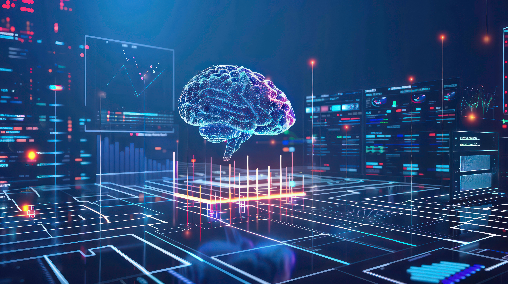

In the age of deep learning and neural networks, it’s easy to overlook the power and value of statistical machine learning (ML) methods that are foundational to the field. Techniques like linear regression, logistic regression, decision trees, and support vector machines (SVMs) may seem outdated compared to complex models with millions of parameters, but they remain incredibly valuable tools in the data scientist’s arsenal. Statistical ML methods offer simplicity, interpretability, and efficiency, making them highly effective for a wide range of applications, especially in environments where transparency and speed are paramount.

One of the key advantages of statistical ML methods is their interpretability. In industries like healthcare, finance, and manufacturing, understanding the "why" behind a model’s predictions is as important as the accuracy itself. Statistical models provide insights into relationships between variables, allowing practitioners to make data-driven decisions with a clear understanding of the underlying patterns.

Beyond their operational benefits, statistical methods are crucial for validating the legitimacy of AI solutions. They provide a rigorous framework for testing hypotheses, evaluating model assumptions, and quantifying uncertainty. This is especially important when deploying AI solutions to solve real-world problems, where accountability and evidence-based decisions are critical. By leveraging statistical methods, practitioners can demonstrate that their AI solutions are not only accurate but also sound, building trust with stakeholders and ensuring compliance with regulatory standards.

The relevance of statistical ML extends to the rapidly expanding field of generative AI as well. As generative models like GPT, GANs, and VAEs are used to create realistic content, statistical methods play an essential role in evaluating and enhancing these solutions. Statistical techniques can help fine-tune generative models by identifying biases, ensuring data distribution integrity, and providing quantitative metrics for evaluating output quality. By integrating statistical analysis into generative AI workflows, practitioners can better control model outputs, ensure consistency, and prevent unintended consequences, such as biased or unrealistic content generation. This blend of statistical rigor and advanced generative capabilities can produce AI solutions that are not only innovative but also trustworthy and aligned with business needs.

Moreover, statistical techniques often serve as the first line of defense in understanding model performance and diagnosing issues. They enable practitioners to conduct robustness checks, assess biases, and validate assumptions before deploying complex AI models. This step is essential in proving that the AI solution is genuinely solving the intended problem rather than exploiting spurious correlations or noise in the data. As AI continues to evolve, the value of statistical methods remains indispensable—not only as standalone tools but also as critical components in validating and legitimizing advanced AI solutions. By integrating statistical competencies into AI workflows, organizations can ensure their models are not just black boxes but reliable and trustworthy contributors to decision-making.

Ready to elevate your AI solutions? [Contact Improving today and discover how we can help you achieve your business goals with cutting-edge statistical techniques.](https://www.improving.com/contact)
