In Kubernetes environments, teams are constantly looking for ways to move faster without sacrificing security or efficiency. Managing multiple environments like development, testing, and staging often leads to cluster sprawl, higher costs, and complex maintenance. This is where virtual clusters come in.

Virtual clusters make it possible to create isolated, on-demand Kubernetes environments that share the same underlying infrastructure. They give developers the freedom to spin up their own clusters quickly for testing new features, running experiments, or deploying temporary workloads, all without waiting on cluster admins or consuming extra resources. Each virtual cluster runs its own control plane, offering stronger isolation and flexibility than namespace-based setups. We’ll be using vCluster, an implementation of virtual clusters by Loft, to illustrate the concept in practice.

Managing workloads across multiple virtual clusters is a common pattern in multi-tenant environments. However, while virtual clusters make isolation easy, moving workloads across them is not straightforward. That’s where Velero comes in. It is a powerful Kubernetes backup tool that migrates workloads from one virtual cluster to another.

In this blog post, we’ll understand the importance of backups, how Velero works, and walk you through a practical migration of resources using Velero, from backing up one virtual cluster to restoring it in another.

## What is Velero?

[Velero](https://github.com/vmware-tanzu/velero) is an open source tool to back up and restore your Kubernetes cluster resources and persistent volumes. You can run Velero with a cloud provider or on-premises.

Velero lets you:

- Take backups of your cluster and restore in case of loss
- Migrate cluster resources to other clusters
- Replicate your production cluster to development and testing clusters

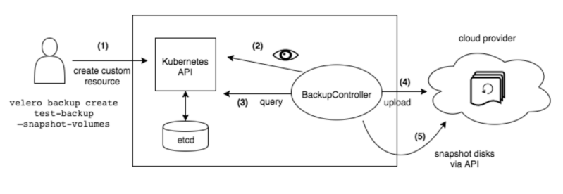

source: velero.io

Velero consists of:

How it works:

1. User runs a Velero backup command using the CLI: velero backup create my-backup
2. CLI creates a backup request in Kubernetes
3. The Velero server detects the request and gathers cluster resources
4. Backup data is uploaded to cloud object storage
5. Persistent volumes are backed up using cloud snapshots (if enabled)

Velero supports a variety of storage providers for different backup and snapshot operations. In this blog post, we will focus on the Azure provider.

## What is vCluster?

[vCluster](https://github.com/loft-sh/vcluster) enables building virtual clusters, a certified Kubernetes distribution that runs as isolated, virtual environments within a physical host cluster. They enhance isolation and flexibility in multi-tenant Kubernetes setups. Multiple teams can work independently on shared infrastructure, and help minimize conflicts, increase team autonomy, and reduce infrastructure costs.

A virtual cluster:

- Runs inside a namespace of the host cluster
- Has API server, control plane, and syncer
- Maintains its own set of Kubernetes resources, operating like a full cluster

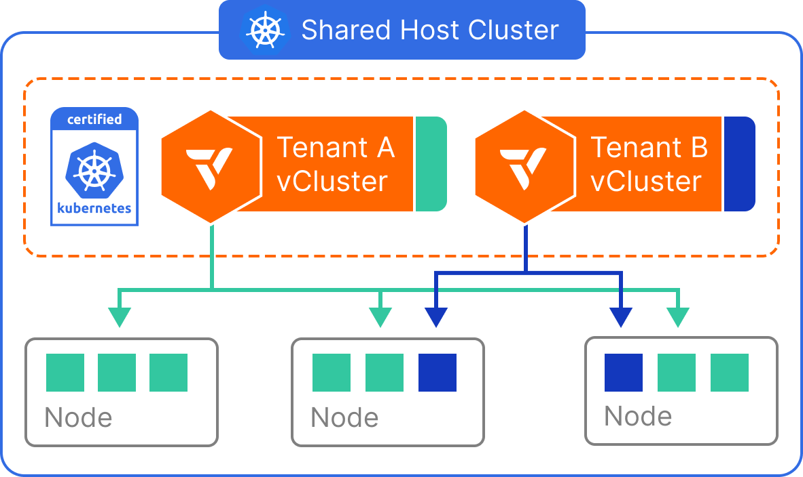

source: vcluster

## Why Backup and Migrate Workloads Using vCluster?

Common reasons to back up or migrate workloads between vCluster are:

- **Promoting apps from dev to staging or prod:** Backing up and restoring workloads between vCluster allows smooth promotion of applications across environments, ensuring consistent configurations and deployments without manual rework.
- **Replicating test environments:** It helps recreate identical test setups quickly, enabling developers to reproduce issues, validate fixes, or test new features in isolated environments.
- **Disaster recovery (DR) setup:** Regular backups across vCluster ensure business continuity by allowing workloads to be restored rapidly in another cluster if the primary one fails.
- **Tenant migration in multi-tenant environments: **vCluster make it easier to move tenants between isolated environments without affecting others, maintaining data security and minimizing downtime.
- **Cluster version upgrades or deprecations:** When upgrading or decommissioning a cluster, backing up workloads to another vCluster ensures a seamless transition without losing data or configurations.

## Why Use Velero with vCluster?

Virtual clusters bult with vCluster are lightweight and isolated, but they don’t provide built-in mechanisms for backing up workloads, restoring them, or moving applications between clusters. Without a backup solution, recovery and migration can be risky.

Using Velero with vCluster fills this gap by enabling simple backup, restore, and migration workflows directly inside virtual clusters. It allows you to move applications between clusters with minimal setup and perform migrations with little to no downtime, especially for stateless workloads.

## How to backup and migrate workloads between vCluster?

Let’s see how to use **Velero** to back up workloads from one vCluster and restore them into another. Think of it as moving your app from *dev to staging *across two clusters running on two different azure clusters.

## Prerequisites

Before starting, please make sure to have the following:

- Two clusters up and running on Azure (user can deploy Kubernetes on with any cloud offering)
- Two running vCluster (source and destination)
- Velero CLI installed on your machine

## Step-by-step Guide

In ‘source’ vCluster and ‘destination’ vCluster, we will install Velero with the same configuration, and deploy a sample MySQL Pod, take its backup at source and restore it in destination vCluster. In our case, we will be using Azure provider to run Velero. To set up Velero on Azure, you have to:

- Create an Azure storage account and blob container
- [Get the resource group](https://github.com/vmware-tanzu/velero-plugin-for-microsoft-azure#Get-resource-group-containing-your-VMs-and-disks) details
- Set permissions for Velero

Velero needs access to your Azure storage account to upload and retrieve backups. So, you’ll need to assign the **“Storage Blob Data Contributor”** role (or equivalent) to the identity or service principal Velero uses, ensuring it can read, write, and manage backup data in the blob container.

- Install and start Velero

Execute the below commands from your terminal, and update the values as per your configuration.

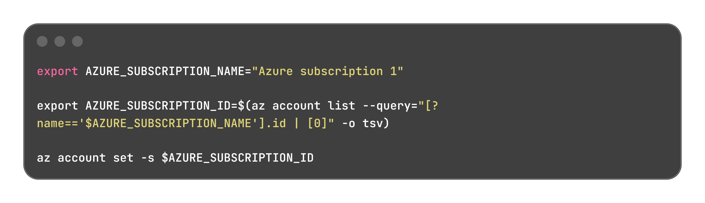

Create Resource group

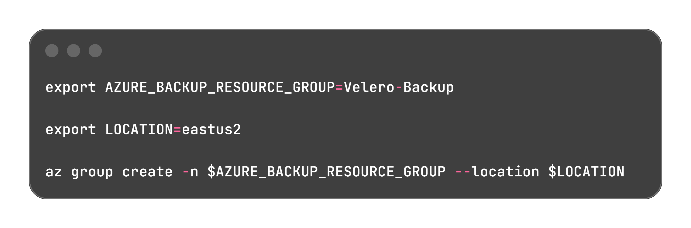

Create the storage account

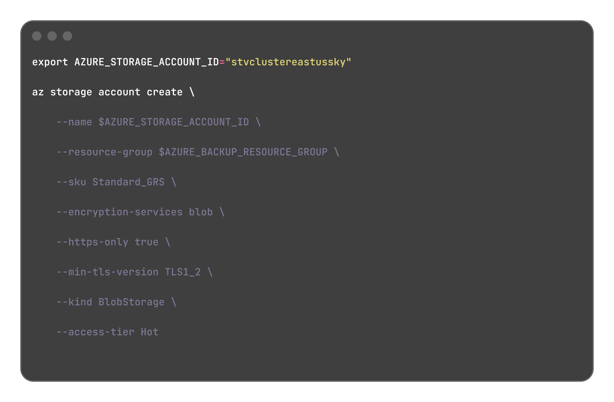

Create a blob container

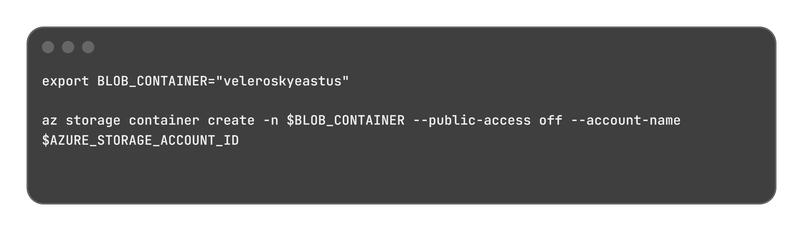

Now create a Service Principal with Contributor privileges.

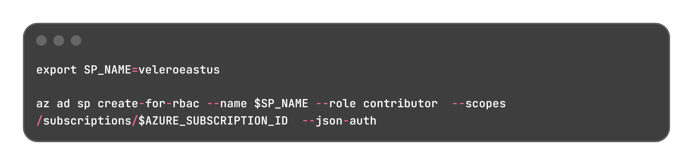

We will get clientID, clientSecret, subscriptionId and tenantId as output

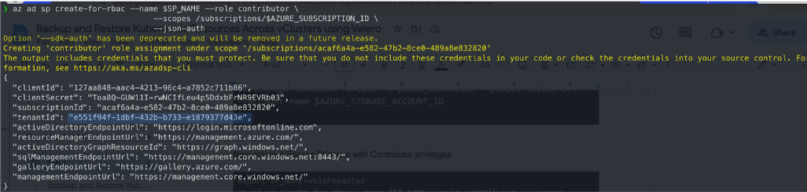

Get the client ID by running the command below and store it in a variable that we will be using in the next command.

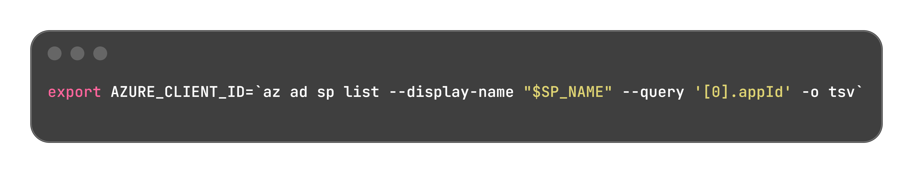

Now we will assign additional permission to the client ID by running the following command

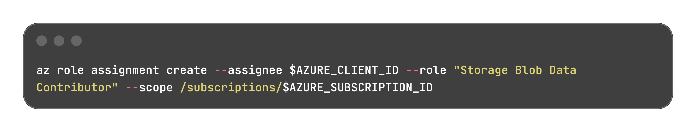

With the JSON output we received above, we will create bsl-creds and cloud-creds for our Velero setup.

Now, **BSL** is a base storage location, which is a blob container in our case. Velero needs a secret to access this storage location and store the backup, so we create BSL creds for this purpose. **cloud creds** is the credentials required to access the Azure cluster. Refer to this [document](https://mcas-proxyweb.mcas.ms/certificate-checker?login=false&originalUrl=https%3A%2F%2Fvelero.io.mcas.ms%2Fdocs%2Fv1.16%2Flocations%2F%3FMcasTsid%3D15600&McasCSRF=937ae9dd235c5af7a968ab92976198f725af69253990848557bf9ae9dec89b6f) to learn more about them.

For creating BSL and cloud creds, we need these keys and values:

`AZURE_SUBSCRIPTION_ID= <YOUR_SUBSCRIPTION_ID> `

`AZURE_TENANT_ID= <YOUR_TENANT_ID> `

`AZURE_CLIENT_ID= <YOUR CLIENT_ID> `

`AZURE_CLIENT_SECRET= <YOUR_CLIENT_SECRET> `

`AZURE_RESOURCE_GROUP= <YOUR_RESOURCE_GROUP> `

`AZURE_CLOUD_NAME=AzurePublicCloud `

`AZURE_ENVIRONMENT=AzurePublicCloud`

Now that we have all the basic setups done, log in to the vCluster to deploy Velero. Once you are logged in to vCluster, we will first encode the above data and create BSL and cloud creds.

Run the below command to create the Velero namespace.

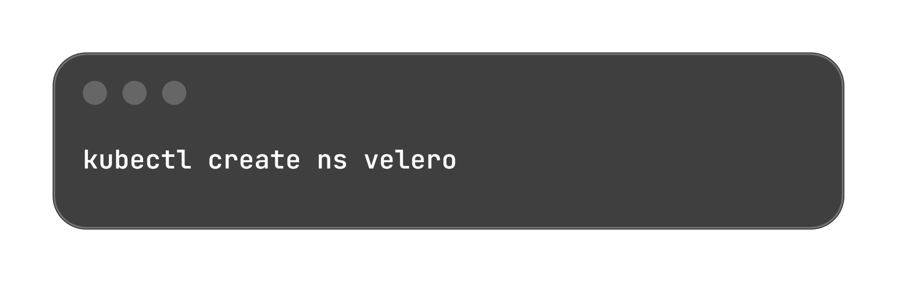

Next, we’ll create **cloud credentials** and **Backup Storage Location (BSL) credentials**.

The cloud credentials allow Velero to authenticate with Azure, while the BSL credentials define where and how your backups are stored in the Azure blob container.

**bsl-creds.yaml**

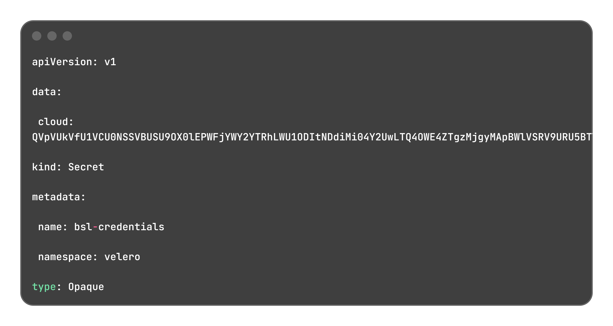

**cloud-creds.yaml**

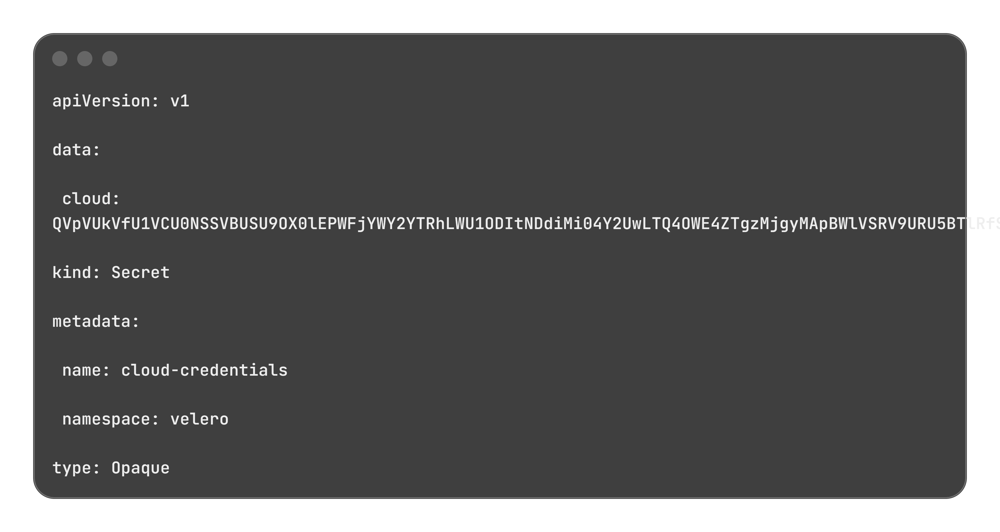

Run the below command to create the secrets.

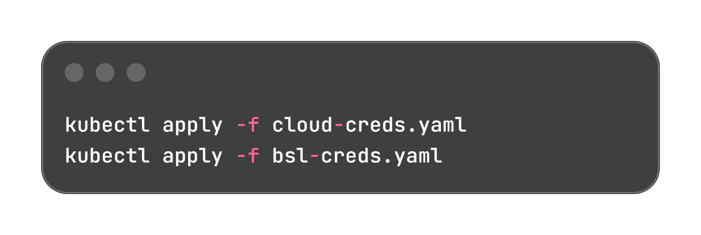

After the secrets are created, we will install Velero in the vCluster

We will use Helm to install Velero. First, we will update the default values.yaml file. We need to change the configuration section mainly. Both for source and destination, we will be using same values.yaml for installing Velero

values.yaml

Run the below command to install the Helm chart.

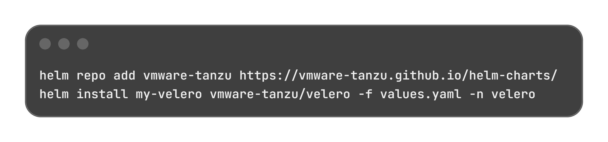

Once you run the above command, you will see velero and node-agent pods running in the Velero namespace.

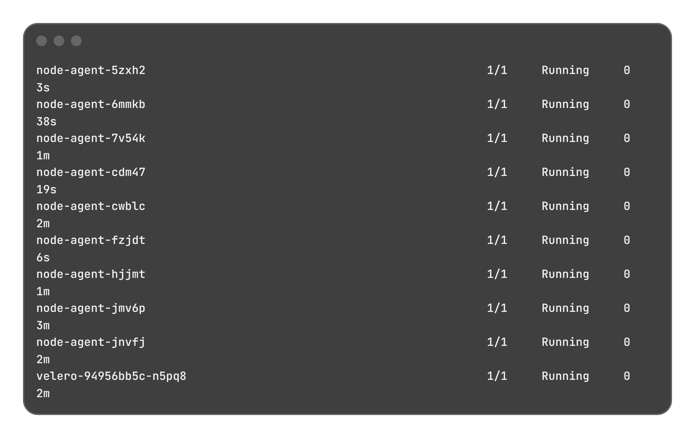

The same steps need to be repeated in the destination cluster to get Velero up and running.

Now we will deploy a sample mysql-pod, take its backup, and restore it in the destination vCluster

mysql-pod.yaml

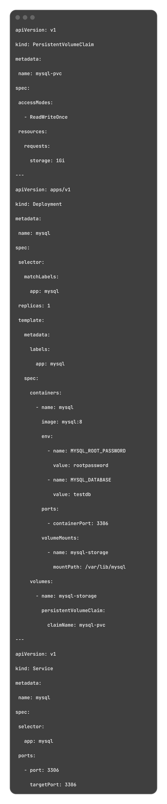

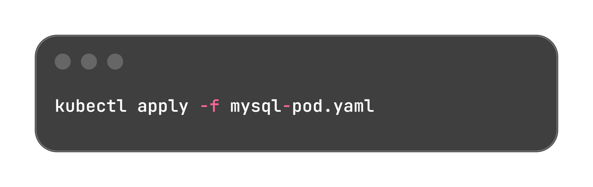

Once we run the above command, a mysql-pod will be created. Next, we need to add some data to test the backup and restore. For that exec into the pod and run command below

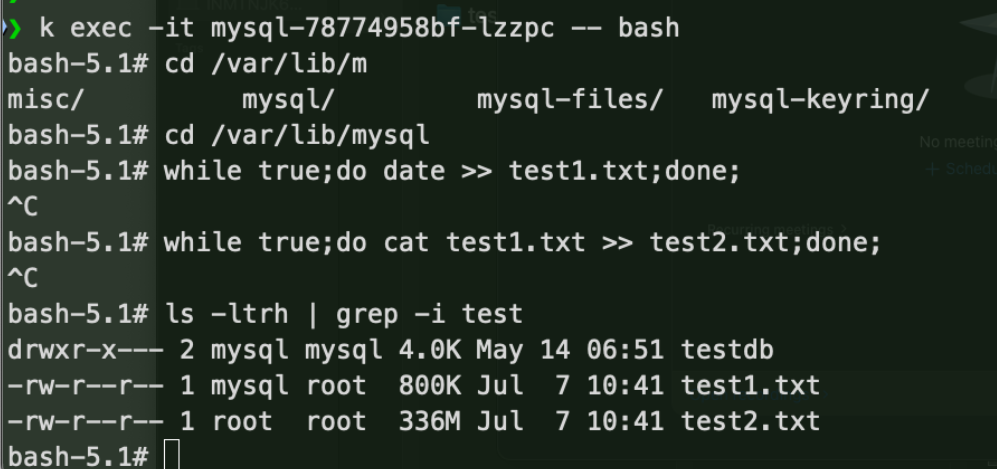

We will run below command to add some data:

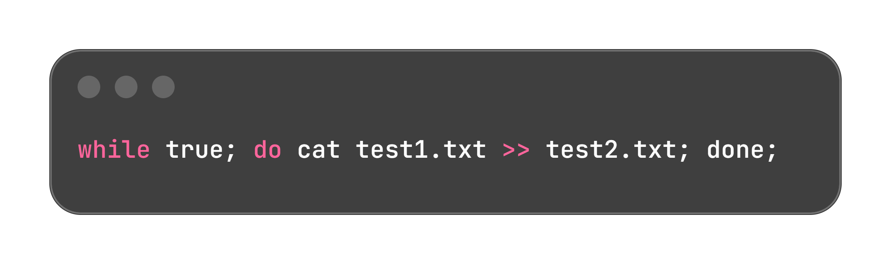

This will create two files, test1.txt and test2.txt

After we have the data, we will take a backup now.

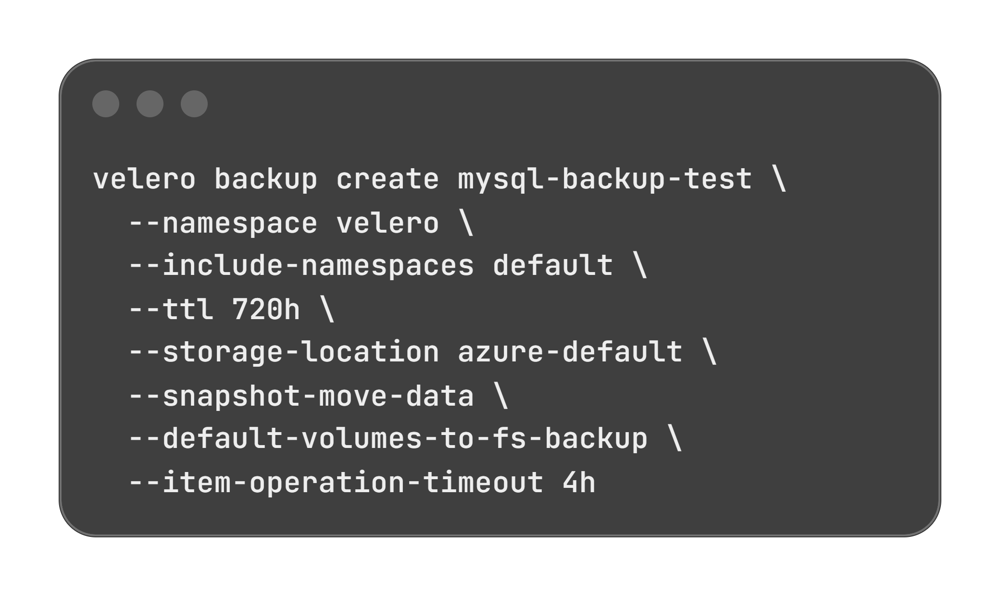

Run the above command to create the backup. After creating the backup, run the following command to check the backup status.

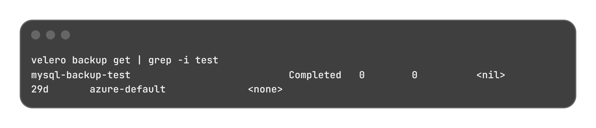

Backup status should be completed. Now, to perform the restore, log in to the destination vCluster.

Make sure that the Velero config is the same as the source cluster and use the same values.yaml to install Velero in the destination cluster, expect the following two parameters.

Make these two changes, search for them in values.yaml, and update them.

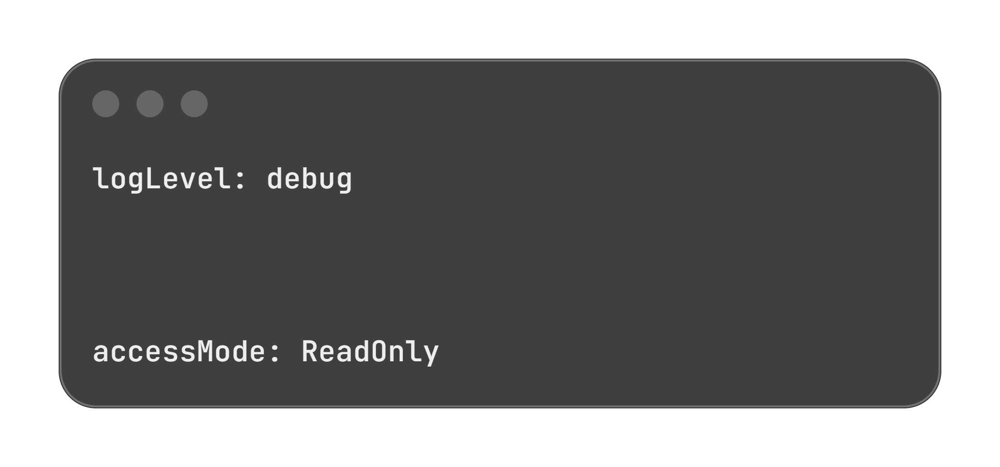

After the Velero is successfully installed at the destination vCluster. Run the below command, it will show the same backup of the source vCluster as we have used the source cluster’s velero values.yaml.

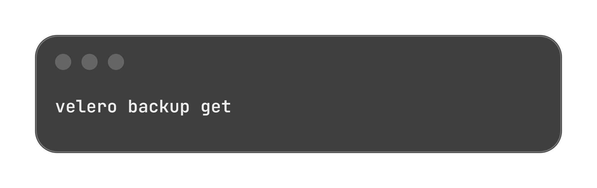

You will see the same backup list as the source vCluster. The next step is to restore the backup.

**restore.yaml**

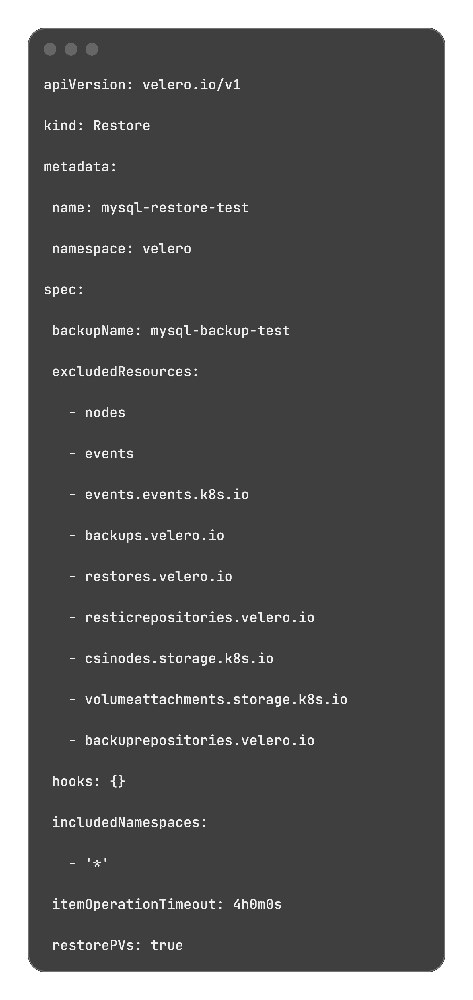

Run the below command to create a restore.

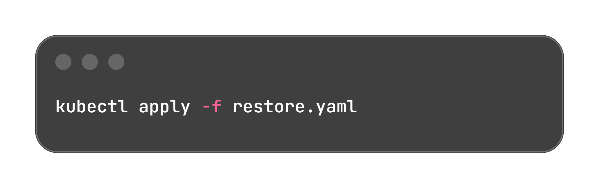

Then run the below command:

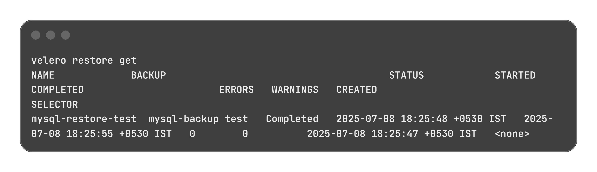

To verify the restore, attach the PVC (created after the restore is complete) to a pod, exec into it, and check the data.

## Troubleshooting Tips

While we take a backup and restore, we may face a few errors. For eg:

**Issue 1: The Backup status is PartiallyFailed or FailedValidation**

**Solution**: In such cases, first describe the backup with detailed parameters and look out for errors, if any

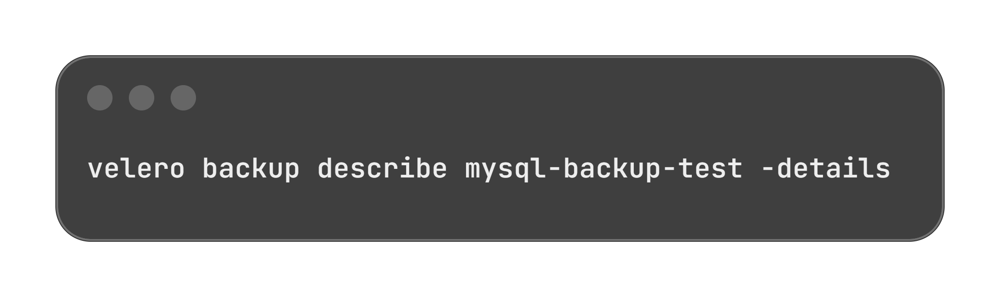

And check the logs of backup using the below command.

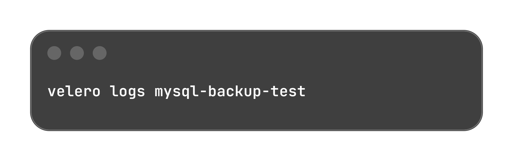

If you do not find anything useful here, then check the logs of velero pod and grep it with the backup name:

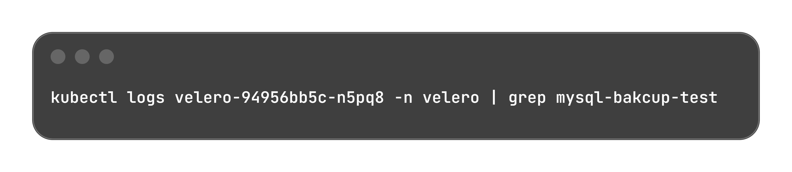

After running the above three commands, you will surely have some clue about what the issue is. It can be due to a permission issue; in that case, review the permission again. Another reason can be incorrect credentials.

Sometimes, it also fails partially due to the node-agent pod not running on any node. In that case, schedule a pod on that node.

**Issue 2:** **Node agent pod is not running**

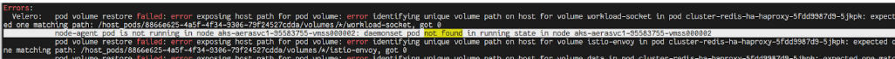

**Solution:** There is a node on which none of the pods are running, and so we need to manually schedule a pod on that node. Once the sample pod is running, the node agent pod is also scheduled on that node and starts running.

**Issue 3: Sometimes restore fails without giving any specific errors**

**Solution:** We need to restart the restore process from scratch.

1. Delete all the resources created by the restore job, i.e., pods, statefulsets, deployments, PVC, etc. OR
2. If you are restoring the whole namespace & the backup has been taken for the whole namespace. Then you can also delete the entire namespace that was currently restored.
3. Delete the restore job.

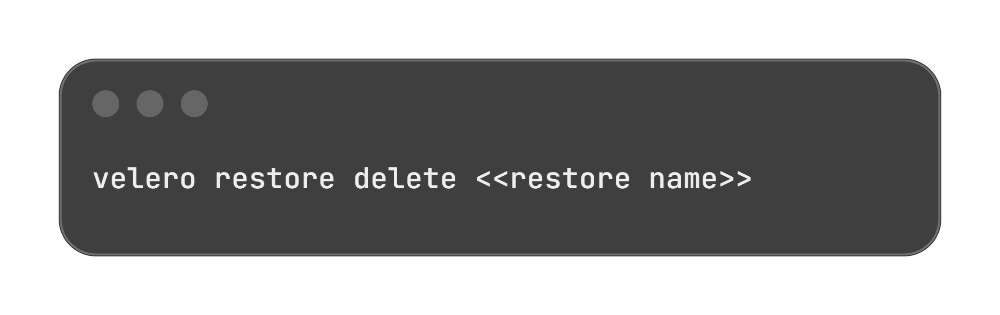

4. After the restore job is deleted, ArgoCD will automatically sync & create the restore job. This will trigger the Velero restoration.

## Conclusion

Using Velero to back up and restore workloads across vCluster provides a robust and flexible approach for managing multi-tenant Kubernetes environments. Whether you're migrating applications between development and production, setting up disaster recovery, or replicating environments for testing, Velero simplifies the process significantly.

In this blog post, we explored how to back up and restore Kubernetes clusters using Velero. While the process is straightforward in principle, production environments can introduce added complexity. Factors like cluster size, workloads, and configurations often make a difference. If you're planning a migration or looking to strengthen your backup strategy, you can get in touch with our [Kubernetes experts](https://www.improving.com/expertise/applications/cloud-native-development/) to help you out. To discuss this blog post, you can find me on [LinkedIn](https://www.linkedin.com/in/richa-mishra-5028061b4).
