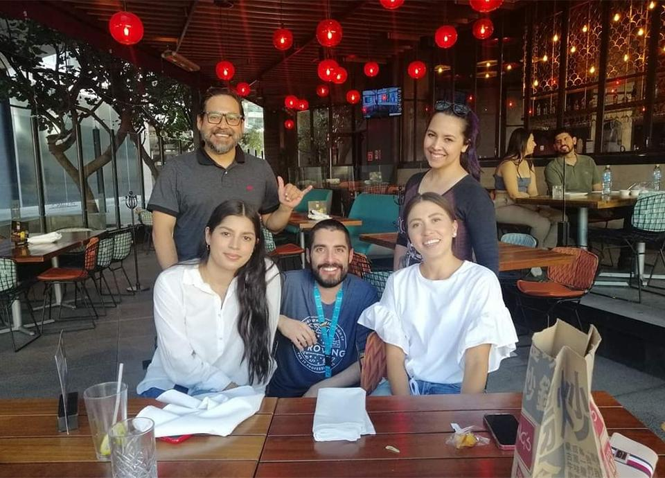
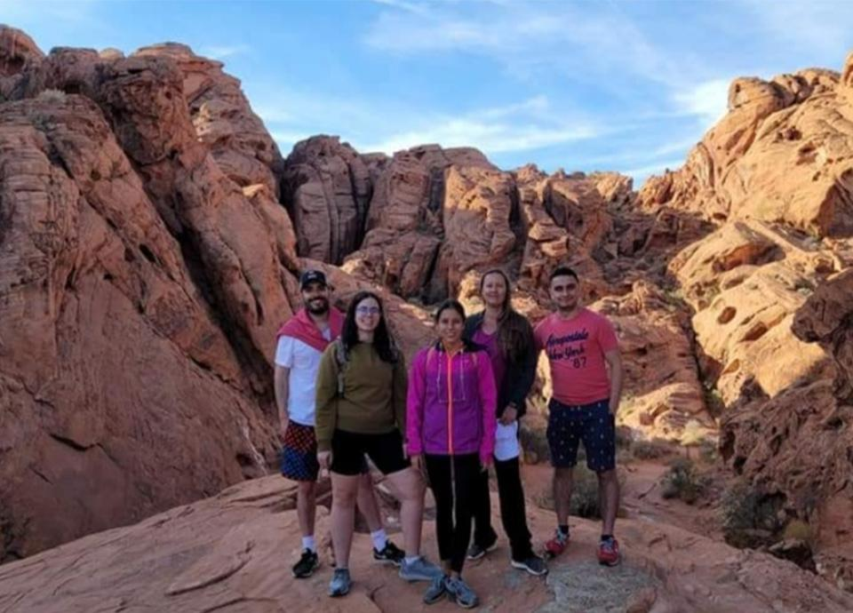
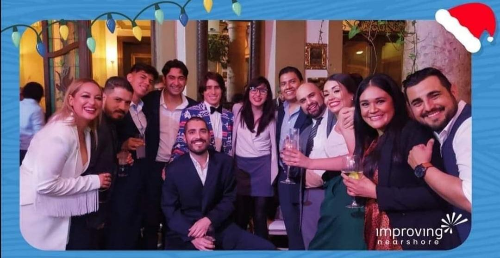

I have always been a people person. The caretaker hat has fit me perfectly for most of my life, and I really love it. It’s even part of my job description as a Talent Management Specialist at Improving Nearshore.

That is why it’s important for me to be out and proud. I want to normalize things for that one person, that one young boy or girl, to be able to say they are not alone. Visibility changes lives and I live by this truth every single day. Whatever it took for me to reach this point in my life makes it all worth it if I can share my story with people around me, and make it easier for younger generations (or whoever needs to hear it) to go through it.

I have never felt ashamed of wearing my heart on my sleeve or talking about personal things because of this simple fact: someone out there will feel less lonely and less bad about themselves if you can get through to them. It’s way easier to experience something difficult if you feel like someone else did it before you and is willing to talk about it without fear of oversharing or being self-conscious.

I’ve always cared a great deal for the well-being of people around me. That extends to my fellow Improvers as well. Not because I’m paid for it, but because I truly feel like we are a big family. I am who I am today because of the amazing people I’ve met along the way who made me feel part of their tribe when I thought (wrongly) that I was alone and didn’t fit anywhere.

I also welcome people labeled "different" with open arms. Inclusivity goes beyond gender and sexual orientation. It means that geeks, glam girls with bright long nails, artsy people, sporty folks, people who hate videogames, people who love them, developers and QAs in their everlasting friendly “fights”, short people, bigger people, foreigners, loners, anxious people, and ANY other “uncommon” group have a special place in the world and at the company.

*That’s why I love it when I can witness this inclusivity for myself at Improving.* Every day, folks find their footing and realize they have the freedom to be accepted for who they are while working at Improving. Way before I started here, my life motto and what I’ve strived to accomplish has been this: to build communities based on mutual respect and acceptance. ANYONE can be a part of it. This is how we roll at Improving!

## Pride History

It's no coincidence that this month we’ll be celebrating “Inclusion and Diversity” for the Come Together Initiative. Part of it has to do with the fact that June is Pride month internationally.

Early in the morning of June 28th, 1969, LGBTQ people rioted following a police raid on the Stonewall Inn in the Greenwich Village neighborhood of Lower Manhattan. The Stonewall Inn was a gay bar that catered to an assortment of patrons but was popular with the most marginalized people in the gay community: transvestites, transgender people, effeminate young men, hustlers, and homeless youth. This raid happened after years of violence and abuse.

The following year (on June 27th, 1970) the Chicago Gay Liberation organized a march from Washington Square Park to the Water Tower at the intersection of Michigan and Chicago Avenues. The date was chosen because the Stonewall events began on the last Saturday of June and because organizers wanted to reach the maximum number of Michigan Avenue shoppers. Subsequent parades have been held on the last Sunday of June, coinciding with the date of many similar parades elsewhere, to commemorate this watershed moment in history.

## But What Exactly Does Pride Mean?

The term comes down to this: it is not necessarily that you are proud to be gay (because it’s no different than being straight). **It means you are proud of living your life in the open and not apologizing for it. **

To me, Pride matters because everybody should feel comfortable and safe being themselves wherever they are in the world. I was conditioned my whole life to be disgusted by gay people and breaking that frame of mind is difficult. It also provides an opportunity for LGBTQ families to be visible in large numbers. Today, I can live out and proud, having a completely different life than those who paved the way for me. A lot of brave men and women fought for that. What we have today is thanks to them.

How often do we take the time to inform ourselves when we feel less secure in our understanding of something different than what we are used to? There are things that go well beyond our own field of interest and expertise, requiring us to stay awake to the world around us. We don’t need to be experts on every subject, but we should be informed.

I would argue that these conversations are what make us grow as people and understand one another. They help reveal our biases, our blind spots, and our confusions which can pave the way for poor questioning and missed opportunities. We need to keep pushing ourselves out of our “comfortable knowledge bubbles”. Isn’t that the joy of living? To be able to learn, grow, and adapt?

## My Personal Journey:

I’ve always maintained that most people who are uncomfortable with this whole “gay thing” just don’t know how to behave or what to say. I don’t think it is because they are homophobic, but they need to learn more about it. They need to ask questions and have conversations.

Many of them have to deconstruct what they have been told throughout their lives. Everyone starts out this way, even in my case. We fear what we don’t know, and we reject what we fear. That is why it has always been extremely important to me to build bridges and learn how to communicate properly with people who think differently than me.

But this hasn’t always been the opinion I have had. When I started this personal process almost 17 years ago, I wanted to be loud. I wanted to debate anyone who made me feel bad about who I was. But I learned with time that honey takes more flies than ice. It required a lot of patience and understanding, which did not come easily to me at first, but I learned to fight my own limitations and character flaws.

I want to give you an example of something that happened at Improving because it was totally unexpected and a game-changer for me. I was once asked to speak about Pride month (what it meant, how and why the June Marches started, etc.) in front of everyone at my site. I remember that day vividly. I had been at the company for roughly five months and most people had already warmed up to the idea that there was an “out” coworker in their midst. But there were still some people who still felt uncomfortable about it.

I wasn’t expecting a big turnout at all. So, imagine my surprise when 50+ people showed up to the talk. I was beyond nervous and worried about people’s reactions to what I was about to talk about and share. While I was prepared to talk about Pride, I decided on the spot to share some personal stuff as well.

I can’t begin to describe how this moment felt to me. It was a culmination of everything I had learned about myself, what I had gone through over the years, and most importantly, the experiences I had already gained since coming out by talking to people and reaching common ground. It was one of the most emotional moments of my life, for sure. I even acknowledged this at the start of my pitch in front of everyone (I think I called it my “second coming out” to break the ice).

After what felt to me like hours, my presentation was done. I could see crying faces all around me. I also shed a few tears during the presentation and I was not prepared for what came next. Most of the audience stayed, wanted to hug me, talk more, and congratulate and thank me. The people I was nervous about at first were also very moved and reached out to me.

I was so touched during this moment that all I wanted to do was leave and have a private moment to myself for a few minutes. I had just bared my soul in front of my work family, and they had responded so positively that it was beyond belief. I was hugged and fully accepted by everyone. I also realized that this marked a before and after at our site.

Most of the time we talk to or see our coworkers even more than we do our own families and friends. That is why, at Improving, we love the fact that it is a culturally diverse company. That is one of the reasons we are a great place to work! We respect the personal dignity, privacy, and rights of each employee and are committed to maintaining a workplace that feels like a second home.

***Diversity is beautiful.*** Let’s all live by that every day of our lives.

Do you want to talk with me about this topic? [Email me](mailto:armando.lopez@improving.com) and I will be more than happy to get to know you. To learn more about Improving and our job opportunities, [reach out](https://improving.com/contact) to Improving!
