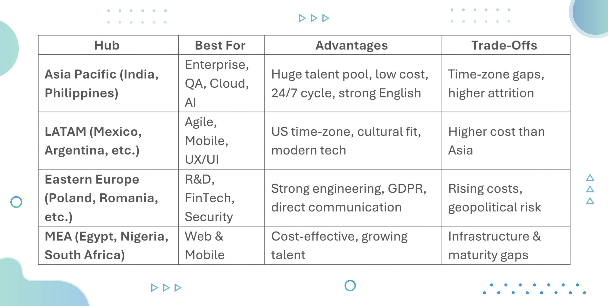
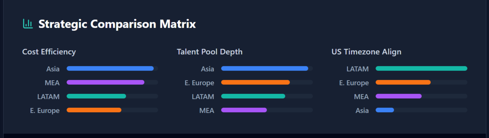

A dedicated outsourcing development center can give you access to global talent, lower costs, and scalability. But not all outsourcing hubs are equal, each region and country comes with its own mix of strengths and trade-offs. Some countries are very inexpensive but lack experienced engineers; others offer high technical skills but at premium rates. Some have strong English communication but may pose cultural or time zone challenges; others are cost-effective but may suffer from unstable regulatory or political conditions. Choosing the right outsourcing location, whether for a long-term overseas outsourcing arrangement or a short-term project, requires a careful look at cost, talent quality, communication, time zones, and stability. In this blog post, we will cover the best regions and countries for outsourcing software teams, highlight what makes them attractive (and what to watch out for), and provide a practical checklist to help you evaluate potential offshore and nearshore partners with confidence.

## Best Countries to Outsource Software Teams

## 1. Asia Pacific

**Top Countries:** India, Philippines

**Best For:** Large-scale enterprise projects, QA/Testing, Cloud-native development, and AI/Machine Learning

For decades, Asia has been the go-to destination for outsourcing software development. APAC is ideal for organizations seeking massive scalability. The sheer volume of engineering graduates produced annually in Indian region allows companies to scale teams from 5 to 50 in a matter of weeks. It is particularly strong for enterprise-level support, cloud migration, and legacy modernization.

### Top countries for outsourcing in Asia

- **India:** India offers unmatched scalability and a mature ecosystem of Service Integrators. From legacy system maintenance to cutting-edge AI and Cloud DevOps, talent exists here.
- **Philippines:** Known for exceptional English proficiency and Western cultural compatibility, making them ideal for frontend and QA roles that require heavy communication.

### Strengths & key advantages

- **Deep Talent Pool:** India alone produces over 1.5 million engineering graduates per year.
- **24/7 Development Cycle:** The time zone difference (10–12 hours from the US) allows for a "follow the sun" model where work continues while the onshore team sleeps.
- **English Proficiency:** India and the Philippines have high English fluency, making them distinct from other low-cost regions.
- **Cost-Efficiency:** It remains one of the most cost-effective regions for high-volume staffing.

### Tradeoffs

- **Time Zone Gaps:** While good for 24/7 cycles, real-time collaboration can be difficult without flexible working hours.
- **High Attrition:** The market is competitive; retention can be a struggle if you don't partner with a top-tier firm.

## 2. Latin America (LATAM)

**Top Countries:** Mexico, Brazil, Argentina, Costa Rica, Guatemala

**Best For:** Agile product development, Staff Augmentation, Mobile App Development, and UX/UI design.

For North American companies, LATAM has become the premier destination for nearshoring. The primary advantage here is not just cost, but synchronization. When your engineering team is online at the same time as your product team, iteration cycles speed up dramatically. LATAM offers the perfect balance of cost and convenience. It is the premier choice for Agile teams that require real-time collaboration. Most major LATAM hubs offer a 4-8 hour overlap with US and Canada working hours, meaning your outsourcing software development company is essentially working the same hours you are.

### Top countries for nearshoring in LATAM:

- **Mexico: **With the [USMCA trade agreement](https://ustr.gov/trade-agreements/free-trade-agreements/united-states-mexico-canada-agreement) and physical proximity to the US, Mexico boasts a massive talent pool familiar with US business culture. Often called the “Silicon Valley of Mexico,” Guadalajara is a leading tech hub with strong engineering talent.
- **Guatemala: **With its growing pool of bilingual tech talent, competitive costs, and increasing investment in digital infrastructure, Guatemala is emerging as a promising nearshore destination for software outsourcing.
- **Argentina: **A rapidly growing hub with strong government support for IT and high cultural affinity with the US.

### Strengths & key advantages

- **Time Zone Alignment:** Teams work in CST/EST/PST, enabling instant feedback loops and simultaneous Scrum ceremonies.
- **Cultural Affinity:** There is a strong cultural overlap with Western business practices, leading to smoother integration with internal teams.
- **Tech Savviness:** Strong focus on modern stacks (JavaScript frameworks, Mobile development, UX/UI).
- **English Proficiency:** High proficiency, particularly in Mexico and Costa Rica, reducing the barrier to entry.

*As Guillermo Ortega, President of Improving Mexico, states: *

*"Outsourcing in LATAM and India is more than only cost-effectiveness. Our clients have found a true innovation partner that makes their business goals possible through collaboration, convenience, and technology savviness."*

### Tradeoffs

- **Cost:** Due to high demand from the US, rates in LATAM are generally higher than in Asia or Africa, though considerably lower than onshore.
- **Economic Volatility:** Certain countries (like Argentina) face economic fluctuations, though established tech partners usually insulate clients from this.

## 3. Eastern Europe

**Top Countries:** Poland, Romania, Czech Republic, Ukraine

**Best For:** Complex R&D, FinTech, Cybersecurity, and automotive software

Eastern Europe has built a reputation for high-end engineering, rooted in a strong educational history of mathematics and science. If your project involves complex algorithms, security protocols, or deep R&D, Eastern Europe is a strong contender. The developers here are often viewed not just as coders, but as product engineers who challenge specifications to improve the final outcome.

### Top countries for outsourcing in Eastern Europe:

- **Poland:** The central hub. Highly stable, EU member (GDPR compliant), and home to developers who consistently rank high in global coding competitions (HackerRank, TopCoder).
- **Romania:** Excellent balance of cost and quality, with widely spoken English and French.
- **Ukraine:** Despite geopolitical challenges, Ukrainian developers remain renowned for their resilience and high-level technical output.

### Strengths & key advantages

- **High-Quality Code:** A strong emphasis on architectural integrity and mathematical precision.
- **Direct Communication:** The work culture is direct and efficient; developers are known for their candid feedback and problem-solving mindset.
- **GDPR Compliance:** Being part of or near the EU means strong adherence to data security and privacy standards.

### Tradeoffs

- **Geopolitical Risk:** The ongoing conflict in Ukraine has created hesitation in the region, though countries like Poland and Romania remain stable and secure NATO members.
- **Rising Costs:** As the region integrates more with the Western European economy, rates are climbing steadily.

## 4. Middle East & Africa (MEA)

**Top Countries:** Egypt, Nigeria, South Africa, UAE

**Best For:** Web development, mobile apps, and organizations prioritizing value-based scaling.

While less saturated than Asia or Europe, the MEA region is rapidly digitizing and becoming a hub for value-based scaling. This region is attractive for companies looking to diversify their talent supply chain. With a young, tech-hungry population and increasing government investment in technical education, it offers a "ground floor" opportunity for hiring.

### Top Countries for outsourcing in MEA & African region:

- **Egypt:** A government-backed tech hub with excellent time zone alignment for Europe and competitive costs.
- **Nigeria:** Popularly known as "Silicon Lagoon" of Lagos, it is producing a generation of self-taught and bootcamp-trained developers eager for international work.
- **South Africa:** A more mature market with native English speakers and high cultural compatibility with the UK/Australia.

### Strengths & key advantages

- **Growing Talent Ecosystem:** Massive youth population eager to upskill in modern technologies.
- **Cost Advantage:** Very competitive pricing compared to Eastern Europe and LATAM.
- **Language:** South Africa and Nigeria have strong English capabilities.

### Trade offs

- **Infrastructure:** Power and internet stability can vary significantly by country (though established tech hubs usually have redundancies).
- **Maturity:** The project management maturity may vary compared to the established processes found in India or Eastern Europe.

## Comparison Table

## Hybrid Model

A hybrid outsourcing model combines teams from two different regions to leverage their respective strengths. One location may handle tasks that require real-time communication, tight feedback loops, or deep product involvement, while another location focuses on high-volume development, backend processing, testing, or long-running tasks. Instead of placing all your development resources in a single country or time zone, you distribute work strategically across multiple geographies based on capability, availability, and collaboration needs.

**Best For: **Companies that want to balance cost, speed, talent depth, and risk diversification without relying on just one region.

### Why choose a hybrid approach?

- **Optimized Talent Mix:** Access different skill strengths from different regions.
- **Better Coverage:** Near-24-hour development cycles without overworking any single team.
- **Cost Balancing:** Mix premium talent with more cost-efficient resources.
- **Risk Diversification:** Reduced dependency on a single economy, political environment, or labor market.
- **Scalability:** Easier to expand or contract teams based on regional availability.

## Important Things to Look at When Considering Location for Outsourcing

Before signing a contract with an outsourcing software development company, explore the location and the partner against these criteria:

- **Security & IP Laws:** Does the country have legal frameworks that protect your Intellectual Property?
- **English & Communication:** Don't just check for "fluent" on paper. Interview the lead engineers to assess conversational ability and cultural nuance.
- **Attrition Rates:** Ask the vendor about their employee retention. High turnover in the offshore and nearshore teams kills momentum.
- **Infrastructure Redundancy:** Does the dedicated development center have backup power and diverse internet connections?
- **Overlap Hours:** Keep at least 3-4 hours of working overlap for meetings and unblocking issues.

## Final Words

Choosing the best place to outsource software teams is about aligning a region's strengths with your business goals. Asia offers unmatched scale; LATAM offers unmatched collaboration; Eastern Europe offers deep technical expertise. However, the most successful companies don't just pick the location, they pick an outsourcing partner with global reach.

Improving has strategically positioned itself to offer the best of both worlds. Through strategic acquisitions, we have established world-class delivery centers in both LATAM (Nearshore) and India (Offshore). Our outsourcing centers allow us to offer a hybrid model that provides the cost-efficiency and scale of India, combined with the real-time collaboration and cultural alignment of the Americas. [Contact us today](https://www.improving.com/contact/) to learn why Fortune 500 and global enterprises trust Improving to help outsourcing software development.
