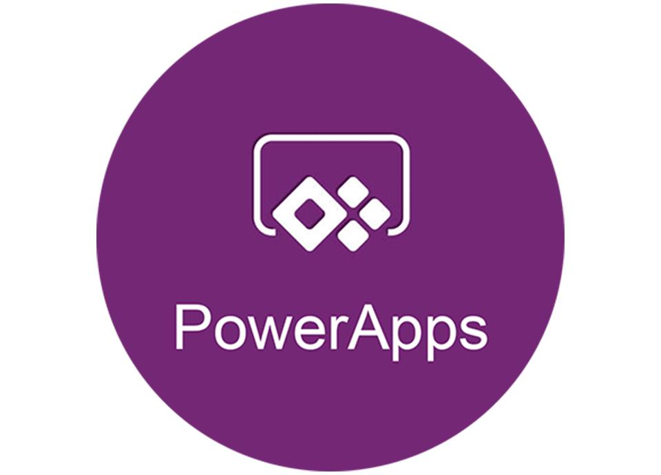
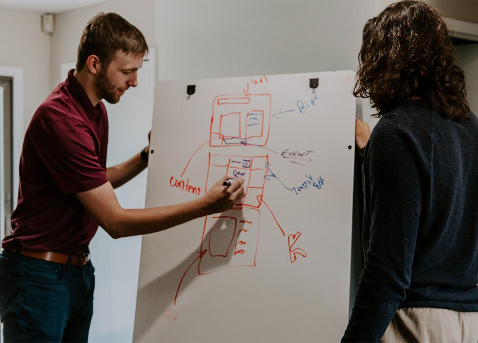

As part of the Microsoft Power Platform, Power Apps delivers on the promise of saving time and expense of traditional development efforts by enabling non-developers to quickly create useful applications within the Microsoft 365 environment. Unfortunately, the merits of this approach lose a little of their luster when the finished product does not have a good look and feel or is not easy to use. The benefits further fade if a rudimentary technical architecture makes it harder to create consistency or accommodate the inevitably requested changes.

So how do we find the sweet spot between the weaknesses of a bare-bones app and the expense of full-fledged development? The answer: ***embrace design***. Even a modest effort to incorporate sound User Experience (UX), User Interface (UI), and architectural design principles and best practices will pay off when your Power App is more intuitive and consistent. It will also be easier to support and maintain.

## UI/UX Design for Power Apps

The key to good UI/UX design is to empathize with users – start by striving to understand what they need to accomplish and why it is important. Define the app to help users accomplish their goals, iterate to find patterns that make sense, and test whenever possible with stakeholders and users to make sure the app is on track.

### Collaborate

The UX designer and Power App developer need to collaborate from the beginning by interviewing client stakeholders together. Creating and reviewing low-fidelity wireframes and user flows together will sift through the many control and component options Power Apps provides and help find unique solutions that provide the best possible experience for users.

### Build Consistency & Find the 'Happy Path'

Because consistency is the key to a great experience, create page layout templates with a consistent flow to guide users down the desired path. Keep all menus and controls in familiar places and establish patterns that are consistent throughout so users learn what to expect next, eliminating fear and doubt. The *Happy Path *for end-users is the easiest and fastest way to the end goal. Reduce clutter and extra clicks or taps to create an intuitive interface experience and push to find more efficiencies at every step. Always be asking if it can be even easier and faster.

### Prototype & Get Feedback

Power Apps makes it easy to quickly prototype and create something which looks realistic to find flaws and improve the experience every step of the way. This creates less throw-away work and a leaner process that emphasizes communication over documentation—it is always easier to show them rather than describe how it will work. Get stakeholders and users involved early and often to test the prototype, watch them complete basic tasks, and get their feedback. Refine and repeat to build an app that you can be assured meets their needs.

## Architectural Design for Power Apps

Good architecture design embraces patterns and techniques that provide flexibility and easier maintenance. While you might be able to get a win with a quick and dirty solution, there is value in being thorough so that your approach can solve the immediate issue as well as those that are likely to come up in the future.

### Be Selective

With great power comes great responsibility – there are over sixty controls available within the Power Apps development environment. The challenge is to select the right ones and set them up to deliver on your requirements. A quality Power App will use fewer than ten different controls, grouped into components to build sophistication. While it is possible to extend the set of Power Apps controls, strive to use what is available out of the box to avoid customization pitfalls.

### Think Globally

Use global styling to make it easier to consistently apply changes when they occur – change the font and size once on a globally styled field label rather than hunt down dozens of individual elements that were styled manually. The group controls into global components to improve consistency, scalability, and re-use. This also helps eliminate duplicate code and makes it easier to uniformly apply any logic changes.

### Separate Concerns

Power Apps provides the ability to generate application screens from the structure of underlying data sources and a common practice is to use a SharePoint list to store data records. This can provide a great head start, but if the record has a lot of fields, the generated interface and standard save process can be cumbersome. In this case, a better approach is to allow the user interface to break the process down into digestible logical steps and use an atomic save technique to save the record using a series of small independent updates. Separating concerns provides a better user experience by ensuring the needs of the user take precedence over any underlying technical details or limitations.

## Getting Results from Power Apps

A client recently requested help building a small mobile application that was estimated to be eight weeks of effort using a traditional development process. Hoping to get it done for less, we found that Power Apps could be used to provide a functional app in just one week. Once underway, it became clear that the bare-bones approach was going to deliver a solution that would fall short of end-user expectations. A compromise was reached to add UX/UI and technical resources that would work collaboratively to improve the Power Apps approach. The project effort expanded to three weeks, but embracing design ended up creating a far superior finished product with buy-in from all involved.

### Key Elements to Success

- Work with the project sponsor to understand the value possible from a slightly larger investment
- Commit to using OOTB features and functionality in smart and efficient ways
- Involve seasoned UX/UI and technical design resources
- Ensure that resources and stakeholders can collaborate without friction
- Iterate often to regularly review progress and test with stakeholders and end-users

## Conclusions

Adding a design-centric process and seasoned UI/UX and technical resources to a Power Apps project will provide a substantial ROI. While an incrementally larger investment than the bare-bones approach, it is still far less than the traditional development model, and building a better app that is easier to use and maintain benefits everyone. Just as Power Apps adds to the value of Microsoft 365, embracing design adds to the value that Power Apps can provide to your organization.
