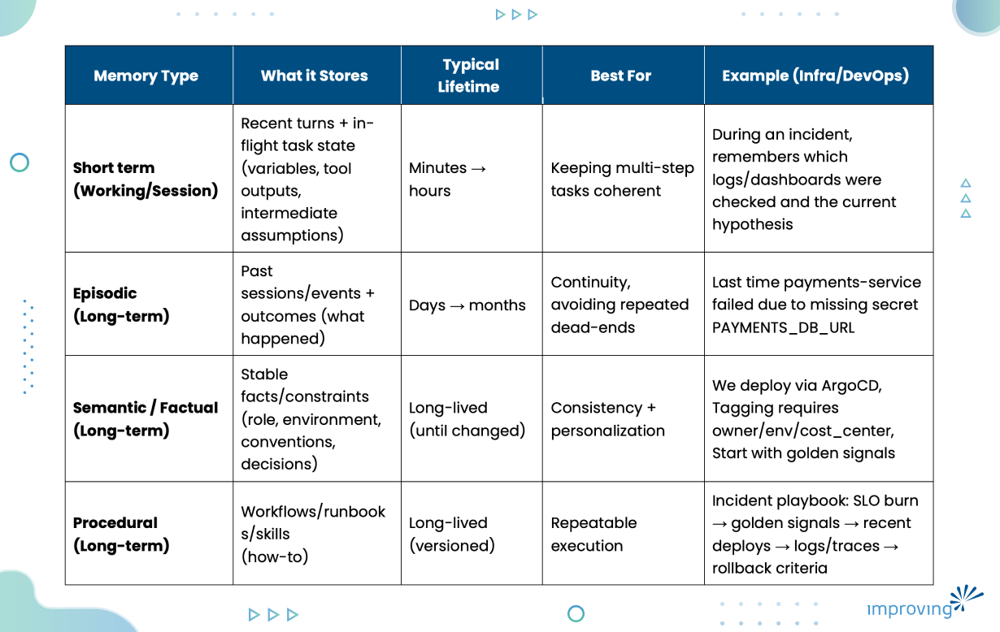
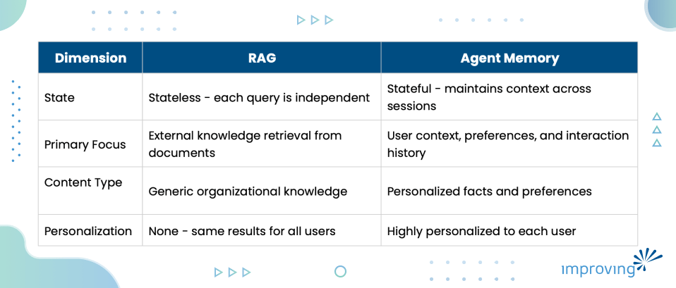

AI is almost everywhere now from agentic coding, autonomous workflows to day-to-day engineering tasks that you want to delegate to an agent. In many cases, an agent looks impressive in a single turn: you dump all the details of your pipeline or cluster issue into one prompt, and it responds with clean reasoning and a plausible plan. The trouble starts when you try to work like a human does, iteratively over multiple turns. Suddenly the agent forgets what you decided earlier, why you chose a certain approach, and sometimes even who is talking to it (SRE? platform engineer? backend dev?).

Agent memory fills this gap. Without a memory system, your agent behaves like a goldfish, it can only remember what fits inside a fixed context window, and once that window is saturated or a new session begins, the continuity breaks. Memory is how you turn a one-shot chatbot into something that can maintain state, learn from outcomes, and stay aligned with your constraints over time.

Let’s start with understanding how context engineering solves this goldfish problem.

## What is Context Engineering?

Context engineering refers to the set of strategies for curating and maintaining the optimal set of tokens (information) during LLM inference, including all the other information that may land there outside of the prompts. It includes a lot of related techniques:

- Prompt engineering
- Structured outputs
- State handling
- RAG (Retrieval-Augmented Generation)
- Memory (short-term + long-term)
- Context packing / token budgeting etc.

## Why Agentic Memory Matters

Let's understand from an example. You're building a DevOps pipeline, and you ask the agent to add one more step, and it replies with *I don’t know what you’re talking about.* That does not mean the model you're using is not good or capable; it’s because it has no context – it doesn’t know about your previous step - in a single turn conversation system. If your system recalls previous conversation state, evidence, and decisions, the agent can understand exactly what pipeline you mean and what step should be added, even if you were referring in different sessions.

Without memory, the AI agent behaves like Dory (Finding Nemo). It might remember a few recent turns, and then it stops, especially if the context window is small, or you cross a certain token limit. Once you restart a conversation (or start a new session), it forgets nearly everything unless you build persistence.

The [importance of memory](https://platform.claude.com/docs/en/agents-and-tools/tool-use/memory-tool) is already being discussed and implemented by leading AI tools like Claude. Their memory feature allows Claude to remember user preferences, recurring topics, and personal details across conversations. If you tell Claude about your role, your interests, your preferred programming languages, or facts about your life and work, it can remember and reference these details in future interactions.

Agentic memory is required for workflows that are iterative, multi-step, and long run, helping in achieving:

- **Continuity: **Enables agents to remember previous turns in a conversation, multi-turn interactions.
- **Learning and adaptation:** Allows agents to learn from past successes and failures, improving future decisions.
- **Advanced reasoning:** Complex tasks requiring planning, personalization, and maintaining state.

## Memory Architecture Patterns

Agent memory isn’t a single bucket where you dump everything from chat history. In practice, it’s layered because different information has different lifetimes, retrieval needs, and failure modes.

A useful mental model is short-term memory (what the agent needs right now to finish the current task) and long-term memory (what should persist across sessions). Long-term memory typically splits into episodic, semantic, and procedural memory. Below is a comparison table to provide you with a quick overview of the difference.

### Short-term Memory (Session / Working Memory)

Short-term memory is generally considered as an agent session buffer: it holds recent conversation plus the immediate working state needed to complete the current task. It prevents the agent from resetting mid-debug or mid-execution and is typically implemented as a sliding window of messages plus a state object (plan, variables, tool outputs, assumptions).

Once the task ends (or the buffer grows too large), short-term memory is summarized, pruned, or selectively promoted into long-term memory. We will look at memory management later in this blog post.

### Long-term Memory (Persistent Memory)

Long-term memory could be divided into three categories:

- **Episodic memory:** Stores past interactions as events with outcomes (what happened, what failed, and what worked). It’s useful when you revisit the same system over time, because it preserves continuity and prevents repeating dead ends (e.g., last time this rollout failed due to a missing secret).
- **Semantic (Factual) memory: **Stores stable facts and constraints about the user, project, and environment (roles, conventions, policies, decisions). This is what keeps the agent consistent and personalized across sessions (e.g., we deploy via ArgoCD or required tags are X/Y/Z).
- **Procedural memory: **Stores repeatable how-to knowledge (workflows, runbooks, and checklists) so the agent can execute proven operational processes instead of improvising each time (e.g., an incident-response flow from SLO burn to rollback criteria).

## How Agentic Memory Systems Work

Let's see how memory enabled agents mimic the practical shape of human memory and how information flows through stages rather than sitting in a single place forever.

Humans have sensory intake, a working buffer, and longer-term stores. Agents recreate that idea in systems form similar to the below agent loop.

### Practical Agent Loop

For example, you want to deploy payments service to the Kubernetes staging cluster using Helm. Enable HPA and make sure rollout is healthy. You give this task as prompt to the agent. Below are the steps it will take:

1. **Read: **The agent parses the goal (deploy), target (staging), mechanism (Helm), and constraints (HPA + healthy rollout), plus any current state like the active `kube-context` or previously selected namespace.
2. **Retrieve: **It pulls only what’s relevant: cluster/namespace conventions (semantic), the standard deploys runbook/commands (procedural), and any past gotchas for this service (episodic, e.g., needs secret `PAYMENTS_DB_URL`).
3. **Assemble:** It packs a token-budgeted context: the required Helm values (HPA/resources), the exact environment details, and the key safety checks without dumping full docs or entire chat history.
4. **Act: **It executes the deployment steps (via tools/terminal): `helm upgrade --install …`, then checks rollout status and inspects pods/events if something fails.
5. **Evaluate:** It verifies success criteria: deployment rolled out, pods are `Ready`, HPA exists and targets look sane, no `CrashLoop/ImagePull` errors. If not, it loops gathering the specific failure signal and retrying with a fix.
6. **Write-back: **It stores durable learnings: what values were used, what failed (if anything) and the fix, and stable facts worth keeping (e.g., required secrets), so the next deployment starts from a better baseline.

The write-back phase is what turns chat into learning. Without it, you’re only doing retrieval, not memory.

## Agent Memory vs RAG (Retrieval-Augmented Generation)

RAG is about retrieving external knowledge (docs, tickets, wikis, runbooks) from a store and injecting relevant chunks into the prompt. It’s fundamentally a stateless retrieval workflow given a query, fetch relevant context.

Memory, in contrast, is about persistent internal context: who the user is, what preferences and constraints exist, what decisions were made, and what outcomes occurred during prior work.

Now, we know what the differences and their purposes are, but the question now is - all things we give to AI agents should be part of memory?

### What should Become Memory?

Memory should contain information that improves future performance without introducing noise:

- **Explicit “remember this”: **Direct instructions from the user to store something important for future interactions. For example: remember that all production deployments must go through manual approval in ArgoCD.
- **Stable preferences: **Long-term habits, tooling choices, and constraints that rarely change. For example: uses Argo CD for GitOps, prefers YAML over Helm templates, enforces naming conventions like svc-<name>-prod, and follows company policies such as no direct kubectl access in production.
- **Decisions and milestones: **Key architectural or tooling decisions that shape the system over time. For example: migrated from Jenkins to GitHub Actions, adopted Amazon EKS for cluster management, and standardized observability using Prometheus + Grafana.
- **User corrections: **Fixes provided by the user that refine accuracy and prevent repeated mistakes. For example: The API endpoint is /v2/orders, not /v1/orders, or We’re running on EKS, not GKE, or Logs are in Loki, not Elasticsearch.
- **Outcomes and lessons learned: **Captured results of past actions - what worked, what failed, and best practices going forward. For example: Terraform state locking issues resolved by moving to S3 + DynamoDB backend

### RAG and Memory Together

The most effective AI systems use both RAG and memory in complementary ways. RAG provides access to your organization's knowledge base (documentation, procedures, past incidents, technical specifications). Memory provides personalized context about the user, their preferences, their role, and their history with the system.

Together, they create an agent that can both tap into collective organizational knowledge and provide personalized, context-aware assistance tailored to each individual user.

## Vector Store for Semantic Memory

In our memory architecture section, we learned semantic memory as the storage for stable facts, preferences, and knowledge. But how do we actually implement semantic memory on scale? As your agent accumulates hundreds or thousands of facts about a user (their preferences, their domain knowledge, their constraints), you need a scalable way to store and retrieve this information. This is where vector stores come in for semantic memory.

Vector database store information as vectors by converting text into an embedding - a numerical vector that represents meaning. Similar items end up closer in vector space. When the agent needs information, it embeds the current query/context and retrieves nearby vectors. There are multiple strategies for retrieval. I've listed a few in the next section.

### Retrieval Strategies

The most common approach is top-k retrieval, returning the k most similar memories (e.g., top 5 or top 10). You can enhance this by using following strategies:

- Similarity search (top-k): fetch the k closest items to the query embedding.
- Re-ranking: re-score candidates using a stronger model or a rules-based scorer, so you don’t inject weak matches.
- Recency bias: prefer newer memories when correctness depends on freshness (recent decisions, new constraints).
- Filtering: enforce scope boundaries (per user, per project, per environment) to avoid leaking irrelevant context.

### Available Tools

Popular vector databases for semantic memory are:

- Pinecone
- Weaviate
- Milvus
- Qdrant
- Chroma
- pgvector (for PostgreSQL)

## Context Window Management and Token Accounting

The context window is model's working memory, a finite amount of information it can load/retain when generating a response. Measured in tokens, nowadays models context range is from 8K to over 4M tokens and increasing day-by-day with release of new models. However, despite these large windows, managing context effectively remains a challenge because including too much information degrades reasoning quality, increases costs, and adds latency.

### Long-Running vs Short-Running Agents

Short-run agents handling single tasks can often fit everything in their context window. Long-run agents operating over multiple turns, cross sessions, or running for days to accumulate far more memory than any window can hold. These agents need sophisticated strategies to decide what context to include in each interaction.

### Context Stuffing Trap

A common mistake is context stuffing, including all available information without curation. This wastes tokens on irrelevant data, buries important information in noise, and increases costs. The solution is selective inclusion: pack the context with what matters most for the current task. If debugging Kubernetes, include Kubernetes memories and past incidents, not frontend framework preferences. These are some of the common techniques help manage context effectively:

- **Semantic chunking: **Divide content into meaningful units, not arbitrary sizes
- **Memory buffering:** Keep recently accessed information readily available
- **Just-in-time retrieval:** Fetch context only when actually needed
- **Hierarchical summarization: **Store information at multiple detail levels—full detail for recent, summaries for older
- **Progressive disclosure: **Provide summaries first, expand details only when relevant (like Claude's SKILLS.md pattern)
- **Sliding window:** Maintain fixed-size window of recent context that shifts over time

The goal is to ensure the model has the most relevant information while respecting token limits. Always prioritize core user preferences and profiles, then add relevant episodic memories, semantic facts for the current query, and finally recent conversation history.

### Packing Order

Now, we know in context window we need to be careful of what is being included, but more importantly packing order also matters; models pay more attention to the beginning and end. It is recommended to place system instructions and high-priority context at the start, immediate user query and relevant memories near the end, and avoid burying critical information in the middle of large context blocks.

## Memory Management: Pruning and Compression

As memory accumulates over time, it needs active management. Without it, performance degrades (searching millions of memories is slow), storage costs grow indefinitely, and old memories conflict with new ones (I prefer Python from 2023 vs I prefer Rust from 2025).

Memory management uses two common approaches: pruning and compression.

### Pruning Strategies

Pruning is selectively forgetting information that's no longer relevant. Not all information remains useful forever, for e.g. project-specific context becomes obsolete when projects are complete, preferences change over time, and technical details become outdated. All of this creates noise and degrades retrieval quality if the information still exists.

Common pruning policies include:

- **Timestamp-based decay (TTL): **Automatically remove memories after set periods. E.g. session context might live 24 hours, project details 6 months, core preferences indefinitely.
- **Least-recently-used (LRU):** Remove memories that haven't been accessed in a long time.
- **Relevance scoring:** Assign scores based on recency, access frequency, and importance. Remove low-scoring memories first.
- **User-requested deletion:** Always respect explicit user commands to forget information.

Most production systems combine multiple strategies such as TTL as a baseline, LRU for adaptive cleanup, relevance scoring for nuanced decisions, and while also honoring user deletion requests. Tools like LangChain, AutoGen, and LangGraph provide frameworks for implementing these pruning strategies.

### Memory Compression

Compression keeps information in a more compact form. This is useful for episodic memory, for example - detailed conversation logs that are too verbose to store forever but contain important insights. The goal is distilling raw conversations into concise summaries that preserve key facts while reducing storage and noise.

Compression techniques include:

- **Rolling summaries: **Continuously compress ongoing conversations, keep full detail for recent turns and summaries for older exchanges.
- **Hierarchical summarization: **Build multiple levels, raw turns become chunk summaries, chunks become session summaries, and sessions become project summaries.
- **Topic clustering:** Group related memories by topic, then distill each cluster into core facts (50 memories about deployment become User deploys via GitHub Actions, requires staging approval)
- **Deduplication:** Remove redundant or near-duplicate memories, unify references

### Measuring compression quality

The challenge with compression is avoiding information loss that matters. Compression happens by summarizing and selecting bits of key information from a chunk of raw information, which eventually means loss of the information we started with originally.

One of the ways to measure the quality of compression is by checking if critical facts are still retrievable, watching for errors or contradictions introduced during compression, and catching over-compression indicators like lost constraints or incorrect generalizations.

## Final Words

We are entering the era of the personalized AI agent, where memory is the foundational pillar. We’ve already seen a glimpse of the future with industry leader and our AI partner, Anthropic. By threading the past conversations, Claude was able to remove the friction of "starting from scratch."

In this blog post, we discussed the important concepts of agentic memory system, including:

- **Context engineering:** Set of strategies (prompt engineering, RAG, memory, token budgeting) for curating the right information during LLM inference.
- **Why memory matters: **Without it, agents lose continuity across turns and sessions; memory enables learning, adaptation, and advanced reasoning.
- **Memory architecture:** Four layers including short-term (session buffer), episodic (past events/outcomes), semantic (stable facts/preferences), and procedural (reusable workflows/runbooks).
- **Agent loop:** Read, retrieve, assemble, act, evaluate, and write back. The write-back step is what turns chat into learning.
- **Memory vs RAG: **RAG is stateless external knowledge retrieval; memory is stateful, personalized internal context. The best systems use both together.
- **What should become memory: **Explicit user instructions, stable preferences, key decisions, user corrections, and lessons learned.
- **Vector stores for semantic memory:** Storing facts as embeddings for scalable retrieval, with strategies like top-k, re-ranking, recency bias, and filtering.
- **Context window management:** Avoiding the stuffing trap through semantic chunking, just-in-time retrieval, hierarchical summarization, and careful packing order.
- **Memory management:** Pruning (TTL, LRU, relevance scoring) and compression (rolling summaries, topic clustering, deduplication) to keep memory clean and relevant over time.

After working on 250+ projects and helping companies generate billions, one thing is clear and that is that most organizations don't fail at AI because of technology. They fail because they skip the trust-building stages like developing agentic memory systems that make AI safe to scale.

In the next part of this blog, we will be implementing memory patterns and learning how all these pieces come together to form a sophisticated agentic system. That system will make sure that agents not only talk in one session but also across sessions and remember all the past events.

If you found this blog post helpful or have any suggestions/question, you can get in touch with me on [LinkedIn](https://www.linkedin.com/in/sudhanshu212/).
