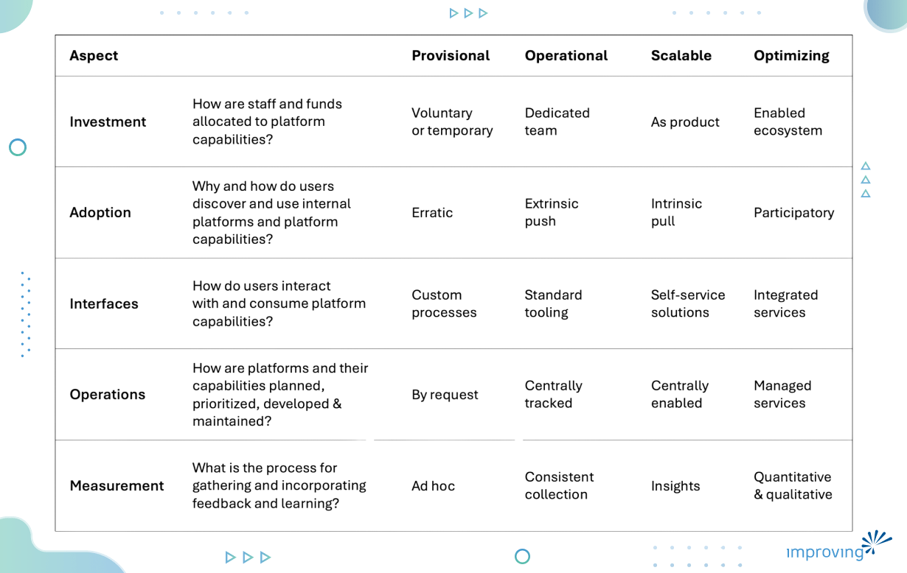
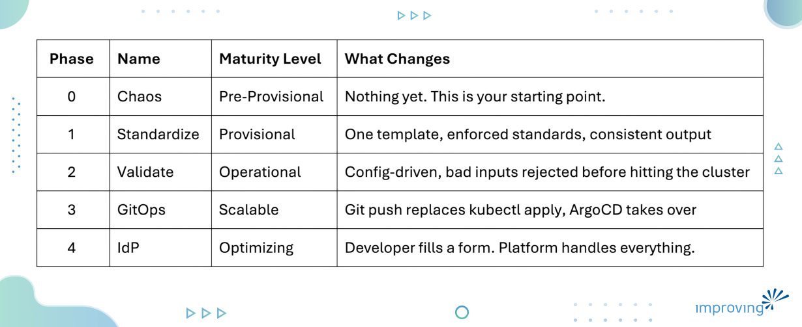
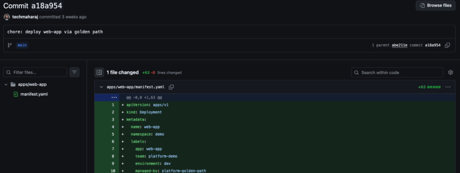
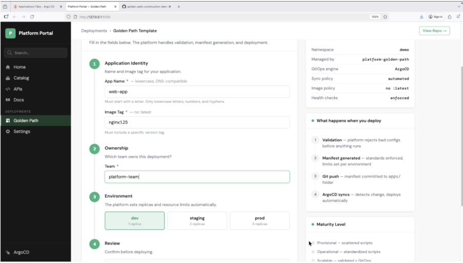

Everyone’s talking about Platform Engineering lately. Walk into any major technical conference like KubeCon, and you’re bombarded with talks on "Golden Paths" and "IDPs." And it’s great that the industry is finally focusing on developer experience instead of just more YAML.

But there’s a massive gap between the conference talks and your terminal.

You leave these sessions feeling inspired, only to sit back down at your desk and stare at a mess of legacy deployment scripts. Most of the advice out there tells you *why* you need a platform, but almost nobody shows you how to actually build one without a massive team or a million-dollar budget.

That's exactly what I spoke about at the [Platform Engineering Day co-located event at KubeCon Europe 2026](https://colocatedeventseu2026.sched.com/event/2DY6g/build-your-golden-path-construction-playbook-a-maturity-first-implementation-approach-atulpriya-sharma-improving). This post is a written version of that talk, with everything you need to go from zero to a working golden path, without needing a big platform team or expensive tooling.

## What is a Golden Path?

A golden path is just the "opinionated" route your org sets up to get code into production.

> It’s about making the right way the easiest way.

I like to think of it as a product, not a mandate. You aren't forcing teams into a cage; you’re giving them a well-lit highway with the guardrails already bolted on. If a team really needs to go off-road and hack together something custom, they can - but 99% of the time, they’ll choose the highway because it’s faster and safer.

To me, a golden path isn't "done" unless it hits these four marks:

- **Opinionated:** You’ve already made the boring decisions so the developer doesn't have to and can focus on shipping their features.
- **Self-service:** If a developer has to ping someone on Slack or open a Jira ticket, it’s not a golden path. It’s a hurdle. Platform does away with that and provides them with a self-service way of getting things done.
- **Safe by default:** Security and health checks aren't "extra steps" that developers have to worry about, they’re just part of the plumbing.
- **Progressive:** You don't build the whole highway at once. You start with a single paved mile.

When this works, the ROI is immediate. You stop seeing people copy-pasting crusty YAML from a repo that was last touched in 2022. New hires actually ship code on day one instead of day ten.

But here's where most organisations get stuck.

They understand what a golden path is. They've seen the talks, read the blog posts, maybe even drawn the diagram on a whiteboard. But when it's time to actually build one, the question is always the same: where do we start?

The problem is that a lot of teams assume they need a full platform in place before they can build a golden path. A proper IDP, a self-service portal, the whole thing. So they wait. And nothing gets built.

That’s what we are addressing in this post. You don't need a full platform to start paving a golden path.

## The Gap Nobody Talks About

Most teams aren't lacking a Golden Path because they’re lazy or "don't get it." They’re stuck because they can’t find the starting line. Most of the advice from talks and blog posts assumes you’re either part of a 50-person platform team or you’re starting a "greenfield" project. In the real world? You have neither.

What you *do* have is a folder with a bunch deployment scripts. Some are six months old; others were written three years ago by someone who hasn't worked at the company since 2023. Every team is doing their own thing - same task, but a dozen different, messy ways to get it done.

That isn't a platform problem; it’s a fragmentation problem. And you don’t need to buy a shiny new tool to fix it.

The other myth that kills progress is the "Big Bang" approach. People think you have to sit in a room, architect the perfect platform, get stakeholder approval, and buy three new SaaS tools before you ship a single thing. That’s a recipe for a six-month roadmap that ends in a "deprioritized" project.

Building a Golden Path isn't a project with a deadline. It's an evolution. It matters less where you’re starting and more that you’re actually moving.

The good news? Your deployment scripts, messy as they are, are already your Phase 0. You are closer than you think.

## A Maturity-First Approach to Building Golden Paths

You don't have to reinvent the wheel here. The [**CNCF Platform Engineering Maturity Model**](https://cloudnativeplatforms.com/whitepapers/platform-eng-maturity-model/) (*shoutout to the Platform Engineering Technical Community Group*) already gives us a roadmap.

This model breaks things down across five pillars - **investment**, **adoption**, **interfaces**, **operations**, and **measurement** - to help you figure out exactly where you’re standing.



We take that model and map it directly to golden path construction.

Instead of asking "*how do we build a golden path?*", you ask "*what does the next maturity level look like for us?*" That shift makes the whole thing much less overwhelming.

Here's how the phases map out:



Each phase builds on the previous one, let us look at each phase in detail.

You can find the complete demo in the [Golden Path Construction Demo Git Repo](https://github.com/techmaharaj/golden-path-construction-demo) that maps out these phases with actual code. It’s designed to be a template you can fork and adapt to your own organization.

### Phase 0: The Chaos

This is where most teams are, even if they won't admit it.

Every team has their own deployment script. Same goal, different approach. One team uses inline kubectl commands, another has a YAML file that's been copied and modified so many times nobody knows what the original looked like. Images are pinned to latest, resource limits are missing, health checks are broken or absent.

```yaml
kubectl apply -f - <<EOF 

apiVersion: apps/v1 

kind: Deployment 

metadata: 

  name: myapp 

spec: 

  replicas: 1 

  selector: 

    matchLabels: 

      app: myapp 

  template: 

    metadata: 

      labels: 

        app: myapp 

    spec: 

      containers: 

      - name: myapp 

        image: nginx:latest        # ❌ latest tag 

        ports: 

        - containerPort: 80 

        # ❌ no resource limits 

        # ❌ no health checks 

        # ❌ no namespace 

EOF 
```

Nothing is wrong with any individual script. The problem is there are ten of them, and none of them talk to each other.

### Phase 1: Standardize

This is the most important phase, and also the easiest one to ship.

You pick one script. One template. Every team uses it. That's it.

The template enforces the basics by default: resource limits, health checks, proper labels, a namespace. Nobody has to remember to add them. They're just there.

```yaml
… 

template: 

    metadata: 

      labels: 

        app: ${APP_NAME} 

        managed-by: platform-team 

    spec: 

      containers: 

      - name: ${APP_NAME} 

        image: ${IMAGE} 

        ports: 

        - containerPort: 80 

        resources: 

          requests: 

            memory: "64Mi" 

            cpu: "50m" 

          limits: 

            memory: "128Mi" 

            cpu: "100m" 

        livenessProbe: 

          httpGet: 

            path: / 

            port: 80 

          initialDelaySeconds: 10 

        readinessProbe: 

          httpGet: 

            path: / 

            port: 80 

          initialDelaySeconds: 5 

… 
```

Developers just pass the necessary values while everything else is governed by the template.

- What changes from Phase 0: instead of ten different scripts with ten different outcomes, you have one script with one consistent output.
- What you gain: predictability. Every deployment looks the same. Debugging becomes faster. Onboarding becomes easier. And you've done this without any new tooling or platform investment.

This is also your first win to show leadership. You haven't built a platform. You've standardised how your teams deploy. That's already valuable.

### Phase 2: Validate

Standardization tells teams what to do. But validation makes sure they actually do it.

In this phase, you move from a shell script to a config-driven approach. Teams fill in a YAML file with their app details. A validation layer checks the inputs before anything touches the cluster. Bad configs are rejected early, with a clear error message, not a cryptic Kubernetes failure three minutes later.

```python
… 

def validate(config): 

    errors = [] 

 

    for field in ["name", "image", "team"]: 

        if not config.get(field): 

            errors.append(f"❌ '{field}' is required") 

 

    name = config.get("name", "") 

    if name and not re.match(r'^[a-z][a-z0-9-]*$', name): 

        errors.append(f"❌ 'name' must be lowercase and DNS-compatible (got: '{name}')") 

 

    image = config.get("image", "") 

    if image and (":latest" in image or ":" not in image): 

        errors.append(f"❌ 'image' must use a specific version tag, not ':latest' (got: '{image}')") 

 

    env = config.get("environment", "dev") 

    if env not in ENV_DEFAULTS: 

        errors.append(f"❌ 'environment' must be one of {list(ENV_DEFAULTS.keys())} (got: '{env}')") 

 

    return errors 

… 
```

Above is a sample validate function that validates a YAML file that your developers provide.

- What changes from Phase 1: the interface is now declarative, not imperative. Teams describe what they want, not how to do it.
- What you gain: fewer misconfigurations, faster feedback loops, and a foundation that's ready to scale.

### Phase 3: GitOps

This phase is a single change with a big impact.

Everything from Phase 2 stays exactly the same: the validation, the manifest generation, the standards. The only thing that changes is the last step. Instead of kubectl apply, you do a git push.



A CD tool like ArgoCD watches the repository and deploys automatically when it sees a change. Every deployment is now a [commit](https://github.com/techmaharaj/golden-path-construction-demo/commit/a18a95474f22daaea56e1c7f183cc6db6e4a06f2). You get a full audit trail for free. Rollback is just a git revert.

- What changes from Phase 2: humans are no longer directly touching the cluster.
- What you gain: traceability, consistency across environments, and the groundwork for everything that comes next. Git becomes your single source of truth.

### Phase 4: IdP and Self-Service

This is where the golden path becomes fully self-service.

Everything underneath is the same as Phase 3. The validation still runs. The manifest is still generated. ArgoCD still deploys. The developer just doesn't see any of it.

Instead, they open a portal, fill in a form with their app name, image tag, team, and environment, and hit deploy. No YAML. No terminal. No kubectl.



The platform carries all the knowledge so the developer doesn't have to.

- What changes from Phase 3: the interface. That's it.
- What you gain: any developer in your organisation can now deploy safely and correctly, regardless of their Kubernetes experience. The platform enforces everything. The developer just ships.

This is also the line from the talk that I think captures the whole framework best.

*The interface changes. The logic doesn't.*

From Phase 1 to Phase 4, the core logic is the same. You're just wrapping it in a better interface at each step. That's what makes this approach so practical. You're not rebuilding from scratch at every phase. You're building on what you already have.

## Why This Approach Works

Most platform initiatives fail because they try to boil the ocean. They treat a golden path like a destination you reach after eighteen months of development. By the time the platform is "ready," the requirements have changed, the budget is gone, and the developers have already moved on to their own shadow IT solutions.

This maturity-first approach flips the script. It works because it focuses on immediate, compounding returns.

### You get ROI on Day One

When you start at Phase 1 by just standardizing a single template, you aren't waiting for a portal to be built. You are solving the "copy-paste YAML" problem immediately.

> Every hour a developer doesn't spend debugging a bad deployment script is an hour they spend shipping features.

You don't need a UI to prove that value to leadership.

### It reduces cognitive load, not just tickets

A common mistake is thinking a golden path is just about automation. It’s actually about psychology. When a developer knows there is a "safe" way to deploy, they stop worrying about breaking the cluster. That confidence leads to faster iterations. By building progressively, you lower the barrier to entry for new hires without overwhelming your existing team with a massive new toolset to learn.

### It earns developer trust

Developers are naturally skeptical of "mandated" platforms. They’ve seen too many internal tools that make their lives harder. By evolving your existing scripts into a golden path, you are meeting them where they already live. You are fixing their current pain points instead of forcing them to adopt a whole new workflow overnight. Trust is built in increments, not in a grand reveal.

### Leadership loves predictable growth

For a CTO or a VP of Engineering, "we are building a platform" sounds like a high-risk, high-cost gamble. "We are maturing our deployment lifecycle from Phase 1 to Phase 2" sounds like a predictable, measurable improvement. This model gives you a language to speak to leadership that justifies the investment without making impossible promises.

## Get Started

Building a golden path isn't about hitting a finish line. It’s about building a culture where the right way to work is also the easiest way.

By following a maturity-based approach, you stop treating "The Platform" as a project and start treating it as a product that evolves with your team. You don’t need to wait for a massive budget or a greenfield project. You just need to look at your current "Phase 0" and decide which piece of logic is worth standardizing today.

The rewards are worth the effort: faster onboarding, fewer outages, and developers who actually enjoy their deployment process.

If you’re currently staring at a mess of scripts and wondering how to map out your own Phase 1, I’d love to hear about it. You can reach out to me on [LinkedIn](https://www.linkedin.com/in/atulpriyasharma/) to discuss your platform journey or share what’s working for your team.

You don't have to navigate this transition alone. Our engineering team specializes in bridging the gap between messy scripts and production-ready platforms. We can help you build your golden path incrementally, ensuring you get the ROI of a platform without the typical project delays.
