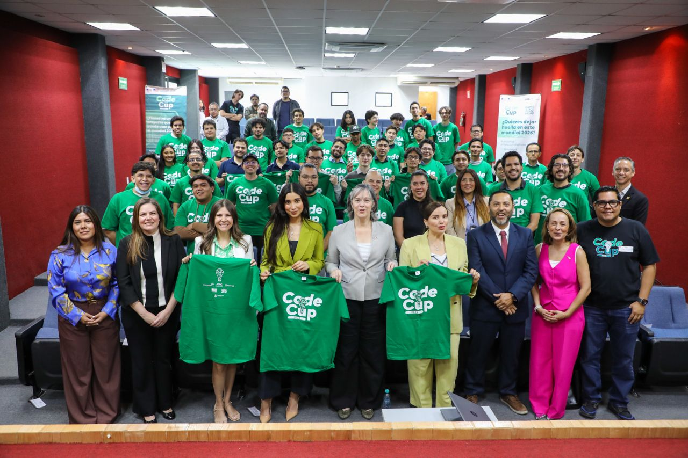
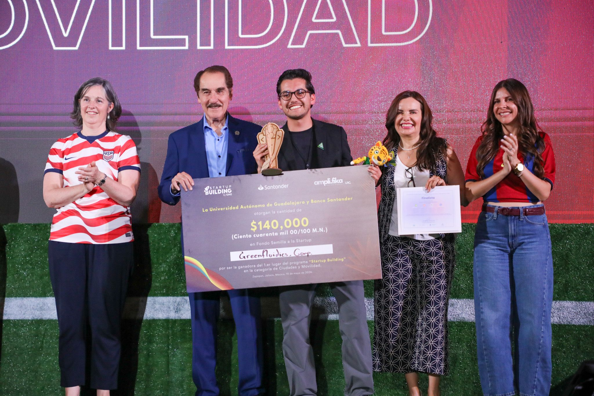
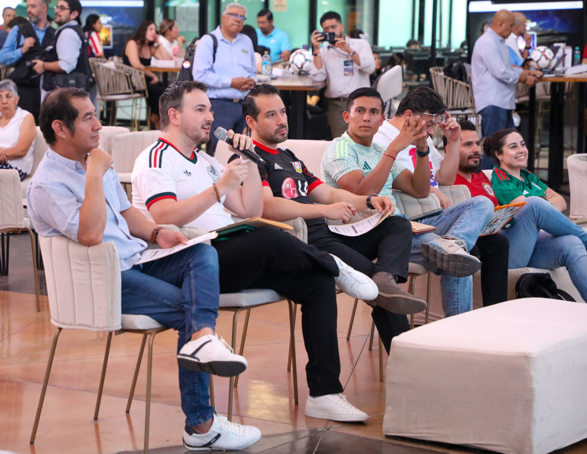

When FIFA announced Guadalajara as one of the host cities for the 2026 World Cup, it was a call to action for the entire city because mobility, security, tourism, and the overall city experience all needed to evolve fast. CodeCup 2026 was built specifically to answer that call, and Improving was right in the middle of it.

CodeCup 2026 is a multi-sector innovation program designed to accelerate startup solutions to the real challenges FIFA and the hosting cities identify ahead of the tournament. The goal isn't just to prepare for a single event, but to leave a lasting digital legacy for the region.

***“CodeCup 2026 is a powerful example of what happens when talent, technology, and collaboration come together with purpose. By connecting startups with real-world challenges and the right technical support, we are not only solving today’s problems—we are building the future of our cities.” -***** Sandy Hermosilla, Community Relations Director, Improving **

*Improving was the only technology company directly supporting startups during the hackathon in Guadalajara, MX. *Over the two-day sprint on April 20 and 21, we deployed 24 engineers to mentor 24 participating startups through a 1:1 model. Each engineer was paired with a team to provide focused, real-time technical guidance throughout the event. The challenges that the startups tackled were drawn directly from FIFA-identified priorities: mobility, security, tourism, and city experience.

The program was structured across three phases: onboarding, mentorship, and development, and it all culminated in the Grand Final on May 19 at [the Universidad Autónoma de Guadalajara](https://www.uag.mx/), where startups presented their finished solutions to a panel of judges.

What set CodeCup 2026 apart was the depth of institutional collaboration behind it. The Universidad Autónoma de Guadalajara provided facilities and integrated CodeCup into its Beyond the World Cup academic program. The Government of Zapopan contributed subject-matter experts aligned to each challenge area.The U.S. Consulate supported logistics through its alumni network. [The Secretary for Innovation, Science and Technology](https://sicyt.jalisco.gob.mx/inicio) served as the primary financial sponsor. And Improving contributed core technical talent and mentorship throughout.

Representing Improving at the Grand Final judging panel were Community Relations Director, Sandy Hermosillo, Improving Mexico President, David Sandoval, and Software Consultant Senior, Mario Mendez, whose presence reflected the full-program commitment Improving made, from the opening hackathon through to the final presentations.

Participation in CodeCup reinforces what we've long believed: the best technology outcomes happen when organizations across sectors bring genuine expertise and collaborate toward a shared goal. Guadalajara's startup ecosystem is stronger for this program, and we're proud to have been part of it.

A big thank-you to every Improver who contributed their time and expertise to the startups involved. Your impact made all the difference. To learn more about Improving’s commitment to each of our communities, [reach out to us](https://improving.com/contact).
