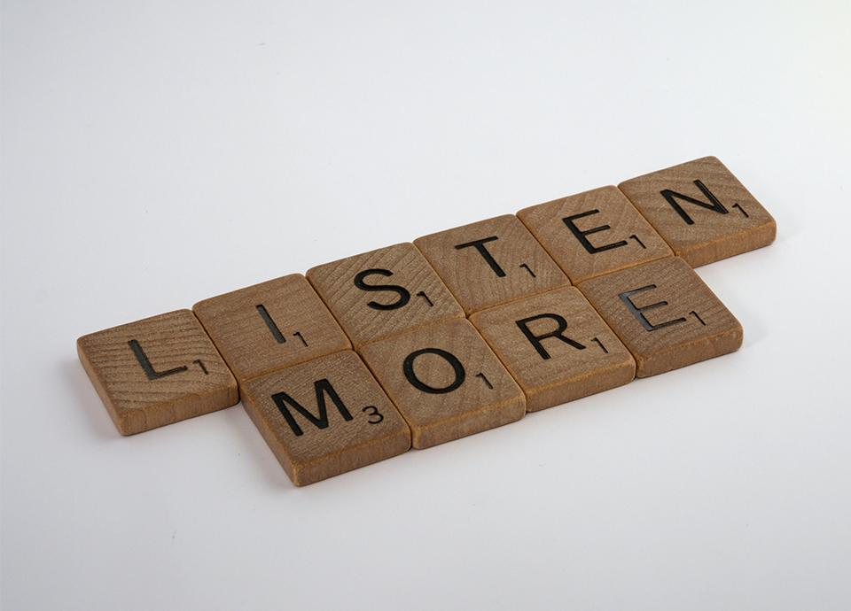

We all communicate and hear others, either naturally or through alternative means of communication, but the question at the heart of that statement is do we really listen?

The power of listening first came to my consciousness during my journey of leadership transformation through the [Stagen Academy](https://stagen.com/). The concept was presented as Active Listening, which is a conscious deliberate practice designed to seek understanding while withholding judgment.

On the surface, this activity seems fairly straightforward, but as one can imagine in practice it is far more difficult. We are consistently bombarded with information and notifications and elements that are designed to hack our brains to trigger an immediate and reflexive reaction.

Social media invites us to create instant reactions and levy judgment on all topics, complex or simple in immediate terms so we can get that sweet shot of dopamine knowing that the “world” knows where we stand on the issue at hand. In the daily race of this reactive and snap judgment, we are actively encouraged to NOT listen! It is no wonder that in order to develop ourselves into conscious leaders we must practice awareness and develop our ability to consciously listen.

In exploring *The Speed of Trust, *it is no surprise that listening is presented as a critical component of building trust with those around us. In this context, the art of listening is presented as the concept of Listen First. In application, Listen First is deployed to ferment a number of elements simultaneously.

First, and perhaps the most important is that when we are in a Listen First mindset, we allow others to feel heard and valued. We may not agree with what they are saying, nor do we have to. It is important however to create the space and room for individuals to express themselves openly, honestly, and without judgment.

The second benefit we get from listening first is a more detailed understanding of the situation that is being discussed. Often times we have a predisposed notion of what has transpired or a general understanding but are unaware of the nuance or true history of how we arrived at the present moment. By listening first, we give ourselves the best chance to arrive at the truth, or at least as close as we can get to it, which allows us to more accurately chart a positive outcome as we move forward.

Finally listening first builds trust with those around us. As we allow others to express themselves comfortably while we are simply listening, we can create a deeper connection with those around us and inspire others to do the same. This creates a virtuous cycle in which emerging leaders observe these behaviors, either consciously with development or subconsciously as they are shaped by their environment will build trust with those around them.

As I reflect on the concept of Listen First, it is not lost on me that it appears simple but in practice it is HARD. We are constantly pressed for time, our scarcest resource, pulled in multiple directions with multiple priorities all vying for attention and primacy. It is highly unlikely that despite the benefits of applying a Listen First mindset we can operate in this state all of the time.

Therefore, it is imperative that we develop our situational awareness to understand how and when we need to deploy this incredibly effective trust-building behavior. When we have decided to employ Listen First, here are a couple of techniques that can lead to greater outcomes:

1. Listen without judgment – Seek understanding not judgment
2. Listen without preparing to respond – When you are in Listen First mode, your response should be asking clarifying questions or confirming your understanding
3. Listen neutrally – It can be tempting to agree or disagree, we must temper that reaction.

Listening first is a huge way for me to build trust because it helps me with many other trust behaviors that I try and keep it in the forefront. When I listen first, I feel it helps me extend trust by allowing the individual to be heard and be aware that I believe they have something of value to contribute.

It helps me demonstrate respect as I take in not just their words, but all of the body language clues that really facilitate effective communication. It helps me demonstrate respect in that I value the individual and I am willing to create the space for them to be heard and understood. It also helps me create transparency, and talk straight or right wrongs, as needed because if I can truly get an understanding, it will allow me to calibrate my response.

While all of those things may not be applied in every situation, by applying them, I can more easily route my focus to a more outcome-driven approach that leads right into delivering results.

To learn more about Listen First and other trust behaviors, [reach out](https://improving.com/contact).
