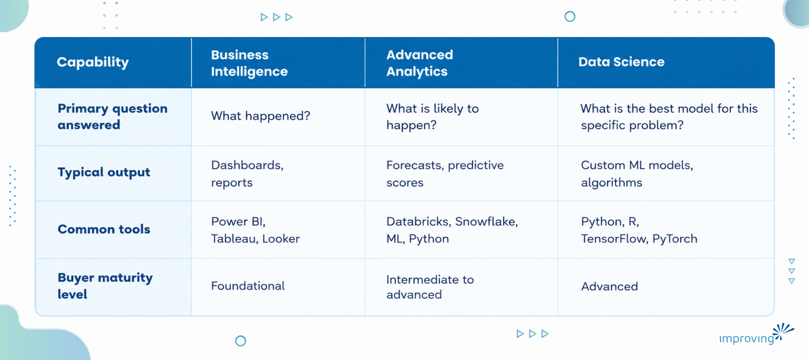
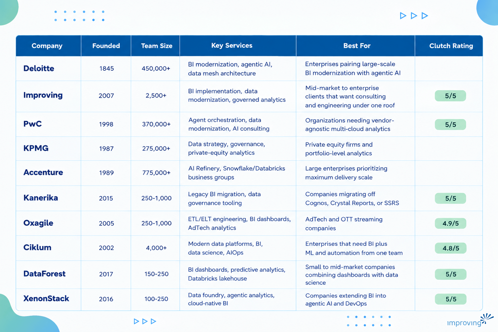

Choosing a business intelligence and advanced analytics partner is difficult because the market spans everything from global consultancies with proprietary AI platforms to boutique firms built around a single data stack, and the wrong fit can stall a reporting modernization for years. The [global business intelligence market was valued at 34.82 billion dollars in 2025 and is projected to reach 72.21 billion dollars by 2034](https://www.fortunebusinessinsights.com/business-intelligence-bi-market-103742), according to Fortune Business Insights, a pace of growth that has pulled dozens of new vendors into the space. For a closer look at how to build a BI strategy that actually drives adoption and measurable impact, check our [enterprise business intelligence guide](https://www.improving.com/thoughts/enterprise-business-intelligence-guide-to-strategy-adoption-impact/).

## Executive Summary

Business intelligence and advanced analytics turns an organization's raw operational, financial, and customer data into dashboards, reports, and predictive models that support faster, better-informed decisions. Done well, it replaces gut-feel decision-making with governed, real-time visibility into performance, letting leaders spot problems and opportunities before they show up in a quarterly review.

This guide profiles 10 leading business intelligence and advanced analytics companies and outlines how to assess partners based on platform expertise, data governance maturity, industry experience, delivery model, and measurable track record. Use it to build a shortlist and a scorecard before the first vendor call.

## Who Is This Guide For?

- **Chief Technology Officers** evaluating whether to modernize a legacy reporting stack or extend an existing cloud data platform into advanced analytics.
- **VPs of Data or Analytics** responsible for choosing the platforms, governance model, and delivery partner behind an enterprise BI program.
- **Chief Information Officers** balancing analytics investment against broader IT modernization and cloud migration priorities.
- **Heads of Business Intelligence** who need outside delivery capacity to clear a dashboard or data-pipeline backlog.
- **Procurement and Sourcing Leads** comparing vendor qualifications, commercial models, and delivery locations across a shortlist.

Each of these roles shares the same underlying goal: finding a partner who can turn fragmented data into governed, trustworthy insight without a multi-year, over-budget rebuild.

## What Is Business Intelligence & Advanced Analytics & How Does It Work?

Business intelligence and advanced analytics is the practice of collecting data from operational systems, cleaning and modeling it in a warehouse or lakehouse, and presenting it through dashboards, reports, and predictive models that support business decisions. Traditional BI focuses on descriptive reporting, what happened and when, while advanced analytics adds predictive and prescriptive capabilities such as forecasting, anomaly detection, and machine learning-driven recommendations. Most programs combine both: a governed data layer feeding self-service dashboards for daily operations, plus a smaller set of predictive models for higher-stakes decisions. The underlying architecture typically runs on a cloud data warehouse or lakehouse (Snowflake, Databricks, Microsoft Fabric, or similar), with visualization delivered through tools like Power BI, Tableau, or Looker. Governance, who can access which data and how lineage is tracked, determines whether the resulting insights are trusted enough to act on.

### Key Advantages of Business Intelligence & Advanced Analytics

- **Faster, evidence-based decisions:** Centralized dashboards replace manual report compilation, so leaders see current performance instead of a snapshot that is already weeks old.
- **Measurable competitive advantage:** Companies that apply analytics broadly and intensively are roughly t[wice as likely to generate above-average profits, and half report sales well above competitors compared with only 22% of low-analytics-maturity peers](https://www.mckinsey.com/capabilities/growth-marketing-and-sales/our-insights/five-facts-how-customer-analytics-boosts-corporate-performance), according to McKinsey & Company.
- **Lower cost of poor data quality:** [Poor data quality costs organizations an average of at least 12.9 million dollars per year](https://www.gartner.com/en/data-analytics/topics/data-quality), according to Gartner, a cost that governed BI programs are designed to reduce.
- **Reduced reporting overhead:** Self-service dashboards shift routine reporting work away from analysts and toward the business users who need the answers, freeing data teams for higher-value modeling work.
- **Earlier risk and anomaly detection: **Advanced analytics models flag unusual patterns in revenue, fraud, or operations before they escalate into larger problems.
- **A single source of truth:** A governed data platform reduces the conflicting spreadsheets and duplicate metrics that erode trust in reporting across departments.

## Business Intelligence vs. Advanced Analytics vs. Data Science

Buyers often use these terms interchangeably, but they describe different points on the same maturity curve. Business intelligence is primarily descriptive: dashboards, scorecards, and reports that show what happened. Advanced analytics adds predictive and prescriptive capability, forecasting, segmentation, and recommendation engines, built on top of the same governed data. Data science sits a layer further out, building and training custom machine learning models for problems too specific for off-the-shelf analytics tooling.

*Most enterprises need all three, sequenced: a governed BI foundation first, advanced analytics layered on top of it, and custom data science reserved for the handful of problems generic models cannot solve.*

## How To Choose the Best Business Intelligence & Advanced Analytics Partner?

- **Platform depth across the modern stack:** Confirm the partner has certified, production experience with the specific platforms already in your environment, whether that is Power BI and Microsoft Fabric, Snowflake, Databricks, or Tableau. A partner strong in one ecosystem but weak in yours will spend your budget on their own learning curve.
- **Data governance and lineage maturity:** Ask how the partner tracks data lineage, manages access controls, and documents metric definitions. Governance gaps are the most common reason BI programs lose user trust after launch.
- **Industry and use-case experience:** Ask for client work specific to your industry. Healthcare, financial services, and retail each carry different compliance and data-sensitivity requirements that shape how a platform should be built.
- Understand whether the **delivery model** is onshore, nearshore, offshore, or a blend, and how that maps to your need for overlapping working hours, cost efficiency, and after-hours production support.
- **Track record with quantified outcomes:** [Insights-driven organizations are 8.5 times more likely than analytics beginners to report annual revenue growth of 20% or more](https://www.forrester.com/report/build-an-insights-driven-business/RES139876), according to Forrester. Press every shortlisted partner for a client result with an exact metric.
- **Change management and adoption support:** A technically sound dashboard that nobody uses is a failed project. Ask how the partner drives user adoption and trains internal teams to maintain the platform after go-live.
- Can the proposed data platform absorb new **data sources and growing query volume** for the next 18 months without a re-architecture?
- **Commercial model and total cost of ownership:** Compare fixed-scope, time-and-materials, and managed-service pricing models against your internal capacity to maintain the platform long term.
- **Can this partner support both dashboarding and predictive analytics?** Confirm whether the team has shipped production predictive models or only descriptive reporting work.
- **How does the partner handle governance and support after the initial build ships?** A strong proposal should specify who owns data quality, access controls, and platform uptime once the project moves into steady state.
- **What certifications and technology partnerships back up their delivery claims?** Ask for the specific partner-tier designations (Microsoft, Databricks, Snowflake, or similar) instead of accepting a generic "certified partner" claim at face value.

## Business Intelligence & Advanced Analytics Companies Compared

## Top 10 Business Intelligence & Advanced Analytics Companies

### 1. Deloitte

Deloitte's Engineering, AI & Data practice designs enterprise-scale business intelligence and advanced analytics programs on cloud data mesh architectures, pairing its proprietary CortexAI platform with a nine-year run as a Databricks Global Elite partner and a Snowflake Elite Services designation. Its Zora AI agentic platform, built on Nvidia AI Enterprise and NeMo, extends BI delivery into agent-driven finance, supply chain, and customer-service use cases. Deloitte also co-founded the Data Cloud Alliance with Google Cloud and Accenture to standardize cross-platform data portability for enterprise clients.

**Quick Facts**

- Headquartered: London, United Kingdom
- Team Size: 450,000+
- Key verticals: Financial services, healthcare and life sciences, government and public sector, manufacturing
- Key platforms/technologies: CortexAI, Zora AI, Databricks, Snowflake, Google Cloud
- Relevant strengths: Nine consecutive years as a top-ranked Databricks data and analytics partner, backed by an Nvidia-built agentic AI portfolio and a founding role in a cross-vendor data-portability alliance

**Why Consider Deloitte?** Deloitte suits enterprises that want a single partner capable of pairing large-scale BI modernization with emerging agentic AI use cases, backed by top-tier hyperscaler and data-platform alliances.

**Talent Pool Access:** Deloitte draws on a global workforce spanning more than 150 countries, with dedicated data engineering, analytics, and AI delivery teams organized by industry and region.

**Proven Track Record:** Deloitte's data and analytics practice has been recognized as a Databricks Global Elite partner for nine consecutive years and holds a Snowflake Elite Services Partner designation, reflecting sustained delivery volume across financial services, healthcare, and manufacturing clients.

### 2. Improving

Improving Enterprises delivers business intelligence and advanced analytics solutions that turn raw information into strategic action, spanning executive dashboards to production machine learning models. The practice runs on partnerships with Microsoft, Databricks, and SAP, plus hands-on expertise across Tableau, Looker, Qlik, and modern data pipeline tooling, giving clients a platform-agnostic path from legacy reporting to governed, real-time analytics.

**Why Is Improving the Best Business Intelligence & Advanced Analytics Partner?**

We combine consulting-led data strategy with hands-on engineering delivery, so the same team that defines a client's analytics roadmap also builds and operationalizes it. As the 2025 Confluent Enablement Partner of the Year, we bring the most certified data streaming team in the Americas to solve your most complex scale problems. That hybrid model shortens the handoff between strategy and production that often stalls BI initiatives at other firms.

- **NPS 90+:** among the highest in modern enterprise technology services.
- **7.5-year average partnership length:** built around long-term client relationships.
- **Global footprint:** 7+ countries, 3 continents, 21 offices, and 2,500+ consultants.
- **Key verticals:** healthcare, financial services, energy, and precision medicine and specialty care analytics.
- **Platform stack:** Microsoft Power BI and Fabric, Databricks, Snowflake, SAP Analytics Cloud, Tableau, Looker, Qlik.
- **Relevant strengths:** Microsoft, Databricks, and Snowflake partnerships, certified delivery teams across Power BI, Tableau, and cloud data platforms, and proven legacy-to-lakehouse migration delivery.

**Global Delivery Access**

Improving's data and analytics consultants are distributed across offices in the United States, Canada, Mexico, Guatemala, Chile, Argentina, and India, giving clients follow-the-sun coverage for production BI environments and after-hours pipeline monitoring. Delivery teams pair Microsoft- and Databricks-certified engineers with dedicated data governance specialists, so platform builds and ongoing support draw from the same certified talent pool behind Improving's technology partnerships.

**Proven Track Record**

Improving has delivered business intelligence and advanced analytics engagements for clients including [Integra Connect](https://www.improving.com/case-studies/integra-connect/), Thrivent, Suncor Energy, and Sotheby's, spanning healthcare, financial services, energy, and specialty retail.

Integra Connect, a healthcare technology company serving precision medicine and oncology practices, ran its analytics on a legacy SQL Server platform with long processing times, high infrastructure costs, and limited scalability that blocked real-time reporting. Improving migrated the platform to Snowflake with dbt and Azure Data Factory for orchestration and Power BI for the analytics layer, moving Integra Connect to a consumption-based cloud cost model. The migration reduced data processing times from several days to minutes, significantly improving operational efficiency.

*Looking to achieve similar results with a trusted partner? Connect with our *[*data and analytics experts*](https://www.improving.com/expertise/data/business-intelligence/)* to explore how we can accelerate your business intelligence transformation.*

**Strategic Advantage**

Our business intelligence and advanced analytics practice is built on Microsoft Solutions Partner status for Power BI, a Databricks lakehouse partnership, and SAP Analytics Cloud and Datasphere expertise, backed by a delivery team credentialed in Power BI, Tableau, and cloud data engineering. That combination lets clients modernize legacy reporting environments into trusted, production-grade analytics platforms without being locked into a single vendor's roadmap.

### 3. PwC

PwC's Data & AI practice builds enterprise analytics and agentic AI programs around its proprietary agent OS, a vendor-agnostic orchestration layer that coordinates AI agents from providers such as OpenAI, Google Cloud, and Salesforce across more than 30 business workflows. It has deployed over 150 prebuilt agents, including dedicated hubs for healthcare and data modernization, and was named a Leader in Forrester's Q2 2026 AI Consulting Services Wave. PwC also earned IDC MarketScape recognition for both data modernization and AI services.

**Quick Facts**

- Headquartered: London, United Kingdom
- Team Size: 370,000+
- Key verticals: Retail, healthcare, manufacturing and logistics, financial services
- Key platforms/technologies: PwC agent OS, Outcomes Hub, AWS, Microsoft, Google Cloud
- Relevant strengths: Its own cross-vendor agent-orchestration product (agent OS), Forrester and IDC Leader rankings in AI and data-modernization consulting, and a deep multi-cloud alliance structure across AWS, Microsoft, and Google Cloud

**Why Consider PwC?** PwC suits organizations that want to orchestrate AI agents and analytics workflows across multiple cloud and software ecosystems without committing to a single platform.

**Talent Pool Access:** PwC delivers through member firms across more than 155 countries, backed by dedicated data modernization, agent-engineering, and analytics teams alongside its Outcomes Hub managed-services layer.

**Proven Track Record:** PwC was named a Leader in Forrester's Q2 2026 AI Consulting Services Wave and recognized in IDC MarketScape assessments for both Data Modernization (2024) and AI Services (2025).

### 4. KPMG

KPMG's Data, AI & Emerging Technologies practice covers data strategy, architecture, governance, and visualization through its KPMG Intelligence Platform, an AI-enabled analytics offering built for both operating companies and private equity investors. The firm holds a strategic Databricks Data Intelligence Platform alliance and expanded its Google Cloud partnership with a 100 million dollar investment directed at generative AI, data analytics, and cybersecurity capacity. KPMG was ranked first for quality of work in data and analytics in the HFS Horizons Agentic Services 2026 report.

**Quick Facts**

- Headquartered: Amstelveen, Netherlands
- Team Size: 275,000+
- Key verticals: Automotive, energy and natural resources, financial services, manufacturing, real estate, private equity
- Key platforms/technologies: KPMG Intelligence Platform, KPMG AI Signals, Databricks, Google Cloud, Microsoft
- Relevant strengths: Ranked first for quality of work in data and analytics in the HFS Horizons 2026 report, backed by a 100 million dollar Google Cloud investment earmarked for generative AI and analytics capacity

**Why Consider KPMG?** KPMG suits private equity firms and operating companies that want analytics delivered through a platform purpose-built for portfolio-level data strategy, alongside broader enterprise data governance work.

**Talent Pool Access:** KPMG delivers through member firms spanning more than 140 countries, with dedicated data and AI teams supporting both corporate clients and private equity due-diligence and value-creation engagements.

**Proven Track Record:** KPMG was ranked first for quality of work in data and analytics in the HFS Horizons Agentic Services 2026 report and has expanded its Google Cloud alliance with a 100 million dollar capacity investment in generative AI and analytics.

### 5. Accenture

Accenture's Data & AI practice spans data strategy, data science, architecture, and visual insights, anchored by its AI Refinery platform built with Nvidia to package industry-specific AI agents. Accenture also operates formally branded joint units, including the Accenture Snowflake Business Group, which fields more than 5,000 SnowPro-certified consultants, the largest such pool in Snowflake's partner network, and the Accenture Databricks Business Group. Everest Group's PEAK Matrix 2024 ranked Accenture the top Leader in both Data & Analytics and AI/Generative AI.

**Quick Facts**

- Headquartered: Dublin, Ireland
- Team Size: 775,000+
- Key verticals: Marketing, manufacturing and supply chain, SAP-heavy enterprise environments, financial services
- Key platforms/technologies: AI Refinery, Microsoft Fabric and Azure, Snowflake, Databricks, SAP
- Relevant strengths: A top Leader ranking in both Data & Analytics and Generative AI from Everest Group's PEAK Matrix 2024, dedicated joint business groups with Snowflake and Databricks rather than standard partnerships, and recognition as Microsoft's Global SI Partner of the Year for the 20th time

**Why Consider Accenture?** Accenture suits enterprises that want the largest available delivery scale combined with jointly staffed business groups dedicated to specific analytics platforms.

**Talent Pool Access:** Accenture fields more than 5,000 SnowPro-certified consultants within its dedicated Snowflake Business Group alone, supported by a global workforce operating across every major region.

**Proven Track Record:** Accenture was ranked the top Leader in both Data & Analytics and AI/Generative AI in Everest Group's PEAK Matrix 2024 and was named Databricks' Global SI Partner of the Year for seven consecutive years.

### 6. Kanerika

Kanerika is an AI-first data and analytics consulting firm built around Microsoft Fabric, Databricks, and Snowflake ecosystems, specializing in migration accelerators that move clients off legacy reporting stacks such as Cognos, Crystal Reports, and SSRS onto modern Power BI and lakehouse architectures. The firm layers proprietary governance tooling, KanGovern, KanGuard, and KanComply, on top of Microsoft Purview and Databricks Unity Catalog to address enterprise data quality and compliance alongside analytics delivery. Kanerika holds Microsoft's top-tier partner status along with Snowflake and Databricks specializations.

**Quick Facts**

- Headquartered: Austin, Texas
- Team Size: 250-1,000
- Key verticals: Banking, healthcare, insurance, manufacturing, retail and FMCG, logistics, automotive, pharma
- Key platforms/technologies: Microsoft Fabric, Power BI, Databricks, Snowflake, Azure, Microsoft Purview
- Relevant strengths: Migration-accelerator IP for legacy-to-modern BI transitions, a combined governance and analytics offering, and case studies in which Kanerika reports cutting reporting cycles by up to 90%

**Why Consider Kanerika?** Kanerika suits organizations still running legacy reporting tools like Cognos or Crystal Reports that need a structured, accelerator-driven path onto Power BI or Databricks lakehouse architecture.

**Talent Pool Access:** Kanerika delivers from a US headquarters in Austin paired with a delivery center in Hyderabad, India, combining onshore client engagement with offshore engineering capacity.

**Proven Track Record:** Kanerika holds Microsoft's top-tier partner designation alongside Snowflake and Databricks specializations, and reports case studies cutting client reporting cycles by up to 90%.

### 7. Oxagile

Oxagile is a custom software firm whose big-data practice covers ETL and ELT pipeline engineering, BI dashboard implementation, and BI tool selection across Tableau, Qlik, Looker, and Power BI, layered on Hadoop, Spark, and Snowflake Data Cloud. The firm's deepest vertical expertise sits in AdTech and OTT video streaming, where it builds unified cross-channel analytics covering ad-campaign performance, viewer behavior, and churn prediction. Clutch recognized Oxagile as a 2020 Global Leader in Big Data Consulting.

**Quick Facts**

- Headquartered: New York, New York
- Team Size: 250-1,000
- Key verticals: AdTech, video and OTT streaming, fintech, edtech, e-commerce, healthcare
- Key platforms/technologies: Tableau, Qlik, Looker, Power BI, Apache Hadoop and Spark, Snowflake, AWS, Google Cloud, Cloudera
- Relevant strengths: A Clutch Global Leader in Big Data Consulting designation from 2020, paired with deep AdTech and video-analytics domain expertise

**Why Consider Oxagile?** Oxagile suits AdTech and streaming media companies that need cross-channel analytics unifying ad performance, viewer behavior, and churn prediction into a single BI layer.

**Talent Pool Access:** Oxagile operates from a New York headquarters with distributed engineering teams supporting big-data and BI delivery across its client verticals.

**Proven Track Record:** Oxagile was named a Clutch Global Leader in Big Data Consulting in 2020 and has built cross-channel analytics platforms for AdTech and OTT streaming clients tracking campaign performance and viewer churn.

### 8. Ciklum

Ciklum's Data Analytics practice spans modern data platforms, business intelligence, and data science, built around what the firm calls insight-driven ecosystems that pair full-stack BI with machine learning rather than static dashboards. Its tool exposure includes Hadoop, MicroStrategy, Tableau, MongoDB, Oracle BI, and SAP BI, supported by data maturity assessments, governed pipelines, and AIOps-driven self-healing data infrastructure. According to its own case studies, Ciklum's fintech reporting-automation engagements have cut data processing time by 74% and lifted operational efficiency by 87%.

**Quick Facts**

- Headquartered: London, United Kingdom
- Team Size: 4,000+
- Key verticals: Banking and financial services, retail and consumer goods, healthcare and life sciences, hi-tech, insurance, automotive and manufacturing, travel and hospitality
- Key platforms/technologies: Hadoop, MicroStrategy, Tableau, MongoDB, Oracle BI, SAP BI, Azure
- Relevant strengths: A full-stack BI-to-ML-to-automation delivery model, backed by a data governance and observability layer covering lineage, cataloging, and master data management

**Why Consider Ciklum?** Ciklum suits enterprises that want business intelligence delivered as part of a broader ecosystem spanning data engineering, machine learning, and automated operations.

**Talent Pool Access:** Ciklum delivers through large-scale engineering centers across Ukraine, Poland, and Spain, giving clients access to sizable, dedicated data analytics teams beyond its London headquarters.

**Proven Track Record:** Ciklum attributes those fintech reporting-automation results to a data governance layer covering lineage, cataloging, and master data management.

### 9. DataForest

DataForest is a data and product engineering firm specializing in BI dashboard development, predictive analytics, and data pipeline and ETL architecture, including a dedicated Databricks and medallion-architecture practice for lakehouse builds. It pairs custom dashboard development with data science services covering natural language processing, machine learning, and predictive analytics for small and mid-market clients, and has been recognized on Clutch's Top Big Data Analytics Company and Top Data Migration Company lists.

**Quick Facts**

- Headquartered: Kyiv, Ukraine
- Team Size: 150-250
- Key verticals: E-commerce, retail, healthcare, finance and fintech, insurance, utilities, travel tech, real estate
- Key platforms/technologies: Databricks with medallion architecture, data lakes and warehouses, Power BI-style custom dashboards, Python-based machine learning and NLP stack
- Relevant strengths: A Databricks and lakehouse specialization built around a medallion-architecture methodology, plus Clutch Top Big Data Analytics Company and Top Data Migration Company recognitions

**Why Consider DataForest?** DataForest suits small and mid-market companies that want combined BI dashboarding and data science, including NLP, machine learning, and predictive analytics, delivered by a single lakehouse-focused team.

**Talent Pool Access:** DataForest operates from a Kyiv headquarters with additional offices in Portugal and Estonia, keeping BI and data science delivery based in Europe.

**Proven Track Record:** DataForest has been recognized on Clutch's Top Big Data Analytics Company and Top Data Migration Company lists, reflecting a client base concentrated in e-commerce, retail, and fintech analytics engagements.

### 10. XenonStack

XenonStack operates as a Data and AI Foundry, building proprietary platforms including ElixirData for agentic and explainable analytics, Akira AI for multi-agent orchestration, and a Data Foundry stack covering streaming data platforms, data lakehouses, and data observability. It runs a dedicated data and analytics practice spanning big-data analytics, data engineering, and real-time analytics, and holds Microsoft Power BI certified solution provider status alongside AWS and Azure data and analytics competencies.

**Quick Facts**

- Headquartered: Chandigarh, India
- Team Size: 100-250
- Key verticals: Energy and utilities, manufacturing, retail and e-commerce, telecommunications, financial services, government, aerospace, travel and hospitality
- Key platforms/technologies: Microsoft Power BI, Databricks, Snowflake, Microsoft Fabric, Hadoop, Tableau, Qlik, Kubernetes
- Relevant strengths: Broad technical depth spanning big data, AI, and DevOps ecosystems, plus proprietary agentic analytics platforms in ElixirData and Akira AI

**Why Consider XenonStack?** XenonStack suits organizations that want business intelligence delivered alongside emerging agentic AI and cloud-native infrastructure work from a single, technically deep team.

**Talent Pool Access:** XenonStack delivers from a Chandigarh, India headquarters with additional offices in Dubai and Plano, Texas, blending offshore engineering scale with onshore client presence.

**Proven Track Record:** XenonStack holds Microsoft Power BI certified solution provider status alongside AWS and Azure data and analytics competencies, with Clutch reviews citing strong Kubernetes and cloud-native architecture delivery.

## Building a Long-Term Business Intelligence & Advanced Analytics Partnership

Business intelligence and advanced analytics pays off when the underlying platform stays trusted and actively used long after launch. The right partner treats a BI engagement as an ongoing relationship: the data model gets tuned as the business changes, governance extends to new sources, and predictive capability gets added once reporting is solid. That ongoing investment is what compounds a BI platform's value across years.

We have seen this play out directly. When Integra Connect needed to move off a legacy SQL Server platform that could not support real-time analytics, we rebuilt its data foundation on Snowflake, dbt, and Power BI, cutting data processing times from several days to minutes.

If your organization is ready to modernize its reporting and analytics environment, [explore Improving's business intelligence and advanced analytics services](https://www.improving.com/expertise/data/business-intelligence/) to see how our team can support your specific environment.

## Frequently Asked Questions

**1) What is the difference between business intelligence and advanced analytics?**

Business intelligence is primarily descriptive, dashboards and reports showing what already happened in the business. Advanced analytics builds on that foundation with predictive and prescriptive capabilities, such as forecasting and machine learning-driven recommendations. Most mature programs run both on the same governed data platform.

**2) How much does a business intelligence and advanced analytics engagement typically cost?**

Cost depends heavily on scope, whether the work is a net-new platform build, a migration off a legacy system, or an extension of an existing warehouse, and on the commercial model used (fixed-scope, time-and-materials, or managed service). Buyers should request a detailed scope and compare total cost of ownership over the life of the platform, since ongoing governance and support carry real recurring cost.

**3) Should we build business intelligence capabilities in-house or hire a partner?**

Many organizations use a hybrid approach: a partner builds the initial platform and governance model, then trains internal staff to maintain and extend it. This avoids the multi-year hiring ramp required to build a full in-house data engineering and analytics team from scratch while still leaving the organization capable of running the platform independently.

**4) What platforms do most business intelligence and advanced analytics partners work with?**

Most partners in this space work across Microsoft Power BI and Fabric, Snowflake, Databricks, and Tableau, with several also supporting Looker, Qlik, and SAP Analytics Cloud. Buyers should confirm a partner's certified, production experience with the specific platform already in use. General BI experience does not always transfer cleanly across ecosystems.

**5) How long does a typical BI implementation take?**

A focused dashboard or reporting project can take a few months, while a full platform migration off a legacy system, like moving from on-premises SQL Server to a cloud lakehouse, typically takes six months to over a year depending on data volume and the number of source systems involved.

**6) What Clutch rating should we look for in a BI partner?**

Look for a Clutch rating of at least 4.5 out of 5 with a meaningful number of reviews, though the largest global consultancies often do not maintain individual Clutch profiles at all. In those cases, rely on specific case studies, industry analyst rankings, and technology-partner certifications instead.

**7) Can a single partner handle both dashboarding and predictive analytics?**

Yes, most firms profiled in this guide offer both, but depth varies. Ask specifically whether the partner has shipped production predictive models. Proof-of-concept demos are common; production deployments are the real signal if advanced analytics is a near-term priority.
